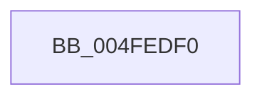

# ExpSystemErrorHandler

- RVA: `0x004FEDF0`–`0x004FEECD` (길이 `221` bytes)
- VA: `0x00000001404FEDF0`
- 실행 섹션: `.text`
- PDB 이름 있음: `예`; PDB Function 태그: `아니요`
- unwind 정보 RVA: `0x000C2618`
- 디코드: `41`개 명령, `221/221` bytes 표시
- 미해석 바이트: `0` (있으면 어셈블리에 `.byte`로 보존)

> 이 문서는 커널 이미지의 기계어와 PDB 기호를 분석해 생성했습니다. 4번과 5번은 함수 원형과 자료형을 바이너리 사용 방식에서 추정한 C 해석이며 원본 소스 복구 결과는 아닙니다.

## 1. Dependencies

- 직접 호출 지점: **3**; 고유 호출 대상: **3**
- 직접 호출자로 확인된 함수: **1**
- RIP 상대 이미지 참조: **1**

### Outgoing calls
- `0x004FEE30` → [RtlCaptureContext](RtlCaptureContext_function_004FE570.md) (function, `0x004FE570`)
- `0x004FEE45` → [KiSaveProcessorControlState](../6B/KiSaveProcessorControlState_function_006B0EF0.md) (function, `0x006B0EF0`)
- `0x004FEEC3` → [ExpSystemErrorHandler2](../../pagelk/B7/ExpSystemErrorHandler2_function_00B72C30.md) (function, `0x00B72C30`)

### Direct callers
- [ExpRaiseHardError](../../page/A6/ExpRaiseHardError_function_00A64AD4.md) at `0x00A64C6D`
- [ExpRaiseHardError](../../page/A6/ExpRaiseHardError_function_00A64AD4.md) at `0x00A64CA5`

### Static image references
- `0x004FEE8E` → RVA `0x004FEDF0` (`ExpSystemErrorHandler`; read)

## 2. Other-region calls and transfers

- 다른 실행 섹션으로 향하는 call: **1**
  - `0x004FEEC3` → [ExpSystemErrorHandler2](../../pagelk/B7/ExpSystemErrorHandler2_function_00B72C30.md) (`.text` → `PAGELK`)
- 별도 외부 분기/꼬리 이동을 확인하지 못했습니다.

## 3. Assembly (complete function range)

```asm
004FEDF0  48 89 4C 24 08                  mov qword ptr [rsp + 8], rcx
004FEDF5  48 89 54 24 10                  mov qword ptr [rsp + 0x10], rdx
004FEDFA  4C 89 44 24 18                  mov qword ptr [rsp + 0x18], r8
004FEDFF  4C 89 4C 24 20                  mov qword ptr [rsp + 0x20], r9
004FEE04  9C                              pushfq
004FEE05  48 83 EC 30                     sub rsp, 0x30
004FEE09  48 89 44 24 28                  mov qword ptr [rsp + 0x28], rax
004FEE0E  B9 02 00 00 00                  mov ecx, 2
004FEE13  44 0F 20 C0                     mov rax, cr8
004FEE17  44 0F 22 C1                     mov cr8, rcx
004FEE1B  48 87 44 24 28                  xchg qword ptr [rsp + 0x28], rax
004FEE20  65 48 8B 0C 25 20 00 00 00      mov rcx, qword ptr gs:[0x20]
004FEE29  48 8B 89 C0 8F 00 00            mov rcx, qword ptr [rcx + 0x8fc0]
004FEE30  E8 3B F7 FF FF                  call 0x1404fe570
004FEE35  65 48 8B 0C 25 20 00 00 00      mov rcx, qword ptr gs:[0x20]
004FEE3E  48 81 C1 00 01 00 00            add rcx, 0x100
004FEE45  E8 A6 20 1B 00                  call 0x1406b0ef0
004FEE4A  65 48 8B 0C 25 20 00 00 00      mov rcx, qword ptr gs:[0x20]
004FEE53  4C 8D 91 00 01 00 00            lea r10, [rcx + 0x100]
004FEE5A  48 8B 44 24 28                  mov rax, qword ptr [rsp + 0x28]
004FEE5F  49 89 82 A0 00 00 00            mov qword ptr [r10 + 0xa0], rax
004FEE66  4C 8B 91 C0 8F 00 00            mov r10, qword ptr [rcx + 0x8fc0]
004FEE6D  48 8B 44 24 40                  mov rax, qword ptr [rsp + 0x40]
004FEE72  49 89 82 80 00 00 00            mov qword ptr [r10 + 0x80], rax
004FEE79  48 8B 44 24 30                  mov rax, qword ptr [rsp + 0x30]
004FEE7E  49 89 42 44                     mov qword ptr [r10 + 0x44], rax
004FEE82  48 8D 44 24 38                  lea rax, [rsp + 0x38]
004FEE87  49 89 82 98 00 00 00            mov qword ptr [r10 + 0x98], rax
004FEE8E  48 8D 05 5B FF FF FF            lea rax, [rip - 0xa5]
004FEE95  49 89 82 F8 00 00 00            mov qword ptr [r10 + 0xf8], rax
004FEE9C  48 8B 4C 24 28                  mov rcx, qword ptr [rsp + 0x28]
004FEEA1  44 0F 22 C1                     mov cr8, rcx
004FEEA5  48 8B 44 24 60                  mov rax, qword ptr [rsp + 0x60]
004FEEAA  48 89 44 24 20                  mov qword ptr [rsp + 0x20], rax
004FEEAF  4C 8B 4C 24 58                  mov r9, qword ptr [rsp + 0x58]
004FEEB4  4C 8B 44 24 50                  mov r8, qword ptr [rsp + 0x50]
004FEEB9  48 8B 54 24 48                  mov rdx, qword ptr [rsp + 0x48]
004FEEBE  48 8B 4C 24 40                  mov rcx, qword ptr [rsp + 0x40]
004FEEC3  E8 68 3D 67 00                  call 0x140b72c30
004FEEC8  48 83 C4 38                     add rsp, 0x38
004FEECC  C3                              ret
```

## 4. C-style interpretation (structured pseudocode)

```c
__int64 __fastcall ExpSystemErrorHandler(__int64 a1, __int64 a2, __int64 a3, __int64 a4, __int64 a5, __int64 a6)
{
    __int64 result;
    __int64 v_rsp;
    unsigned __int64 v_stack_m10;
    unsigned __int64 v_stack_m18;
    unsigned __int64 v_stack_m8;
    unsigned __int64 v_stack_p0;
    unsigned __int64 v_stack_p10;
    unsigned __int64 v_stack_p18;
    unsigned __int64 v_stack_p20;
    unsigned __int64 v_stack_p8;

    v_stack_p8 = a1;
    v_stack_p10 = a2;
    v_stack_p18 = a3;
    v_stack_p20 = a4;
    v_rsp = (v_rsp) - (48);
    v_stack_m10 = result;
    result = RtlCaptureContext(*(unsigned __int64 *)(*(unsigned __int64 *)(gs_base + (0 + 32)) + 36800), a2, a3, a4);
    a1 = (*(unsigned __int64 *)(gs_base + (0 + 32))) + (256);
    result = KiSaveProcessorControlState(a1, a2, a3, a4);
    *(unsigned __int64 *)(*(unsigned __int64 *)(gs_base + (0 + 32)) + 256 + 160) = v_stack_m10;
    *(unsigned __int64 *)(*(unsigned __int64 *)(*(unsigned __int64 *)(gs_base + (0 + 32)) + 36800) + 128) = v_stack_p8;
    *(unsigned __int64 *)(*(unsigned __int64 *)(*(unsigned __int64 *)(gs_base + (0 + 32)) + 36800) + 68) = v_stack_m8;
    *(unsigned __int64 *)(*(unsigned __int64 *)(*(unsigned __int64 *)(gs_base + (0 + 32)) + 36800) + 152) = v_stack_p0;
    *(unsigned __int64 *)(*(unsigned __int64 *)(*(unsigned __int64 *)(gs_base + (0 + 32)) + 36800) + 248) = v_rip - 165;
    v_stack_m18 = a6;
    result = ExpSystemErrorHandler2(v_stack_p8, v_stack_p10, v_stack_p18, a5);
    v_rsp = (v_rsp) + (56);
    return result;
}
```

## 5. (Beta) C Style

```c
int64_t ExpSystemErrorHandler(int64_t Arg1, int64_t Arg2, int64_t Arg3, int64_t Arg4, int64_t Arg5, int64_t Arg6)
{
    int64_t result;
    int64_t local_rsp;
    uint64_t v_stack_m10;
    uint64_t v_stack_m18;
    uint64_t v_stack_m8;
    uint64_t v_stack_p0;
    uint64_t v_stack_p10;
    uint64_t v_stack_p18;
    uint64_t v_stack_p20;
    uint64_t v_stack_p8;

    v_stack_p8 = Arg1;
    v_stack_p10 = Arg2;
    v_stack_p18 = Arg3;
    v_stack_p20 = Arg4;
    local_rsp = (local_rsp) - (48);
    v_stack_m10 = result;
    result = RtlCaptureContext(*(uint64_t *)(*(uint64_t *)(gs_base + (0 + 0x20)) + 0x8FC0), Arg2, Arg3, Arg4);
    Arg1 = (*(uint64_t *)(gs_base + (0 + 0x20))) + (256);
    result = KiSaveProcessorControlState(Arg1, Arg2, Arg3, Arg4);
    *(uint64_t *)(*(uint64_t *)(gs_base + (0 + 0x20)) + 0x100 + 0xA0) = v_stack_m10;
    *(uint64_t *)(*(uint64_t *)(*(uint64_t *)(gs_base + (0 + 0x20)) + 0x8FC0) + 0x80) = v_stack_p8;
    *(uint64_t *)(*(uint64_t *)(*(uint64_t *)(gs_base + (0 + 0x20)) + 0x8FC0) + 0x44) = v_stack_m8;
    *(uint64_t *)(*(uint64_t *)(*(uint64_t *)(gs_base + (0 + 0x20)) + 0x8FC0) + 0x98) = v_stack_p0;
    *(uint64_t *)(*(uint64_t *)(*(uint64_t *)(gs_base + (0 + 0x20)) + 0x8FC0) + 0xF8) = v_rip - 165;
    v_stack_m18 = Arg6;
    result = ExpSystemErrorHandler2(v_stack_p8, v_stack_p10, v_stack_p18, Arg5);
    local_rsp = (local_rsp) + (56);
    return result;
}
```

## 6. Execution-region graph

[열기: 2D/3D 그래프와 함수 탐색 컨트롤 패널](../../../control-panel.html?section=text&rva=0x004FEDF0&view=graph)

- 2D 그래프는 위에서 아래로 흐르고, 3D 그래프는 빈 공간을 드래그해 회전합니다. Shift+드래그는 이동, 휠은 확대·축소, 함수 노드 선택은 대상 보고서 이동입니다.

### Static fallback


