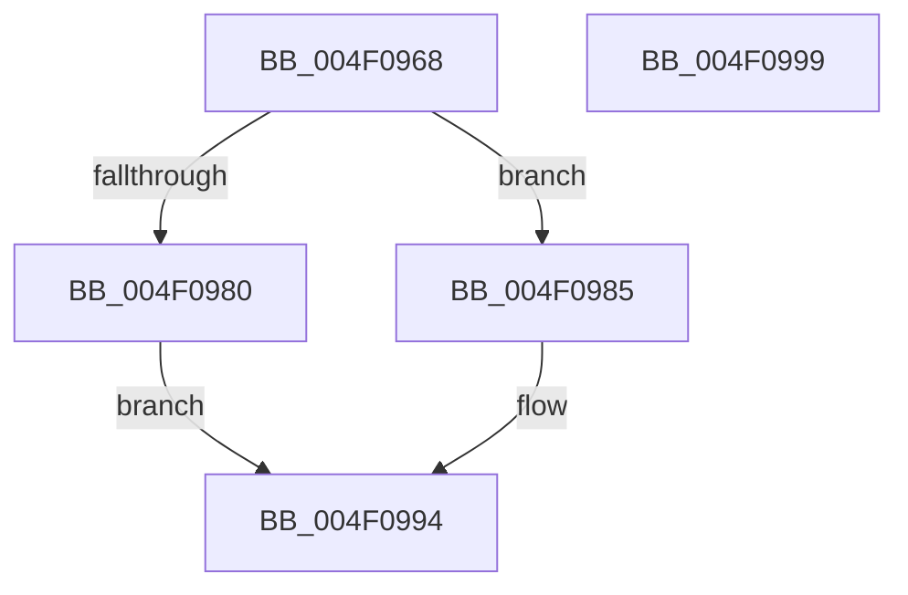

# Feature_2045735225__private_IsEnabledDeviceUsageNoInline

- RVA: `0x004F0968`–`0x004F099A` (길이 `50` bytes)
- VA: `0x00000001404F0968`
- 실행 섹션: `.text`
- PDB 이름 있음: `예`; PDB Function 태그: `아니요`
- unwind 정보 RVA: `0x0005C788`
- 디코드: `14`개 명령, `50/50` bytes 표시
- 미해석 바이트: `0` (있으면 어셈블리에 `.byte`로 보존)

> 이 문서는 커널 이미지의 기계어와 PDB 기호를 분석해 생성했습니다. 4번과 5번은 함수 원형과 자료형을 바이너리 사용 방식에서 추정한 C 해석이며 원본 소스 복구 결과는 아닙니다.

## 1. Dependencies

- 직접 호출 지점: **1**; 고유 호출 대상: **1**
- 직접 호출자로 확인된 함수: **6**
- RIP 상대 이미지 참조: **1**

### Outgoing calls
- `0x004F098F` → [Feature_2045735225__private_IsEnabledFallback](../60/Feature_2045735225__private_IsEnabledFallback_function_006066B0.md) (function, `0x006066B0`)

### Direct callers
- [SepOneWayLinkLogonSessions](../60/SepOneWayLinkLogonSessions_function_006068D8.md) at `0x00606977`
- [SepOneWayLinkLogonSessions](../60/SepOneWayLinkLogonSessions_function_006068D8.md) at `0x006069CC`
- [SepOneWayLinkLogonSessions](../60/SepOneWayLinkLogonSessions_function_006068D8.md) at `0x00606A2A`
- [SepOneWayLinkLogonSessions](../60/SepOneWayLinkLogonSessions_function_006068D8.md) at `0x00606B63`
- [SepOneWayLinkLogonSessions](../60/SepOneWayLinkLogonSessions_function_006068D8.md) at `0x00606B89`
- [SepOneWayLinkLogonSessions](../60/SepOneWayLinkLogonSessions_function_006068D8.md) at `0x00606BB9`
- [SepDuplicateToken](../../page/8B/SepDuplicateToken_function_008B87EC.md) at `0x008B8AC2`
- [SepDuplicateToken](../../page/8B/SepDuplicateToken_function_008B87EC.md) at `0x008B8C29`
- [SepFilterToken](../../page/9C/SepFilterToken_function_009C6B80.md) at `0x009C6F5B`
- [SepFilterToken](../../page/9C/SepFilterToken_function_009C6B80.md) at `0x009C70A1`
- [NtQueryInformationToken](../../page/AE/NtQueryInformationToken_function_00AECDD0.md) at `0x00AED51B`
- [SepTokenDeleteMethod](../../page/AF/SepTokenDeleteMethod_function_00AF23D0.md) at `0x00AF2447`
- [SepDeReferenceLogonSession](../../page/AF/SepDeReferenceLogonSession_function_00AF25EC.md) at `0x00AF270C`

### Static image references
- `0x004F0972` → RVA `0x00FC4B88` (`.data`; read)

## 2. Other-region calls and transfers

- 다른 실행 섹션으로 향하는 call: **0**
- 별도 외부 분기/꼬리 이동을 확인하지 못했습니다.

## 3. Assembly (complete function range)

```asm
004F0968  48 83 EC 28                     sub rsp, 0x28
004F096C  48 83 64 24 30 00               and qword ptr [rsp + 0x30], 0
004F0972  8B 05 10 42 AD 00               mov eax, dword ptr [rip + 0xad4210]
004F0978  89 44 24 30                     mov dword ptr [rsp + 0x30], eax
004F097C  A8 10                           test al, 0x10
004F097E  74 05                           je 0x1404f0985
004F0980  83 E0 01                        and eax, 1
004F0983  EB 0F                           jmp 0x1404f0994
004F0985  48 8B 4C 24 30                  mov rcx, qword ptr [rsp + 0x30]
004F098A  BA 03 00 00 00                  mov edx, 3
004F098F  E8 1C 5D 11 00                  call 0x1406066b0
004F0994  48 83 C4 28                     add rsp, 0x28
004F0998  C3                              ret
004F0999  CC                              int3
```

## 4. C-style interpretation (structured pseudocode)

```c
__int64 __fastcall Feature_2045735225__private_IsEnabledDeviceUsageNoInline(void)
{
    __int64 result;
    __int64 v_rsp;
    unsigned __int64 v_stack_p8;

    v_rsp = (v_rsp) - (40);
    v_stack_p8 = (unsigned int)((unsigned int)(*(unsigned int *)(v_rip + 11354640)));
    if ((((unsigned __int8)((unsigned int)(*(unsigned int *)(v_rip + 11354640)))) & (16)) == 0) goto loc_004F0985;
    result = (unsigned int)(((unsigned int)(*(unsigned int *)(v_rip + 11354640))) & (1));
    goto loc_004F0994;
loc_004F0985:
    result = Feature_2045735225__private_IsEnabledFallback(v_stack_p8, 3, a3, a4);
loc_004F0994:
    v_rsp = (v_rsp) + (40);
    return result;
}
```

## 5. (Beta) C Style

```c
void Feature_2045735225__private_IsEnabledDeviceUsageNoInline(void)
{
    int64_t result;
    int64_t local_rsp;
    uint64_t v_stack_p8;

    local_rsp = (local_rsp) - (40);
    v_stack_p8 = (uint32_t)((uint32_t)(*(uint32_t *)(v_rip + 0xAD4210)));
    if ((((uint8_t)((uint32_t)(*(uint32_t *)(v_rip + 0xAD4210)))) & (16)) == 0) goto loc_004F0985;
    result = (uint32_t)(((uint32_t)(*(uint32_t *)(v_rip + 0xAD4210))) & (1));
    goto loc_004F0994;
loc_004F0985:
    result = Feature_2045735225__private_IsEnabledFallback(v_stack_p8, 3, a3, a4);
loc_004F0994:
    local_rsp = (local_rsp) + (40);
    return result;
}
```

## 6. Execution-region graph

[열기: 2D/3D 그래프와 함수 탐색 컨트롤 패널](../../../control-panel.html?section=text&rva=0x004F0968&view=graph)

- 2D 그래프는 위에서 아래로 흐르고, 3D 그래프는 빈 공간을 드래그해 회전합니다. Shift+드래그는 이동, 휠은 확대·축소, 함수 노드 선택은 대상 보고서 이동입니다.

### Static fallback


