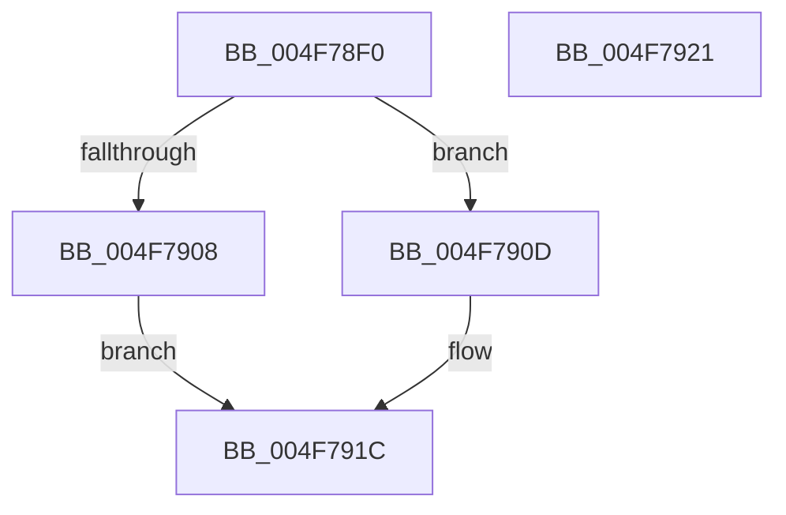

# Feature_AdaptiveHibernateEnhancements__private_IsEnabledDeviceUsageNoInline

- RVA: `0x004F78F0`–`0x004F7922` (길이 `50` bytes)
- VA: `0x00000001404F78F0`
- 실행 섹션: `.text`
- PDB 이름 있음: `예`; PDB Function 태그: `아니요`
- unwind 정보 RVA: `0x0005C788`
- 디코드: `14`개 명령, `50/50` bytes 표시
- 미해석 바이트: `0` (있으면 어셈블리에 `.byte`로 보존)

> 이 문서는 커널 이미지의 기계어와 PDB 기호를 분석해 생성했습니다. 4번과 5번은 함수 원형과 자료형을 바이너리 사용 방식에서 추정한 C 해석이며 원본 소스 복구 결과는 아닙니다.

## 1. Dependencies

- 직접 호출 지점: **1**; 고유 호출 대상: **1**
- 직접 호출자로 확인된 함수: **14**
- RIP 상대 이미지 참조: **1**

### Outgoing calls
- `0x004F7917` → [Feature_AdaptiveHibernateEnhancements__private_IsEnabledFallback](Feature_AdaptiveHibernateEnhancements__private_IsEnabledFallback_function_004F7928.md) (function, `0x004F7928`)

### Direct callers
- [PopAdaptiveStandbyHandleBatteryUpdate](../../page/6F/PopAdaptiveStandbyHandleBatteryUpdate_function_006FD39C.md) at `0x006FD3F4`
- [PopAdaptiveStandbyHandleBatteryUpdate](../../page/6F/PopAdaptiveStandbyHandleBatteryUpdate_function_006FD39C.md) at `0x006FD5B5`
- [PopAdaptiveStandbyHandleBatteryUpdate](../../page/6F/PopAdaptiveStandbyHandleBatteryUpdate_function_006FD39C.md) at `0x006FD6FA`
- [PopAdaptiveStandbyHandleBatteryUpdate](../../page/6F/PopAdaptiveStandbyHandleBatteryUpdate_function_006FD39C.md) at `0x006FD7FB`
- [PopPowerAggregatorHandleModernStandbyIntent](../../page/76/PopPowerAggregatorHandleModernStandbyIntent_function_007649F0.md) at `0x00764A5C`
- [PopPowerAggregatorNotifyPdcPhaseState](../../page/76/PopPowerAggregatorNotifyPdcPhaseState_function_00764C54.md) at `0x00764CC9`
- [PopPowerAggregatorNotifyPdcPhaseState](../../page/76/PopPowerAggregatorNotifyPdcPhaseState_function_00764C54.md) at `0x00764CE7`
- [PopPowerAggregatorTriggerAdaptiveAction](../../page/76/PopPowerAggregatorTriggerAdaptiveAction_function_00765240.md) at `0x0076529A`
- [PopPowerAggregatorTriggerAdaptiveAction](../../page/76/PopPowerAggregatorTriggerAdaptiveAction_function_00765240.md) at `0x007652B8`
- [PopDelayedPdcRegistrationWorker](../../page/76/PopDelayedPdcRegistrationWorker_function_007696F0.md) at `0x007696F4`
- [PopAdaptiveStandbyCheckHibernateBudgetAction](../../page/76/PopAdaptiveStandbyCheckHibernateBudgetAction_function_0076CB54.md) at `0x0076CB91`
- [PopAdaptiveStandbyCheckHibernateBudgetAction](../../page/76/PopAdaptiveStandbyCheckHibernateBudgetAction_function_0076CB54.md) at `0x0076CC52`
- [PopAdaptiveStandbyCheckRestrictedStandbyBudgetAction](../../page/76/PopAdaptiveStandbyCheckRestrictedStandbyBudgetAction_function_0076D5C4.md) at `0x0076D616`
- [PopAdaptiveStandbyCheckRestrictedStandbyBudgetAction](../../page/76/PopAdaptiveStandbyCheckRestrictedStandbyBudgetAction_function_0076D5C4.md) at `0x0076D678`
- [PopAdaptiveStandbyInitialize](../../page/76/PopAdaptiveStandbyInitialize_function_0076DDF8.md) at `0x0076DEE5`
- [PopAdaptiveStandbyInitialize](../../page/76/PopAdaptiveStandbyInitialize_function_0076DDF8.md) at `0x0076DEF6`
- [PopAdaptiveStandbyInitialize](../../page/76/PopAdaptiveStandbyInitialize_function_0076DDF8.md) at `0x0076DF8A`
- [PopAdaptiveStandbyInitialize](../../page/76/PopAdaptiveStandbyInitialize_function_0076DDF8.md) at `0x0076E03B`
- [PopAdaptiveStandbyPowerSettingCallback](../../page/76/PopAdaptiveStandbyPowerSettingCallback_function_0076E530.md) at `0x0076E62E`
- [PopAdaptiveStandbySessionStart](../../page/76/PopAdaptiveStandbySessionStart_function_0076E8C8.md) at `0x0076E92E`
- [PopAdaptiveStandbySessionStart](../../page/76/PopAdaptiveStandbySessionStart_function_0076E8C8.md) at `0x0076E95B`
- [PopAdaptiveStandbySessionStop](../../page/76/PopAdaptiveStandbySessionStop_function_0076EC94.md) at `0x0076ED23`
- [PopAdaptiveStandbyTraceBatteryUpdate](../../page/76/PopAdaptiveStandbyTraceBatteryUpdate_function_0076EF7C.md) at `0x0076F193`
- [PopAdaptiveStandbyTraceSessionSettings](../../page/76/PopAdaptiveStandbyTraceSessionSettings_function_0076F428.md) at `0x0076F459`
- [PopAdaptiveStandbyTraceSessionSettings](../../page/76/PopAdaptiveStandbyTraceSessionSettings_function_0076F428.md) at `0x0076F491`
- [PopAdaptiveStandbyTraceSessionSettings](../../page/76/PopAdaptiveStandbyTraceSessionSettings_function_0076F428.md) at `0x0076F515`
- [PopAdaptiveStandbyTraceSessionSettings](../../page/76/PopAdaptiveStandbyTraceSessionSettings_function_0076F428.md) at `0x0076F7EA`
- [PopAdaptiveStandbyTraceSessionSettings](../../page/76/PopAdaptiveStandbyTraceSessionSettings_function_0076F428.md) at `0x0076F816`
- [PopAdaptiveStandbyWnfCallback](../../page/76/PopAdaptiveStandbyWnfCallback_function_0076F910.md) at `0x0076FAAB`
- [PopAdaptiveStandbyWnfCallback](../../page/76/PopAdaptiveStandbyWnfCallback_function_0076F910.md) at `0x0076FD54`
- [PopAdaptiveStandbyWnfCallback](../../page/76/PopAdaptiveStandbyWnfCallback_function_0076F910.md) at `0x0076FE32`

### Static image references
- `0x004F78FA` → RVA `0x00FC4768` (`.data`; read)

## 2. Other-region calls and transfers

- 다른 실행 섹션으로 향하는 call: **0**
- 별도 외부 분기/꼬리 이동을 확인하지 못했습니다.

## 3. Assembly (complete function range)

```asm
004F78F0  48 83 EC 28                     sub rsp, 0x28
004F78F4  48 83 64 24 30 00               and qword ptr [rsp + 0x30], 0
004F78FA  8B 05 68 CE AC 00               mov eax, dword ptr [rip + 0xacce68]
004F7900  89 44 24 30                     mov dword ptr [rsp + 0x30], eax
004F7904  A8 10                           test al, 0x10
004F7906  74 05                           je 0x1404f790d
004F7908  83 E0 01                        and eax, 1
004F790B  EB 0F                           jmp 0x1404f791c
004F790D  48 8B 4C 24 30                  mov rcx, qword ptr [rsp + 0x30]
004F7912  BA 03 00 00 00                  mov edx, 3
004F7917  E8 0C 00 00 00                  call 0x1404f7928
004F791C  48 83 C4 28                     add rsp, 0x28
004F7920  C3                              ret
004F7921  CC                              int3
```

## 4. C-style interpretation (structured pseudocode)

```c
__int64 __fastcall Feature_AdaptiveHibernateEnhancements__private_IsEnabledDeviceUsageNoInline(void)
{
    __int64 result;
    __int64 v_rsp;
    unsigned __int64 v_stack_p8;

    v_rsp = (v_rsp) - (40);
    v_stack_p8 = (unsigned int)((unsigned int)(*(unsigned int *)(v_rip + 11325032)));
    if ((((unsigned __int8)((unsigned int)(*(unsigned int *)(v_rip + 11325032)))) & (16)) == 0) goto loc_004F790D;
    result = (unsigned int)(((unsigned int)(*(unsigned int *)(v_rip + 11325032))) & (1));
    goto loc_004F791C;
loc_004F790D:
    result = Feature_AdaptiveHibernateEnhancements__private_IsEnabledFallback(v_stack_p8, 3, a3, a4);
loc_004F791C:
    v_rsp = (v_rsp) + (40);
    return result;
}
```

## 5. (Beta) C Style

```c
void Feature_AdaptiveHibernateEnhancements__private_IsEnabledDeviceUsageNoInline(void)
{
    int64_t result;
    int64_t local_rsp;
    uint64_t v_stack_p8;

    local_rsp = (local_rsp) - (40);
    v_stack_p8 = (uint32_t)((uint32_t)(*(uint32_t *)(v_rip + 0xACCE68)));
    if ((((uint8_t)((uint32_t)(*(uint32_t *)(v_rip + 0xACCE68)))) & (16)) == 0) goto loc_004F790D;
    result = (uint32_t)(((uint32_t)(*(uint32_t *)(v_rip + 0xACCE68))) & (1));
    goto loc_004F791C;
loc_004F790D:
    result = Feature_AdaptiveHibernateEnhancements__private_IsEnabledFallback(v_stack_p8, 3, a3, a4);
loc_004F791C:
    local_rsp = (local_rsp) + (40);
    return result;
}
```

## 6. Execution-region graph

[열기: 2D/3D 그래프와 함수 탐색 컨트롤 패널](../../../control-panel.html?section=text&rva=0x004F78F0&view=graph)

- 2D 그래프는 위에서 아래로 흐르고, 3D 그래프는 빈 공간을 드래그해 회전합니다. Shift+드래그는 이동, 휠은 확대·축소, 함수 노드 선택은 대상 보고서 이동입니다.

### Static fallback


