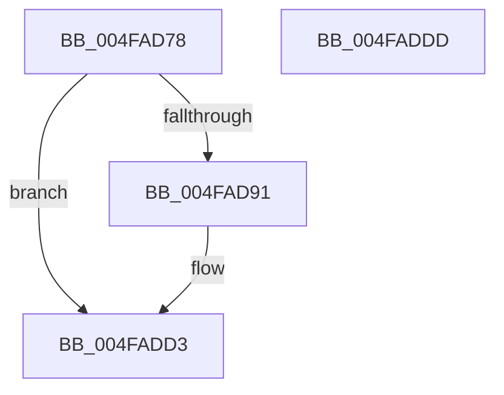

# Feature_AggressiveInputSuppression__private_IsEnabledPreCheck

- RVA: `0x004FAD78`–`0x004FADDE` (길이 `102` bytes)
- VA: `0x00000001404FAD78`
- 실행 섹션: `.text`
- PDB 이름 있음: `예`; PDB Function 태그: `아니요`
- unwind 정보 RVA: `0x0005C788`
- 디코드: `23`개 명령, `102/102` bytes 표시
- 미해석 바이트: `0` (있으면 어셈블리에 `.byte`로 보존)

> 이 문서는 커널 이미지의 기계어와 PDB 기호를 분석해 생성했습니다. 4번과 5번은 함수 원형과 자료형을 바이너리 사용 방식에서 추정한 C 해석이며 원본 소스 복구 결과는 아닙니다.

## 1. Dependencies

- 직접 호출 지점: **2**; 고유 호출 대상: **2**
- 직접 호출자로 확인된 함수: **1**
- RIP 상대 이미지 참조: **2**

### Outgoing calls
- `0x004FADB8` → [wil_details_FeatureReporting_ReportUsageToService](../53/wil_details_FeatureReporting_ReportUsageToService_function_0053E6E4.md) (function, `0x0053E6E4`)
- `0x004FADCE` → [wil_details_FeatureStateCache_TryEnableDeviceUsageFastPath](../53/wil_details_FeatureStateCache_TryEnableDeviceUsageFastPath_function_0053E774.md) (function, `0x0053E774`)

### Direct callers
- [PopPowerAggregatorHandleActiveIntent](../../page/AD/PopPowerAggregatorHandleActiveIntent_function_00ADFCB0.md) at `0x00ADFD2D`

### Static image references
- `0x004FAD82` → RVA `0x00FC4780` (`.data`; read)
- `0x004FADA8` → RVA `0x000DD6A0` (`.rdata`; read)

## 2. Other-region calls and transfers

- 다른 실행 섹션으로 향하는 call: **0**
- 별도 외부 분기/꼬리 이동을 확인하지 못했습니다.

## 3. Assembly (complete function range)

```asm
004FAD78  48 83 EC 28                     sub rsp, 0x28
004FAD7C  48 83 64 24 30 00               and qword ptr [rsp + 0x30], 0
004FAD82  8B 0D F8 99 AC 00               mov ecx, dword ptr [rip + 0xac99f8]
004FAD88  89 4C 24 30                     mov dword ptr [rsp + 0x30], ecx
004FAD8C  F6 C1 10                        test cl, 0x10
004FAD8F  75 42                           jne 0x1404fadd3
004FAD91  48 8B 44 24 30                  mov rax, qword ptr [rsp + 0x30]
004FAD96  83 C9 01                        or ecx, 1
004FAD99  48 89 44 24 30                  mov qword ptr [rsp + 0x30], rax
004FAD9E  41 B9 01 00 00 00               mov r9d, 1
004FADA4  89 4C 24 30                     mov dword ptr [rsp + 0x30], ecx
004FADA8  48 8D 0D F1 28 BE FF            lea rcx, [rip - 0x41d70f]
004FADAF  48 8B 54 24 30                  mov rdx, qword ptr [rsp + 0x30]
004FADB4  45 8D 41 02                     lea r8d, [r9 + 2]
004FADB8  E8 27 39 04 00                  call 0x14053e6e4
004FADBD  48 8B 4C 24 30                  mov rcx, qword ptr [rsp + 0x30]
004FADC2  4C 8D 05 D7 28 BE FF            lea r8, [rip - 0x41d729]
004FADC9  BA 03 00 00 00                  mov edx, 3
004FADCE  E8 A1 39 04 00                  call 0x14053e774
004FADD3  B8 01 00 00 00                  mov eax, 1
004FADD8  48 83 C4 28                     add rsp, 0x28
004FADDC  C3                              ret
004FADDD  CC                              int3
```

## 4. C-style interpretation (structured pseudocode)

```c
__int64 __fastcall Feature_AggressiveInputSuppression__private_IsEnabledPreCheck(void)
{
    __int64 result;
    __int64 v_rsp;
    unsigned __int64 v_stack_p8;

    v_rsp = (v_rsp) - (40);
    v_stack_p8 = (unsigned int)((unsigned int)(*(unsigned int *)(v_rip + 11311608)));
    if ((((unsigned __int8)((unsigned int)(*(unsigned int *)(v_rip + 11311608)))) & (16)) == 0) {
        result = v_stack_p8;
        a1 = (unsigned int)(((unsigned int)(*(unsigned int *)(v_rip + 11311608))) | (1));
        v_stack_p8 = result;
        a4 = 1;
        v_stack_p8 = (unsigned int)(a1);
        a1 = v_rip - 4314895;
        a2 = v_stack_p8;
        a3 = a4 + 2;
        result = wil_details_FeatureReporting_ReportUsageToService(a1, a2, a3, a4);
        a1 = v_stack_p8;
        a3 = v_rip - 4314921;
        a2 = 3;
        result = wil_details_FeatureStateCache_TryEnableDeviceUsageFastPath(a1, a2, a3, a4);
    }
    v_rsp = (v_rsp) + (40);
    return 1;
}
```

## 5. (Beta) C Style

```c
void Feature_AggressiveInputSuppression__private_IsEnabledPreCheck(void)
{
    int64_t result;
    int64_t local_rsp;
    uint64_t v_stack_p8;

    local_rsp = (local_rsp) - (40);
    v_stack_p8 = (uint32_t)((uint32_t)(*(uint32_t *)(v_rip + 0xAC99F8)));
    if ((((uint8_t)((uint32_t)(*(uint32_t *)(v_rip + 0xAC99F8)))) & (16)) == 0) {
        result = v_stack_p8;
        a1 = (uint32_t)(((uint32_t)(*(uint32_t *)(v_rip + 0xAC99F8))) | (1));
        v_stack_p8 = result;
        a4 = 1;
        v_stack_p8 = (uint32_t)(a1);
        a1 = v_rip - 4314895;
        a2 = v_stack_p8;
        a3 = a4 + 2;
        result = wil_details_FeatureReporting_ReportUsageToService(a1, a2, a3, a4);
        a1 = v_stack_p8;
        a3 = v_rip - 4314921;
        a2 = 3;
        result = wil_details_FeatureStateCache_TryEnableDeviceUsageFastPath(a1, a2, a3, a4);
    }
    local_rsp = (local_rsp) + (40);
    return 1;
}
```

## 6. Execution-region graph

[열기: 2D/3D 그래프와 함수 탐색 컨트롤 패널](../../../control-panel.html?section=text&rva=0x004FAD78&view=graph)

- 2D 그래프는 위에서 아래로 흐르고, 3D 그래프는 빈 공간을 드래그해 회전합니다. Shift+드래그는 이동, 휠은 확대·축소, 함수 노드 선택은 대상 보고서 이동입니다.

### Static fallback


