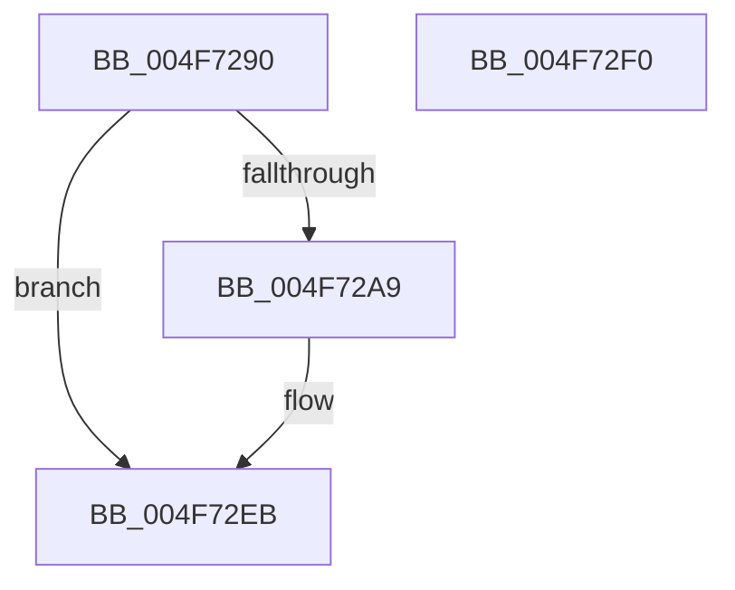

# Feature_HaltOnAddress_Barrier__private_ReportDeviceUsage

- RVA: `0x004F7290`–`0x004F72F1` (길이 `97` bytes)
- VA: `0x00000001404F7290`
- 실행 섹션: `.text`
- PDB 이름 있음: `예`; PDB Function 태그: `아니요`
- unwind 정보 RVA: `0x0005C788`
- 디코드: `22`개 명령, `97/97` bytes 표시
- 미해석 바이트: `0` (있으면 어셈블리에 `.byte`로 보존)

> 이 문서는 커널 이미지의 기계어와 PDB 기호를 분석해 생성했습니다. 4번과 5번은 함수 원형과 자료형을 바이너리 사용 방식에서 추정한 C 해석이며 원본 소스 복구 결과는 아닙니다.

## 1. Dependencies

- 직접 호출 지점: **2**; 고유 호출 대상: **2**
- 직접 호출자로 확인된 함수: **1**
- RIP 상대 이미지 참조: **2**

### Outgoing calls
- `0x004F72D0` → [wil_details_FeatureReporting_ReportUsageToService](../53/wil_details_FeatureReporting_ReportUsageToService_function_0053E6E4.md) (function, `0x0053E6E4`)
- `0x004F72E6` → [wil_details_FeatureStateCache_TryEnableDeviceUsageFastPath](../53/wil_details_FeatureStateCache_TryEnableDeviceUsageFastPath_function_0053E774.md) (function, `0x0053E774`)

### Direct callers
- [KiInitializeVelocity](../../init/BE/KiInitializeVelocity_function_00BEEDB8.md) at `0x00BEEDC9`

### Static image references
- `0x004F729A` → RVA `0x00FC4920` (`.data`; read)
- `0x004F72C0` → RVA `0x000DE200` (`.rdata`; read)

## 2. Other-region calls and transfers

- 다른 실행 섹션으로 향하는 call: **0**
- 별도 외부 분기/꼬리 이동을 확인하지 못했습니다.

## 3. Assembly (complete function range)

```asm
004F7290  48 83 EC 28                     sub rsp, 0x28
004F7294  48 83 64 24 30 00               and qword ptr [rsp + 0x30], 0
004F729A  8B 0D 80 D6 AC 00               mov ecx, dword ptr [rip + 0xacd680]
004F72A0  89 4C 24 30                     mov dword ptr [rsp + 0x30], ecx
004F72A4  F6 C1 10                        test cl, 0x10
004F72A7  75 42                           jne 0x1404f72eb
004F72A9  48 8B 44 24 30                  mov rax, qword ptr [rsp + 0x30]
004F72AE  41 B9 01 00 00 00               mov r9d, 1
004F72B4  41 0B C9                        or ecx, r9d
004F72B7  48 89 44 24 30                  mov qword ptr [rsp + 0x30], rax
004F72BC  89 4C 24 30                     mov dword ptr [rsp + 0x30], ecx
004F72C0  48 8D 0D 39 6F BE FF            lea rcx, [rip - 0x4190c7]
004F72C7  48 8B 54 24 30                  mov rdx, qword ptr [rsp + 0x30]
004F72CC  45 8D 41 02                     lea r8d, [r9 + 2]
004F72D0  E8 0F 74 04 00                  call 0x14053e6e4
004F72D5  48 8B 4C 24 30                  mov rcx, qword ptr [rsp + 0x30]
004F72DA  4C 8D 05 1F 6F BE FF            lea r8, [rip - 0x4190e1]
004F72E1  BA 03 00 00 00                  mov edx, 3
004F72E6  E8 89 74 04 00                  call 0x14053e774
004F72EB  48 83 C4 28                     add rsp, 0x28
004F72EF  C3                              ret
004F72F0  CC                              int3
```

## 4. C-style interpretation (structured pseudocode)

```c
__int64 __fastcall Feature_HaltOnAddress_Barrier__private_ReportDeviceUsage(void)
{
    __int64 result;
    __int64 v_rsp;
    unsigned __int64 v_stack_p8;

    v_rsp = (v_rsp) - (40);
    v_stack_p8 = (unsigned int)((unsigned int)(*(unsigned int *)(v_rip + 11327104)));
    if ((((unsigned __int8)((unsigned int)(*(unsigned int *)(v_rip + 11327104)))) & (16)) == 0) {
        result = v_stack_p8;
        a4 = 1;
        a1 = (unsigned int)(((unsigned int)(*(unsigned int *)(v_rip + 11327104))) | ((unsigned int)(a4)));
        v_stack_p8 = result;
        v_stack_p8 = (unsigned int)(a1);
        a1 = v_rip - 4296903;
        a2 = v_stack_p8;
        a3 = a4 + 2;
        result = wil_details_FeatureReporting_ReportUsageToService(a1, a2, a3, a4);
        a1 = v_stack_p8;
        a3 = v_rip - 4296929;
        a2 = 3;
        result = wil_details_FeatureStateCache_TryEnableDeviceUsageFastPath(a1, a2, a3, a4);
    }
    v_rsp = (v_rsp) + (40);
    return result;
}
```

## 5. (Beta) C Style

```c
void Feature_HaltOnAddress_Barrier__private_ReportDeviceUsage(void)
{
    int64_t result;
    int64_t local_rsp;
    uint64_t v_stack_p8;

    local_rsp = (local_rsp) - (40);
    v_stack_p8 = (uint32_t)((uint32_t)(*(uint32_t *)(v_rip + 0xACD680)));
    if ((((uint8_t)((uint32_t)(*(uint32_t *)(v_rip + 0xACD680)))) & (16)) == 0) {
        result = v_stack_p8;
        a4 = 1;
        a1 = (uint32_t)(((uint32_t)(*(uint32_t *)(v_rip + 0xACD680))) | ((uint32_t)(a4)));
        v_stack_p8 = result;
        v_stack_p8 = (uint32_t)(a1);
        a1 = v_rip - 4296903;
        a2 = v_stack_p8;
        a3 = a4 + 2;
        result = wil_details_FeatureReporting_ReportUsageToService(a1, a2, a3, a4);
        a1 = v_stack_p8;
        a3 = v_rip - 4296929;
        a2 = 3;
        result = wil_details_FeatureStateCache_TryEnableDeviceUsageFastPath(a1, a2, a3, a4);
    }
    local_rsp = (local_rsp) + (40);
    return result;
}
```

## 6. Execution-region graph

[열기: 2D/3D 그래프와 함수 탐색 컨트롤 패널](../../../control-panel.html?section=text&rva=0x004F7290&view=graph)

- 2D 그래프는 위에서 아래로 흐르고, 3D 그래프는 빈 공간을 드래그해 회전합니다. Shift+드래그는 이동, 휠은 확대·축소, 함수 노드 선택은 대상 보고서 이동입니다.

### Static fallback


