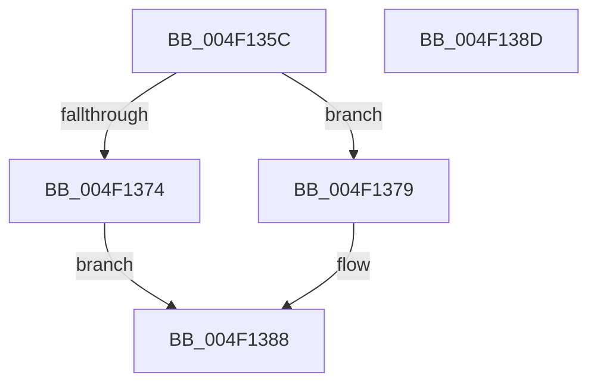

# Feature_PpmParkEx__private_IsEnabledDeviceUsageNoInline

- RVA: `0x004F135C`–`0x004F138E` (길이 `50` bytes)
- VA: `0x00000001404F135C`
- 실행 섹션: `.text`
- PDB 이름 있음: `예`; PDB Function 태그: `아니요`
- unwind 정보 RVA: `0x0005C788`
- 디코드: `14`개 명령, `50/50` bytes 표시
- 미해석 바이트: `0` (있으면 어셈블리에 `.byte`로 보존)

> 이 문서는 커널 이미지의 기계어와 PDB 기호를 분석해 생성했습니다. 4번과 5번은 함수 원형과 자료형을 바이너리 사용 방식에서 추정한 C 해석이며 원본 소스 복구 결과는 아닙니다.

## 1. Dependencies

- 직접 호출 지점: **1**; 고유 호출 대상: **1**
- 직접 호출자로 확인된 함수: **30**
- RIP 상대 이미지 참조: **1**

### Outgoing calls
- `0x004F1383` → [Feature_PpmParkEx__private_IsEnabledFallback](../5B/Feature_PpmParkEx__private_IsEnabledFallback_function_005B613C.md) (function, `0x005B613C`)

### Direct callers
- [PpmParkRecordNodeStatistics](../40/PpmParkRecordNodeStatistics_function_0040B02C.md) at `0x0040B143`
- [PpmPerfRecordMostActiveWorkloadClass](../40/PpmPerfRecordMostActiveWorkloadClass_function_0040B1A4.md) at `0x0040B279`
- [PpmPerfRecordMostActiveWorkloadClass](../40/PpmPerfRecordMostActiveWorkloadClass_function_0040B1A4.md) at `0x0040B416`
- [PpmParkDistributeAllUtility](../41/PpmParkDistributeAllUtility_function_00412D10.md) at `0x00412D6D`
- [PpmParkCalculateUnparkCount](../41/PpmParkCalculateUnparkCount_function_00413750.md) at `0x0041396B`
- [PpmEventHgsCoresUnparkedCount](../41/PpmEventHgsCoresUnparkedCount_function_0041432C.md) at `0x0041434F`
- [PpmHeteroHgsCalculateContainmentCount](../41/PpmHeteroHgsCalculateContainmentCount_function_004144E4.md) at `0x00414629`
- [PpmParkCalculateCoreParkingMask](../48/PpmParkCalculateCoreParkingMask_function_0048E5F0.md) at `0x0048E62D`
- [PpmParkGetParkNode](../4A/PpmParkGetParkNode_function_004A0B4C.md) at `0x004A0B88`
- [PpmCheckComputeHeteroResponse](../4A/PpmCheckComputeHeteroResponse_function_004AACD0.md) at `0x004AAD16`
- [PpmParkComputeDiff](../4A/PpmParkComputeDiff_function_004ADCAC.md) at `0x004ADD22`
- [PpmParkEvaluateRestriction](../4A/PpmParkEvaluateRestriction_function_004ADE0C.md) at `0x004ADE74`
- [PpmParkEvaluateRestriction](../4A/PpmParkEvaluateRestriction_function_004ADE0C.md) at `0x004ADEBA`
- [PpmHeteroDistributeUtility](../4A/PpmHeteroDistributeUtility_function_004AE7B0.md) at `0x004AE7D6`
- [PpmParkApplyPolicy](../4B/PpmParkApplyPolicy_function_004B613C.md) at `0x004B6163`
- [KiComputeHeteroSet](../4B/KiComputeHeteroSet_function_004B7310.md) at `0x004B73E3`
- [PpmEventTraceMultiClassHeteroResponseUpdate](../4D/PpmEventTraceMultiClassHeteroResponseUpdate_function_004D0B1C.md) at `0x004D0B46`
- [PpmEventTraceHeteroDistributeUtility](../4D/PpmEventTraceHeteroDistributeUtility_function_004DF094.md) at `0x004DF0BF`
- [PpmHeteroHgsRegisterContainmentGroups](../5D/PpmHeteroHgsRegisterContainmentGroups_function_005D8D14.md) at `0x005D8D92`
- [PpmEventAffinityMask](../5D/PpmEventAffinityMask_function_005DA500.md) at `0x005DA52A`
- [PpmEventParkNodeRestriction](../5D/PpmEventParkNodeRestriction_function_005DB0E8.md) at `0x005DB110`
- [PpmParkRegisterParking](../5D/PpmParkRegisterParking_function_005DB508.md) at `0x005DB579`
- [sub_006EC724](../6E/Unknown_function_006EC724.md) at `0x006EC77C`
- [PpmIdleInitializeConcurrency](../../page/75/PpmIdleInitializeConcurrency_function_00754F30.md) at `0x00754F75`
- [PpmIdleInitializeConcurrency](../../page/75/PpmIdleInitializeConcurrency_function_00754F30.md) at `0x00754FAB`
- [PpmEventStaticPolicyRundown](../../page/76/PpmEventStaticPolicyRundown_function_0076A528.md) at `0x0076A548`
- [PpmParkApplyForcedMask](../../page/76/PpmParkApplyForcedMask_function_0076A904.md) at `0x0076A9F8`
- [PpmParkApplyForcedMask](../../page/76/PpmParkApplyForcedMask_function_0076A904.md) at `0x0076AA78`
- [PpmParkClearForcedMask](../../page/76/PpmParkClearForcedMask_function_0076AB20.md) at `0x0076AB9F`
- [PpmEventTraceControlCallback](../../page/A5/PpmEventTraceControlCallback_function_00A51F60.md) at `0x00A52222`
- [PpmParkParkingAvailable](../../page/A8/PpmParkParkingAvailable_function_00A84F58.md) at `0x00A84FC5`
- [PpmParkParkingAvailable](../../page/A8/PpmParkParkingAvailable_function_00A84F58.md) at `0x00A85092`
- [PpmParkUpdateConcurrencyTracking](../../page/A8/PpmParkUpdateConcurrencyTracking_function_00A850B8.md) at `0x00A85152`
- [PpmParkUpdateConcurrencyTracking](../../page/A8/PpmParkUpdateConcurrencyTracking_function_00A850B8.md) at `0x00A851E0`
- [PpmEventInitialize](../../init/C4/PpmEventInitialize_function_00C437A0.md) at `0x00C437A4`
- [PpmParkInitialize](../../init/C4/PpmParkInitialize_function_00C437EC.md) at `0x00C4387C`
- [PpmParkInitialize](../../init/C4/PpmParkInitialize_function_00C437EC.md) at `0x00C4391F`

### Static image references
- `0x004F1366` → RVA `0x00FC4988` (`.data`; read)

## 2. Other-region calls and transfers

- 다른 실행 섹션으로 향하는 call: **0**
- 별도 외부 분기/꼬리 이동을 확인하지 못했습니다.

## 3. Assembly (complete function range)

```asm
004F135C  48 83 EC 28                     sub rsp, 0x28
004F1360  48 83 64 24 30 00               and qword ptr [rsp + 0x30], 0
004F1366  8B 05 1C 36 AD 00               mov eax, dword ptr [rip + 0xad361c]
004F136C  89 44 24 30                     mov dword ptr [rsp + 0x30], eax
004F1370  A8 10                           test al, 0x10
004F1372  74 05                           je 0x1404f1379
004F1374  83 E0 01                        and eax, 1
004F1377  EB 0F                           jmp 0x1404f1388
004F1379  48 8B 4C 24 30                  mov rcx, qword ptr [rsp + 0x30]
004F137E  BA 03 00 00 00                  mov edx, 3
004F1383  E8 B4 4D 0C 00                  call 0x1405b613c
004F1388  48 83 C4 28                     add rsp, 0x28
004F138C  C3                              ret
004F138D  CC                              int3
```

## 4. C-style interpretation (structured pseudocode)

```c
__int64 __fastcall Feature_PpmParkEx__private_IsEnabledDeviceUsageNoInline(void)
{
    __int64 result;
    __int64 v_rsp;
    unsigned __int64 v_stack_p8;

    v_rsp = (v_rsp) - (40);
    v_stack_p8 = (unsigned int)((unsigned int)(*(unsigned int *)(v_rip + 11351580)));
    if ((((unsigned __int8)((unsigned int)(*(unsigned int *)(v_rip + 11351580)))) & (16)) == 0) goto loc_004F1379;
    result = (unsigned int)(((unsigned int)(*(unsigned int *)(v_rip + 11351580))) & (1));
    goto loc_004F1388;
loc_004F1379:
    result = Feature_PpmParkEx__private_IsEnabledFallback(v_stack_p8, 3, a3, a4);
loc_004F1388:
    v_rsp = (v_rsp) + (40);
    return result;
}
```

## 5. (Beta) C Style

```c
void Feature_PpmParkEx__private_IsEnabledDeviceUsageNoInline(void)
{
    int64_t result;
    int64_t local_rsp;
    uint64_t v_stack_p8;

    local_rsp = (local_rsp) - (40);
    v_stack_p8 = (uint32_t)((uint32_t)(*(uint32_t *)(v_rip + 0xAD361C)));
    if ((((uint8_t)((uint32_t)(*(uint32_t *)(v_rip + 0xAD361C)))) & (16)) == 0) goto loc_004F1379;
    result = (uint32_t)(((uint32_t)(*(uint32_t *)(v_rip + 0xAD361C))) & (1));
    goto loc_004F1388;
loc_004F1379:
    result = Feature_PpmParkEx__private_IsEnabledFallback(v_stack_p8, 3, a3, a4);
loc_004F1388:
    local_rsp = (local_rsp) + (40);
    return result;
}
```

## 6. Execution-region graph

[열기: 2D/3D 그래프와 함수 탐색 컨트롤 패널](../../../control-panel.html?section=text&rva=0x004F135C&view=graph)

- 2D 그래프는 위에서 아래로 흐르고, 3D 그래프는 빈 공간을 드래그해 회전합니다. Shift+드래그는 이동, 휠은 확대·축소, 함수 노드 선택은 대상 보고서 이동입니다.

### Static fallback


