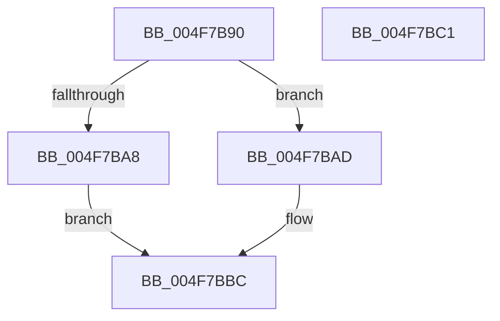

# Feature_Test57481295__private_IsEnabledDeviceUsageNoInline

- RVA: `0x004F7B90`–`0x004F7BC2` (길이 `50` bytes)
- VA: `0x00000001404F7B90`
- 실행 섹션: `.text`
- PDB 이름 있음: `예`; PDB Function 태그: `아니요`
- unwind 정보 RVA: `0x0005C788`
- 디코드: `14`개 명령, `50/50` bytes 표시
- 미해석 바이트: `0` (있으면 어셈블리에 `.byte`로 보존)

> 이 문서는 커널 이미지의 기계어와 PDB 기호를 분석해 생성했습니다. 4번과 5번은 함수 원형과 자료형을 바이너리 사용 방식에서 추정한 C 해석이며 원본 소스 복구 결과는 아닙니다.

## 1. Dependencies

- 직접 호출 지점: **1**; 고유 호출 대상: **1**
- 직접 호출자로 확인된 함수: **23**
- RIP 상대 이미지 참조: **1**

### Outgoing calls
- `0x004F7BB7` → [Feature_Test57481295__private_IsEnabledFallback](Feature_Test57481295__private_IsEnabledFallback_function_004F7BC8.md) (function, `0x004F7BC8`)

### Direct callers
- [IvtUpdateScalableModePasidTablesForPasid](../4C/IvtUpdateScalableModePasidTablesForPasid_function_004CD628.md) at `0x004CD6B1`
- [IvtBuildScalableModePasidTableS1Entry](IvtBuildScalableModePasidTableS1Entry_function_004F6644.md) at `0x004F66A8`
- [HalpDmaGetDefaultRemappingDomainPolicy](../53/HalpDmaGetDefaultRemappingDomainPolicy_function_0053E240.md) at `0x0053E24E`
- [HalpIommuUpdatePageWalkCapability](../54/HalpIommuUpdatePageWalkCapability_function_0054EAD0.md) at `0x0054EAF0`
- [IommupDomainAttachPasidDevice](../54/IommupDomainAttachPasidDevice_function_0054F984.md) at `0x0054FA44`
- [IommupDomainAttachPasidDevice](../54/IommupDomainAttachPasidDevice_function_0054F984.md) at `0x0054FB24`
- [HalpIommuAllocateDmaDomain](../55/HalpIommuAllocateDmaDomain_function_00554904.md) at `0x00554A33`
- [HalpIommuGetPageTableType](../55/HalpIommuGetPageTableType_function_00555220.md) at `0x00555257`
- [IommuFlushTb](../56/IommuFlushTb_function_005656B0.md) at `0x005656D9`
- [IommuGetLibraryContext](../56/IommuGetLibraryContext_function_00565990.md) at `0x00565A12`
- [IommupMapDeviceInternal](../56/IommupMapDeviceInternal_function_00566478.md) at `0x005664D1`
- [IommupMapDeviceInternal](../56/IommupMapDeviceInternal_function_00566478.md) at `0x0056664F`
- [IommupUnmapDeviceInternal](../56/IommupUnmapDeviceInternal_function_005667D8.md) at `0x00566811`
- [IommupHvAttachPasidDevice](../56/IommupHvAttachPasidDevice_function_00566AEC.md) at `0x00566B42`
- [HalpIommuInitializeDmarPageTable](../56/HalpIommuInitializeDmarPageTable_function_00568F24.md) at `0x00568F91`
- [IvtAttachDeviceDomain](../56/IvtAttachDeviceDomain_function_0056ED40.md) at `0x0056ED58`
- [IvtDetachDeviceDomain](../56/IvtDetachDeviceDomain_function_0056F3A0.md) at `0x0056F3B0`
- [IvtGetScalableModePasidTables](../56/IvtGetScalableModePasidTables_function_0056FD5C.md) at `0x0056FD7A`
- [IvtInvalidateScalableModeContextEntry](../57/IvtInvalidateScalableModeContextEntry_function_00570940.md) at `0x00570958`
- [HalpIvtProcessDmarTable](../57/HalpIvtProcessDmarTable_function_005793EC.md) at `0x00579465`
- [HalpDmaAllocateChildAdapterV3](../../page/70/HalpDmaAllocateChildAdapterV3_function_007066A0.md) at `0x00706B45`
- [HalpDmaAllocateChildAdapterV3](../../page/70/HalpDmaAllocateChildAdapterV3_function_007066A0.md) at `0x00706CCA`
- [IommupDeviceEnablePasidTaggedDma](../../page/70/IommupDeviceEnablePasidTaggedDma_function_00708B74.md) at `0x00708BD9`
- [IvtInitializeIommu](../../pagelk/B6/IvtInitializeIommu_function_00B61FE0.md) at `0x00B6209D`
- [IvtInitializeIommu](../../pagelk/B6/IvtInitializeIommu_function_00B61FE0.md) at `0x00B620DD`
- [IvtInitializeIommu](../../pagelk/B6/IvtInitializeIommu_function_00B61FE0.md) at `0x00B622B4`
- [IvtInitializeIommu](../../pagelk/B6/IvtInitializeIommu_function_00B61FE0.md) at `0x00B6237B`
- [IvtInitializeIommu](../../pagelk/B6/IvtInitializeIommu_function_00B61FE0.md) at `0x00B623EA`
- [IvtInitializeIommu](../../pagelk/B6/IvtInitializeIommu_function_00B61FE0.md) at `0x00B6255C`
- [IvtInitializeReservedDomains](../../pagelk/B6/IvtInitializeReservedDomains_function_00B63A08.md) at `0x00B63A32`
- [KiInitializeKernel](../../pagelk/B6/KiInitializeKernel_function_00B68D20.md) at `0x00B694A1`

### Static image references
- `0x004F7B9A` → RVA `0x00FC4650` (`.data`; read)

## 2. Other-region calls and transfers

- 다른 실행 섹션으로 향하는 call: **0**
- 별도 외부 분기/꼬리 이동을 확인하지 못했습니다.

## 3. Assembly (complete function range)

```asm
004F7B90  48 83 EC 28                     sub rsp, 0x28
004F7B94  48 83 64 24 30 00               and qword ptr [rsp + 0x30], 0
004F7B9A  8B 05 B0 CA AC 00               mov eax, dword ptr [rip + 0xaccab0]
004F7BA0  89 44 24 30                     mov dword ptr [rsp + 0x30], eax
004F7BA4  A8 10                           test al, 0x10
004F7BA6  74 05                           je 0x1404f7bad
004F7BA8  83 E0 01                        and eax, 1
004F7BAB  EB 0F                           jmp 0x1404f7bbc
004F7BAD  48 8B 4C 24 30                  mov rcx, qword ptr [rsp + 0x30]
004F7BB2  BA 03 00 00 00                  mov edx, 3
004F7BB7  E8 0C 00 00 00                  call 0x1404f7bc8
004F7BBC  48 83 C4 28                     add rsp, 0x28
004F7BC0  C3                              ret
004F7BC1  CC                              int3
```

## 4. C-style interpretation (structured pseudocode)

```c
__int64 __fastcall Feature_Test57481295__private_IsEnabledDeviceUsageNoInline(void)
{
    __int64 result;
    __int64 v_rsp;
    unsigned __int64 v_stack_p8;

    v_rsp = (v_rsp) - (40);
    v_stack_p8 = (unsigned int)((unsigned int)(*(unsigned int *)(v_rip + 11324080)));
    if ((((unsigned __int8)((unsigned int)(*(unsigned int *)(v_rip + 11324080)))) & (16)) == 0) goto loc_004F7BAD;
    result = (unsigned int)(((unsigned int)(*(unsigned int *)(v_rip + 11324080))) & (1));
    goto loc_004F7BBC;
loc_004F7BAD:
    result = Feature_Test57481295__private_IsEnabledFallback(v_stack_p8, 3, a3, a4);
loc_004F7BBC:
    v_rsp = (v_rsp) + (40);
    return result;
}
```

## 5. (Beta) C Style

```c
void Feature_Test57481295__private_IsEnabledDeviceUsageNoInline(void)
{
    int64_t result;
    int64_t local_rsp;
    uint64_t v_stack_p8;

    local_rsp = (local_rsp) - (40);
    v_stack_p8 = (uint32_t)((uint32_t)(*(uint32_t *)(v_rip + 0xACCAB0)));
    if ((((uint8_t)((uint32_t)(*(uint32_t *)(v_rip + 0xACCAB0)))) & (16)) == 0) goto loc_004F7BAD;
    result = (uint32_t)(((uint32_t)(*(uint32_t *)(v_rip + 0xACCAB0))) & (1));
    goto loc_004F7BBC;
loc_004F7BAD:
    result = Feature_Test57481295__private_IsEnabledFallback(v_stack_p8, 3, a3, a4);
loc_004F7BBC:
    local_rsp = (local_rsp) + (40);
    return result;
}
```

## 6. Execution-region graph

[열기: 2D/3D 그래프와 함수 탐색 컨트롤 패널](../../../control-panel.html?section=text&rva=0x004F7B90&view=graph)

- 2D 그래프는 위에서 아래로 흐르고, 3D 그래프는 빈 공간을 드래그해 회전합니다. Shift+드래그는 이동, 휠은 확대·축소, 함수 노드 선택은 대상 보고서 이동입니다.

### Static fallback


