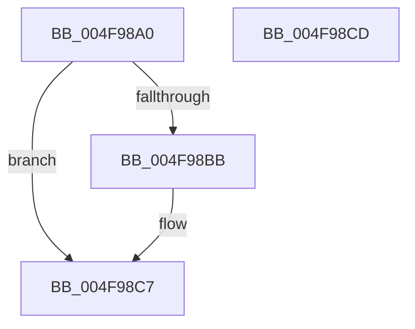

# FioFwReadUshortAtOffset

- RVA: `0x004F98A0`–`0x004F98CE` (길이 `46` bytes)
- VA: `0x00000001404F98A0`
- 실행 섹션: `.text`
- PDB 이름 있음: `예`; PDB Function 태그: `아니요`
- unwind 정보 RVA: `0x0005CF00`
- 디코드: `16`개 명령, `46/46` bytes 표시
- 미해석 바이트: `0` (있으면 어셈블리에 `.byte`로 보존)

> 이 문서는 커널 이미지의 기계어와 PDB 기호를 분석해 생성했습니다. 4번과 5번은 함수 원형과 자료형을 바이너리 사용 방식에서 추정한 C 해석이며 원본 소스 복구 결과는 아닙니다.

## 1. Dependencies

- 직접 호출 지점: **1**; 고유 호출 대상: **1**
- 직접 호출자로 확인된 함수: **6**
- RIP 상대 이미지 참조: **0**

### Outgoing calls
- `0x004F98B2` → [FioFwReadBytesAtOffset](../3E/FioFwReadBytesAtOffset_function_003E5948.md) (function, `0x003E5948`)

### Direct callers
- [RaspInitializeGlyphData](../3E/RaspInitializeGlyphData_function_003E54B8.md) at `0x003E571F`
- [RaspInitializeGlyphData](../3E/RaspInitializeGlyphData_function_003E54B8.md) at `0x003E5866`
- [RaspInitializeGlyphData](../3E/RaspInitializeGlyphData_function_003E54B8.md) at `0x003E58EC`
- [RaspGetCompositeGlyphList](../6A/RaspGetCompositeGlyphList_function_006A1B54.md) at `0x006A1BDC`
- [RaspGetCompositeGlyphList](../6A/RaspGetCompositeGlyphList_function_006A1B54.md) at `0x006A1C51`
- [RaspGetCompositeGlyphList](../6A/RaspGetCompositeGlyphList_function_006A1B54.md) at `0x006A1C6C`
- [RaspGetCompositeGlyphList](../6A/RaspGetCompositeGlyphList_function_006A1B54.md) at `0x006A1C83`
- [RaspGetCompositeGlyphList](../6A/RaspGetCompositeGlyphList_function_006A1B54.md) at `0x006A1CA0`
- [RaspGetCompositeGlyphList](../6A/RaspGetCompositeGlyphList_function_006A1B54.md) at `0x006A1CD5`
- [RaspGetCompositeGlyphList](../6A/RaspGetCompositeGlyphList_function_006A1B54.md) at `0x006A1CF9`
- [RaspGetCompositeGlyphList](../6A/RaspGetCompositeGlyphList_function_006A1B54.md) at `0x006A1D10`
- [RaspGetCompositeGlyphList](../6A/RaspGetCompositeGlyphList_function_006A1B54.md) at `0x006A1D2D`
- [RaspGetCompositeGlyphList](../6A/RaspGetCompositeGlyphList_function_006A1B54.md) at `0x006A1D44`
- [RaspGetCompositeGlyphList](../6A/RaspGetCompositeGlyphList_function_006A1B54.md) at `0x006A1D5D`
- [RaspGetCompositeGlyphList](../6A/RaspGetCompositeGlyphList_function_006A1B54.md) at `0x006A1D74`
- [RaspGetCompositeGlyphList](../6A/RaspGetCompositeGlyphList_function_006A1B54.md) at `0x006A1DF9`
- [RaspLoadBearings](../6A/RaspLoadBearings_function_006A24A8.md) at `0x006A2582`
- [RaspLoadCompositeGlyphData](../6A/RaspLoadCompositeGlyphData_function_006A261C.md) at `0x006A2699`
- [RaspLoadCompositeGlyphData](../6A/RaspLoadCompositeGlyphData_function_006A261C.md) at `0x006A26A8`
- [RaspLoadCompositeGlyphData](../6A/RaspLoadCompositeGlyphData_function_006A261C.md) at `0x006A26B9`
- [RaspLoadCompositeGlyphData](../6A/RaspLoadCompositeGlyphData_function_006A261C.md) at `0x006A26C8`
- [RaspLoadCompositeGlyphData](../6A/RaspLoadCompositeGlyphData_function_006A261C.md) at `0x006A26D9`
- [RaspLoadGlyphData](../6A/RaspLoadGlyphData_function_006A2818.md) at `0x006A28A6`
- [RaspMapGlyphIndexToLocation](../6A/RaspMapGlyphIndexToLocation_function_006A29B4.md) at `0x006A29FE`
- [RaspMapGlyphIndexToLocation](../6A/RaspMapGlyphIndexToLocation_function_006A29B4.md) at `0x006A2A24`

### Static image references
- 디코드된 RIP-relative 메모리 참조가 없습니다.

## 2. Other-region calls and transfers

- 다른 실행 섹션으로 향하는 call: **0**
- 별도 외부 분기/꼬리 이동을 확인하지 못했습니다.

## 3. Assembly (complete function range)

```asm
004F98A0  40 53                           push rbx
004F98A2  48 83 EC 20                     sub rsp, 0x20
004F98A6  49 8B D8                        mov rbx, r8
004F98A9  4D 8B C8                        mov r9, r8
004F98AC  41 B8 02 00 00 00               mov r8d, 2
004F98B2  E8 91 C0 EE FF                  call 0x1403e5948
004F98B7  85 C0                           test eax, eax
004F98B9  78 0C                           js 0x1404f98c7
004F98BB  0F B7 03                        movzx eax, word ptr [rbx]
004F98BE  66 C1 C8 08                     ror ax, 8
004F98C2  66 89 03                        mov word ptr [rbx], ax
004F98C5  33 C0                           xor eax, eax
004F98C7  48 83 C4 20                     add rsp, 0x20
004F98CB  5B                              pop rbx
004F98CC  C3                              ret
004F98CD  CC                              int3
```

## 4. C-style interpretation (structured pseudocode)

```c
__int64 __fastcall FioFwReadUshortAtOffset(__int64 a1, __int64 a2, __int64 a3)
{
    __int64 result;
    __int64 v_rsp;

    v_rsp = (v_rsp) - (32);
    result = FioFwReadBytesAtOffset(a1, a2, 2, a3);
    if (!(sign_flag)) {
        result = *(unsigned __int16 *)(a3);
        *(unsigned __int16 *)(a3) = (unsigned __int16)(result);
        result = 0;
    }
    v_rsp = (v_rsp) + (32);
    return result;
}
```

## 5. (Beta) C Style

```c
int64_t FioFwReadUshortAtOffset(int64_t Arg1, int64_t Arg2, void *Arg3)
{
    uint8_t *arg3 = (uint8_t *)Arg3;

    int64_t result;
    int64_t local_rsp;

    local_rsp = (local_rsp) - (32);
    result = FioFwReadBytesAtOffset(Arg1, Arg2, 2, Arg3);
    if (!(sign_flag)) {
        result = *(uint16_t *)(arg3);
        *(uint16_t *)(arg3) = (uint16_t)(result);
        result = 0;
    }
    local_rsp = (local_rsp) + (32);
    return result;
}
```

### 관측된 메모리 오프셋

구조체 형식이 확인되지 않은 접근은 인자 기준의 오프셋으로만 기록했습니다.

| 기준 인자 | 오프셋 표현 | 폭 (bit) | 접근 |
|---|---:|---:|---|
| `Arg3` | `+ 0x0` | `16` | `R` |
| `Arg3` | `+ 0x0` | `16` | `W` |

## 6. Execution-region graph

[열기: 2D/3D 그래프와 함수 탐색 컨트롤 패널](../../../control-panel.html?section=text&rva=0x004F98A0&view=graph)

- 2D 그래프는 위에서 아래로 흐르고, 3D 그래프는 빈 공간을 드래그해 회전합니다. Shift+드래그는 이동, 휠은 확대·축소, 함수 노드 선택은 대상 보고서 이동입니다.

### Static fallback


