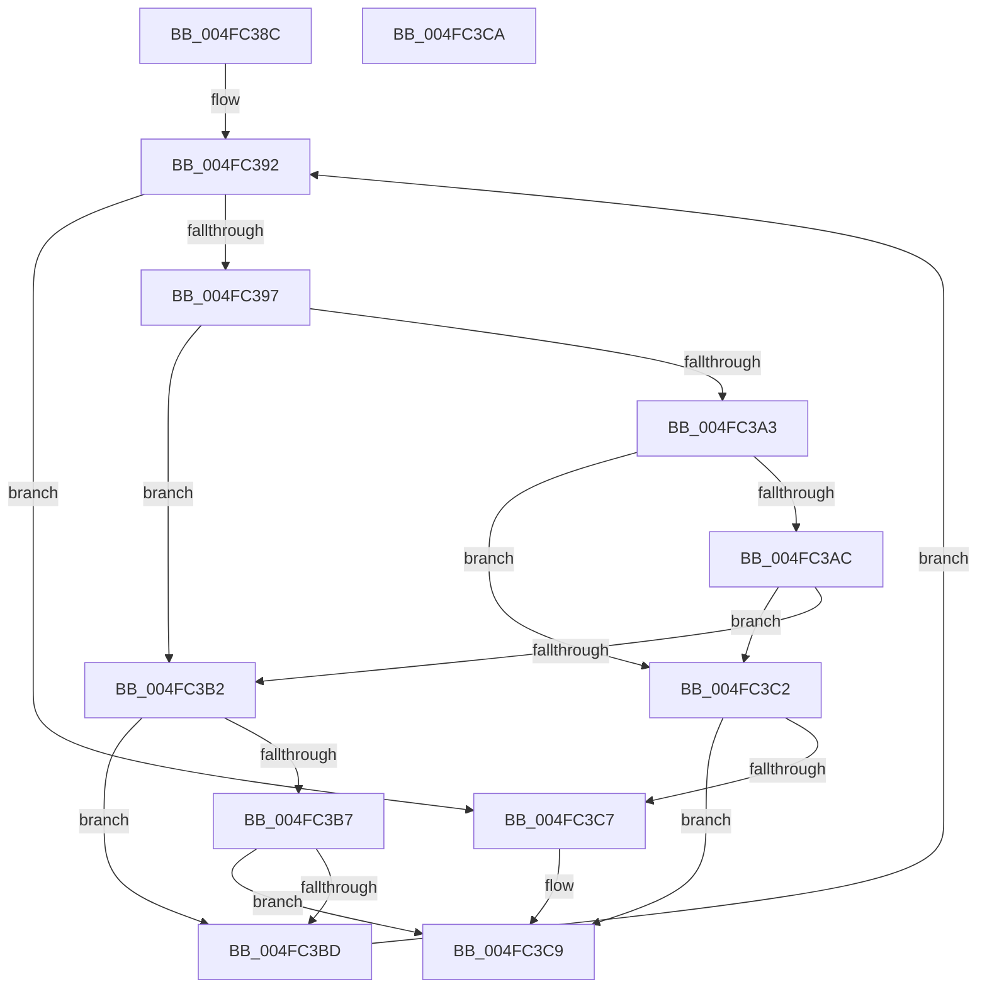

# FsRtlFindFirstOverlapInNode

- RVA: `0x004FC38C`–`0x004FC3CB` (길이 `63` bytes)
- VA: `0x00000001404FC38C`
- 실행 섹션: `.text`
- PDB 이름 있음: `예`; PDB Function 태그: `아니요`
- unwind 정보 RVA: `0x000DB714`
- 디코드: `24`개 명령, `63/63` bytes 표시
- 미해석 바이트: `0` (있으면 어셈블리에 `.byte`로 보존)

> 이 문서는 커널 이미지의 기계어와 PDB 기호를 분석해 생성했습니다. 4번과 5번은 함수 원형과 자료형을 바이너리 사용 방식에서 추정한 C 해석이며 원본 소스 복구 결과는 아닙니다.

## 1. Dependencies

- 직접 호출 지점: **0**; 고유 호출 대상: **0**
- 직접 호출자로 확인된 함수: **2**
- RIP 상대 이미지 참조: **0**

### Outgoing calls
- 직접 디코드된 call 명령이 없습니다.

### Direct callers
- [FsRtlPrivateCheckForExclusiveLockAccess](../38/FsRtlPrivateCheckForExclusiveLockAccess_function_0038EA28.md) at `0x0038EBD3`
- [FsRtlCheckNoSharedConflict](../38/FsRtlCheckNoSharedConflict_function_0038FB8C.md) at `0x0038FC87`

### Static image references
- 디코드된 RIP-relative 메모리 참조가 없습니다.

## 2. Other-region calls and transfers

- 다른 실행 섹션으로 향하는 call: **0**
- 별도 외부 분기/꼬리 이동을 확인하지 못했습니다.

## 3. Assembly (complete function range)

```asm
004FC38C  48 8B 01                        mov rax, qword ptr [rcx]
004FC38F  4C 8B DA                        mov r11, rdx
004FC392  48 85 C0                        test rax, rax
004FC395  74 30                           je 0x1404fc3c7
004FC397  4C 8B 50 30                     mov r10, qword ptr [rax + 0x30]
004FC39B  4D 8B 0B                        mov r9, qword ptr [r11]
004FC39E  4D 3B D1                        cmp r10, r9
004FC3A1  72 0F                           jb 0x1404fc3b2
004FC3A3  48 8B 50 08                     mov rdx, qword ptr [rax + 8]
004FC3A7  48 85 D2                        test rdx, rdx
004FC3AA  75 16                           jne 0x1404fc3c2
004FC3AC  48 39 50 10                     cmp qword ptr [rax + 0x10], rdx
004FC3B0  75 10                           jne 0x1404fc3c2
004FC3B2  4D 3B 10                        cmp r10, qword ptr [r8]
004FC3B5  75 06                           jne 0x1404fc3bd
004FC3B7  4C 39 48 08                     cmp qword ptr [rax + 8], r9
004FC3BB  74 0C                           je 0x1404fc3c9
004FC3BD  48 8B 00                        mov rax, qword ptr [rax]
004FC3C0  EB D0                           jmp 0x1404fc392
004FC3C2  49 3B 10                        cmp rdx, qword ptr [r8]
004FC3C5  76 02                           jbe 0x1404fc3c9
004FC3C7  33 C0                           xor eax, eax
004FC3C9  C3                              ret
004FC3CA  CC                              int3
```

## 4. C-style interpretation (structured pseudocode)

```c
__int64 __fastcall FsRtlFindFirstOverlapInNode(__int64 a1, __int64 a2, __int64 a3)
{
    __int64 result;

loc_004FC392:
    if (*(unsigned __int64 *)(a1) == 0) goto loc_004FC3C7;
    if ((*(unsigned __int64 *)(*(unsigned __int64 *)(a1) + 48)) < (*(unsigned __int64 *)(a2))) goto loc_004FC3B2;
    if (*(unsigned __int64 *)(*(unsigned __int64 *)(a1) + 8) != 0) goto loc_004FC3C2;
    if ((*(unsigned __int64 *)(*(unsigned __int64 *)(a1) + 16)) != (*(unsigned __int64 *)(*(unsigned __int64 *)(a1) + 8))) goto loc_004FC3C2;
loc_004FC3B2:
    if ((*(unsigned __int64 *)(*(unsigned __int64 *)(a1) + 48)) != (*(unsigned __int64 *)(a3))) goto loc_004FC3BD;
    if ((*(unsigned __int64 *)(*(unsigned __int64 *)(a1) + 8)) == (*(unsigned __int64 *)(a2))) goto loc_004FC3C9;
loc_004FC3BD:
    goto loc_004FC392;
loc_004FC3C2:
    result = *(unsigned __int64 *)(*(unsigned __int64 *)(a1));
    if ((*(unsigned __int64 *)(*(unsigned __int64 *)(a1) + 8)) >= = (*(unsigned __int64 *)(a3))) {
        result = 0;
    }
    return result;
}
```

## 5. (Beta) C Style

```c
int64_t FsRtlFindFirstOverlapInNode(void *Arg1, void *Arg2, void *Arg3)
{
    uint8_t *arg1 = (uint8_t *)Arg1;
    uint8_t *arg2 = (uint8_t *)Arg2;
    uint8_t *arg3 = (uint8_t *)Arg3;

    int64_t result;

loc_004FC392:
    if (*(uint64_t *)(arg1) == 0) goto loc_004FC3C7;
    if ((*(uint64_t *)(*(uint64_t *)(arg1) + 0x30)) < (*(uint64_t *)(arg2))) goto loc_004FC3B2;
    if (*(uint64_t *)(*(uint64_t *)(arg1) + 0x8) != 0) goto loc_004FC3C2;
    if ((*(uint64_t *)(*(uint64_t *)(arg1) + 0x10)) != (*(uint64_t *)(*(uint64_t *)(arg1) + 0x8))) goto loc_004FC3C2;
loc_004FC3B2:
    if ((*(uint64_t *)(*(uint64_t *)(arg1) + 0x30)) != (*(uint64_t *)(arg3))) goto loc_004FC3BD;
    if ((*(uint64_t *)(*(uint64_t *)(arg1) + 0x8)) == (*(uint64_t *)(arg2))) goto loc_004FC3C9;
loc_004FC3BD:
    goto loc_004FC392;
loc_004FC3C2:
    result = *(uint64_t *)(*(uint64_t *)(arg1));
    if ((*(uint64_t *)(*(uint64_t *)(arg1) + 0x8)) >= = (*(uint64_t *)(arg3))) {
        result = 0;
    }
    return result;
}
```

### 관측된 메모리 오프셋

구조체 형식이 확인되지 않은 접근은 인자 기준의 오프셋으로만 기록했습니다.

| 기준 인자 | 오프셋 표현 | 폭 (bit) | 접근 |
|---|---:|---:|---|
| `Arg1` | `+ 0x0` | `64` | `R` |
| `Arg2` | `+ 0x0` | `64` | `R` |
| `Arg3` | `+ 0x0` | `64` | `R` |

## 6. Execution-region graph

[열기: 2D/3D 그래프와 함수 탐색 컨트롤 패널](../../../control-panel.html?section=text&rva=0x004FC38C&view=graph)

- 2D 그래프는 위에서 아래로 흐르고, 3D 그래프는 빈 공간을 드래그해 회전합니다. Shift+드래그는 이동, 휠은 확대·축소, 함수 노드 선택은 대상 보고서 이동입니다.

### Static fallback


