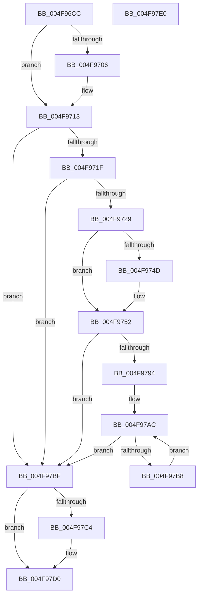

# FsRtlpCancelExclusiveIrp

- RVA: `0x004F96CC`–`0x004F97E1` (길이 `277` bytes)
- VA: `0x00000001404F96CC`
- 실행 섹션: `.text`
- PDB 이름 있음: `예`; PDB Function 태그: `아니요`
- unwind 정보 RVA: `0x000BF8A8`
- 디코드: `72`개 명령, `277/277` bytes 표시
- 미해석 바이트: `0` (있으면 어셈블리에 `.byte`로 보존)

> 이 문서는 커널 이미지의 기계어와 PDB 기호를 분석해 생성했습니다. 4번과 5번은 함수 원형과 자료형을 바이너리 사용 방식에서 추정한 C 해석이며 원본 소스 복구 결과는 아닙니다.

## 1. Dependencies

- 직접 호출 지점: **10**; 고유 호출 대상: **10**
- 직접 호출자로 확인된 함수: **4**
- RIP 상대 이미지 참조: **0**

### Outgoing calls
- `0x004F96FC` → [KeReleaseQueuedSpinLock](../27/KeReleaseQueuedSpinLock_function_00272540.md) (function, `0x00272540`)
- `0x004F970D` → [ExAcquireFastMutex](../20/ExAcquireFastMutex_function_0020E5A0.md) (function, `0x0020E5A0`)
- `0x004F9731` → [FsRtlpModifyThreadPriorities](../48/FsRtlpModifyThreadPriorities_function_0048B098.md) (function, `0x0048B098`)
- `0x004F973B` → [FsRtlpClearOwner](../26/FsRtlpClearOwner_function_00265BE8.md) (function, `0x00265BE8`)
- `0x004F9761` → [IofCompleteRequest](../29/IofCompleteRequest_function_0029B5C0.md) (function, `0x0029B5C0`)
- `0x004F9773` → [ObfDereferenceObjectWithTag](../2F/ObfDereferenceObjectWithTag_function_002F78E0.md) (function, `0x002F78E0`)
- `0x004F979B` → [FsRtlpSyncWithAckTimeout](FsRtlpSyncWithAckTimeout_function_004F23C4.md) (function, `0x004F23C4`)
- `0x004F97A7` → [FsRtlpOplockPerfSendData](../../page/6F/FsRtlpOplockPerfSendData_function_006FDB80.md) (function, `0x006FDB80`)
- `0x004F97B8` → [FsRtlpRemoveAndCompleteWaitingIrp](../42/FsRtlpRemoveAndCompleteWaitingIrp_function_00425FC0.md) (function, `0x00425FC0`)
- `0x004F97CB` → [ExReleaseFastMutex](../25/ExReleaseFastMutex_function_002519C0.md) (function, `0x002519C0`)

### Direct callers
- [FsRtlpAcknowledgeOplockBreakByCacheFlags](../3F/FsRtlpAcknowledgeOplockBreakByCacheFlags_function_003F1988.md) at `0x003F21F6`
- [FsRtlpRequestExclusiveOplock](../3F/FsRtlpRequestExclusiveOplock_function_003F3800.md) at `0x003F3FFE`
- [FsRtlpExclusiveIrpCancelRoutine](../58/FsRtlpExclusiveIrpCancelRoutine_function_00582520.md) at `0x0058252C`
- [FsRtlpGrantAnyOplockFromExclusive](../58/FsRtlpGrantAnyOplockFromExclusive_function_00582540.md) at `0x005828C1`

### Static image references
- 디코드된 RIP-relative 메모리 참조가 없습니다.

## 2. Other-region calls and transfers

- 다른 실행 섹션으로 향하는 call: **1**
  - `0x004F97A7` → [FsRtlpOplockPerfSendData](../../page/6F/FsRtlpOplockPerfSendData_function_006FDB80.md) (`.text` → `PAGE`)
- 별도 외부 분기/꼬리 이동을 확인하지 못했습니다.

## 3. Assembly (complete function range)

```asm
004F96CC  48 89 5C 24 18                  mov qword ptr [rsp + 0x18], rbx
004F96D1  48 89 74 24 20                  mov qword ptr [rsp + 0x20], rsi
004F96D6  88 54 24 10                     mov byte ptr [rsp + 0x10], dl
004F96DA  57                              push rdi
004F96DB  48 83 EC 20                     sub rsp, 0x20
004F96DF  41 8A F0                        mov sil, r8b
004F96E2  40 8A FA                        mov dil, dl
004F96E5  48 8B 59 38                     mov rbx, qword ptr [rcx + 0x38]
004F96E9  48 89 5C 24 30                  mov qword ptr [rsp + 0x30], rbx
004F96EE  33 C0                           xor eax, eax
004F96F0  48 87 41 68                     xchg qword ptr [rcx + 0x68], rax
004F96F4  8A 51 45                        mov dl, byte ptr [rcx + 0x45]
004F96F7  B9 07 00 00 00                  mov ecx, 7
004F96FC  E8 3F 8E D7 FF                  call 0x140272540
004F9701  40 84 FF                        test dil, dil
004F9704  75 0D                           jne 0x1404f9713
004F9706  48 8B 8B 98 00 00 00            mov rcx, qword ptr [rbx + 0x98]
004F970D  E8 8E 4E D1 FF                  call 0x14020e5a0
004F9712  90                              nop
004F9713  48 8B 03                        mov rax, qword ptr [rbx]
004F9716  48 85 C0                        test rax, rax
004F9719  0F 84 A0 00 00 00               je 0x1404f97bf
004F971F  80 78 44 00                     cmp byte ptr [rax + 0x44], 0
004F9723  0F 84 96 00 00 00               je 0x1404f97bf
004F9729  45 33 C0                        xor r8d, r8d
004F972C  33 D2                           xor edx, edx
004F972E  48 8B CB                        mov rcx, rbx
004F9731  E8 62 19 F9 FF                  call 0x14048b098
004F9736  33 D2                           xor edx, edx
004F9738  48 8B CB                        mov rcx, rbx
004F973B  E8 A8 C4 D6 FF                  call 0x140265be8
004F9740  C6 43 20 00                     mov byte ptr [rbx + 0x20], 0
004F9744  48 8B 03                        mov rax, qword ptr [rbx]
004F9747  48 39 58 38                     cmp qword ptr [rax + 0x38], rbx
004F974B  75 05                           jne 0x1404f9752
004F974D  48 83 60 38 00                  and qword ptr [rax + 0x38], 0
004F9752  48 8B 03                        mov rax, qword ptr [rbx]
004F9755  C7 40 30 20 01 00 C0            mov dword ptr [rax + 0x30], 0xc0000120
004F975C  B2 01                           mov dl, 1
004F975E  48 8B 0B                        mov rcx, qword ptr [rbx]
004F9761  E8 5A 1E DA FF                  call 0x14029b5c0
004F9766  48 83 23 00                     and qword ptr [rbx], 0
004F976A  48 8B 4B 08                     mov rcx, qword ptr [rbx + 8]
004F976E  BA 44 66 6C 74                  mov edx, 0x746c6644
004F9773  E8 68 E1 DF FF                  call 0x1402f78e0
004F9778  48 83 63 08 00                  and qword ptr [rbx + 8], 0
004F977D  8B 83 90 00 00 00               mov eax, dword ptr [rbx + 0x90]
004F9783  83 E0 20                        and eax, 0x20
004F9786  83 C8 01                        or eax, 1
004F9789  89 83 90 00 00 00               mov dword ptr [rbx + 0x90], eax
004F978F  40 84 F6                        test sil, sil
004F9792  74 2B                           je 0x1404f97bf
004F9794  48 8D 8B B8 00 00 00            lea rcx, [rbx + 0xb8]
004F979B  E8 24 8C FF FF                  call 0x1404f23c4
004F97A0  48 8D 8B A8 00 00 00            lea rcx, [rbx + 0xa8]
004F97A7  E8 D4 43 20 00                  call 0x1406fdb80
004F97AC  48 8D 43 58                     lea rax, [rbx + 0x58]
004F97B0  48 8B 08                        mov rcx, qword ptr [rax]
004F97B3  48 3B C8                        cmp rcx, rax
004F97B6  74 07                           je 0x1404f97bf
004F97B8  E8 03 C8 F2 FF                  call 0x140425fc0
004F97BD  EB ED                           jmp 0x1404f97ac
004F97BF  40 84 FF                        test dil, dil
004F97C2  75 0C                           jne 0x1404f97d0
004F97C4  48 8B 8B 98 00 00 00            mov rcx, qword ptr [rbx + 0x98]
004F97CB  E8 F0 81 D5 FF                  call 0x1402519c0
004F97D0  48 8B 5C 24 40                  mov rbx, qword ptr [rsp + 0x40]
004F97D5  48 8B 74 24 48                  mov rsi, qword ptr [rsp + 0x48]
004F97DA  48 83 C4 20                     add rsp, 0x20
004F97DE  5F                              pop rdi
004F97DF  C3                              ret
004F97E0  CC                              int3
```

## 4. C-style interpretation (structured pseudocode)

```c
__int64 __fastcall FsRtlpCancelExclusiveIrp(__int64 a1, unsigned __int8 a2, int a3)
{
    __int64 result;
    __int64 v_rsp;
    unsigned __int8 v_stack_p10;
    unsigned __int64 v_stack_p18;
    unsigned __int64 v_stack_p20;
    unsigned __int64 v_stack_p8;

    v_stack_p18 = v_rbx;
    v_stack_p20 = v_rsi;
    v_stack_p10 = a2;
    v_rsp = (v_rsp) - (32);
    v_stack_p8 = *(unsigned __int64 *)(a1 + 56);
    result = 0;
    result = KeReleaseQueuedSpinLock(7, *(unsigned __int8 *)(a1 + 69), a3, a4);
    if (a2 == 0) {
        a1 = *(unsigned __int64 *)(*(unsigned __int64 *)(a1 + 56) + 152);
        result = ExAcquireFastMutex(a1, *(unsigned __int8 *)(a1 + 69), a3, a4);
    }
    if (*(unsigned __int64 *)(*(unsigned __int64 *)(a1 + 56)) == 0) goto loc_004F97BF;
    if ((*(unsigned __int8 *)(*(unsigned __int64 *)(*(unsigned __int64 *)(a1 + 56)) + 68)) == 0) goto loc_004F97BF;
    a3 = 0;
    a2 = 0;
    result = FsRtlpModifyThreadPriorities(*(unsigned __int64 *)(a1 + 56), a2, a3, a4);
    a2 = 0;
    result = FsRtlpClearOwner(*(unsigned __int64 *)(a1 + 56), a2, a3, a4);
    *(unsigned __int8 *)(*(unsigned __int64 *)(a1 + 56) + 32) = 0;
    if ((*(unsigned __int64 *)(*(unsigned __int64 *)(*(unsigned __int64 *)(a1 + 56)) + 56)) == (*(unsigned __int64 *)(a1 + 56))) {
    }
    *(unsigned int *)(*(unsigned __int64 *)(*(unsigned __int64 *)(a1 + 56)) + 48) = 0xC0000120ULL;
    result = IofCompleteRequest(*(unsigned __int64 *)(*(unsigned __int64 *)(a1 + 56)), 1, a3, a4);
    result = ObfDereferenceObjectWithTag(*(unsigned __int64 *)(*(unsigned __int64 *)(a1 + 56) + 8), (unsigned int)(0x746C6644ULL), a3, a4);
    result = (unsigned int)(((unsigned int)(*(unsigned int *)(*(unsigned __int64 *)(a1 + 56) + 144))) & (32));
    result = (unsigned int)((result) | (1));
    *(unsigned int *)(*(unsigned __int64 *)(a1 + 56) + 144) = (unsigned int)(result);
    if ((unsigned __int8)((unsigned __int8)(a3)) == 0) goto loc_004F97BF;
    result = FsRtlpSyncWithAckTimeout(*(unsigned __int64 *)(a1 + 56) + 184, (unsigned int)(0x746C6644ULL), a3, a4);
    result = FsRtlpOplockPerfSendData(*(unsigned __int64 *)(a1 + 56) + 168, (unsigned int)(0x746C6644ULL), a3, a4);
loc_004F97AC:
    if ((*(unsigned __int64 *)(*(unsigned __int64 *)(a1 + 56) + 88)) == (*(unsigned __int64 *)(a1 + 56) + 88)) goto loc_004F97BF;
    result = FsRtlpRemoveAndCompleteWaitingIrp(*(unsigned __int64 *)(*(unsigned __int64 *)(a1 + 56) + 88), (unsigned int)(0x746C6644ULL), a3, a4);
    goto loc_004F97AC;
loc_004F97BF:
    if (0 == 0) {
        a1 = *(unsigned __int64 *)(*(unsigned __int64 *)(a1 + 56) + 152);
        result = ExReleaseFastMutex(a1, (unsigned int)(0x746C6644ULL), a3, a4);
    }
    v_rsp = (v_rsp) + (32);
    return result;
}
```

## 5. (Beta) C Style

```c
int64_t FsRtlpCancelExclusiveIrp(void *Arg1, uint8_t Arg2, int32_t Arg3)
{
    uint8_t *arg1 = (uint8_t *)Arg1;

    int64_t result;
    int64_t local_rsp;
    uint8_t v_stack_p10;
    uint64_t v_stack_p18;
    uint64_t v_stack_p20;
    uint64_t v_stack_p8;

    v_stack_p18 = local_rbx;
    v_stack_p20 = local_rsi;
    v_stack_p10 = Arg2;
    local_rsp = (local_rsp) - (32);
    v_stack_p8 = *(uint64_t *)(arg1 + 0x38);
    result = 0;
    result = KeReleaseQueuedSpinLock(7, *(uint8_t *)(arg1 + 0x45), Arg3, a4);
    if (Arg2 == 0) {
        Arg1 = *(uint64_t *)(*(uint64_t *)(arg1 + 0x38) + 0x98);
        result = ExAcquireFastMutex(Arg1, *(uint8_t *)(arg1 + 0x45), Arg3, a4);
    }
    if (*(uint64_t *)(*(uint64_t *)(arg1 + 0x38)) == 0) goto loc_004F97BF;
    if ((*(uint8_t *)(*(uint64_t *)(*(uint64_t *)(arg1 + 0x38)) + 0x44)) == 0) goto loc_004F97BF;
    Arg3 = 0;
    Arg2 = 0;
    result = FsRtlpModifyThreadPriorities(*(uint64_t *)(arg1 + 0x38), Arg2, Arg3, a4);
    Arg2 = 0;
    result = FsRtlpClearOwner(*(uint64_t *)(arg1 + 0x38), Arg2, Arg3, a4);
    *(uint8_t *)(*(uint64_t *)(arg1 + 0x38) + 0x20) = 0;
    if ((*(uint64_t *)(*(uint64_t *)(*(uint64_t *)(arg1 + 0x38)) + 0x38)) == (*(uint64_t *)(arg1 + 0x38))) {
    }
    *(uint32_t *)(*(uint64_t *)(*(uint64_t *)(arg1 + 0x38)) + 0x30) = 0xC0000120ULL;
    result = IofCompleteRequest(*(uint64_t *)(*(uint64_t *)(arg1 + 0x38)), 1, Arg3, a4);
    result = ObfDereferenceObjectWithTag(*(uint64_t *)(*(uint64_t *)(arg1 + 0x38) + 0x8), (uint32_t)(0x746C6644ULL), Arg3, a4);
    result = (uint32_t)(((uint32_t)(*(uint32_t *)(*(uint64_t *)(arg1 + 0x38) + 0x90))) & (32));
    result = (uint32_t)((result) | (1));
    *(uint32_t *)(*(uint64_t *)(arg1 + 0x38) + 0x90) = (uint32_t)(result);
    if ((uint8_t)((uint8_t)(Arg3)) == 0) goto loc_004F97BF;
    result = FsRtlpSyncWithAckTimeout(*(uint64_t *)(arg1 + 0x38) + 184, (uint32_t)(0x746C6644ULL), Arg3, a4);
    result = FsRtlpOplockPerfSendData(*(uint64_t *)(arg1 + 0x38) + 168, (uint32_t)(0x746C6644ULL), Arg3, a4);
loc_004F97AC:
    if ((*(uint64_t *)(*(uint64_t *)(arg1 + 0x38) + 0x58)) == (*(uint64_t *)(arg1 + 0x38) + 88)) goto loc_004F97BF;
    result = FsRtlpRemoveAndCompleteWaitingIrp(*(uint64_t *)(*(uint64_t *)(arg1 + 0x38) + 0x58), (uint32_t)(0x746C6644ULL), Arg3, a4);
    goto loc_004F97AC;
loc_004F97BF:
    if (0 == 0) {
        Arg1 = *(uint64_t *)(*(uint64_t *)(arg1 + 0x38) + 0x98);
        result = ExReleaseFastMutex(Arg1, (uint32_t)(0x746C6644ULL), Arg3, a4);
    }
    local_rsp = (local_rsp) + (32);
    return result;
}
```

### 관측된 메모리 오프셋

구조체 형식이 확인되지 않은 접근은 인자 기준의 오프셋으로만 기록했습니다.

| 기준 인자 | 오프셋 표현 | 폭 (bit) | 접근 |
|---|---:|---:|---|
| `Arg1` | `+ 0x38` | `64` | `R` |
| `Arg1` | `+ 0x45` | `8` | `R` |
| `Arg1` | `+ 0x68` | `64` | `R/W` |

## 6. Execution-region graph

[열기: 2D/3D 그래프와 함수 탐색 컨트롤 패널](../../../control-panel.html?section=text&rva=0x004F96CC&view=graph)

- 2D 그래프는 위에서 아래로 흐르고, 3D 그래프는 빈 공간을 드래그해 회전합니다. Shift+드래그는 이동, 휠은 확대·축소, 함수 노드 선택은 대상 보고서 이동입니다.

### Static fallback


