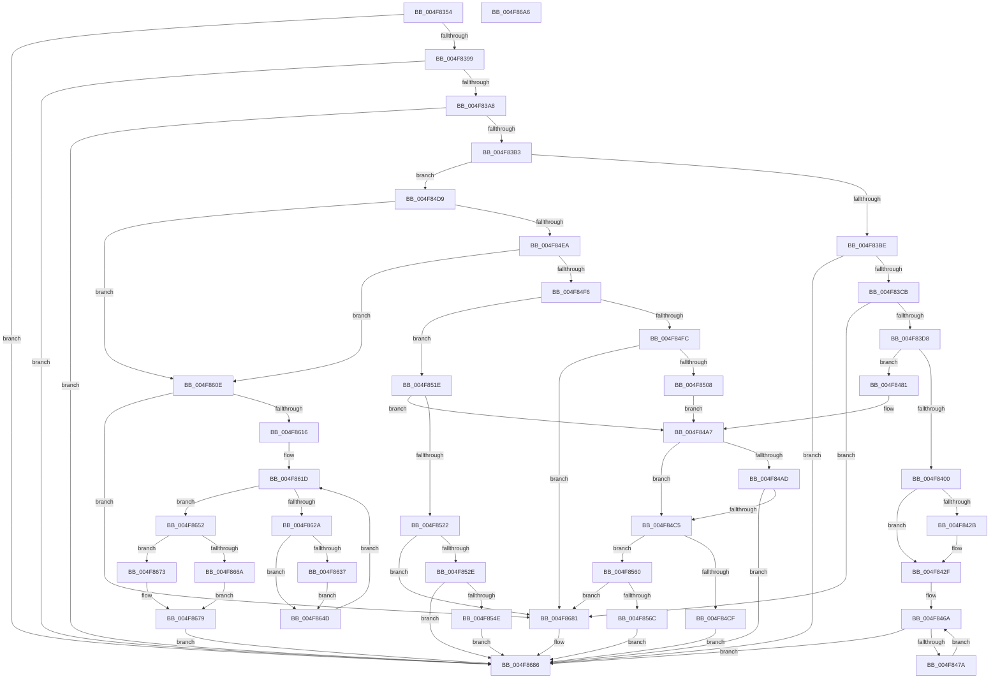

# FsRtlpOplockBreakToNone

- RVA: `0x004F8354`–`0x004F86A7` (길이 `851` bytes)
- VA: `0x00000001404F8354`
- 실행 섹션: `.text`
- PDB 이름 있음: `예`; PDB Function 태그: `아니요`
- unwind 정보 RVA: `0x000BF750`
- 디코드: `204`개 명령, `851/851` bytes 표시
- 미해석 바이트: `0` (있으면 어셈블리에 `.byte`로 보존)

> 이 문서는 커널 이미지의 기계어와 PDB 기호를 분석해 생성했습니다. 4번과 5번은 함수 원형과 자료형을 바이너리 사용 방식에서 추정한 C 해석이며 원본 소스 복구 결과는 아닙니다.

## 1. Dependencies

- 직접 호출 지점: **15**; 고유 호출 대상: **12**
- 직접 호출자로 확인된 함수: **3**
- RIP 상대 이미지 참조: **0**

### Outgoing calls
- `0x004F83DB` → [KeAcquireQueuedSpinLock](../27/KeAcquireQueuedSpinLock_function_00273D80.md) (function, `0x00273D80`)
- `0x004F83F1` → [KeReleaseQueuedSpinLock](../27/KeReleaseQueuedSpinLock_function_00272540.md) (function, `0x00272540`)
- `0x004F8410` → [FsRtlpModifyThreadPriorities](../48/FsRtlpModifyThreadPriorities_function_0048B098.md) (function, `0x0048B098`)
- `0x004F841A` → [FsRtlpClearOwner](../26/FsRtlpClearOwner_function_00265BE8.md) (function, `0x00265BE8`)
- `0x004F843E` → [IofCompleteRequest](../29/IofCompleteRequest_function_0029B5C0.md) (function, `0x0029B5C0`)
- `0x004F844F` → [ObfDereferenceObjectWithTag](../2F/ObfDereferenceObjectWithTag_function_002F78E0.md) (function, `0x002F78E0`)
- `0x004F847A` → [FsRtlpRemoveAndCompleteWaitingIrp](../42/FsRtlpRemoveAndCompleteWaitingIrp_function_00425FC0.md) (function, `0x00425FC0`)
- `0x004F8497` → [IofCompleteRequest](../29/IofCompleteRequest_function_0029B5C0.md) (function, `0x0029B5C0`)
- `0x004F84B8` → [FsRtlpOplockKeysEqual](../3F/FsRtlpOplockKeysEqual_function_003F26B0.md) (function, `0x003F26B0`)
- `0x004F8553` → [FsRtlpClearOwner](../26/FsRtlpClearOwner_function_00265BE8.md) (function, `0x00265BE8`)
- `0x004F857A` → [FsRtlpOplockTryStartBreakAckTimeout](../../page/71/FsRtlpOplockTryStartBreakAckTimeout_function_007158B4.md) (function, `0x007158B4`)
- `0x004F8587` → [FsRtlpModifyThreadPriorities](../48/FsRtlpModifyThreadPriorities_function_0048B098.md) (function, `0x0048B098`)
- `0x004F8591` → [FsRtlpOplockSendModernAppTermination](../49/FsRtlpOplockSendModernAppTermination_function_0049F22C.md) (function, `0x0049F22C`)
- `0x004F8605` → [FsRtlpWaitOnIrp](../4E/FsRtlpWaitOnIrp_function_004E7998.md) (function, `0x004E7998`)
- `0x004F8646` → [FsRtlpRemoveAndCompleteReadOnlyIrp](../4B/FsRtlpRemoveAndCompleteReadOnlyIrp_function_004B495C.md) (function, `0x004B495C`)

### Direct callers
- [FsRtlCheckOplockEx2](../3F/FsRtlCheckOplockEx2_function_003F2BC0.md) at `0x003F34C4`
- [FsRtlOplockBreakToNoneEx](../58/FsRtlOplockBreakToNoneEx_function_00581F40.md) at `0x00582008`
- [FsRtlCheckUpperOplock](../../page/71/FsRtlCheckUpperOplock_function_007145F0.md) at `0x00714866`

### Static image references
- 디코드된 RIP-relative 메모리 참조가 없습니다.

## 2. Other-region calls and transfers

- 다른 실행 섹션으로 향하는 call: **1**
  - `0x004F857A` → [FsRtlpOplockTryStartBreakAckTimeout](../../page/71/FsRtlpOplockTryStartBreakAckTimeout_function_007158B4.md) (`.text` → `PAGE`)
- 별도 외부 분기/꼬리 이동을 확인하지 못했습니다.

## 3. Assembly (complete function range)

```asm
004F8354  4C 8B DC                        mov r11, rsp
004F8357  49 89 5B 10                     mov qword ptr [r11 + 0x10], rbx
004F835B  49 89 73 18                     mov qword ptr [r11 + 0x18], rsi
004F835F  49 89 7B 20                     mov qword ptr [r11 + 0x20], rdi
004F8363  41 54                           push r12
004F8365  41 56                           push r14
004F8367  41 57                           push r15
004F8369  48 81 EC 80 00 00 00            sub rsp, 0x80
004F8370  41 8B F1                        mov esi, r9d
004F8373  4D 8B E0                        mov r12, r8
004F8376  4C 8B FA                        mov r15, rdx
004F8379  48 8B F9                        mov rdi, rcx
004F837C  0F 57 C0                        xorps xmm0, xmm0
004F837F  33 C0                           xor eax, eax
004F8381  0F 11 44 24 60                  movups xmmword ptr [rsp + 0x60], xmm0
004F8386  49 89 43 D8                     mov qword ptr [r11 - 0x28], rax
004F838A  33 DB                           xor ebx, ebx
004F838C  41 89 5B 28                     mov dword ptr [r11 + 0x28], ebx
004F8390  48 85 C9                        test rcx, rcx
004F8393  0F 84 ED 02 00 00               je 0x1404f8686
004F8399  8B 81 90 00 00 00               mov eax, dword ptr [rcx + 0x90]
004F839F  83 F8 01                        cmp eax, 1
004F83A2  0F 84 DE 02 00 00               je 0x1404f8686
004F83A8  A9 00 60 00 00                  test eax, 0x6000
004F83AD  0F 85 D3 02 00 00               jne 0x1404f8686
004F83B3  A9 90 0F F0 01                  test eax, 0x1f00f90
004F83B8  0F 85 1B 01 00 00               jne 0x1404f84d9
004F83BE  4C 8B 31                        mov r14, qword ptr [rcx]
004F83C1  0F BA E0 0C                     bt eax, 0xc
004F83C5  0F 82 BB 02 00 00               jb 0x1404f8686
004F83CB  41 F7 C1 00 00 01 10            test r9d, 0x10010000
004F83D2  0F 85 A9 02 00 00               jne 0x1404f8681
004F83D8  8D 4B 07                        lea ecx, [rbx + 7]
004F83DB  E8 A0 B9 D7 FF                  call 0x140273d80
004F83E0  41 88 46 45                     mov byte ptr [r14 + 0x45], al
004F83E4  8B C3                           mov eax, ebx
004F83E6  49 87 46 68                     xchg qword ptr [r14 + 0x68], rax
004F83EA  41 8A 56 45                     mov dl, byte ptr [r14 + 0x45]
004F83EE  8D 4B 07                        lea ecx, [rbx + 7]
004F83F1  E8 4A A1 D7 FF                  call 0x140272540
004F83F6  41 38 5E 44                     cmp byte ptr [r14 + 0x44], bl
004F83FA  0F 84 81 00 00 00               je 0x1404f8481
004F8400  49 C7 46 38 08 00 00 00         mov qword ptr [r14 + 0x38], 8
004F8408  45 33 C0                        xor r8d, r8d
004F840B  33 D2                           xor edx, edx
004F840D  48 8B CF                        mov rcx, rdi
004F8410  E8 83 2C F9 FF                  call 0x14048b098
004F8415  33 D2                           xor edx, edx
004F8417  48 8B CF                        mov rcx, rdi
004F841A  E8 C9 D7 D6 FF                  call 0x140265be8
004F841F  88 5F 20                        mov byte ptr [rdi + 0x20], bl
004F8422  48 8B 07                        mov rax, qword ptr [rdi]
004F8425  48 39 78 38                     cmp qword ptr [rax + 0x38], rdi
004F8429  75 04                           jne 0x1404f842f
004F842B  48 89 58 38                     mov qword ptr [rax + 0x38], rbx
004F842F  48 8B 07                        mov rax, qword ptr [rdi]
004F8432  C7 40 30 20 01 00 C0            mov dword ptr [rax + 0x30], 0xc0000120
004F8439  B2 01                           mov dl, 1
004F843B  48 8B 0F                        mov rcx, qword ptr [rdi]
004F843E  E8 7D 31 DA FF                  call 0x14029b5c0
004F8443  48 89 1F                        mov qword ptr [rdi], rbx
004F8446  48 8B 4F 08                     mov rcx, qword ptr [rdi + 8]
004F844A  BA 44 66 6C 74                  mov edx, 0x746c6644
004F844F  E8 8C F4 DF FF                  call 0x1402f78e0
004F8454  48 89 5F 08                     mov qword ptr [rdi + 8], rbx
004F8458  8B 87 90 00 00 00               mov eax, dword ptr [rdi + 0x90]
004F845E  83 E0 20                        and eax, 0x20
004F8461  83 C8 01                        or eax, 1
004F8464  89 87 90 00 00 00               mov dword ptr [rdi + 0x90], eax
004F846A  48 8D 47 58                     lea rax, [rdi + 0x58]
004F846E  48 8B 08                        mov rcx, qword ptr [rax]
004F8471  48 3B C8                        cmp rcx, rax
004F8474  0F 84 0C 02 00 00               je 0x1404f8686
004F847A  E8 41 DB F2 FF                  call 0x140425fc0
004F847F  EB E9                           jmp 0x1404f846a
004F8481  48 8B 07                        mov rax, qword ptr [rdi]
004F8484  48 C7 40 38 08 00 00 00         mov qword ptr [rax + 0x38], 8
004F848C  48 8B 07                        mov rax, qword ptr [rdi]
004F848F  89 58 30                        mov dword ptr [rax + 0x30], ebx
004F8492  B2 01                           mov dl, 1
004F8494  48 8B 0F                        mov rcx, qword ptr [rdi]
004F8497  E8 24 31 DA FF                  call 0x14029b5c0
004F849C  48 89 1F                        mov qword ptr [rdi], rbx
004F849F  0F BA AF 90 00 00 00 09         bts dword ptr [rdi + 0x90], 9
004F84A7  40 F6 C6 08                     test sil, 8
004F84AB  75 18                           jne 0x1404f84c5
004F84AD  48 8B 57 08                     mov rdx, qword ptr [rdi + 8]
004F84B1  49 8B 4F 30                     mov rcx, qword ptr [r15 + 0x30]
004F84B5  45 33 C0                        xor r8d, r8d
004F84B8  E8 F3 A1 EF FF                  call 0x1403f26b0
004F84BD  84 C0                           test al, al
004F84BF  0F 85 C1 01 00 00               jne 0x1404f8686
004F84C5  40 F6 C6 01                     test sil, 1
004F84C9  0F 84 91 00 00 00               je 0x1404f8560
004F84CF  BB 08 01 00 00                  mov ebx, 0x108
004F84D4  E9 AD 01 00 00                  jmp 0x1404f8686
004F84D9  8B C8                           mov ecx, eax
004F84DB  81 E1 DF FF F0 01               and ecx, 0x1f0ffdf
004F84E1  83 F9 10                        cmp ecx, 0x10
004F84E4  0F 84 24 01 00 00               je 0x1404f860e
004F84EA  81 F9 10 10 00 00               cmp ecx, 0x1010
004F84F0  0F 84 18 01 00 00               je 0x1404f860e
004F84F6  0F BA E0 08                     bt eax, 8
004F84FA  73 22                           jae 0x1404f851e
004F84FC  F7 C6 00 00 01 10               test esi, 0x10010000
004F8502  0F 85 79 01 00 00               jne 0x1404f8681
004F8508  0F BA F0 08                     btr eax, 8
004F850C  89 87 90 00 00 00               mov dword ptr [rdi + 0x90], eax
004F8512  0F BA E8 0A                     bts eax, 0xa
004F8516  89 87 90 00 00 00               mov dword ptr [rdi + 0x90], eax
004F851C  EB 89                           jmp 0x1404f84a7
004F851E  84 C0                           test al, al
004F8520  79 85                           jns 0x1404f84a7
004F8522  F7 C6 00 00 01 10               test esi, 0x10010000
004F8528  0F 85 53 01 00 00               jne 0x1404f8681
004F852E  8B 87 90 00 00 00               mov eax, dword ptr [rdi + 0x90]
004F8534  83 E0 20                        and eax, 0x20
004F8537  83 C8 01                        or eax, 1
004F853A  89 87 90 00 00 00               mov dword ptr [rdi + 0x90], eax
004F8540  48 89 5F 08                     mov qword ptr [rdi + 8], rbx
004F8544  48 39 5F 18                     cmp qword ptr [rdi + 0x18], rbx
004F8548  0F 84 38 01 00 00               je 0x1404f8686
004F854E  33 D2                           xor edx, edx
004F8550  48 8B CF                        mov rcx, rdi
004F8553  E8 90 D6 D6 FF                  call 0x140265be8
004F8558  88 5F 20                        mov byte ptr [rdi + 0x20], bl
004F855B  E9 26 01 00 00                  jmp 0x1404f8686
004F8560  F7 C6 00 00 01 10               test esi, 0x10010000
004F8566  0F 85 15 01 00 00               jne 0x1404f8681
004F856C  48 8D 8F A8 00 00 00            lea rcx, [rdi + 0xa8]
004F8573  48 8B 97 B8 00 00 00            mov rdx, qword ptr [rdi + 0xb8]
004F857A  E8 35 D3 21 00                  call 0x1407158b4
004F857F  41 B0 01                        mov r8b, 1
004F8582  33 D2                           xor edx, edx
004F8584  48 8B CF                        mov rcx, rdi
004F8587  E8 0C 2B F9 FF                  call 0x14048b098
004F858C  33 D2                           xor edx, edx
004F858E  48 8B CF                        mov rcx, rdi
004F8591  E8 96 6C FA FF                  call 0x14049f22c
004F8596  48 8B 84 24 F8 00 00 00         mov rax, qword ptr [rsp + 0xf8]
004F859E  88 18                           mov byte ptr [rax], bl
004F85A0  48 8B 84 24 00 01 00 00         mov rax, qword ptr [rsp + 0x100]
004F85A8  48 89 44 24 50                  mov qword ptr [rsp + 0x50], rax
004F85AD  48 8B 84 24 F0 00 00 00         mov rax, qword ptr [rsp + 0xf0]
004F85B5  48 89 44 24 48                  mov qword ptr [rsp + 0x48], rax
004F85BA  48 8B 84 24 E8 00 00 00         mov rax, qword ptr [rsp + 0xe8]
004F85C2  48 89 44 24 40                  mov qword ptr [rsp + 0x40], rax
004F85C7  48 8B 84 24 E0 00 00 00         mov rax, qword ptr [rsp + 0xe0]
004F85CF  48 89 44 24 38                  mov qword ptr [rsp + 0x38], rax
004F85D4  88 5C 24 30                     mov byte ptr [rsp + 0x30], bl
004F85D8  48 8D 44 24 60                  lea rax, [rsp + 0x60]
004F85DD  48 89 44 24 28                  mov qword ptr [rsp + 0x28], rax
004F85E2  48 8B 84 24 D8 00 00 00         mov rax, qword ptr [rsp + 0xd8]
004F85EA  48 89 44 24 20                  mov qword ptr [rsp + 0x20], rax
004F85EF  4C 8B 8C 24 D0 00 00 00         mov r9, qword ptr [rsp + 0xd0]
004F85F7  4C 8B 84 24 C8 00 00 00         mov r8, qword ptr [rsp + 0xc8]
004F85FF  49 8B D4                        mov rdx, r12
004F8602  48 8B CF                        mov rcx, rdi
004F8605  E8 8E F3 FE FF                  call 0x1404e7998
004F860A  8B D8                           mov ebx, eax
004F860C  EB 78                           jmp 0x1404f8686
004F860E  F7 C6 00 00 01 10               test esi, 0x10010000
004F8614  75 6B                           jne 0x1404f8681
004F8616  4C 8D 77 28                     lea r14, [rdi + 0x28]
004F861A  49 8B 36                        mov rsi, qword ptr [r14]
004F861D  48 89 B4 24 A0 00 00 00         mov qword ptr [rsp + 0xa0], rsi
004F8625  49 3B F6                        cmp rsi, r14
004F8628  74 28                           je 0x1404f8652
004F862A  48 8B 46 10                     mov rax, qword ptr [rsi + 0x10]
004F862E  81 78 18 40 02 09 00            cmp dword ptr [rax + 0x18], 0x90240
004F8635  74 16                           je 0x1404f864d
004F8637  48 8B 76 08                     mov rsi, qword ptr [rsi + 8]
004F863B  4C 8B CF                        mov r9, rdi
004F863E  45 33 C0                        xor r8d, r8d
004F8641  33 D2                           xor edx, edx
004F8643  48 8B 0E                        mov rcx, qword ptr [rsi]
004F8646  E8 11 C3 FB FF                  call 0x1404b495c
004F864B  EB 00                           jmp 0x1404f864d
004F864D  48 8B 36                        mov rsi, qword ptr [rsi]
004F8650  EB CB                           jmp 0x1404f861d
004F8652  8B 87 90 00 00 00               mov eax, dword ptr [rdi + 0x90]
004F8658  25 DF FF F0 01                  and eax, 0x1f0ffdf
004F865D  3D 10 10 00 00                  cmp eax, 0x1010
004F8662  8B 87 90 00 00 00               mov eax, dword ptr [rdi + 0x90]
004F8668  75 09                           jne 0x1404f8673
004F866A  83 E0 20                        and eax, 0x20
004F866D  0F BA E8 0C                     bts eax, 0xc
004F8671  EB 06                           jmp 0x1404f8679
004F8673  83 E0 20                        and eax, 0x20
004F8676  83 C8 01                        or eax, 1
004F8679  89 87 90 00 00 00               mov dword ptr [rdi + 0x90], eax
004F867F  EB 05                           jmp 0x1404f8686
004F8681  BB 09 09 00 C0                  mov ebx, 0xc0000909
004F8686  8B C3                           mov eax, ebx
004F8688  4C 8D 9C 24 80 00 00 00         lea r11, [rsp + 0x80]
004F8690  49 8B 5B 28                     mov rbx, qword ptr [r11 + 0x28]
004F8694  49 8B 73 30                     mov rsi, qword ptr [r11 + 0x30]
004F8698  49 8B 7B 38                     mov rdi, qword ptr [r11 + 0x38]
004F869C  49 8B E3                        mov rsp, r11
004F869F  41 5F                           pop r15
004F86A1  41 5E                           pop r14
004F86A3  41 5C                           pop r12
004F86A5  C3                              ret
004F86A6  CC                              int3
```

## 4. C-style interpretation (structured pseudocode)

```c
__int64 __fastcall FsRtlpOplockBreakToNone(__int64 a1, __int64 a2, __int64 a3, int a4, __int64 a5, __int64 a6, __int64 a7, __int64 a8, __int64 a9, __int64 a10, __int64 a11, __int64 a12, __int64 a13)
{
    __int64 result;
    __int64 v_rbx;
    __int64 v_rsp;
    unsigned __int64 v_stack_m18;
    unsigned __int64 v_stack_m38;
    unsigned __int64 v_stack_m48;
    unsigned __int64 v_stack_m50;
    unsigned __int64 v_stack_m58;
    unsigned __int64 v_stack_m60;
    unsigned __int8 v_stack_m68;
    unsigned __int64 v_stack_m70;
    unsigned __int64 v_stack_m78;
    unsigned __int64 v_stack_p8;

    *(unsigned __int64 *)(v_rsp + 16) = v_rbx;
    *(unsigned __int64 *)(v_rsp + 24) = v_rsi;
    *(unsigned __int64 *)(v_rsp + 32) = v_rdi;
    v_rsp = (v_rsp) - (128);
    result = 0;
    v_stack_m38 = v_xmm0;
    *(unsigned __int64 *)(v_rsp - 40) = 0;
    v_rbx = 0;
    *(unsigned int *)(v_rsp + 40) = 0;
    if (a1 == 0) goto loc_004F8686;
    if (((unsigned int)((unsigned int)(*(unsigned int *)(a1 + 144)))) == 1) goto loc_004F8686;
    if ((((unsigned int)((unsigned int)(*(unsigned int *)(a1 + 144)))) & (0x6000ULL)) != 0) goto loc_004F8686;
    if ((((unsigned int)((unsigned int)(*(unsigned int *)(a1 + 144)))) & (0x1F00F90ULL)) != 0) goto loc_004F84D9;
    if (condition_is_below) goto loc_004F8686;
    if (((a4) & (0x10010000ULL)) != 0) goto loc_004F8681;
    result = KeAcquireQueuedSpinLock(v_rbx + 7, a2, a3, a4);
    *(unsigned __int8 *)(*(unsigned __int64 *)(a1) + 69) = (unsigned __int8)(result);
    result = KeReleaseQueuedSpinLock(v_rbx + 7, *(unsigned __int8 *)(*(unsigned __int64 *)(a1) + 69), a3, a4);
    if ((*(unsigned __int8 *)(*(unsigned __int64 *)(a1) + 68)) == 0) goto loc_004F8481;
    *(unsigned __int64 *)(*(unsigned __int64 *)(a1) + 56) = 8;
    a3 = 0;
    a2 = 0;
    result = FsRtlpModifyThreadPriorities(a1, a2, a3, a4);
    a2 = 0;
    result = FsRtlpClearOwner(a1, a2, a3, a4);
    *(unsigned __int8 *)(a1 + 32) = 0;
    if ((*(unsigned __int64 *)(*(unsigned __int64 *)(a1) + 56)) == a1) {
        *(unsigned __int64 *)(*(unsigned __int64 *)(a1) + 56) = 0;
    }
    *(unsigned int *)(*(unsigned __int64 *)(a1) + 48) = 0xC0000120ULL;
    result = IofCompleteRequest(*(unsigned __int64 *)(a1), 1, a3, a4);
    *(unsigned __int64 *)(a1) = 0;
    result = ObfDereferenceObjectWithTag(*(unsigned __int64 *)(a1 + 8), (unsigned int)(0x746C6644ULL), a3, a4);
    *(unsigned __int64 *)(a1 + 8) = 0;
    result = (unsigned int)(((unsigned int)(*(unsigned int *)(a1 + 144))) & (32));
    result = (unsigned int)((result) | (1));
    *(unsigned int *)(a1 + 144) = (unsigned int)(result);
loc_004F846A:
    if ((*(unsigned __int64 *)(a1 + 88)) == (a1 + 88)) goto loc_004F8686;
    result = FsRtlpRemoveAndCompleteWaitingIrp(*(unsigned __int64 *)(a1 + 88), (unsigned int)(0x746C6644ULL), a3, a4);
    goto loc_004F846A;
loc_004F8481:
    *(unsigned __int64 *)(*(unsigned __int64 *)(a1) + 56) = 8;
    *(unsigned int *)(*(unsigned __int64 *)(a1) + 48) = 0;
    result = IofCompleteRequest(*(unsigned __int64 *)(a1), 1, a3, a4);
    *(unsigned __int64 *)(a1) = 0;
loc_004F84A7:
    if ((((unsigned __int8)((unsigned int)(a4))) & (8)) != 0) goto loc_004F84C5;
    a3 = 0;
    result = FsRtlpOplockKeysEqual(*(unsigned __int64 *)(a2 + 48), *(unsigned __int64 *)(a1 + 8), a3, a4);
    if ((unsigned __int8)(result) != 0) goto loc_004F8686;
loc_004F84C5:
    if ((((unsigned __int8)((unsigned int)(a4))) & (1)) == 0) goto loc_004F8560;
    goto loc_004F8686;
loc_004F84D9:
    a1 = (unsigned int)(((unsigned int)((unsigned int)(result))) & (0x1F0FFDFULL));
    if (((unsigned int)(a1)) == 16) goto loc_004F860E;
    if (((unsigned int)(a1)) == 0x1010ULL) goto loc_004F860E;
    if (((unsigned int)(a1)) >= 0x1010ULL) goto loc_004F851E;
    if ((((unsigned int)((unsigned int)(a4))) & (0x10010000ULL)) != 0) goto loc_004F8681;
    *(unsigned int *)(a1 + 144) = (unsigned int)(result);
    *(unsigned int *)(a1 + 144) = (unsigned int)(result);
    goto loc_004F84A7;
loc_004F851E:
    if (!sign_flag) goto loc_004F84A7;
    if ((((unsigned int)((unsigned int)(a4))) & (0x10010000ULL)) != 0) goto loc_004F8681;
    result = (unsigned int)(((unsigned int)(*(unsigned int *)(a1 + 144))) & (32));
    result = (unsigned int)((result) | (1));
    *(unsigned int *)(a1 + 144) = (unsigned int)(result);
    *(unsigned __int64 *)(a1 + 8) = 264;
    if ((*(unsigned __int64 *)(a1 + 24)) == 264) goto loc_004F8686;
    a2 = 0;
    result = FsRtlpClearOwner(a1, a2, a3, a4);
    *(unsigned __int8 *)(a1 + 32) = 264;
    goto loc_004F8686;
loc_004F8560:
    if ((((unsigned int)((unsigned int)(a4))) & (0x10010000ULL)) != 0) goto loc_004F8681;
    result = FsRtlpOplockTryStartBreakAckTimeout(a1 + 168, *(unsigned __int64 *)(a1 + 184), a3, a4);
    a2 = 0;
    result = FsRtlpModifyThreadPriorities(a1, a2, 1, a4);
    a2 = 0;
    result = FsRtlpOplockSendModernAppTermination(a1, a2, 1, a4);
    *(unsigned __int8 *)(a12) = 264;
    v_stack_m48 = a13;
    v_stack_m50 = a11;
    v_stack_m58 = a10;
    v_stack_m60 = a9;
    v_stack_m68 = 264;
    v_stack_m70 = v_stack_m38;
    v_stack_m78 = a8;
    result = FsRtlpWaitOnIrp(a1, 0, a6, a7);
    goto loc_004F8686;
loc_004F860E:
    if ((((unsigned int)((unsigned int)(a4))) & (0x10010000ULL)) != 0) goto loc_004F8681;
loc_004F861D:
    v_stack_p8 = *(unsigned __int64 *)(a1 + 40);
    if ((*(unsigned __int64 *)(a1 + 40)) == (a1 + 40)) goto loc_004F8652;
    if ((*(unsigned int *)(*(unsigned __int64 *)(*(unsigned __int64 *)(a1 + 40) + 16) + 24)) == 0x90240ULL) goto loc_004F864D;
    a3 = 0;
    a2 = 0;
    result = FsRtlpRemoveAndCompleteReadOnlyIrp(*(unsigned __int64 *)(*(unsigned __int64 *)(*(unsigned __int64 *)(a1 + 40) + 8)), a2, a3, a1);
    goto loc_004F864D;
loc_004F864D:
    goto loc_004F861D;
loc_004F8652:
    result = (unsigned int)(((unsigned int)(*(unsigned int *)(a1 + 144))) & (0x1F0FFDFULL));
    if (((unsigned int)(result)) != 0x1010ULL) goto loc_004F8673;
    result = (unsigned int)(((unsigned int)(*(unsigned int *)(a1 + 144))) & (32));
    goto loc_004F8679;
loc_004F8673:
    result = (unsigned int)((result) & (32));
    result = (unsigned int)((result) | (1));
loc_004F8679:
    *(unsigned int *)(a1 + 144) = (unsigned int)(result);
    goto loc_004F8686;
loc_004F8681:
loc_004F8686:
    return (unsigned int)((unsigned int)((unsigned int)(0xC0000909ULL)));
}
```

## 5. (Beta) C Style

```c
int64_t FsRtlpOplockBreakToNone(void *Arg1, void *Arg2, int64_t Arg3, int32_t Arg4, uint64_t Arg5, int64_t Arg6, int64_t Arg7, int64_t Arg8, int64_t Arg9, int64_t Arg10, int64_t Arg11, void *Arg12, int64_t Arg13)
{
    uint8_t *arg1 = (uint8_t *)Arg1;
    uint8_t *arg2 = (uint8_t *)Arg2;
    uint8_t *arg12 = (uint8_t *)Arg12;

    int64_t result;
    int64_t local_rbx;
    int64_t local_rsp;
    uint64_t v_stack_m18;
    uint64_t v_stack_m38;
    uint64_t v_stack_m48;
    uint64_t v_stack_m50;
    uint64_t v_stack_m58;
    uint64_t v_stack_m60;
    uint8_t v_stack_m68;
    uint64_t v_stack_m70;
    uint64_t v_stack_m78;
    uint64_t v_stack_p8;

    *(uint64_t *)(local_rsp + 0x10) = local_rbx;
    *(uint64_t *)(local_rsp + 0x18) = local_rsi;
    *(uint64_t *)(local_rsp + 0x20) = local_rdi;
    local_rsp = (local_rsp) - (128);
    result = 0;
    v_stack_m38 = v_xmm0;
    *(uint64_t *)(local_rsp - 0x28) = 0;
    local_rbx = 0;
    *(uint32_t *)(local_rsp + 0x28) = 0;
    if (Arg1 == NULL) goto loc_004F8686;
    if (((uint32_t)((uint32_t)(*(uint32_t *)(arg1 + 0x90)))) == 1) goto loc_004F8686;
    if ((((uint32_t)((uint32_t)(*(uint32_t *)(arg1 + 0x90)))) & (0x6000ULL)) != 0) goto loc_004F8686;
    if ((((uint32_t)((uint32_t)(*(uint32_t *)(arg1 + 0x90)))) & (0x1F00F90ULL)) != 0) goto loc_004F84D9;
    if (condition_is_below) goto loc_004F8686;
    if (((Arg4) & (0x10010000ULL)) != 0) goto loc_004F8681;
    result = KeAcquireQueuedSpinLock(local_rbx + 7, Arg2, Arg3, Arg4);
    *(uint8_t *)(*(uint64_t *)(arg1) + 0x45) = (uint8_t)(result);
    result = KeReleaseQueuedSpinLock(local_rbx + 7, *(uint8_t *)(*(uint64_t *)(arg1) + 0x45), Arg3, Arg4);
    if ((*(uint8_t *)(*(uint64_t *)(arg1) + 0x44)) == 0) goto loc_004F8481;
    *(uint64_t *)(*(uint64_t *)(arg1) + 0x38) = 8;
    Arg3 = 0;
    Arg2 = 0;
    result = FsRtlpModifyThreadPriorities(Arg1, Arg2, Arg3, Arg4);
    Arg2 = 0;
    result = FsRtlpClearOwner(Arg1, Arg2, Arg3, Arg4);
    *(uint8_t *)(arg1 + 0x20) = 0;
    if ((*(uint64_t *)(*(uint64_t *)(arg1) + 0x38)) == Arg1) {
        *(uint64_t *)(*(uint64_t *)(arg1) + 0x38) = 0;
    }
    *(uint32_t *)(*(uint64_t *)(arg1) + 0x30) = 0xC0000120ULL;
    result = IofCompleteRequest(*(uint64_t *)(arg1), 1, Arg3, Arg4);
    *(uint64_t *)(arg1) = 0;
    result = ObfDereferenceObjectWithTag(*(uint64_t *)(arg1 + 0x8), (uint32_t)(0x746C6644ULL), Arg3, Arg4);
    *(uint64_t *)(arg1 + 0x8) = 0;
    result = (uint32_t)(((uint32_t)(*(uint32_t *)(arg1 + 0x90))) & (32));
    result = (uint32_t)((result) | (1));
    *(uint32_t *)(arg1 + 0x90) = (uint32_t)(result);
loc_004F846A:
    if ((*(uint64_t *)(arg1 + 0x58)) == (Arg1 + 88)) goto loc_004F8686;
    result = FsRtlpRemoveAndCompleteWaitingIrp(*(uint64_t *)(arg1 + 0x58), (uint32_t)(0x746C6644ULL), Arg3, Arg4);
    goto loc_004F846A;
loc_004F8481:
    *(uint64_t *)(*(uint64_t *)(arg1) + 0x38) = 8;
    *(uint32_t *)(*(uint64_t *)(arg1) + 0x30) = 0;
    result = IofCompleteRequest(*(uint64_t *)(arg1), 1, Arg3, Arg4);
    *(uint64_t *)(arg1) = 0;
loc_004F84A7:
    if ((((uint8_t)((uint32_t)(Arg4))) & (8)) != 0) goto loc_004F84C5;
    Arg3 = 0;
    result = FsRtlpOplockKeysEqual(*(uint64_t *)(arg2 + 0x30), *(uint64_t *)(arg1 + 0x8), Arg3, Arg4);
    if ((uint8_t)(result) != 0) goto loc_004F8686;
loc_004F84C5:
    if ((((uint8_t)((uint32_t)(Arg4))) & (1)) == 0) goto loc_004F8560;
    goto loc_004F8686;
loc_004F84D9:
    Arg1 = (uint32_t)(((uint32_t)((uint32_t)(result))) & (0x1F0FFDFULL));
    if (((uint32_t)(Arg1)) == 16) goto loc_004F860E;
    if (((uint32_t)(Arg1)) == 0x1010ULL) goto loc_004F860E;
    if (((uint32_t)(Arg1)) >= 0x1010ULL) goto loc_004F851E;
    if ((((uint32_t)((uint32_t)(Arg4))) & (0x10010000ULL)) != 0) goto loc_004F8681;
    *(uint32_t *)(arg1 + 0x90) = (uint32_t)(result);
    *(uint32_t *)(arg1 + 0x90) = (uint32_t)(result);
    goto loc_004F84A7;
loc_004F851E:
    if (!sign_flag) goto loc_004F84A7;
    if ((((uint32_t)((uint32_t)(Arg4))) & (0x10010000ULL)) != 0) goto loc_004F8681;
    result = (uint32_t)(((uint32_t)(*(uint32_t *)(arg1 + 0x90))) & (32));
    result = (uint32_t)((result) | (1));
    *(uint32_t *)(arg1 + 0x90) = (uint32_t)(result);
    *(uint64_t *)(arg1 + 0x8) = 264;
    if ((*(uint64_t *)(arg1 + 0x18)) == 264) goto loc_004F8686;
    Arg2 = 0;
    result = FsRtlpClearOwner(Arg1, Arg2, Arg3, Arg4);
    *(uint8_t *)(arg1 + 0x20) = 264;
    goto loc_004F8686;
loc_004F8560:
    if ((((uint32_t)((uint32_t)(Arg4))) & (0x10010000ULL)) != 0) goto loc_004F8681;
    result = FsRtlpOplockTryStartBreakAckTimeout(Arg1 + 168, *(uint64_t *)(arg1 + 0xB8), Arg3, Arg4);
    Arg2 = 0;
    result = FsRtlpModifyThreadPriorities(Arg1, Arg2, 1, Arg4);
    Arg2 = 0;
    result = FsRtlpOplockSendModernAppTermination(Arg1, Arg2, 1, Arg4);
    *(uint8_t *)(arg12) = 264;
    v_stack_m48 = Arg13;
    v_stack_m50 = Arg11;
    v_stack_m58 = Arg10;
    v_stack_m60 = Arg9;
    v_stack_m68 = 264;
    v_stack_m70 = v_stack_m38;
    v_stack_m78 = Arg8;
    result = FsRtlpWaitOnIrp(Arg1, 0, Arg6, Arg7);
    goto loc_004F8686;
loc_004F860E:
    if ((((uint32_t)((uint32_t)(Arg4))) & (0x10010000ULL)) != 0) goto loc_004F8681;
loc_004F861D:
    v_stack_p8 = *(uint64_t *)(arg1 + 0x28);
    if ((*(uint64_t *)(arg1 + 0x28)) == (Arg1 + 40)) goto loc_004F8652;
    if ((*(uint32_t *)(*(uint64_t *)(*(uint64_t *)(arg1 + 0x28) + 0x10) + 0x18)) == 0x90240ULL) goto loc_004F864D;
    Arg3 = 0;
    Arg2 = 0;
    result = FsRtlpRemoveAndCompleteReadOnlyIrp(*(uint64_t *)(*(uint64_t *)(*(uint64_t *)(arg1 + 0x28) + 0x8)), Arg2, Arg3, Arg1);
    goto loc_004F864D;
loc_004F864D:
    goto loc_004F861D;
loc_004F8652:
    result = (uint32_t)(((uint32_t)(*(uint32_t *)(arg1 + 0x90))) & (0x1F0FFDFULL));
    if (((uint32_t)(result)) != 0x1010ULL) goto loc_004F8673;
    result = (uint32_t)(((uint32_t)(*(uint32_t *)(arg1 + 0x90))) & (32));
    goto loc_004F8679;
loc_004F8673:
    result = (uint32_t)((result) & (32));
    result = (uint32_t)((result) | (1));
loc_004F8679:
    *(uint32_t *)(arg1 + 0x90) = (uint32_t)(result);
    goto loc_004F8686;
loc_004F8681:
loc_004F8686:
    return (uint32_t)((uint32_t)((uint32_t)(0xC0000909ULL)));
}
```

### 관측된 메모리 오프셋

구조체 형식이 확인되지 않은 접근은 인자 기준의 오프셋으로만 기록했습니다.

| 기준 인자 | 오프셋 표현 | 폭 (bit) | 접근 |
|---|---:|---:|---|
| `Arg1` | `+ 0x0` | `64` | `R` |
| `Arg1` | `+ 0x0` | `64` | `W` |
| `Arg1` | `+ 0x8` | `64` | `R` |
| `Arg1` | `+ 0x8` | `64` | `W` |
| `Arg1` | `+ 0x18` | `64` | `R` |
| `Arg1` | `+ 0x20` | `8` | `W` |
| `Arg1` | `+ 0x28` | `64` | `R` |
| `Arg1` | `+ 0x58` | `64` | `R` |
| `Arg1` | `+ 0x90` | `32` | `R` |
| `Arg1` | `+ 0x90` | `32` | `R/W` |
| `Arg1` | `+ 0x90` | `32` | `W` |
| `Arg1` | `+ 0xA8` | `64` | `R` |
| `Arg1` | `+ 0xB8` | `64` | `R` |
| `Arg2` | `+ 0x30` | `64` | `R` |
| `Arg12` | `+ 0x0` | `8` | `W` |

## 6. Execution-region graph

[열기: 2D/3D 그래프와 함수 탐색 컨트롤 패널](../../../control-panel.html?section=text&rva=0x004F8354&view=graph)

- 2D 그래프는 위에서 아래로 흐르고, 3D 그래프는 빈 공간을 드래그해 회전합니다. Shift+드래그는 이동, 휠은 확대·축소, 함수 노드 선택은 대상 보고서 이동입니다.

### Static fallback


