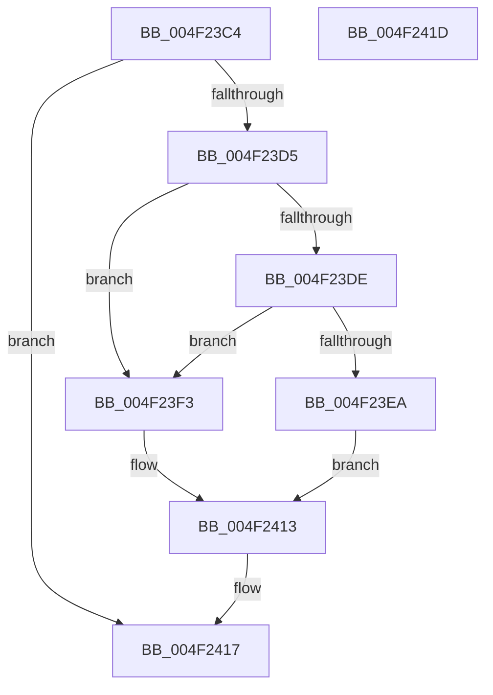

# FsRtlpSyncWithAckTimeout

- RVA: `0x004F23C4`–`0x004F241E` (길이 `90` bytes)
- VA: `0x00000001404F23C4`
- 실행 섹션: `.text`
- PDB 이름 있음: `예`; PDB Function 태그: `아니요`
- unwind 정보 RVA: `0x0005CF00`
- 디코드: `25`개 명령, `90/90` bytes 표시
- 미해석 바이트: `0` (있으면 어셈블리에 `.byte`로 보존)

> 이 문서는 커널 이미지의 기계어와 PDB 기호를 분석해 생성했습니다. 4번과 5번은 함수 원형과 자료형을 바이너리 사용 방식에서 추정한 C 해석이며 원본 소스 복구 결과는 아닙니다.

## 1. Dependencies

- 직접 호출 지점: **3**; 고유 호출 대상: **3**
- 직접 호출자로 확인된 함수: **8**
- RIP 상대 이미지 참조: **1**

### Outgoing calls
- `0x004F23DE` → [KeCancelTimer](../23/KeCancelTimer_function_002327E0.md) (function, `0x002327E0`)
- `0x004F23FF` → [ObfDereferenceObjectWithTag](../2F/ObfDereferenceObjectWithTag_function_002F78E0.md) (function, `0x002F78E0`)
- `0x004F240E` → [ExFreeToNPagedLookasideList](../38/ExFreeToNPagedLookasideList_function_0038D9D0.md) (function, `0x0038D9D0`)

### Direct callers
- [FsRtlCheckOplockEx2](../3F/FsRtlCheckOplockEx2_function_003F2BC0.md) at `0x003F2D82`
- [FsRtlpOplockCleanup](../42/FsRtlpOplockCleanup_function_00425030.md) at `0x0042535B`
- [FsRtlpOplockCleanup](../42/FsRtlpOplockCleanup_function_00425030.md) at `0x0042547C`
- [FsRtlpOplockCleanup](../42/FsRtlpOplockCleanup_function_00425030.md) at `0x0042555C`
- [FsRtlpOplockCleanup](../42/FsRtlpOplockCleanup_function_00425030.md) at `0x00425684`
- [FsRtlUninitializeOplock](../4E/FsRtlUninitializeOplock_function_004E42C0.md) at `0x004E4407`
- [FsRtlpFreeRHOpContext](FsRtlpFreeRHOpContext_function_004F2394.md) at `0x004F23A5`
- [FsRtlpCancelExclusiveIrp](FsRtlpCancelExclusiveIrp_function_004F96CC.md) at `0x004F979B`
- [FsRtlpAcknowledgeOplockBreak](../58/FsRtlpAcknowledgeOplockBreak_function_00582144.md) at `0x00582330`
- [FsRtlpGrantAnyOplockFromExclusive](../58/FsRtlpGrantAnyOplockFromExclusive_function_00582540.md) at `0x00582736`
- [FsRtlpGrantAnyOplockFromExclusive](../58/FsRtlpGrantAnyOplockFromExclusive_function_00582540.md) at `0x005827C6`
- [FsRtlpOpBatchBreakClosePending](../../page/71/FsRtlpOpBatchBreakClosePending_function_00714CDC.md) at `0x00714DAF`

### Static image references
- `0x004F2407` → RVA `0x00E12280` (`.data`; read)

## 2. Other-region calls and transfers

- 다른 실행 섹션으로 향하는 call: **0**
- 별도 외부 분기/꼬리 이동을 확인하지 못했습니다.

## 3. Assembly (complete function range)

```asm
004F23C4  40 53                           push rbx
004F23C6  48 83 EC 20                     sub rsp, 0x20
004F23CA  48 8B D9                        mov rbx, rcx
004F23CD  48 8B 09                        mov rcx, qword ptr [rcx]
004F23D0  48 85 C9                        test rcx, rcx
004F23D3  74 42                           je 0x1404f2417
004F23D5  80 B9 B4 00 00 00 00            cmp byte ptr [rcx + 0xb4], 0
004F23DC  74 15                           je 0x1404f23f3
004F23DE  E8 FD 03 D4 FF                  call 0x1402327e0
004F23E3  48 8B 0B                        mov rcx, qword ptr [rbx]
004F23E6  84 C0                           test al, al
004F23E8  75 09                           jne 0x1404f23f3
004F23EA  C6 81 B5 00 00 00 01            mov byte ptr [rcx + 0xb5], 1
004F23F1  EB 20                           jmp 0x1404f2413
004F23F3  48 8B 89 A8 00 00 00            mov rcx, qword ptr [rcx + 0xa8]
004F23FA  BA 44 66 6C 74                  mov edx, 0x746c6644
004F23FF  E8 DC 54 E0 FF                  call 0x1402f78e0
004F2404  48 8B 13                        mov rdx, qword ptr [rbx]
004F2407  48 8D 0D 72 FE 91 00            lea rcx, [rip + 0x91fe72]
004F240E  E8 BD B5 E9 FF                  call 0x14038d9d0
004F2413  48 83 23 00                     and qword ptr [rbx], 0
004F2417  48 83 C4 20                     add rsp, 0x20
004F241B  5B                              pop rbx
004F241C  C3                              ret
004F241D  CC                              int3
```

## 4. C-style interpretation (structured pseudocode)

```c
__int64 __fastcall FsRtlpSyncWithAckTimeout(__int64 a1)
{
    __int64 result;
    __int64 v_rsp;

    v_rsp = (v_rsp) - (32);
    if (*(unsigned __int64 *)(a1) == 0) goto loc_004F2417;
    if ((*(unsigned __int8 *)(*(unsigned __int64 *)(a1) + 180)) == 0) goto loc_004F23F3;
    result = KeCancelTimer(*(unsigned __int64 *)(a1), a2, a3, a4);
    if ((unsigned __int8)(result) != 0) goto loc_004F23F3;
    *(unsigned __int8 *)(*(unsigned __int64 *)(a1) + 181) = 1;
    goto loc_004F2413;
loc_004F23F3:
    result = ObfDereferenceObjectWithTag(*(unsigned __int64 *)(*(unsigned __int64 *)(a1) + 168), (unsigned int)(0x746C6644ULL), a3, a4);
    result = ExFreeToNPagedLookasideList(v_rip + 9567858, *(unsigned __int64 *)(a1), a3, a4);
loc_004F2413:
loc_004F2417:
    v_rsp = (v_rsp) + (32);
    return result;
}
```

## 5. (Beta) C Style

```c
int64_t FsRtlpSyncWithAckTimeout(void *Arg1)
{
    uint8_t *arg1 = (uint8_t *)Arg1;

    int64_t result;
    int64_t local_rsp;

    local_rsp = (local_rsp) - (32);
    if (*(uint64_t *)(arg1) == 0) goto loc_004F2417;
    if ((*(uint8_t *)(*(uint64_t *)(arg1) + 0xB4)) == 0) goto loc_004F23F3;
    result = KeCancelTimer(*(uint64_t *)(arg1), a2, a3, a4);
    if ((uint8_t)(result) != 0) goto loc_004F23F3;
    *(uint8_t *)(*(uint64_t *)(arg1) + 0xB5) = 1;
    goto loc_004F2413;
loc_004F23F3:
    result = ObfDereferenceObjectWithTag(*(uint64_t *)(*(uint64_t *)(arg1) + 0xA8), (uint32_t)(0x746C6644ULL), a3, a4);
    result = ExFreeToNPagedLookasideList(v_rip + 9567858, *(uint64_t *)(arg1), a3, a4);
loc_004F2413:
loc_004F2417:
    local_rsp = (local_rsp) + (32);
    return result;
}
```

### 관측된 메모리 오프셋

구조체 형식이 확인되지 않은 접근은 인자 기준의 오프셋으로만 기록했습니다.

| 기준 인자 | 오프셋 표현 | 폭 (bit) | 접근 |
|---|---:|---:|---|
| `Arg1` | `+ 0x0` | `64` | `R` |
| `Arg1` | `+ 0x0` | `64` | `R/W` |

## 6. Execution-region graph

[열기: 2D/3D 그래프와 함수 탐색 컨트롤 패널](../../../control-panel.html?section=text&rva=0x004F23C4&view=graph)

- 2D 그래프는 위에서 아래로 흐르고, 3D 그래프는 빈 공간을 드래그해 회전합니다. Shift+드래그는 이동, 휠은 확대·축소, 함수 노드 선택은 대상 보고서 이동입니다.

### Static fallback


