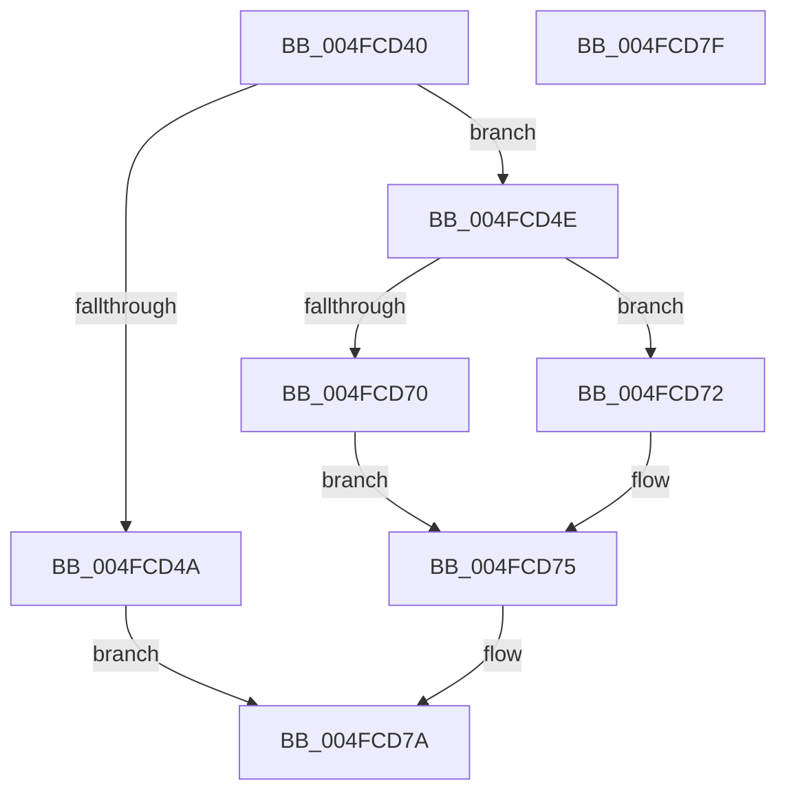

# HalMapIoSpace

- RVA: `0x004FCD40`–`0x004FCD80` (길이 `64` bytes)
- VA: `0x00000001404FCD40`
- 실행 섹션: `.text`
- PDB 이름 있음: `예`; PDB Function 태그: `아니요`
- unwind 정보 RVA: `0x0005D2F4`
- 디코드: `18`개 명령, `64/64` bytes 표시
- 미해석 바이트: `0` (있으면 어셈블리에 `.byte`로 보존)

> 이 문서는 커널 이미지의 기계어와 PDB 기호를 분석해 생성했습니다. 4번과 5번은 함수 원형과 자료형을 바이너리 사용 방식에서 추정한 C 해석이며 원본 소스 복구 결과는 아닙니다.

## 1. Dependencies

- 직접 호출 지점: **1**; 고유 호출 대상: **1**
- 직접 호출자로 확인된 함수: **15**
- RIP 상대 이미지 참조: **0**

### Outgoing calls
- `0x004FCD75` → [HalpMap](../3F/HalpMap_function_003F88F4.md) (function, `0x003F88F4`)

### Direct callers
- [HalpHvTimerInitialize](../56/HalpHvTimerInitialize_function_00560810.md) at `0x005608D5`
- [ExtEnvAllocatePhysicalMemory](../56/ExtEnvAllocatePhysicalMemory_function_00561124.md) at `0x005611E5`
- [HalpPmTimerInitialize](../56/HalpPmTimerInitialize_function_00561BE0.md) at `0x00561BFE`
- [HalpHpetDiscover](../56/HalpHpetDiscover_function_00561E98.md) at `0x00561F4A`
- [HalpHpetInitialize](../56/HalpHpetInitialize_function_00562310.md) at `0x0056233A`
- [HalpApicInitializeIoUnit](../56/HalpApicInitializeIoUnit_function_00569CE0.md) at `0x00569D24`
- [HalpApicInitializeLocalUnit](../56/HalpApicInitializeLocalUnit_function_00569EC0.md) at `0x00569F1F`
- [WdHwCreateHardwareRegister](../56/WdHwCreateHardwareRegister_function_0056DCB8.md) at `0x0056DDEA`
- [IvtInitializeIdentityMappings](../57/IvtInitializeIdentityMappings_function_005702A8.md) at `0x0057031E`
- [IvtInitializeIdentityMappings](../57/IvtInitializeIdentityMappings_function_005702A8.md) at `0x0057039E`
- [HalpIvtLegacyProcessDrhdEntry](../57/HalpIvtLegacyProcessDrhdEntry_function_00578C58.md) at `0x00578DB9`
- [HalpIvtProcessDrhdEntry](../57/HalpIvtProcessDrhdEntry_function_005794B4.md) at `0x0057962D`
- [IvtInitializeIommu](../../pagelk/B6/IvtInitializeIommu_function_00B61FE0.md) at `0x00B6216F`
- [IvtInitializeIommu](../../pagelk/B6/IvtInitializeIommu_function_00B61FE0.md) at `0x00B622A2`
- [IvtInitializeIommu](../../pagelk/B6/IvtInitializeIommu_function_00B61FE0.md) at `0x00B62303`
- [IvtInitializeIommu](../../pagelk/B6/IvtInitializeIommu_function_00B61FE0.md) at `0x00B624AF`
- [IvtInitializeIommu](../../pagelk/B6/IvtInitializeIommu_function_00B61FE0.md) at `0x00B62532`
- [IvtInitializeIommu](../../pagelk/B6/IvtInitializeIommu_function_00B61FE0.md) at `0x00B62663`
- [IvtInitializeIommu](../../pagelk/B6/IvtInitializeIommu_function_00B61FE0.md) at `0x00B62781`
- [HsaInitializeInterruptRemapping](../../pagelk/B6/HsaInitializeInterruptRemapping_function_00B62FA8.md) at `0x00B63046`
- [HsaInitializeIommu](../../pagelk/B6/HsaInitializeIommu_function_00B63140.md) at `0x00B63226`
- [HsaInitializeIommu](../../pagelk/B6/HsaInitializeIommu_function_00B63140.md) at `0x00B6326C`
- [HsaInitializeIommu](../../pagelk/B6/HsaInitializeIommu_function_00B63140.md) at `0x00B632FF`
- [HalpAcpiSetupPmRegister](../../init/C2/HalpAcpiSetupPmRegister_function_00C23CD8.md) at `0x00C23DE1`

### Static image references
- 디코드된 RIP-relative 메모리 참조가 없습니다.

## 2. Other-region calls and transfers

- 다른 실행 섹션으로 향하는 call: **0**
- 별도 외부 분기/꼬리 이동을 확인하지 못했습니다.

## 3. Assembly (complete function range)

```asm
004FCD40  48 83 EC 38                     sub rsp, 0x38
004FCD44  41 83 F8 01                     cmp r8d, 1
004FCD48  76 04                           jbe 0x1404fcd4e
004FCD4A  33 C0                           xor eax, eax
004FCD4C  EB 2C                           jmp 0x1404fcd7a
004FCD4E  48 83 64 24 28 00               and qword ptr [rsp + 0x28], 0
004FCD54  48 81 C2 FF 0F 00 00            add rdx, 0xfff
004FCD5B  48 C1 EA 0C                     shr rdx, 0xc
004FCD5F  45 33 C9                        xor r9d, r9d
004FCD62  C7 44 24 20 04 00 00 00         mov dword ptr [rsp + 0x20], 4
004FCD6A  41 83 F8 01                     cmp r8d, 1
004FCD6E  75 02                           jne 0x1404fcd72
004FCD70  EB 03                           jmp 0x1404fcd75
004FCD72  45 33 C0                        xor r8d, r8d
004FCD75  E8 7A BB EF FF                  call 0x1403f88f4
004FCD7A  48 83 C4 38                     add rsp, 0x38
004FCD7E  C3                              ret
004FCD7F  CC                              int3
```

## 4. C-style interpretation (structured pseudocode)

```c
__int64 __fastcall HalMapIoSpace(__int64 a1, __int64 a2, int a3, int a4)
{
    __int64 result;
    __int64 v_rsp;
    unsigned __int64 v_stack_m10;
    unsigned int v_stack_m18;

    v_rsp = (v_rsp) - (56);
    if (a3 <= 1) goto loc_004FCD4E;
    result = 0;
    goto loc_004FCD7A;
loc_004FCD4E:
    a2 = (a2) + (0xFFFULL);
    a2 = (a2) >> (12);
    a4 = 0;
    v_stack_m18 = 4;
    if (a3 != 1) goto loc_004FCD72;
    goto loc_004FCD75;
loc_004FCD72:
    a3 = 0;
loc_004FCD75:
    result = HalpMap(a1, a2, a3, a4);
loc_004FCD7A:
    v_rsp = (v_rsp) + (56);
    return result;
}
```

## 5. (Beta) C Style

```c
int64_t HalMapIoSpace(int64_t Arg1, int64_t Arg2, int32_t Arg3, int32_t Arg4)
{
    int64_t result;
    int64_t local_rsp;
    uint64_t v_stack_m10;
    uint32_t v_stack_m18;

    local_rsp = (local_rsp) - (56);
    if (Arg3 <= 1) goto loc_004FCD4E;
    result = 0;
    goto loc_004FCD7A;
loc_004FCD4E:
    Arg2 = (Arg2) + (0xFFFULL);
    Arg2 = (Arg2) >> (12);
    Arg4 = 0;
    v_stack_m18 = 4;
    if (Arg3 != 1) goto loc_004FCD72;
    goto loc_004FCD75;
loc_004FCD72:
    Arg3 = 0;
loc_004FCD75:
    result = HalpMap(Arg1, Arg2, Arg3, Arg4);
loc_004FCD7A:
    local_rsp = (local_rsp) + (56);
    return result;
}
```

## 6. Execution-region graph

[열기: 2D/3D 그래프와 함수 탐색 컨트롤 패널](../../../control-panel.html?section=text&rva=0x004FCD40&view=graph)

- 2D 그래프는 위에서 아래로 흐르고, 3D 그래프는 빈 공간을 드래그해 회전합니다. Shift+드래그는 이동, 휠은 확대·축소, 함수 노드 선택은 대상 보고서 이동입니다.

### Static fallback


