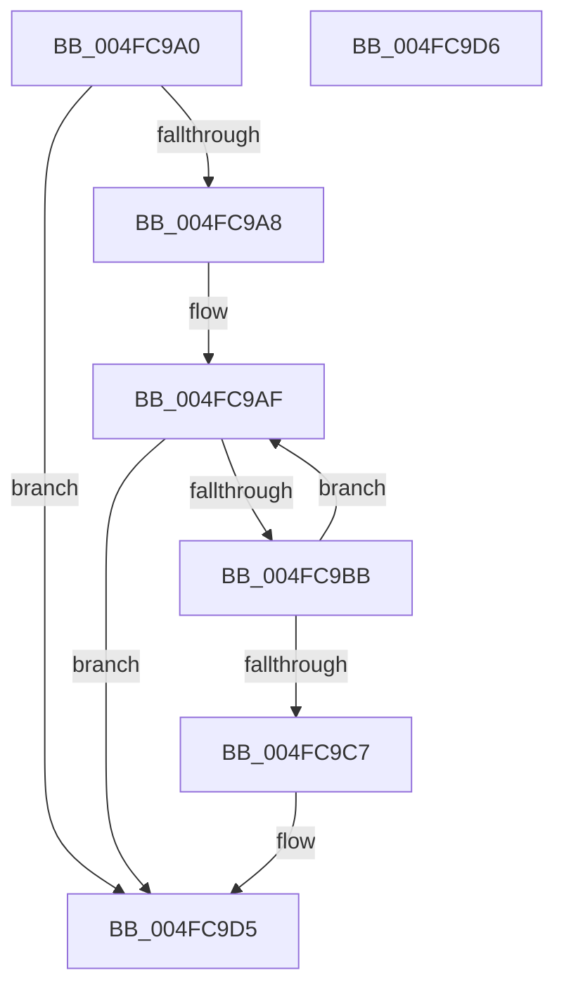

# HalSetTimerProblem

- RVA: `0x004FC9A0`–`0x004FC9D7` (길이 `55` bytes)
- VA: `0x00000001404FC9A0`
- 실행 섹션: `.text`
- PDB 이름 있음: `예`; PDB Function 태그: `아니요`
- unwind 정보 RVA: `0x000DB714`
- 디코드: `15`개 명령, `55/55` bytes 표시
- 미해석 바이트: `0` (있으면 어셈블리에 `.byte`로 보존)

> 이 문서는 커널 이미지의 기계어와 PDB 기호를 분석해 생성했습니다. 4번과 5번은 함수 원형과 자료형을 바이너리 사용 방식에서 추정한 C 해석이며 원본 소스 복구 결과는 아닙니다.

## 1. Dependencies

- 직접 호출 지점: **0**; 고유 호출 대상: **0**
- 직접 호출자로 확인된 함수: **3**
- RIP 상대 이미지 참조: **1**

### Outgoing calls
- 직접 디코드된 call 명령이 없습니다.

### Direct callers
- [HalpHpetArmTimer](../4A/HalpHpetArmTimer_function_004AC5C0.md) at `0x004AC5D5`
- [HalpHpetSetMatchValue](../4A/HalpHpetSetMatchValue_function_004AC60C.md) at `0x004AC783`
- [HalpHpetSetMatchValue](../4A/HalpHpetSetMatchValue_function_004AC60C.md) at `0x004AC7D4`
- [HalpHpetAcknowledgeInterrupt](../4B/HalpHpetAcknowledgeInterrupt_function_004B9760.md) at `0x004B9784`

### Static image references
- `0x004FC9A8` → RVA `0x00FC4120` (`.data`; read)

## 2. Other-region calls and transfers

- 다른 실행 섹션으로 향하는 call: **0**
- 별도 외부 분기/꼬리 이동을 확인하지 못했습니다.

## 3. Assembly (complete function range)

```asm
004FC9A0  45 8B C8                        mov r9d, r8d
004FC9A3  48 85 C9                        test rcx, rcx
004FC9A6  74 2D                           je 0x1404fc9d5
004FC9A8  48 8B 05 71 77 AC 00            mov rax, qword ptr [rip + 0xac7771]
004FC9AF  4C 8D 05 6A 77 AC 00            lea r8, [rip + 0xac776a]
004FC9B6  49 3B C0                        cmp rax, r8
004FC9B9  74 1A                           je 0x1404fc9d5
004FC9BB  4C 8B C0                        mov r8, rax
004FC9BE  48 8B 00                        mov rax, qword ptr [rax]
004FC9C1  49 39 48 48                     cmp qword ptr [r8 + 0x48], rcx
004FC9C5  75 E8                           jne 0x1404fc9af
004FC9C7  41 89 90 14 01 00 00            mov dword ptr [r8 + 0x114], edx
004FC9CE  45 89 88 18 01 00 00            mov dword ptr [r8 + 0x118], r9d
004FC9D5  C3                              ret
004FC9D6  CC                              int3
```

## 4. C-style interpretation (structured pseudocode)

```c
__int64 __fastcall HalSetTimerProblem(__int64 a1, int a2, int a3)
{
    if (a1 == 0) goto loc_004FC9D5;
loc_004FC9AF:
    if ((*(unsigned __int64 *)(v_rip + 11302769)) == (v_rip + 11302762)) goto loc_004FC9D5;
    if ((*(unsigned __int64 *)(*(unsigned __int64 *)(v_rip + 11302769) + 72)) != a1) goto loc_004FC9AF;
    *(unsigned int *)(*(unsigned __int64 *)(v_rip + 11302769) + 276) = a2;
    *(unsigned int *)(*(unsigned __int64 *)(v_rip + 11302769) + 280) = (unsigned int)((unsigned int)(a3));
loc_004FC9D5:
    return *(unsigned __int64 *)(*(unsigned __int64 *)(v_rip + 11302769));
}
```

## 5. (Beta) C Style

```c
int64_t HalSetTimerProblem(int64_t Arg1, int32_t Arg2, int32_t Arg3)
{
    if (Arg1 == 0) goto loc_004FC9D5;
loc_004FC9AF:
    if ((*(uint64_t *)(v_rip + 0xAC7771)) == (v_rip + 11302762)) goto loc_004FC9D5;
    if ((*(uint64_t *)(*(uint64_t *)(v_rip + 0xAC7771) + 0x48)) != Arg1) goto loc_004FC9AF;
    *(uint32_t *)(*(uint64_t *)(v_rip + 0xAC7771) + 0x114) = Arg2;
    *(uint32_t *)(*(uint64_t *)(v_rip + 0xAC7771) + 0x118) = (uint32_t)((uint32_t)(Arg3));
loc_004FC9D5:
    return *(uint64_t *)(*(uint64_t *)(v_rip + 0xAC7771));
}
```

## 6. Execution-region graph

[열기: 2D/3D 그래프와 함수 탐색 컨트롤 패널](../../../control-panel.html?section=text&rva=0x004FC9A0&view=graph)

- 2D 그래프는 위에서 아래로 흐르고, 3D 그래프는 빈 공간을 드래그해 회전합니다. Shift+드래그는 이동, 휠은 확대·축소, 함수 노드 선택은 대상 보고서 이동입니다.

### Static fallback


