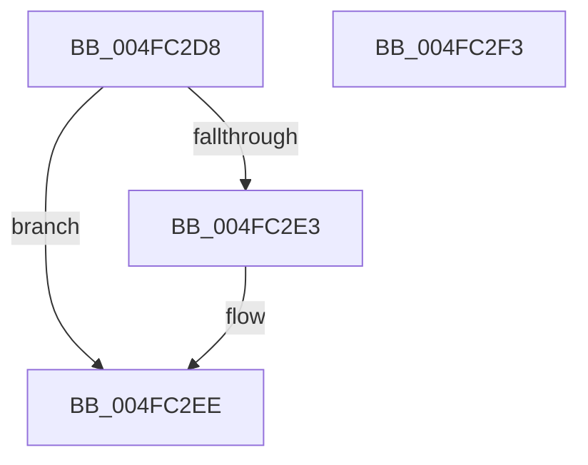

# HalpCheckInterruptType

- RVA: `0x004FC2D8`–`0x004FC2F4` (길이 `28` bytes)
- VA: `0x00000001404FC2D8`
- 실행 섹션: `.text`
- PDB 이름 있음: `예`; PDB Function 태그: `아니요`
- unwind 정보 RVA: `0x0005C788`
- 디코드: `10`개 명령, `28/28` bytes 표시
- 미해석 바이트: `0` (있으면 어셈블리에 `.byte`로 보존)

> 이 문서는 커널 이미지의 기계어와 PDB 기호를 분석해 생성했습니다. 4번과 5번은 함수 원형과 자료형을 바이너리 사용 방식에서 추정한 C 해석이며 원본 소스 복구 결과는 아닙니다.

## 1. Dependencies

- 직접 호출 지점: **1**; 고유 호출 대상: **1**
- 직접 호출자로 확인된 함수: **2**
- RIP 상대 이미지 참조: **0**

### Outgoing calls
- `0x004FC2E9` → [HalpIsInterruptTypeSecondary](../2D/HalpIsInterruptTypeSecondary_function_002D2510.md) (function, `0x002D2510`)

### Direct callers
- [HalpDisableSecondaryInterrupt](../48/HalpDisableSecondaryInterrupt_function_00488F34.md) at `0x00488F4F`
- [HalpEnableSecondaryInterrupt](../../page/AC/HalpEnableSecondaryInterrupt_function_00AC4DC0.md) at `0x00AC4DEA`

### Static image references
- 디코드된 RIP-relative 메모리 참조가 없습니다.

## 2. Other-region calls and transfers

- 다른 실행 섹션으로 향하는 call: **0**
- 별도 외부 분기/꼬리 이동을 확인하지 못했습니다.

## 3. Assembly (complete function range)

```asm
004FC2D8  48 83 EC 28                     sub rsp, 0x28
004FC2DC  32 C0                           xor al, al
004FC2DE  83 39 01                        cmp dword ptr [rcx], 1
004FC2E1  75 0B                           jne 0x1404fc2ee
004FC2E3  8B 51 40                        mov edx, dword ptr [rcx + 0x40]
004FC2E6  8B 49 08                        mov ecx, dword ptr [rcx + 8]
004FC2E9  E8 22 62 DD FF                  call 0x1402d2510
004FC2EE  48 83 C4 28                     add rsp, 0x28
004FC2F2  C3                              ret
004FC2F3  CC                              int3
```

## 4. C-style interpretation (structured pseudocode)

```c
__int64 __fastcall HalpCheckInterruptType(__int64 a1)
{
    __int64 result;
    __int64 v_rsp;

    v_rsp = (v_rsp) - (40);
    result = 0;
    if ((*(unsigned int *)(a1)) == 1) {
        a2 = *(unsigned int *)(a1 + 64);
        a1 = *(unsigned int *)(a1 + 8);
        result = HalpIsInterruptTypeSecondary(a1, a2, a3, a4);
    }
    v_rsp = (v_rsp) + (40);
    return result;
}
```

## 5. (Beta) C Style

```c
int64_t HalpCheckInterruptType(void *Arg1)
{
    uint8_t *arg1 = (uint8_t *)Arg1;

    int64_t result;
    int64_t local_rsp;

    local_rsp = (local_rsp) - (40);
    result = 0;
    if ((*(uint32_t *)(arg1)) == 1) {
        a2 = *(uint32_t *)(arg1 + 0x40);
        Arg1 = *(uint32_t *)(arg1 + 0x8);
        result = HalpIsInterruptTypeSecondary(Arg1, a2, a3, a4);
    }
    local_rsp = (local_rsp) + (40);
    return result;
}
```

### 관측된 메모리 오프셋

구조체 형식이 확인되지 않은 접근은 인자 기준의 오프셋으로만 기록했습니다.

| 기준 인자 | 오프셋 표현 | 폭 (bit) | 접근 |
|---|---:|---:|---|
| `Arg1` | `+ 0x0` | `32` | `R` |
| `Arg1` | `+ 0x8` | `32` | `R` |
| `Arg1` | `+ 0x40` | `32` | `R` |

## 6. Execution-region graph

[열기: 2D/3D 그래프와 함수 탐색 컨트롤 패널](../../../control-panel.html?section=text&rva=0x004FC2D8&view=graph)

- 2D 그래프는 위에서 아래로 흐르고, 3D 그래프는 빈 공간을 드래그해 회전합니다. Shift+드래그는 이동, 휠은 확대·축소, 함수 노드 선택은 대상 보고서 이동입니다.

### Static fallback


