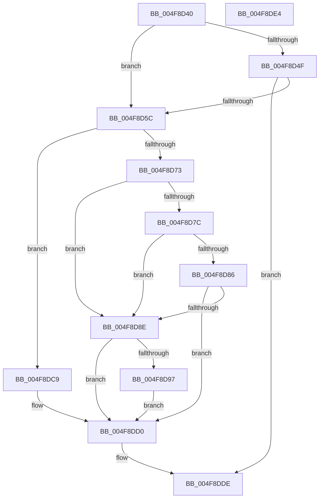

# HalpCmcStartPolling

- RVA: `0x004F8D40`–`0x004F8DE5` (길이 `165` bytes)
- VA: `0x00000001404F8D40`
- 실행 섹션: `.text`
- PDB 이름 있음: `예`; PDB Function 태그: `아니요`
- unwind 정보 RVA: `0x00064C80`
- 디코드: `39`개 명령, `165/165` bytes 표시
- 미해석 바이트: `0` (있으면 어셈블리에 `.byte`로 보존)

> 이 문서는 커널 이미지의 기계어와 PDB 기호를 분석해 생성했습니다. 4번과 5번은 함수 원형과 자료형을 바이너리 사용 방식에서 추정한 C 해석이며 원본 소스 복구 결과는 아닙니다.

## 1. Dependencies

- 직접 호출 지점: **5**; 고유 호출 대상: **5**
- 직접 호출자로 확인된 함수: **2**
- RIP 상대 이미지 참조: **11**

### Outgoing calls
- `0x004F8D46` → [HalpIsMicrosoftCompatibleHvLoaded](../4A/HalpIsMicrosoftCompatibleHvLoaded_function_004AFAAC.md) (function, `0x004AFAAC`)
- `0x004F8D4F` → [HalpIsPartitionCpuManager](HalpIsPartitionCpuManager_function_004F8DEC.md) (function, `0x004F8DEC`)
- `0x004F8D63` → [KeAcquireSpinLockRaiseToDpc](../20/KeAcquireSpinLockRaiseToDpc_function_00208470.md) (function, `0x00208470`)
- `0x004F8DBB` → [KiSetTimerEx](../23/KiSetTimerEx_function_00232CB0.md) (function, `0x00232CB0`)
- `0x004F8DD9` → [KeReleaseSpinLock](../39/KeReleaseSpinLock_function_00392BA0.md) (function, `0x00392BA0`)

### Direct callers
- [HalpCmciDeferredRoutine](../48/HalpCmciDeferredRoutine_function_00487290.md) at `0x004872A4`
- [HalpInitializeCmc](../../pagelk/B5/HalpInitializeCmc_function_00B5BB08.md) at `0x00B5BB61`

### Static image references
- `0x004F8D5C` → RVA `0x00E0F6A8` (`.data`; read)
- `0x004F8D68` → RVA `0x00E0FC03` (`.data`; read)
- `0x004F8D73` → RVA `0x00E0FC00` (`.data`; read)
- `0x004F8D7C` → RVA `0x00E0F6A0` (`.data`; read)
- `0x004F8D86` → RVA `0x00E0F6EC` (`.data`; read)
- `0x004F8D8E` → RVA `0x00E0F6D8` (`.data`; read)
- `0x004F8D97` → RVA `0x00E100F0` (`.data`; read)
- `0x004F8D9E` → RVA `0x00E10138` (`.data`; read)
- `0x004F8DB4` → RVA `0x00E100F8` (`.data`; read)
- `0x004F8DC0` → RVA `0x00E0F6D8` (`.data`; write)
- `0x004F8DC9` → RVA `0x00E0F6EC` (`.data`; write)

## 2. Other-region calls and transfers

- 다른 실행 섹션으로 향하는 call: **0**
- 별도 외부 분기/꼬리 이동을 확인하지 못했습니다.

## 3. Assembly (complete function range)

```asm
004F8D40  40 53                           push rbx
004F8D42  48 83 EC 30                     sub rsp, 0x30
004F8D46  E8 61 6D FB FF                  call 0x1404afaac
004F8D4B  84 C0                           test al, al
004F8D4D  74 0D                           je 0x1404f8d5c
004F8D4F  E8 98 00 00 00                  call 0x1404f8dec
004F8D54  84 C0                           test al, al
004F8D56  0F 84 82 00 00 00               je 0x1404f8dde
004F8D5C  48 8D 0D 45 69 91 00            lea rcx, [rip + 0x916945]
004F8D63  E8 08 F7 D0 FF                  call 0x140208470
004F8D68  80 3D 94 6E 91 00 00            cmp byte ptr [rip + 0x916e94], 0
004F8D6F  8A D8                           mov bl, al
004F8D71  74 56                           je 0x1404f8dc9
004F8D73  80 3D 86 6E 91 00 00            cmp byte ptr [rip + 0x916e86], 0
004F8D7A  75 12                           jne 0x1404f8d8e
004F8D7C  8B 0D 1E 69 91 00               mov ecx, dword ptr [rip + 0x91691e]
004F8D82  85 C9                           test ecx, ecx
004F8D84  75 08                           jne 0x1404f8d8e
004F8D86  38 0D 60 69 91 00               cmp byte ptr [rip + 0x916960], cl
004F8D8C  74 42                           je 0x1404f8dd0
004F8D8E  80 3D 43 69 91 00 00            cmp byte ptr [rip + 0x916943], 0
004F8D95  75 39                           jne 0x1404f8dd0
004F8D97  44 8B 05 52 73 91 00            mov r8d, dword ptr [rip + 0x917352]
004F8D9E  48 8D 05 93 73 91 00            lea rax, [rip + 0x917393]
004F8DA5  49 69 D0 F0 D8 FF FF            imul rdx, r8, -0x2710
004F8DAC  45 33 C9                        xor r9d, r9d
004F8DAF  48 89 44 24 20                  mov qword ptr [rsp + 0x20], rax
004F8DB4  48 8D 0D 3D 73 91 00            lea rcx, [rip + 0x91733d]
004F8DBB  E8 F0 9E D3 FF                  call 0x140232cb0
004F8DC0  C6 05 11 69 91 00 01            mov byte ptr [rip + 0x916911], 1
004F8DC7  EB 07                           jmp 0x1404f8dd0
004F8DC9  C6 05 1C 69 91 00 01            mov byte ptr [rip + 0x91691c], 1
004F8DD0  8A D3                           mov dl, bl
004F8DD2  48 8D 0D CF 68 91 00            lea rcx, [rip + 0x9168cf]
004F8DD9  E8 C2 9D E9 FF                  call 0x140392ba0
004F8DDE  48 83 C4 30                     add rsp, 0x30
004F8DE2  5B                              pop rbx
004F8DE3  C3                              ret
004F8DE4  CC                              int3
```

## 4. C-style interpretation (structured pseudocode)

```c
__int64 __fastcall HalpCmcStartPolling(__int64 a1, __int64 a2, __int64 a3, int a4)
{
    __int64 result;
    __int64 v_rsp;
    unsigned __int64 v_stack_m18;

    v_rsp = (v_rsp) - (48);
    result = HalpIsMicrosoftCompatibleHvLoaded(a1, a2, a3, a4);
    if ((unsigned __int8)(result) == 0) goto loc_004F8D5C;
    result = HalpIsPartitionCpuManager(a1, a2, a3, a4);
    if ((unsigned __int8)(result) == 0) goto loc_004F8DDE;
loc_004F8D5C:
    result = KeAcquireSpinLockRaiseToDpc(v_rip + 9529669, a2, a3, a4);
    if ((*(unsigned __int8 *)(v_rip + 9531028)) == 0) goto loc_004F8DC9;
    if ((*(unsigned __int8 *)(v_rip + 9531014)) != 0) goto loc_004F8D8E;
    if ((unsigned int)((unsigned int)(*(unsigned int *)(v_rip + 9529630))) != 0) goto loc_004F8D8E;
    if ((*(unsigned __int8 *)(v_rip + 9529696)) == ((unsigned __int8)((unsigned int)(*(unsigned int *)(v_rip + 9529630))))) goto loc_004F8DD0;
loc_004F8D8E:
    if ((*(unsigned __int8 *)(v_rip + 9529667)) != 0) goto loc_004F8DD0;
    a2 = (a2) * ((unsigned int)(*(unsigned int *)(v_rip + 9532242)));
    a4 = 0;
    v_stack_m18 = v_rip + 9532307;
    result = KiSetTimerEx(v_rip + 9532221, a2, (unsigned int)(*(unsigned int *)(v_rip + 9532242)), a4);
    *(unsigned __int8 *)(v_rip + 9529617) = 1;
    goto loc_004F8DD0;
loc_004F8DC9:
    *(unsigned __int8 *)(v_rip + 9529628) = 1;
loc_004F8DD0:
    result = KeReleaseSpinLock(v_rip + 9529551, (unsigned __int8)((unsigned __int8)(result)), (unsigned int)(*(unsigned int *)(v_rip + 9532242)), a4);
loc_004F8DDE:
    v_rsp = (v_rsp) + (48);
    return result;
}
```

## 5. (Beta) C Style

```c
int64_t HalpCmcStartPolling(int64_t Arg1, int64_t Arg2, int64_t Arg3, int32_t Arg4)
{
    int64_t result;
    int64_t local_rsp;
    uint64_t v_stack_m18;

    local_rsp = (local_rsp) - (48);
    result = HalpIsMicrosoftCompatibleHvLoaded(Arg1, Arg2, Arg3, Arg4);
    if ((uint8_t)(result) == 0) goto loc_004F8D5C;
    result = HalpIsPartitionCpuManager(Arg1, Arg2, Arg3, Arg4);
    if ((uint8_t)(result) == 0) goto loc_004F8DDE;
loc_004F8D5C:
    result = KeAcquireSpinLockRaiseToDpc(v_rip + 9529669, Arg2, Arg3, Arg4);
    if ((*(uint8_t *)(v_rip + 0x916E94)) == 0) goto loc_004F8DC9;
    if ((*(uint8_t *)(v_rip + 0x916E86)) != 0) goto loc_004F8D8E;
    if ((uint32_t)((uint32_t)(*(uint32_t *)(v_rip + 0x91691E))) != 0) goto loc_004F8D8E;
    if ((*(uint8_t *)(v_rip + 0x916960)) == ((uint8_t)((uint32_t)(*(uint32_t *)(v_rip + 0x91691E))))) goto loc_004F8DD0;
loc_004F8D8E:
    if ((*(uint8_t *)(v_rip + 0x916943)) != 0) goto loc_004F8DD0;
    Arg2 = (Arg2) * ((uint32_t)(*(uint32_t *)(v_rip + 0x917352)));
    Arg4 = 0;
    v_stack_m18 = v_rip + 9532307;
    result = KiSetTimerEx(v_rip + 9532221, Arg2, (uint32_t)(*(uint32_t *)(v_rip + 0x917352)), Arg4);
    *(uint8_t *)(v_rip + 0x916911) = 1;
    goto loc_004F8DD0;
loc_004F8DC9:
    *(uint8_t *)(v_rip + 0x91691C) = 1;
loc_004F8DD0:
    result = KeReleaseSpinLock(v_rip + 9529551, (uint8_t)((uint8_t)(result)), (uint32_t)(*(uint32_t *)(v_rip + 0x917352)), Arg4);
loc_004F8DDE:
    local_rsp = (local_rsp) + (48);
    return result;
}
```

## 6. Execution-region graph

[열기: 2D/3D 그래프와 함수 탐색 컨트롤 패널](../../../control-panel.html?section=text&rva=0x004F8D40&view=graph)

- 2D 그래프는 위에서 아래로 흐르고, 3D 그래프는 빈 공간을 드래그해 회전합니다. Shift+드래그는 이동, 휠은 확대·축소, 함수 노드 선택은 대상 보고서 이동입니다.

### Static fallback


