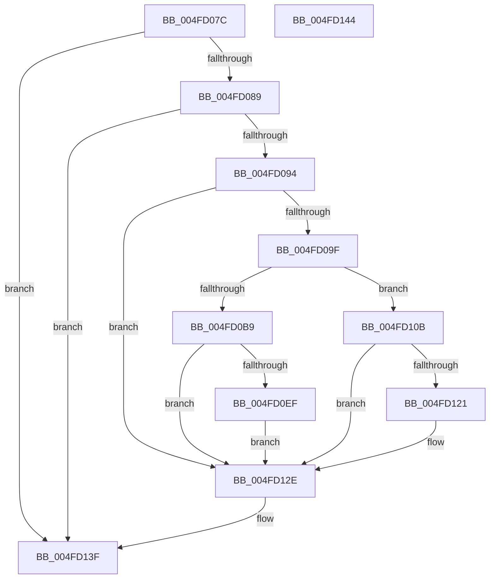

# HalpCmciSetProcessorMiscConfigAMD

- RVA: `0x004FD07C`–`0x004FD145` (길이 `201` bytes)
- VA: `0x00000001404FD07C`
- 실행 섹션: `.text`
- PDB 이름 있음: `예`; PDB Function 태그: `아니요`
- unwind 정보 RVA: `0x0005C788`
- 디코드: `43`개 명령, `201/201` bytes 표시
- 미해석 바이트: `0` (있으면 어셈블리에 `.byte`로 보존)

> 이 문서는 커널 이미지의 기계어와 PDB 기호를 분석해 생성했습니다. 4번과 5번은 함수 원형과 자료형을 바이너리 사용 방식에서 추정한 C 해석이며 원본 소스 복구 결과는 아닙니다.

## 1. Dependencies

- 직접 호출 지점: **1**; 고유 호출 대상: **1**
- 직접 호출자로 확인된 함수: **1**
- RIP 상대 이미지 참조: **2**

### Outgoing calls
- `0x004FD13A` → [guard_dispatch_icall](../6B/guard_dispatch_icall_function_006BAAD0.md) (function, `0x006BAAD0`)

### Direct callers
- [HalpCmciSetProcessorConfigAMD](../48/HalpCmciSetProcessorConfigAMD_function_00487BE0.md) at `0x00487D18`
- [HalpCmciSetProcessorConfigAMD](../48/HalpCmciSetProcessorConfigAMD_function_00487BE0.md) at `0x00487D64`
- [HalpCmciSetProcessorConfigAMD](../48/HalpCmciSetProcessorConfigAMD_function_00487BE0.md) at `0x00487DE8`
- [HalpCmciSetProcessorConfigAMD](../48/HalpCmciSetProcessorConfigAMD_function_00487BE0.md) at `0x00487E13`

### Static image references
- `0x004FD0E6` → RVA `0x00E10258` (`.data`; read)
- `0x004FD12E` → RVA `0x00FC1980` (`.data`; read)

## 2. Other-region calls and transfers

- 다른 실행 섹션으로 향하는 call: **0**
- 별도 외부 분기/꼬리 이동을 확인하지 못했습니다.

## 3. Assembly (complete function range)

```asm
004FD07C  48 83 EC 28                     sub rsp, 0x28
004FD080  4D 85 C0                        test r8, r8
004FD083  0F 89 B6 00 00 00               jns 0x1404fd13f
004FD089  49 0F BA E0 3D                  bt r8, 0x3d
004FD08E  0F 82 AB 00 00 00               jb 0x1404fd13f
004FD094  49 0F BA E0 3E                  bt r8, 0x3e
004FD099  0F 83 8F 00 00 00               jae 0x1404fd12e
004FD09F  8B 49 44                        mov ecx, dword ptr [rcx + 0x44]
004FD0A2  41 BA FF 0F 00 00               mov r10d, 0xfff
004FD0A8  49 23 CA                        and rcx, r10
004FD0AB  B8 01 00 00 00                  mov eax, 1
004FD0B0  48 0F 44 C8                     cmove rcx, rax
004FD0B4  45 84 C9                        test r9b, r9b
004FD0B7  74 52                           je 0x1404fd10b
004FD0B9  49 8B C0                        mov rax, r8
004FD0BC  48 F7 D1                        not rcx
004FD0BF  49 23 CA                        and rcx, r10
004FD0C2  49 B8 FF FF FF FF 00 F0 FA FF   movabs r8, 0xfffaf000ffffffff
004FD0CC  49 23 C0                        and rax, r8
004FD0CF  48 C1 E1 20                     shl rcx, 0x20
004FD0D3  4C 8B C1                        mov r8, rcx
004FD0D6  4C 0B C0                        or r8, rax
004FD0D9  48 B8 00 00 00 00 00 00 0A 00   movabs rax, 0xa000000000000
004FD0E3  4C 0B C0                        or r8, rax
004FD0E6  80 3D 6B 31 91 00 00            cmp byte ptr [rip + 0x91316b], 0
004FD0ED  75 3F                           jne 0x1404fd12e
004FD0EF  48 B8 FF FF FF FF FF FF 1F FF   movabs rax, 0xff1fffffffffffff
004FD0F9  4C 23 C0                        and r8, rax
004FD0FC  48 B8 00 00 00 00 00 00 10 00   movabs rax, 0x10000000000000
004FD106  4C 0B C0                        or r8, rax
004FD109  EB 23                           jmp 0x1404fd12e
004FD10B  48 B8 FF FF FF FF 00 F0 F0 FF   movabs rax, 0xfff0f000ffffffff
004FD115  4C 23 C0                        and r8, rax
004FD118  80 3D 39 31 91 00 00            cmp byte ptr [rip + 0x913139], 0
004FD11F  75 0D                           jne 0x1404fd12e
004FD121  48 B8 FF FF FF FF FF FF 0F FF   movabs rax, 0xff0fffffffffffff
004FD12B  4C 23 C0                        and r8, rax
004FD12E  48 8B 05 4B 48 AC 00            mov rax, qword ptr [rip + 0xac484b]
004FD135  48 8B 4C 24 50                  mov rcx, qword ptr [rsp + 0x50]
004FD13A  E8 91 D9 1B 00                  call 0x1406baad0
004FD13F  48 83 C4 28                     add rsp, 0x28
004FD143  C3                              ret
004FD144  CC                              int3
```

## 4. C-style interpretation (structured pseudocode)

```c
__int64 __fastcall HalpCmciSetProcessorMiscConfigAMD(__int64 a1, __int64 a2, __int64 a3, unsigned __int8 a4, __int64 a5)
{
    __int64 result;
    __int64 v_rsp;

    v_rsp = (v_rsp) - (40);
    if (!sign_flag) goto loc_004FD13F;
    if (condition_is_below) goto loc_004FD13F;
    if (condition_is_above_or_equal) goto loc_004FD12E;
    a1 = ((unsigned int)(*(unsigned int *)(a1 + 68))) & ((unsigned int)(0xFFFULL));
    if (condition_is_equal) { a1 = 1; }
    if (a4 == 0) goto loc_004FD10B;
    a1 = ~(a1);
    a1 = (a1) & ((unsigned int)(0xFFFULL));
    result = (a3) & (a3);
    a1 = (a1) << (32);
    a3 = (a1) | (result);
    a3 = (a3) | (result);
    if ((*(unsigned __int8 *)(v_rip + 9515371)) != 0) goto loc_004FD12E;
    a3 = (a3) & (result);
    a3 = (a3) | (result);
    goto loc_004FD12E;
loc_004FD10B:
    a3 = (a3) & (result);
    if ((*(unsigned __int8 *)(v_rip + 9515321)) == 0) {
        a3 = (a3) & (result);
    }
    result = guard_dispatch_icall(a5, a2, a3, a4);
loc_004FD13F:
    v_rsp = (v_rsp) + (40);
    return result;
}
```

## 5. (Beta) C Style

```c
int64_t HalpCmciSetProcessorMiscConfigAMD(void *Arg1, int64_t Arg2, int64_t Arg3, uint8_t Arg4, int64_t Arg5)
{
    uint8_t *arg1 = (uint8_t *)Arg1;

    int64_t result;
    int64_t local_rsp;

    local_rsp = (local_rsp) - (40);
    if (!sign_flag) goto loc_004FD13F;
    if (condition_is_below) goto loc_004FD13F;
    if (condition_is_above_or_equal) goto loc_004FD12E;
    Arg1 = ((uint32_t)(*(uint32_t *)(arg1 + 0x44))) & ((uint32_t)(0xFFFULL));
    if (condition_is_equal) { Arg1 = 1; }
    if (Arg4 == 0) goto loc_004FD10B;
    Arg1 = ~(Arg1);
    Arg1 = (Arg1) & ((uint32_t)(0xFFFULL));
    result = (Arg3) & (Arg3);
    Arg1 = (Arg1) << (32);
    Arg3 = (Arg1) | (result);
    Arg3 = (Arg3) | (result);
    if ((*(uint8_t *)(v_rip + 0x91316B)) != 0) goto loc_004FD12E;
    Arg3 = (Arg3) & (result);
    Arg3 = (Arg3) | (result);
    goto loc_004FD12E;
loc_004FD10B:
    Arg3 = (Arg3) & (result);
    if ((*(uint8_t *)(v_rip + 0x913139)) == 0) {
        Arg3 = (Arg3) & (result);
    }
    result = guard_dispatch_icall(Arg5, Arg2, Arg3, Arg4);
loc_004FD13F:
    local_rsp = (local_rsp) + (40);
    return result;
}
```

### 관측된 메모리 오프셋

구조체 형식이 확인되지 않은 접근은 인자 기준의 오프셋으로만 기록했습니다.

| 기준 인자 | 오프셋 표현 | 폭 (bit) | 접근 |
|---|---:|---:|---|
| `Arg1` | `+ 0x44` | `32` | `R` |

## 6. Execution-region graph

[열기: 2D/3D 그래프와 함수 탐색 컨트롤 패널](../../../control-panel.html?section=text&rva=0x004FD07C&view=graph)

- 2D 그래프는 위에서 아래로 흐르고, 3D 그래프는 빈 공간을 드래그해 회전합니다. Shift+드래그는 이동, 휠은 확대·축소, 함수 노드 선택은 대상 보고서 이동입니다.

### Static fallback


