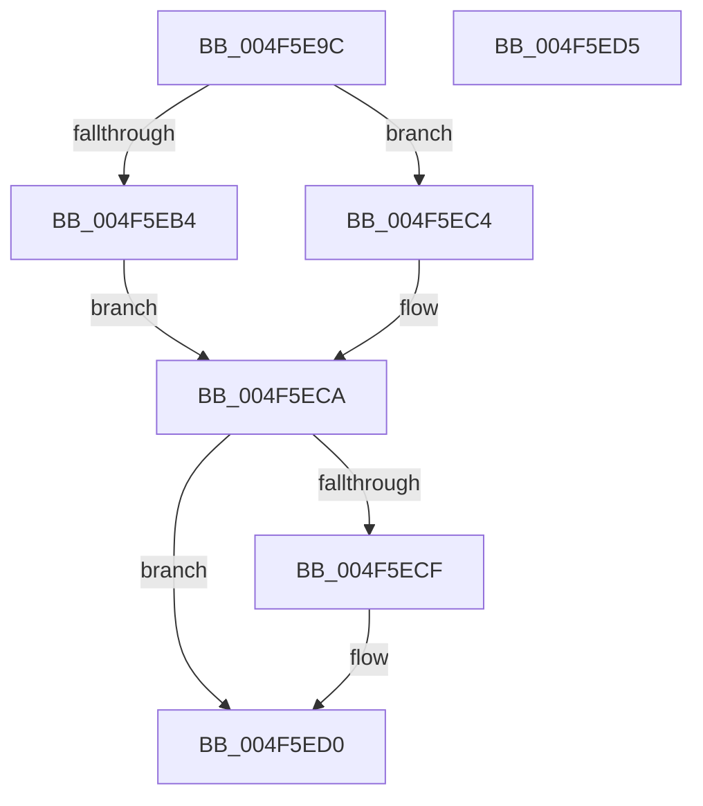

# HalpFlushTLB

- RVA: `0x004F5E9C`–`0x004F5ED6` (길이 `58` bytes)
- VA: `0x00000001404F5E9C`
- 실행 섹션: `.text`
- PDB 이름 있음: `예`; PDB Function 태그: `아니요`
- unwind 정보 RVA: `0x0005C788`
- 디코드: `19`개 명령, `58/58` bytes 표시
- 미해석 바이트: `0` (있으면 어셈블리에 `.byte`로 보존)

> 이 문서는 커널 이미지의 기계어와 PDB 기호를 분석해 생성했습니다. 4번과 5번은 함수 원형과 자료형을 바이너리 사용 방식에서 추정한 C 해석이며 원본 소스 복구 결과는 아닙니다.

## 1. Dependencies

- 직접 호출 지점: **1**; 고유 호출 대상: **1**
- 직접 호출자로 확인된 함수: **5**
- RIP 상대 이미지 참조: **0**

### Outgoing calls
- `0x004F5EA0` → [HalpDisableInterrupts](../25/HalpDisableInterrupts_function_002521A0.md) (function, `0x002521A0`)

### Direct callers
- [HalpMap](../3F/HalpMap_function_003F88F4.md) at `0x003F8B1B`
- [HalpUnmapVirtualAddress](../3F/HalpUnmapVirtualAddress_function_003F8C30.md) at `0x003F8CAE`
- [HalpMmZeroPageWithTemporaryMapping](../54/HalpMmZeroPageWithTemporaryMapping_function_00544CA8.md) at `0x00544D1E`
- [sub_006EB9A8](../6E/Unknown_function_006EB9A8.md) at `0x006EB9A8`
- [sub_006EB9A8](../6E/Unknown_function_006EB9A8.md) at `0x006EB9C6`
- [sub_006EBA20](../6E/Unknown_function_006EBA20.md) at `0x006EBA71`
- [sub_006EBA20](../6E/Unknown_function_006EBA20.md) at `0x006EBA8F`

### Static image references
- 디코드된 RIP-relative 메모리 참조가 없습니다.

## 2. Other-region calls and transfers

- 다른 실행 섹션으로 향하는 call: **0**
- 별도 외부 분기/꼬리 이동을 확인하지 못했습니다.

## 3. Assembly (complete function range)

```asm
004F5E9C  48 83 EC 28                     sub rsp, 0x28
004F5EA0  E8 FB C2 D5 FF                  call 0x1402521a0
004F5EA5  44 8A C0                        mov r8b, al
004F5EA8  0F 20 E2                        mov rdx, cr4
004F5EAB  48 F7 C2 80 00 02 00            test rdx, 0x20080
004F5EB2  74 10                           je 0x1404f5ec4
004F5EB4  48 8B CA                        mov rcx, rdx
004F5EB7  48 0F BA F9 07                  btc rcx, 7
004F5EBC  0F 22 E1                        mov cr4, rcx
004F5EBF  0F 22 E2                        mov cr4, rdx
004F5EC2  EB 06                           jmp 0x1404f5eca
004F5EC4  0F 20 D8                        mov rax, cr3
004F5EC7  0F 22 D8                        mov cr3, rax
004F5ECA  45 84 C0                        test r8b, r8b
004F5ECD  74 01                           je 0x1404f5ed0
004F5ECF  FB                              sti
004F5ED0  48 83 C4 28                     add rsp, 0x28
004F5ED4  C3                              ret
004F5ED5  CC                              int3
```

## 4. C-style interpretation (structured pseudocode)

```c
__int64 __fastcall HalpFlushTLB(void)
{
    __int64 result;
    __int64 v_rsp;

    v_rsp = (v_rsp) - (40);
    result = HalpDisableInterrupts(a1, a2, a3, a4);
    if (((v_cr4) & (0x20080ULL)) == 0) goto loc_004F5EC4;
    goto loc_004F5ECA;
loc_004F5EC4:
loc_004F5ECA:
    if ((unsigned __int8)((unsigned __int8)(result)) != 0) {
    }
    v_rsp = (v_rsp) + (40);
    return v_cr3;
}
```

## 5. (Beta) C Style

```c
void HalpFlushTLB(void)
{
    int64_t result;
    int64_t local_rsp;

    local_rsp = (local_rsp) - (40);
    result = HalpDisableInterrupts(a1, a2, a3, a4);
    if (((v_cr4) & (0x20080ULL)) == 0) goto loc_004F5EC4;
    goto loc_004F5ECA;
loc_004F5EC4:
loc_004F5ECA:
    if ((uint8_t)((uint8_t)(result)) != 0) {
    }
    local_rsp = (local_rsp) + (40);
    return v_cr3;
}
```

## 6. Execution-region graph

[열기: 2D/3D 그래프와 함수 탐색 컨트롤 패널](../../../control-panel.html?section=text&rva=0x004F5E9C&view=graph)

- 2D 그래프는 위에서 아래로 흐르고, 3D 그래프는 빈 공간을 드래그해 회전합니다. Shift+드래그는 이동, 휠은 확대·축소, 함수 노드 선택은 대상 보고서 이동입니다.

### Static fallback


