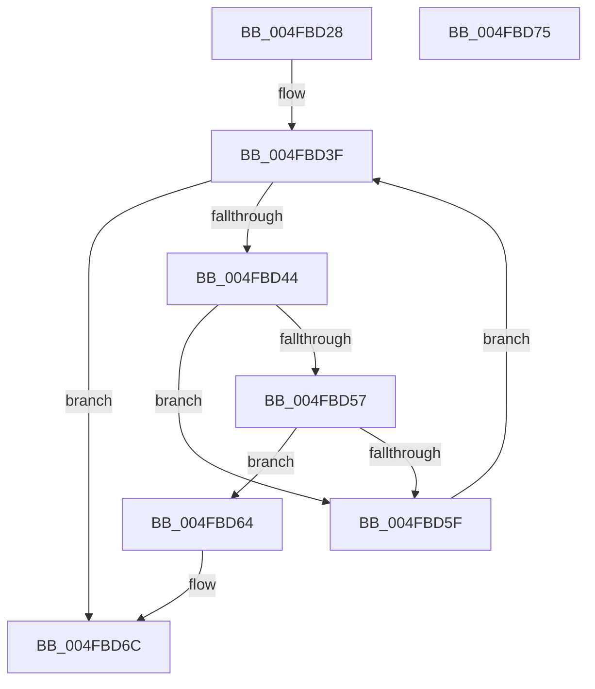

# HalpHsaFindReservedDomain

- RVA: `0x004FBD28`–`0x004FBD76` (길이 `78` bytes)
- VA: `0x00000001404FBD28`
- 실행 섹션: `.text`
- PDB 이름 있음: `예`; PDB Function 태그: `아니요`
- unwind 정보 RVA: `0x00071750`
- 디코드: `25`개 명령, `78/78` bytes 표시
- 미해석 바이트: `0` (있으면 어셈블리에 `.byte`로 보존)

> 이 문서는 커널 이미지의 기계어와 PDB 기호를 분석해 생성했습니다. 4번과 5번은 함수 원형과 자료형을 바이너리 사용 방식에서 추정한 C 해석이며 원본 소스 복구 결과는 아닙니다.

## 1. Dependencies

- 직접 호출 지점: **0**; 고유 호출 대상: **0**
- 직접 호출자로 확인된 함수: **1**
- RIP 상대 이미지 참조: **0**

### Outgoing calls
- 직접 디코드된 call 명령이 없습니다.

### Direct callers
- [HsaGetBlockedDomain](HsaGetBlockedDomain_function_004FBCD4.md) at `0x004FBCEB`

### Static image references
- 디코드된 RIP-relative 메모리 참조가 없습니다.

## 2. Other-region calls and transfers

- 다른 실행 섹션으로 향하는 call: **0**
- 별도 외부 분기/꼬리 이동을 확인하지 못했습니다.

## 3. Assembly (complete function range)

```asm
004FBD28  48 89 5C 24 08                  mov qword ptr [rsp + 8], rbx
004FBD2D  4C 8B 91 D8 00 00 00            mov r10, qword ptr [rcx + 0xd8]
004FBD34  45 33 C9                        xor r9d, r9d
004FBD37  8B DA                           mov ebx, edx
004FBD39  45 8B C1                        mov r8d, r9d
004FBD3C  45 8B 1A                        mov r11d, dword ptr [r10]
004FBD3F  45 3B C3                        cmp r8d, r11d
004FBD42  73 28                           jae 0x1404fbd6c
004FBD44  41 8B C8                        mov ecx, r8d
004FBD47  48 03 C9                        add rcx, rcx
004FBD4A  49 8B 44 CA 10                  mov rax, qword ptr [r10 + rcx*8 + 0x10]
004FBD4F  48 8B 10                        mov rdx, qword ptr [rax]
004FBD52  83 3A 01                        cmp dword ptr [rdx], 1
004FBD55  75 08                           jne 0x1404fbd5f
004FBD57  0F B7 42 0C                     movzx eax, word ptr [rdx + 0xc]
004FBD5B  3B C3                           cmp eax, ebx
004FBD5D  74 05                           je 0x1404fbd64
004FBD5F  41 FF C0                        inc r8d
004FBD62  EB DB                           jmp 0x1404fbd3f
004FBD64  4D 8D 4A 08                     lea r9, [r10 + 8]
004FBD68  4D 8D 0C C9                     lea r9, [r9 + rcx*8]
004FBD6C  48 8B 5C 24 08                  mov rbx, qword ptr [rsp + 8]
004FBD71  49 8B C1                        mov rax, r9
004FBD74  C3                              ret
004FBD75  CC                              int3
```

## 4. C-style interpretation (structured pseudocode)

```c
__int64 __fastcall HalpHsaFindReservedDomain(__int64 a1, int a2, __int64 a3, int a4)
{
    unsigned __int64 v_stack_p8;

    v_stack_p8 = v_rbx;
    a4 = 0;
loc_004FBD3F:
    if (0 >= ((unsigned int)((unsigned int)(*(unsigned int *)(*(unsigned __int64 *)(a1 + 216)))))) goto loc_004FBD6C;
    a1 = (0) + (0);
    if ((*(unsigned int *)(*(unsigned __int64 *)(*(unsigned __int64 *)(*(unsigned __int64 *)(a1 + 216) + a1 * 8 + 16)))) != 1) goto loc_004FBD5F;
    if (((unsigned int)(*(unsigned __int16 *)(*(unsigned __int64 *)(*(unsigned __int64 *)(*(unsigned __int64 *)(a1 + 216) + a1 * 8 + 16)) + 12))) == ((unsigned int)((unsigned int)(a2)))) goto loc_004FBD64;
loc_004FBD5F:
    a3 = (unsigned int)((0) + 1);
    goto loc_004FBD3F;
loc_004FBD64:
loc_004FBD6C:
    return *(unsigned __int64 *)(a1 + 216) + 8 + a1 * 8;
}
```

## 5. (Beta) C Style

```c
int64_t HalpHsaFindReservedDomain(void *Arg1, int32_t Arg2, int64_t Arg3, int32_t Arg4)
{
    uint8_t *arg1 = (uint8_t *)Arg1;

    uint64_t v_stack_p8;

    v_stack_p8 = local_rbx;
    Arg4 = 0;
loc_004FBD3F:
    if (0 >= ((uint32_t)((uint32_t)(*(uint32_t *)(*(uint64_t *)(arg1 + 0xD8)))))) goto loc_004FBD6C;
    Arg1 = (0) + (0);
    if ((*(uint32_t *)(*(uint64_t *)(*(uint64_t *)(*(uint64_t *)(arg1 + 0xD8) + arg1 * 8 + 0x10)))) != 1) goto loc_004FBD5F;
    if (((uint32_t)(*(uint16_t *)(*(uint64_t *)(*(uint64_t *)(*(uint64_t *)(arg1 + 0xD8) + arg1 * 8 + 0x10)) + 0xC))) == ((uint32_t)((uint32_t)(Arg2)))) goto loc_004FBD64;
loc_004FBD5F:
    Arg3 = (uint32_t)((0) + 1);
    goto loc_004FBD3F;
loc_004FBD64:
loc_004FBD6C:
    return *(uint64_t *)(arg1 + 0xD8) + 8 + Arg1 * 8;
}
```

### 관측된 메모리 오프셋

구조체 형식이 확인되지 않은 접근은 인자 기준의 오프셋으로만 기록했습니다.

| 기준 인자 | 오프셋 표현 | 폭 (bit) | 접근 |
|---|---:|---:|---|
| `Arg1` | `+ 0xD8` | `64` | `R` |

## 6. Execution-region graph

[열기: 2D/3D 그래프와 함수 탐색 컨트롤 패널](../../../control-panel.html?section=text&rva=0x004FBD28&view=graph)

- 2D 그래프는 위에서 아래로 흐르고, 3D 그래프는 빈 공간을 드래그해 회전합니다. Shift+드래그는 이동, 휠은 확대·축소, 함수 노드 선택은 대상 보고서 이동입니다.

### Static fallback


