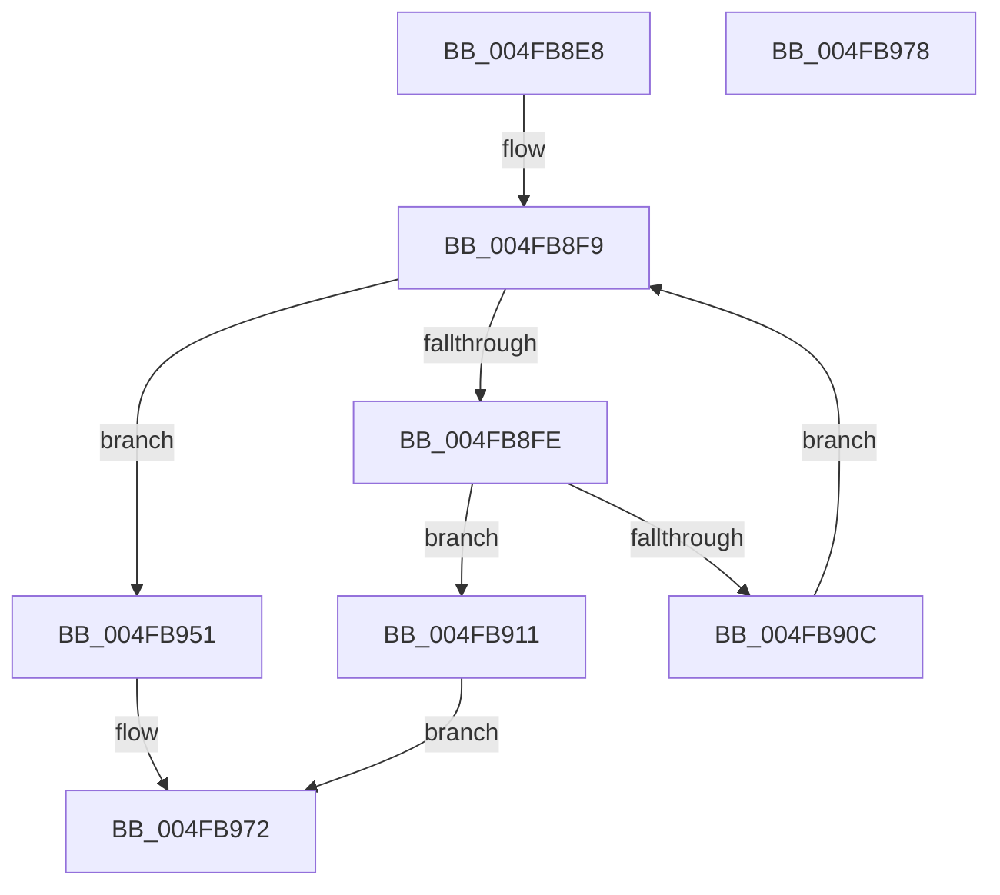

# HalpIommuGetNextFlushDevice

- RVA: `0x004FB8E8`–`0x004FB979` (길이 `145` bytes)
- VA: `0x00000001404FB8E8`
- 실행 섹션: `.text`
- PDB 이름 있음: `예`; PDB Function 태그: `아니요`
- unwind 정보 RVA: `0x00071750`
- 디코드: `44`개 명령, `145/145` bytes 표시
- 미해석 바이트: `0` (있으면 어셈블리에 `.byte`로 보존)

> 이 문서는 커널 이미지의 기계어와 PDB 기호를 분석해 생성했습니다. 4번과 5번은 함수 원형과 자료형을 바이너리 사용 방식에서 추정한 C 해석이며 원본 소스 복구 결과는 아닙니다.

## 1. Dependencies

- 직접 호출 지점: **0**; 고유 호출 대상: **0**
- 직접 호출자로 확인된 함수: **4**
- RIP 상대 이미지 참조: **0**

### Outgoing calls
- 직접 디코드된 call 명령이 없습니다.

### Direct callers
- [IvtFlushTbInternal](../2D/IvtFlushTbInternal_function_002D2548.md) at `0x002D28A5`
- [IvtFlushTbInternal](../2D/IvtFlushTbInternal_function_002D2548.md) at `0x002D2C64`
- [HsaFlushTbInternal](../44/HsaFlushTbInternal_function_0044DEE8.md) at `0x0044E0CB`
- [IvtLegacyFlushTbInternal](../57/IvtLegacyFlushTbInternal_function_005714E8.md) at `0x005717B1`
- [IvtLegacyFlushTbInternal](../57/IvtLegacyFlushTbInternal_function_005714E8.md) at `0x00571A9D`
- [IvtLegacyFlushTbInternal](../57/IvtLegacyFlushTbInternal_function_005714E8.md) at `0x00571B99`
- [sub_006F0EF6](../6F/Unknown_function_006F0EF6.md) at `0x006F0FBC`
- [sub_006F0EF6](../6F/Unknown_function_006F0EF6.md) at `0x006F1085`

### Static image references
- 디코드된 RIP-relative 메모리 참조가 없습니다.

## 2. Other-region calls and transfers

- 다른 실행 섹션으로 향하는 call: **0**
- 별도 외부 분기/꼬리 이동을 확인하지 못했습니다.

## 3. Assembly (complete function range)

```asm
004FB8E8  48 89 5C 24 08                  mov qword ptr [rsp + 8], rbx
004FB8ED  48 8B 02                        mov rax, qword ptr [rdx]
004FB8F0  4D 8B D9                        mov r11, r9
004FB8F3  48 8B DA                        mov rbx, rdx
004FB8F6  4C 8B 10                        mov r10, qword ptr [rax]
004FB8F9  4C 3B D1                        cmp r10, rcx
004FB8FC  74 53                           je 0x1404fb951
004FB8FE  49 8B 52 28                     mov rdx, qword ptr [r10 + 0x28]
004FB902  44 8B 4A 30                     mov r9d, dword ptr [rdx + 0x30]
004FB906  41 F6 C1 01                     test r9b, 1
004FB90A  75 05                           jne 0x1404fb911
004FB90C  4D 8B 12                        mov r10, qword ptr [r10]
004FB90F  EB E8                           jmp 0x1404fb8f9
004FB911  48 8B 42 28                     mov rax, qword ptr [rdx + 0x28]
004FB915  48 8B 52 48                     mov rdx, qword ptr [rdx + 0x48]
004FB919  41 C1 E9 0B                     shr r9d, 0xb
004FB91D  41 80 E1 01                     and r9b, 1
004FB921  49 89 00                        mov qword ptr [r8], rax
004FB924  4C 89 13                        mov qword ptr [rbx], r10
004FB927  B0 01                           mov al, 1
004FB929  8B 4A 3C                        mov ecx, dword ptr [rdx + 0x3c]
004FB92C  48 83 C2 40                     add rdx, 0x40
004FB930  41 89 0B                        mov dword ptr [r11], ecx
004FB933  48 8B 4C 24 28                  mov rcx, qword ptr [rsp + 0x28]
004FB938  44 88 09                        mov byte ptr [rcx], r9b
004FB93B  48 8B 4C 24 30                  mov rcx, qword ptr [rsp + 0x30]
004FB940  48 89 11                        mov qword ptr [rcx], rdx
004FB943  49 8D 52 20                     lea rdx, [r10 + 0x20]
004FB947  48 8B 4C 24 38                  mov rcx, qword ptr [rsp + 0x38]
004FB94C  48 89 11                        mov qword ptr [rcx], rdx
004FB94F  EB 21                           jmp 0x1404fb972
004FB951  48 8B 44 24 28                  mov rax, qword ptr [rsp + 0x28]
004FB956  33 C9                           xor ecx, ecx
004FB958  49 89 08                        mov qword ptr [r8], rcx
004FB95B  41 89 0B                        mov dword ptr [r11], ecx
004FB95E  88 08                           mov byte ptr [rax], cl
004FB960  48 8B 44 24 30                  mov rax, qword ptr [rsp + 0x30]
004FB965  48 89 08                        mov qword ptr [rax], rcx
004FB968  48 8B 44 24 38                  mov rax, qword ptr [rsp + 0x38]
004FB96D  48 89 08                        mov qword ptr [rax], rcx
004FB970  32 C0                           xor al, al
004FB972  48 8B 5C 24 08                  mov rbx, qword ptr [rsp + 8]
004FB977  C3                              ret
004FB978  CC                              int3
```

## 4. C-style interpretation (structured pseudocode)

```c
__int64 __fastcall HalpIommuGetNextFlushDevice(__int64 a1, __int64 a2, __int64 a3, __int64 a4, __int64 a5, __int64 a6, __int64 a7)
{
    __int64 result;
    unsigned __int64 v_stack_p8;

    v_stack_p8 = v_rbx;
loc_004FB8F9:
    if ((*(unsigned __int64 *)(*(unsigned __int64 *)(a2))) == a1) goto loc_004FB951;
    if ((((unsigned __int8)((unsigned int)(*(unsigned int *)(*(unsigned __int64 *)(*(unsigned __int64 *)(*(unsigned __int64 *)(a2)) + 40) + 48)))) & (1)) != 0) goto loc_004FB911;
    goto loc_004FB8F9;
loc_004FB911:
    a4 = (unsigned int)(((unsigned int)(*(unsigned int *)(*(unsigned __int64 *)(*(unsigned __int64 *)(*(unsigned __int64 *)(a2)) + 40) + 48))) >> (11));
    a4 = (unsigned __int8)((a4) & (1));
    *(unsigned __int64 *)(a3) = *(unsigned __int64 *)(*(unsigned __int64 *)(*(unsigned __int64 *)(*(unsigned __int64 *)(a2)) + 40) + 40);
    *(unsigned __int64 *)(a2) = *(unsigned __int64 *)(*(unsigned __int64 *)(*(unsigned __int64 *)(a2)));
    a2 = (*(unsigned __int64 *)(*(unsigned __int64 *)(*(unsigned __int64 *)(*(unsigned __int64 *)(a2)) + 40) + 72)) + (64);
    *(unsigned int *)(a4) = (unsigned int)((unsigned int)(*(unsigned int *)(*(unsigned __int64 *)(*(unsigned __int64 *)(*(unsigned __int64 *)(*(unsigned __int64 *)(a2)) + 40) + 72) + 60)));
    *(unsigned __int8 *)(a5) = (unsigned __int8)(a4);
    *(unsigned __int64 *)(a6) = a2;
    *(unsigned __int64 *)(a7) = *(unsigned __int64 *)(*(unsigned __int64 *)(*(unsigned __int64 *)(a2))) + 32;
    goto loc_004FB972;
loc_004FB951:
    a1 = 0;
    *(unsigned __int64 *)(a3) = 0;
    *(unsigned int *)(a4) = 0;
    *(unsigned __int8 *)(a5) = 0;
    *(unsigned __int64 *)(a6) = 0;
    *(unsigned __int64 *)(a7) = 0;
    result = 0;
loc_004FB972:
    return result;
}
```

## 5. (Beta) C Style

```c
int64_t HalpIommuGetNextFlushDevice(int64_t Arg1, void *Arg2, void *Arg3, void *Arg4, void *Arg5, void *Arg6, void *Arg7)
{
    uint8_t *arg2 = (uint8_t *)Arg2;
    uint8_t *arg3 = (uint8_t *)Arg3;
    uint8_t *arg4 = (uint8_t *)Arg4;
    uint8_t *arg5 = (uint8_t *)Arg5;
    uint8_t *arg6 = (uint8_t *)Arg6;
    uint8_t *arg7 = (uint8_t *)Arg7;

    int64_t result;
    uint64_t v_stack_p8;

    v_stack_p8 = local_rbx;
loc_004FB8F9:
    if ((*(uint64_t *)(*(uint64_t *)(arg2))) == Arg1) goto loc_004FB951;
    if ((((uint8_t)((uint32_t)(*(uint32_t *)(*(uint64_t *)(*(uint64_t *)(*(uint64_t *)(arg2)) + 0x28) + 0x30)))) & (1)) != 0) goto loc_004FB911;
    goto loc_004FB8F9;
loc_004FB911:
    Arg4 = (uint32_t)(((uint32_t)(*(uint32_t *)(*(uint64_t *)(*(uint64_t *)(*(uint64_t *)(arg2)) + 0x28) + 0x30))) >> (11));
    Arg4 = (uint8_t)((Arg4) & (1));
    *(uint64_t *)(arg3) = *(uint64_t *)(*(uint64_t *)(*(uint64_t *)(*(uint64_t *)(arg2)) + 0x28) + 0x28);
    *(uint64_t *)(arg2) = *(uint64_t *)(*(uint64_t *)(*(uint64_t *)(arg2)));
    Arg2 = (*(uint64_t *)(*(uint64_t *)(*(uint64_t *)(*(uint64_t *)(arg2)) + 0x28) + 0x48)) + (64);
    *(uint32_t *)(arg4) = (uint32_t)((uint32_t)(*(uint32_t *)(*(uint64_t *)(*(uint64_t *)(*(uint64_t *)(*(uint64_t *)(arg2)) + 0x28) + 0x48) + 0x3C)));
    *(uint8_t *)(arg5) = (uint8_t)(Arg4);
    *(void **)(arg6) = Arg2;
    *(uint64_t *)(arg7) = *(uint64_t *)(*(uint64_t *)(*(uint64_t *)(arg2))) + 32;
    goto loc_004FB972;
loc_004FB951:
    Arg1 = 0;
    *(uint64_t *)(arg3) = 0;
    *(uint32_t *)(arg4) = 0;
    *(uint8_t *)(arg5) = 0;
    *(uint64_t *)(arg6) = 0;
    *(uint64_t *)(arg7) = 0;
    result = 0;
loc_004FB972:
    return result;
}
```

### 관측된 메모리 오프셋

구조체 형식이 확인되지 않은 접근은 인자 기준의 오프셋으로만 기록했습니다.

| 기준 인자 | 오프셋 표현 | 폭 (bit) | 접근 |
|---|---:|---:|---|
| `Arg2` | `+ 0x0` | `64` | `R` |
| `Arg2` | `+ 0x0` | `64` | `W` |
| `Arg3` | `+ 0x0` | `64` | `W` |
| `Arg4` | `+ 0x0` | `32` | `W` |
| `Arg5` | `+ 0x0` | `8` | `W` |
| `Arg6` | `+ 0x0` | `64` | `W` |
| `Arg7` | `+ 0x0` | `64` | `W` |

## 6. Execution-region graph

[열기: 2D/3D 그래프와 함수 탐색 컨트롤 패널](../../../control-panel.html?section=text&rva=0x004FB8E8&view=graph)

- 2D 그래프는 위에서 아래로 흐르고, 3D 그래프는 빈 공간을 드래그해 회전합니다. Shift+드래그는 이동, 휠은 확대·축소, 함수 노드 선택은 대상 보고서 이동입니다.

### Static fallback


