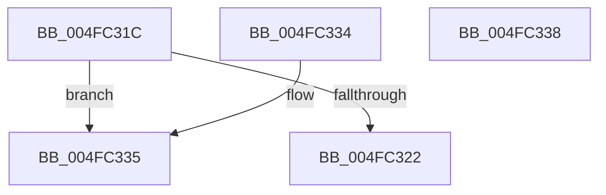

# HalpIommuIsInPermanentPassthrough

- RVA: `0x004FC31C`–`0x004FC339` (길이 `29` bytes)
- VA: `0x00000001404FC31C`
- 실행 섹션: `.text`
- PDB 이름 있음: `예`; PDB Function 태그: `아니요`
- unwind 정보 RVA: `0x000DB714`
- 디코드: `12`개 명령, `29/29` bytes 표시
- 미해석 바이트: `0` (있으면 어셈블리에 `.byte`로 보존)

> 이 문서는 커널 이미지의 기계어와 PDB 기호를 분석해 생성했습니다. 4번과 5번은 함수 원형과 자료형을 바이너리 사용 방식에서 추정한 C 해석이며 원본 소스 복구 결과는 아닙니다.

## 1. Dependencies

- 직접 호출 지점: **0**; 고유 호출 대상: **0**
- 직접 호출자로 확인된 함수: **2**
- RIP 상대 이미지 참조: **0**

### Outgoing calls
- 직접 디코드된 call 명령이 없습니다.

### Direct callers
- [HalpIommuLeaveDmaDomain](../4B/HalpIommuLeaveDmaDomain_function_004BF220.md) at `0x004BF284`
- [HalpIommuJoinDmaDomain](../55/HalpIommuJoinDmaDomain_function_005554E8.md) at `0x00555557`

### Static image references
- 디코드된 RIP-relative 메모리 참조가 없습니다.

## 2. Other-region calls and transfers

- 다른 실행 섹션으로 향하는 call: **0**
- 별도 외부 분기/꼬리 이동을 확인하지 못했습니다.

## 3. Assembly (complete function range)

```asm
004FC31C  83 7A 08 01                     cmp dword ptr [rdx + 8], 1
004FC320  75 13                           jne 0x1404fc335
004FC322  48 8B 41 20                     mov rax, qword ptr [rcx + 0x20]
004FC326  8B 80 D8 01 00 00               mov eax, dword ptr [rax + 0x1d8]
004FC32C  C1 E8 08                        shr eax, 8
004FC32F  F6 D0                           not al
004FC331  24 01                           and al, 1
004FC333  C3                              ret
004FC334  CC                              int3
004FC335  32 C0                           xor al, al
004FC337  C3                              ret
004FC338  CC                              int3
```

## 4. C-style interpretation (structured pseudocode)

```c
__int64 __fastcall HalpIommuIsInPermanentPassthrough(__int64 a1, __int64 a2)
{
    __int64 result;

    if ((*(unsigned int *)(a2 + 8)) != 1) goto loc_004FC335;
    result = (unsigned int)(((unsigned int)(*(unsigned int *)(*(unsigned __int64 *)(a1 + 32) + 472))) >> (8));
    result = (unsigned __int8)(~(result));
    result = (unsigned __int8)((result) & (1));
    return result;
loc_004FC335:
    result = 0;
    return result;
}
```

## 5. (Beta) C Style

```c
int64_t HalpIommuIsInPermanentPassthrough(void *Arg1, void *Arg2)
{
    uint8_t *arg1 = (uint8_t *)Arg1;
    uint8_t *arg2 = (uint8_t *)Arg2;

    int64_t result;

    if ((*(uint32_t *)(arg2 + 0x8)) != 1) goto loc_004FC335;
    result = (uint32_t)(((uint32_t)(*(uint32_t *)(*(uint64_t *)(arg1 + 0x20) + 0x1D8))) >> (8));
    result = (uint8_t)(~(result));
    result = (uint8_t)((result) & (1));
    return result;
loc_004FC335:
    result = 0;
    return result;
}
```

### 관측된 메모리 오프셋

구조체 형식이 확인되지 않은 접근은 인자 기준의 오프셋으로만 기록했습니다.

| 기준 인자 | 오프셋 표현 | 폭 (bit) | 접근 |
|---|---:|---:|---|
| `Arg1` | `+ 0x20` | `64` | `R` |
| `Arg2` | `+ 0x8` | `32` | `R` |

## 6. Execution-region graph

[열기: 2D/3D 그래프와 함수 탐색 컨트롤 패널](../../../control-panel.html?section=text&rva=0x004FC31C&view=graph)

- 2D 그래프는 위에서 아래로 흐르고, 3D 그래프는 빈 공간을 드래그해 회전합니다. Shift+드래그는 이동, 휠은 확대·축소, 함수 노드 선택은 대상 보고서 이동입니다.

### Static fallback


