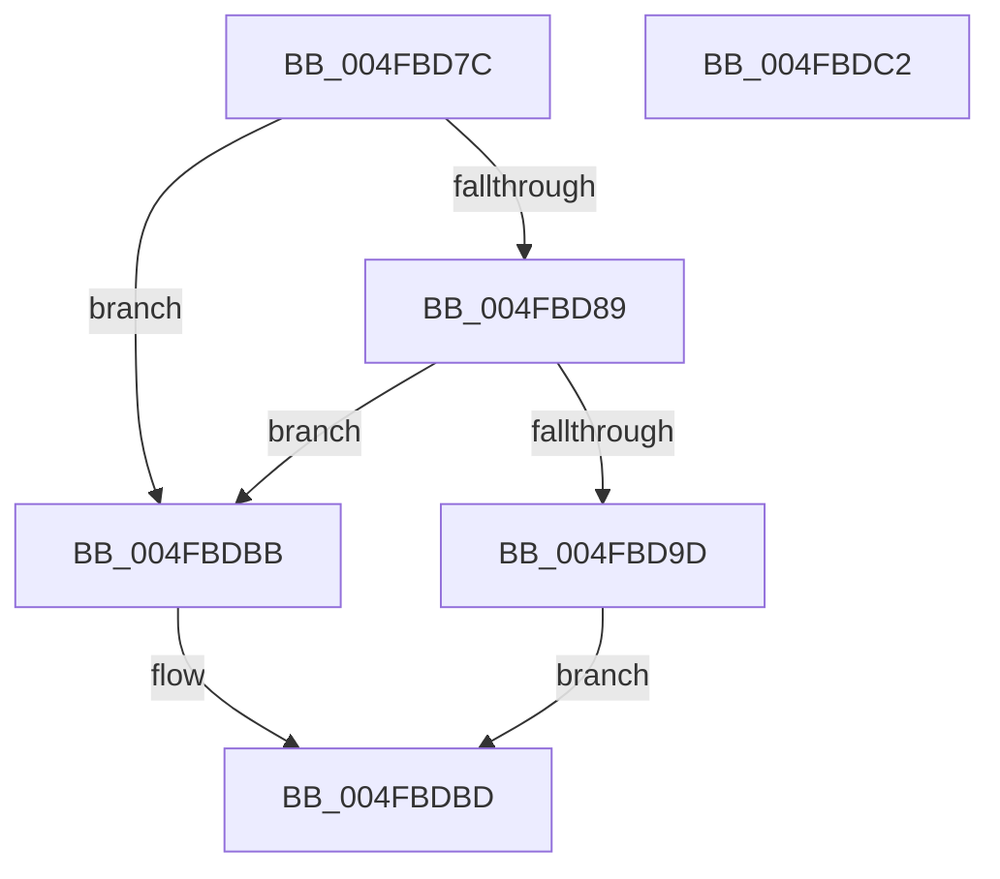

# HalpIsLmceSupported

- RVA: `0x004FBD7C`–`0x004FBDC3` (길이 `71` bytes)
- VA: `0x00000001404FBD7C`
- 실행 섹션: `.text`
- PDB 이름 있음: `예`; PDB Function 태그: `아니요`
- unwind 정보 RVA: `0x0005C788`
- 디코드: `23`개 명령, `71/71` bytes 표시
- 미해석 바이트: `0` (있으면 어셈블리에 `.byte`로 보존)

> 이 문서는 커널 이미지의 기계어와 PDB 기호를 분석해 생성했습니다. 4번과 5번은 함수 원형과 자료형을 바이너리 사용 방식에서 추정한 C 해석이며 원본 소스 복구 결과는 아닙니다.

## 1. Dependencies

- 직접 호출 지점: **1**; 고유 호출 대상: **1**
- 직접 호출자로 확인된 함수: **1**
- RIP 상대 이미지 참조: **0**

### Outgoing calls
- `0x004FBD80` → [HalpGetCpuVendor](../48/HalpGetCpuVendor_function_004879E4.md) (function, `0x004879E4`)

### Direct callers
- [HalpMcaSetProcessorConfig](../../pagelk/B7/HalpMcaSetProcessorConfig_function_00B7B418.md) at `0x00B7B468`

### Static image references
- 디코드된 RIP-relative 메모리 참조가 없습니다.

## 2. Other-region calls and transfers

- 다른 실행 섹션으로 향하는 call: **0**
- 별도 외부 분기/꼬리 이동을 확인하지 못했습니다.

## 3. Assembly (complete function range)

```asm
004FBD7C  48 83 EC 28                     sub rsp, 0x28
004FBD80  E8 5F BC F8 FF                  call 0x1404879e4
004FBD85  3C 02                           cmp al, 2
004FBD87  75 32                           jne 0x1404fbdbb
004FBD89  B9 79 01 00 00                  mov ecx, 0x179
004FBD8E  0F 32                           rdmsr
004FBD90  48 C1 E2 20                     shl rdx, 0x20
004FBD94  48 0B C2                        or rax, rdx
004FBD97  0F BA E0 1B                     bt eax, 0x1b
004FBD9B  73 1E                           jae 0x1404fbdbb
004FBD9D  B9 3A 00 00 00                  mov ecx, 0x3a
004FBDA2  0F 32                           rdmsr
004FBDA4  48 C1 E2 20                     shl rdx, 0x20
004FBDA8  B9 01 00 10 00                  mov ecx, 0x100001
004FBDAD  48 0B C2                        or rax, rdx
004FBDB0  48 23 C1                        and rax, rcx
004FBDB3  48 3B C1                        cmp rax, rcx
004FBDB6  0F 94 C0                        sete al
004FBDB9  EB 02                           jmp 0x1404fbdbd
004FBDBB  32 C0                           xor al, al
004FBDBD  48 83 C4 28                     add rsp, 0x28
004FBDC1  C3                              ret
004FBDC2  CC                              int3
```

## 4. C-style interpretation (structured pseudocode)

```c
__int64 __fastcall HalpIsLmceSupported(__int64 a1, __int64 a2)
{
    __int64 result;
    __int64 v_rsp;

    v_rsp = (v_rsp) - (40);
    result = HalpGetCpuVendor(a1, a2, a3, a4);
    if (((unsigned __int8)(result)) != 2) goto loc_004FBDBB;
    a2 = (a2) << (32);
    result = (result) | (a2);
    if (condition_is_above_or_equal) goto loc_004FBDBB;
    a2 = (a2) << (32);
    result = (result) | (a2);
    result = (result) & ((unsigned int)(0x100001ULL));
    result = (result == ((unsigned int)(0x100001ULL))) ? 1 : 0;
    goto loc_004FBDBD;
loc_004FBDBB:
    result = 0;
loc_004FBDBD:
    v_rsp = (v_rsp) + (40);
    return result;
}
```

## 5. (Beta) C Style

```c
int64_t HalpIsLmceSupported(int64_t Arg1, int64_t Arg2)
{
    int64_t result;
    int64_t local_rsp;

    local_rsp = (local_rsp) - (40);
    result = HalpGetCpuVendor(Arg1, Arg2, a3, a4);
    if (((uint8_t)(result)) != 2) goto loc_004FBDBB;
    Arg2 = (Arg2) << (32);
    result = (result) | (Arg2);
    if (condition_is_above_or_equal) goto loc_004FBDBB;
    Arg2 = (Arg2) << (32);
    result = (result) | (Arg2);
    result = (result) & ((uint32_t)(0x100001ULL));
    result = (result == ((uint32_t)(0x100001ULL))) ? 1 : 0;
    goto loc_004FBDBD;
loc_004FBDBB:
    result = 0;
loc_004FBDBD:
    local_rsp = (local_rsp) + (40);
    return result;
}
```

## 6. Execution-region graph

[열기: 2D/3D 그래프와 함수 탐색 컨트롤 패널](../../../control-panel.html?section=text&rva=0x004FBD7C&view=graph)

- 2D 그래프는 위에서 아래로 흐르고, 3D 그래프는 빈 공간을 드래그해 회전합니다. Shift+드래그는 이동, 휠은 확대·축소, 함수 노드 선택은 대상 보고서 이동입니다.

### Static fallback


