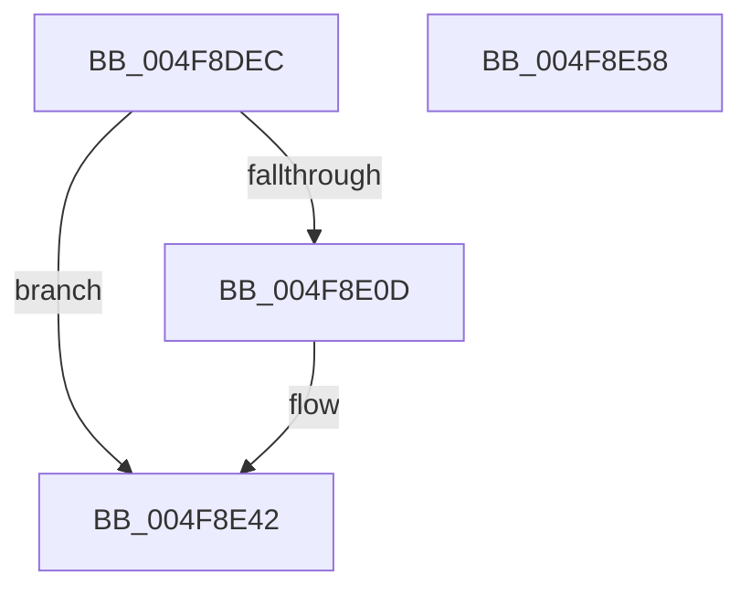

# HalpIsPartitionCpuManager

- RVA: `0x004F8DEC`–`0x004F8E59` (길이 `109` bytes)
- VA: `0x00000001404F8DEC`
- 실행 섹션: `.text`
- PDB 이름 있음: `예`; PDB Function 태그: `아니요`
- unwind 정보 RVA: `0x000AB2E4`
- 디코드: `29`개 명령, `109/109` bytes 표시
- 미해석 바이트: `0` (있으면 어셈블리에 `.byte`로 보존)

> 이 문서는 커널 이미지의 기계어와 PDB 기호를 분석해 생성했습니다. 4번과 5번은 함수 원형과 자료형을 바이너리 사용 방식에서 추정한 C 해석이며 원본 소스 복구 결과는 아닙니다.

## 1. Dependencies

- 직접 호출 지점: **2**; 고유 호출 대상: **2**
- 직접 호출자로 확인된 함수: **6**
- RIP 상대 이미지 참조: **1**

### Outgoing calls
- `0x004F8E04` → [HalpIsMicrosoftCompatibleHvLoaded](../4A/HalpIsMicrosoftCompatibleHvLoaded_function_004AFAAC.md) (function, `0x004AFAAC`)
- `0x004F8E4D` → [_security_check_cookie](../6A/_security_check_cookie_function_006AC640.md) (function, `0x006AC640`)

### Direct callers
- [HalpCmcStartPolling](HalpCmcStartPolling_function_004F8D40.md) at `0x004F8D4F`
- [HalpTimerInitializeHypervisorTimer](../54/HalpTimerInitializeHypervisorTimer_function_0054B8F4.md) at `0x0054B93B`
- [HalSocRequestConfigurationData](../56/HalSocRequestConfigurationData_function_00562ADC.md) at `0x00562B7F`
- [HalSocRequestConfigurationData](../56/HalSocRequestConfigurationData_function_00562ADC.md) at `0x00562C2C`
- [HalpInterruptRegisterController](../56/HalpInterruptRegisterController_function_005640F0.md) at `0x0056434A`
- [HalpProcIsSmtDisabled](../../init/C1/HalpProcIsSmtDisabled_function_00C1FBF4.md) at `0x00C1FC3F`
- [HalpProcIsSmtDisabled](../../init/C1/HalpProcIsSmtDisabled_function_00C1FBF4.md) at `0x00C1FC88`
- [HalpProcIsSmtDisabled](../../init/C1/HalpProcIsSmtDisabled_function_00C1FBF4.md) at `0x00C1FCB8`
- [HalpMiscGetParameters](../../init/C1/HalpMiscGetParameters_function_00C1FD30.md) at `0x00C1FF6A`

### Static image references
- `0x004F8DF2` → RVA `0x00E0A740` (`.data`; read)

## 2. Other-region calls and transfers

- 다른 실행 섹션으로 향하는 call: **0**
- 별도 외부 분기/꼬리 이동을 확인하지 못했습니다.

## 3. Assembly (complete function range)

```asm
004F8DEC  40 53                           push rbx
004F8DEE  48 83 EC 40                     sub rsp, 0x40
004F8DF2  48 8B 05 47 19 91 00            mov rax, qword ptr [rip + 0x911947]
004F8DF9  48 33 C4                        xor rax, rsp
004F8DFC  48 89 44 24 30                  mov qword ptr [rsp + 0x30], rax
004F8E01  45 32 D2                        xor r10b, r10b
004F8E04  E8 A3 6C FB FF                  call 0x1404afaac
004F8E09  84 C0                           test al, al
004F8E0B  74 35                           je 0x1404f8e42
004F8E0D  B8 03 00 00 40                  mov eax, 0x40000003
004F8E12  45 0F B6 D2                     movzx r10d, r10b
004F8E16  33 C9                           xor ecx, ecx
004F8E18  0F 57 C0                        xorps xmm0, xmm0
004F8E1B  0F A2                           cpuid
004F8E1D  0F 11 44 24 20                  movups xmmword ptr [rsp + 0x20], xmm0
004F8E22  89 44 24 20                     mov dword ptr [rsp + 0x20], eax
004F8E26  48 B8 00 00 00 00 00 10 00 00   movabs rax, 0x100000000000
004F8E30  89 5C 24 24                     mov dword ptr [rsp + 0x24], ebx
004F8E34  48 85 44 24 20                  test qword ptr [rsp + 0x20], rax
004F8E39  B8 01 00 00 00                  mov eax, 1
004F8E3E  44 0F 45 D0                     cmovne r10d, eax
004F8E42  41 8A C2                        mov al, r10b
004F8E45  48 8B 4C 24 30                  mov rcx, qword ptr [rsp + 0x30]
004F8E4A  48 33 CC                        xor rcx, rsp
004F8E4D  E8 EE 37 1B 00                  call 0x1406ac640
004F8E52  48 83 C4 40                     add rsp, 0x40
004F8E56  5B                              pop rbx
004F8E57  C3                              ret
004F8E58  CC                              int3
```

## 4. C-style interpretation (structured pseudocode)

```c
__int64 __fastcall HalpIsPartitionCpuManager(int a1)
{
    __int64 result;
    __int64 v_r10;
    __int64 v_rsp;
    unsigned __int64 v_stack_m18;
    unsigned int v_stack_m24;
    unsigned __int64 v_stack_m28;

    v_rsp = (v_rsp) - (64);
    result = (*(unsigned __int64 *)(v_rip + 9509191)) ^ (v_rsp);
    v_stack_m18 = result;
    v_r10 = 0;
    result = HalpIsMicrosoftCompatibleHvLoaded(a1, a2, a3, a4);
    if ((unsigned __int8)(result) != 0) {
        result = 0x40000003ULL;
        v_r10 = 0;
        a1 = 0;
        v_stack_m28 = v_xmm0;
        v_stack_m28 = (unsigned int)(result);
        v_stack_m24 = (unsigned int)(v_rbx);
        result = 1;
        if (((v_stack_m28) & (result)) != 0) { v_r10 = (unsigned int)(result); }
    }
    a1 = (v_stack_m18) ^ (v_rsp);
    result = _security_check_cookie(a1, a2, a3, a4);
    v_rsp = (v_rsp) + (64);
    return result;
}
```

## 5. (Beta) C Style

```c
int64_t HalpIsPartitionCpuManager(int32_t Arg1)
{
    int64_t result;
    int64_t local_r10;
    int64_t local_rsp;
    uint64_t v_stack_m18;
    uint32_t v_stack_m24;
    uint64_t v_stack_m28;

    local_rsp = (local_rsp) - (64);
    result = (*(uint64_t *)(v_rip + 0x911947)) ^ (local_rsp);
    v_stack_m18 = result;
    local_r10 = 0;
    result = HalpIsMicrosoftCompatibleHvLoaded(Arg1, a2, a3, a4);
    if ((uint8_t)(result) != 0) {
        result = 0x40000003ULL;
        local_r10 = 0;
        Arg1 = 0;
        v_stack_m28 = v_xmm0;
        v_stack_m28 = (uint32_t)(result);
        v_stack_m24 = (uint32_t)(local_rbx);
        result = 1;
        if (((v_stack_m28) & (result)) != 0) { local_r10 = (uint32_t)(result); }
    }
    Arg1 = (v_stack_m18) ^ (local_rsp);
    result = _security_check_cookie(Arg1, a2, a3, a4);
    local_rsp = (local_rsp) + (64);
    return result;
}
```

## 6. Execution-region graph

[열기: 2D/3D 그래프와 함수 탐색 컨트롤 패널](../../../control-panel.html?section=text&rva=0x004F8DEC&view=graph)

- 2D 그래프는 위에서 아래로 흐르고, 3D 그래프는 빈 공간을 드래그해 회전합니다. Shift+드래그는 이동, 휠은 확대·축소, 함수 노드 선택은 대상 보고서 이동입니다.

### Static fallback


