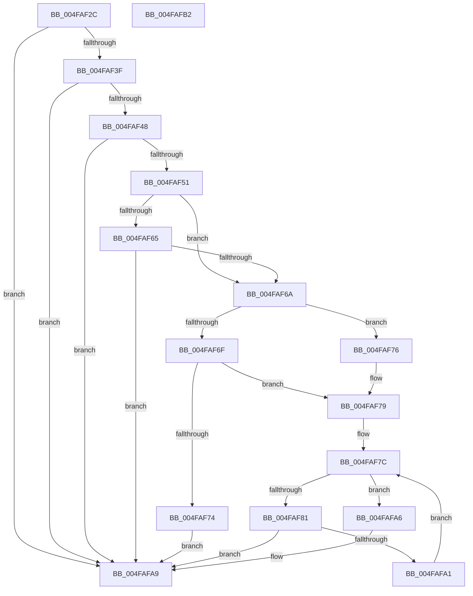

# HalpIvtCheckIdPathMatch

- RVA: `0x004FAF2C`–`0x004FAFB3` (길이 `135` bytes)
- VA: `0x00000001404FAF2C`
- 실행 섹션: `.text`
- PDB 이름 있음: `예`; PDB Function 태그: `아니요`
- unwind 정보 RVA: `0x00071750`
- 디코드: `45`개 명령, `135/135` bytes 표시
- 미해석 바이트: `0` (있으면 어셈블리에 `.byte`로 보존)

> 이 문서는 커널 이미지의 기계어와 PDB 기호를 분석해 생성했습니다. 4번과 5번은 함수 원형과 자료형을 바이너리 사용 방식에서 추정한 C 해석이며 원본 소스 복구 결과는 아닙니다.

## 1. Dependencies

- 직접 호출 지점: **0**; 고유 호출 대상: **0**
- 직접 호출자로 확인된 함수: **3**
- RIP 상대 이미지 참조: **0**

### Outgoing calls
- 직접 디코드된 call 명령이 없습니다.

### Direct callers
- [IvtCreateDevice](../57/IvtCreateDevice_function_00579DE0.md) at `0x00579E47`
- [IvtFindDevice](../57/IvtFindDevice_function_00579F10.md) at `0x00579F6F`
- [IvtCheckForReservedRegion](../../page/70/IvtCheckForReservedRegion_function_0070DDB0.md) at `0x0070DE24`

### Static image references
- 디코드된 RIP-relative 메모리 참조가 없습니다.

## 2. Other-region calls and transfers

- 다른 실행 섹션으로 향하는 call: **0**
- 별도 외부 분기/꼬리 이동을 확인하지 못했습니다.

## 3. Assembly (complete function range)

```asm
004FAF2C  48 89 5C 24 08                  mov qword ptr [rsp + 8], rbx
004FAF31  45 33 C9                        xor r9d, r9d
004FAF34  4C 8B DA                        mov r11, rdx
004FAF37  83 39 01                        cmp dword ptr [rcx], 1
004FAF3A  48 8B D9                        mov rbx, rcx
004FAF3D  75 6A                           jne 0x1404fafa9
004FAF3F  8A 12                           mov dl, byte ptr [rdx]
004FAF41  8D 42 FF                        lea eax, [rdx - 1]
004FAF44  3C 01                           cmp al, 1
004FAF46  77 61                           ja 0x1404fafa9
004FAF48  41 8A 43 05                     mov al, byte ptr [r11 + 5]
004FAF4C  38 41 0B                        cmp byte ptr [rcx + 0xb], al
004FAF4F  75 58                           jne 0x1404fafa9
004FAF51  41 0F B6 43 01                  movzx eax, byte ptr [r11 + 1]
004FAF56  44 0F B7 51 0E                  movzx r10d, word ptr [rcx + 0xe]
004FAF5B  83 E8 06                        sub eax, 6
004FAF5E  D1 E8                           shr eax, 1
004FAF60  80 FA 01                        cmp dl, 1
004FAF63  75 05                           jne 0x1404faf6a
004FAF65  44 3B D0                        cmp r10d, eax
004FAF68  75 3F                           jne 0x1404fafa9
004FAF6A  44 3B D0                        cmp r10d, eax
004FAF6D  73 07                           jae 0x1404faf76
004FAF6F  80 FA 02                        cmp dl, 2
004FAF72  75 05                           jne 0x1404faf79
004FAF74  EB 33                           jmp 0x1404fafa9
004FAF76  44 8B D0                        mov r10d, eax
004FAF79  45 8B C1                        mov r8d, r9d
004FAF7C  45 3B C2                        cmp r8d, r10d
004FAF7F  73 25                           jae 0x1404fafa6
004FAF81  41 8B D0                        mov edx, r8d
004FAF84  41 0F B6 44 53 07               movzx eax, byte ptr [r11 + rdx*2 + 7]
004FAF8A  41 0F B6 4C 53 06               movzx ecx, byte ptr [r11 + rdx*2 + 6]
004FAF90  66 C1 E0 08                     shl ax, 8
004FAF94  66 0B C8                        or cx, ax
004FAF97  48 8B 43 10                     mov rax, qword ptr [rbx + 0x10]
004FAF9B  66 39 0C 50                     cmp word ptr [rax + rdx*2], cx
004FAF9F  75 08                           jne 0x1404fafa9
004FAFA1  41 FF C0                        inc r8d
004FAFA4  EB D6                           jmp 0x1404faf7c
004FAFA6  41 B1 01                        mov r9b, 1
004FAFA9  48 8B 5C 24 08                  mov rbx, qword ptr [rsp + 8]
004FAFAE  41 8A C1                        mov al, r9b
004FAFB1  C3                              ret
004FAFB2  CC                              int3
```

## 4. C-style interpretation (structured pseudocode)

```c
__int64 __fastcall HalpIvtCheckIdPathMatch(__int64 a1, __int64 a2, __int64 a3, int a4)
{
    __int64 result;
    unsigned __int64 v_stack_p8;

    v_stack_p8 = v_rbx;
    a4 = 0;
    if ((*(unsigned int *)(a1)) != 1) goto loc_004FAFA9;
    if (((unsigned __int8)(*(unsigned __int8 *)(a2) - 1)) > 1) goto loc_004FAFA9;
    if ((*(unsigned __int8 *)(a1 + 11)) != ((unsigned __int8)(*(unsigned __int8 *)(a2 + 5)))) goto loc_004FAFA9;
    result = (unsigned int)((*(unsigned __int8 *)(a2 + 1)) - (6));
    result = (unsigned int)((result) >> (1));
    if (((unsigned __int8)(*(unsigned __int8 *)(a2))) != 1) goto loc_004FAF6A;
    if (((unsigned int)(*(unsigned __int16 *)(a1 + 14))) != ((unsigned int)(result))) goto loc_004FAFA9;
loc_004FAF6A:
    if (((unsigned int)(*(unsigned __int16 *)(a1 + 14))) >= ((unsigned int)(result))) goto loc_004FAF76;
    if (((unsigned __int8)(*(unsigned __int8 *)(a2))) != 2) goto loc_004FAF79;
    goto loc_004FAFA9;
loc_004FAF76:
loc_004FAF79:
loc_004FAF7C:
    if (0 >= ((unsigned int)((unsigned int)((unsigned int)(result))))) goto loc_004FAFA6;
    result = (unsigned __int16)((*(unsigned __int8 *)(a2 + 0 * 2 + 7)) << (8));
    a1 = (unsigned __int16)((*(unsigned __int8 *)(a2 + 0 * 2 + 6)) | ((unsigned __int16)(result)));
    if ((*(unsigned __int16 *)(*(unsigned __int64 *)(a1 + 16) + 0 * 2)) != ((unsigned __int16)(a1))) goto loc_004FAFA9;
    a3 = (unsigned int)((0) + 1);
    goto loc_004FAF7C;
loc_004FAFA6:
loc_004FAFA9:
    return 1;
}
```

## 5. (Beta) C Style

```c
int64_t HalpIvtCheckIdPathMatch(void *Arg1, void *Arg2, int64_t Arg3, int32_t Arg4)
{
    uint8_t *arg1 = (uint8_t *)Arg1;
    uint8_t *arg2 = (uint8_t *)Arg2;

    int64_t result;
    uint64_t v_stack_p8;

    v_stack_p8 = local_rbx;
    Arg4 = 0;
    if ((*(uint32_t *)(arg1)) != 1) goto loc_004FAFA9;
    if (((uint8_t)(*(uint8_t *)(arg2) - 1)) > 1) goto loc_004FAFA9;
    if ((*(uint8_t *)(arg1 + 0xB)) != ((uint8_t)(*(uint8_t *)(arg2 + 0x5)))) goto loc_004FAFA9;
    result = (uint32_t)((*(uint8_t *)(arg2 + 0x1)) - (6));
    result = (uint32_t)((result) >> (1));
    if (((uint8_t)(*(uint8_t *)(arg2))) != 1) goto loc_004FAF6A;
    if (((uint32_t)(*(uint16_t *)(arg1 + 0xE))) != ((uint32_t)(result))) goto loc_004FAFA9;
loc_004FAF6A:
    if (((uint32_t)(*(uint16_t *)(arg1 + 0xE))) >= ((uint32_t)(result))) goto loc_004FAF76;
    if (((uint8_t)(*(uint8_t *)(arg2))) != 2) goto loc_004FAF79;
    goto loc_004FAFA9;
loc_004FAF76:
loc_004FAF79:
loc_004FAF7C:
    if (0 >= ((uint32_t)((uint32_t)((uint32_t)(result))))) goto loc_004FAFA6;
    result = (uint16_t)((*(uint8_t *)(arg2 + 0x0 * 2 + 0x7)) << (8));
    Arg1 = (uint16_t)((*(uint8_t *)(arg2 + 0x0 * 2 + 0x6)) | ((uint16_t)(result)));
    if ((*(uint16_t *)(*(uint64_t *)(arg1 + 0x10) + 0x0 * 2)) != ((uint16_t)(Arg1))) goto loc_004FAFA9;
    Arg3 = (uint32_t)((0) + 1);
    goto loc_004FAF7C;
loc_004FAFA6:
loc_004FAFA9:
    return 1;
}
```

### 관측된 메모리 오프셋

구조체 형식이 확인되지 않은 접근은 인자 기준의 오프셋으로만 기록했습니다.

| 기준 인자 | 오프셋 표현 | 폭 (bit) | 접근 |
|---|---:|---:|---|
| `Arg1` | `+ 0x0` | `32` | `R` |
| `Arg1` | `+ 0xB` | `8` | `R` |
| `Arg1` | `+ 0xE` | `16` | `R` |
| `Arg1` | `+ 0x10` | `64` | `R` |
| `Arg2` | `+ 0x0` | `8` | `R` |
| `Arg2` | `+ 0x1` | `8` | `R` |
| `Arg2` | `+ 0x5` | `8` | `R` |
| `Arg2` | `+ 0x6 + rdx*2` | `8` | `R` |
| `Arg2` | `+ 0x7 + rdx*2` | `8` | `R` |

## 6. Execution-region graph

[열기: 2D/3D 그래프와 함수 탐색 컨트롤 패널](../../../control-panel.html?section=text&rva=0x004FAF2C&view=graph)

- 2D 그래프는 위에서 아래로 흐르고, 3D 그래프는 빈 공간을 드래그해 회전합니다. Shift+드래그는 이동, 휠은 확대·축소, 함수 노드 선택은 대상 보고서 이동입니다.

### Static fallback


