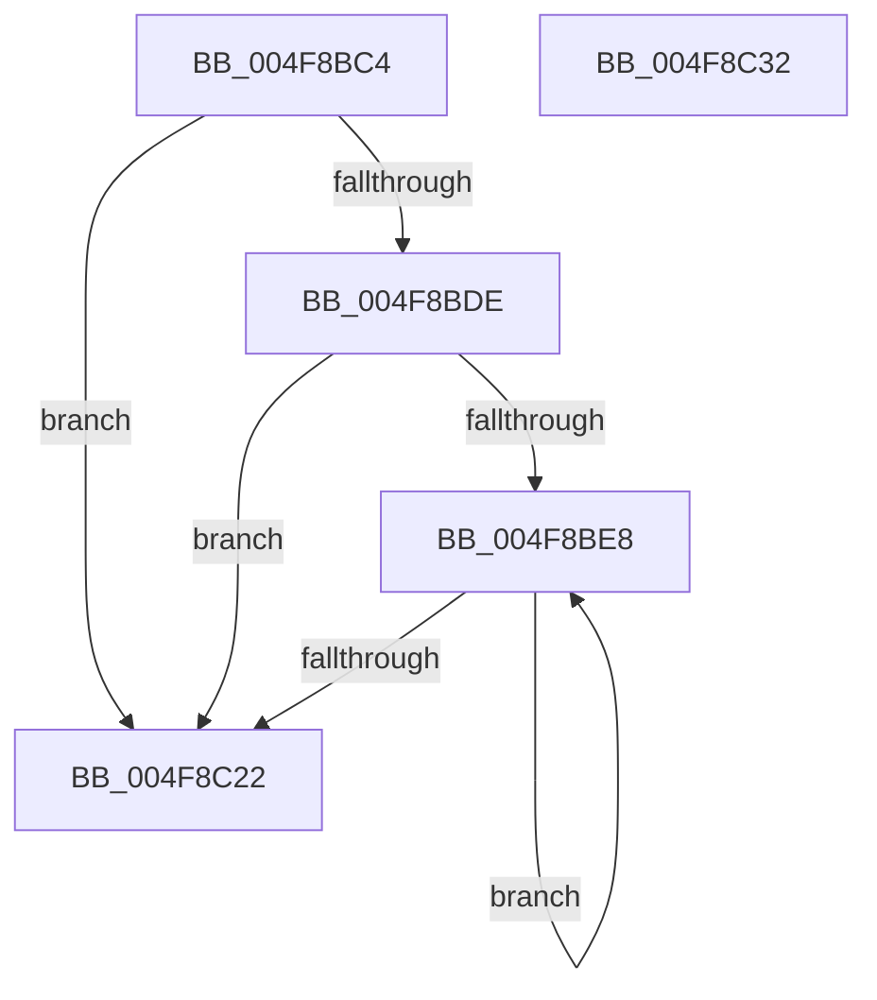

# HalpPreserveNvsArea

- RVA: `0x004F8BC4`–`0x004F8C33` (길이 `111` bytes)
- VA: `0x00000001404F8BC4`
- 실행 섹션: `.text`
- PDB 이름 있음: `예`; PDB Function 태그: `아니요`
- unwind 정보 RVA: `0x00060BC4`
- 디코드: `29`개 명령, `111/111` bytes 표시
- 미해석 바이트: `0` (있으면 어셈블리에 `.byte`로 보존)

> 이 문서는 커널 이미지의 기계어와 PDB 기호를 분석해 생성했습니다. 4번과 5번은 함수 원형과 자료형을 바이너리 사용 방식에서 추정한 C 해석이며 원본 소스 복구 결과는 아닙니다.

## 1. Dependencies

- 직접 호출 지점: **1**; 고유 호출 대상: **1**
- 직접 호출자로 확인된 함수: **1**
- RIP 상대 이미지 참조: **4**

### Outgoing calls
- `0x004F8C08` → [RtlCopyDeviceMemory](../52/RtlCopyDeviceMemory_function_00522BFC.md) (function, `0x00522BFC`)

### Direct callers
- [HalpAcpiPreSleep](../../pagelk/B7/HalpAcpiPreSleep_function_00B7BFD4.md) at `0x00B7C05A`

### Static image references
- `0x004F8BD5` → RVA `0x00E0A834` (`.data`; read)
- `0x004F8BDE` → RVA `0x00F90018` (`.data`; read)
- `0x004F8BE8` → RVA `0x00F90168` (`.data`; read)
- `0x004F8BF3` → RVA `0x00F90158` (`.data`; read)

## 2. Other-region calls and transfers

- 다른 실행 섹션으로 향하는 call: **0**
- 별도 외부 분기/꼬리 이동을 확인하지 못했습니다.

## 3. Assembly (complete function range)

```asm
004F8BC4  48 89 5C 24 08                  mov qword ptr [rsp + 8], rbx
004F8BC9  48 89 74 24 10                  mov qword ptr [rsp + 0x10], rsi
004F8BCE  57                              push rdi
004F8BCF  48 83 EC 20                     sub rsp, 0x20
004F8BD3  33 FF                           xor edi, edi
004F8BD5  40 38 3D 58 1C 91 00            cmp byte ptr [rip + 0x911c58], dil
004F8BDC  75 44                           jne 0x1404f8c22
004F8BDE  39 3D 34 74 A9 00               cmp dword ptr [rip + 0xa97434], edi
004F8BE4  8B F7                           mov esi, edi
004F8BE6  76 3A                           jbe 0x1404f8c22
004F8BE8  48 8B 15 79 75 A9 00            mov rdx, qword ptr [rip + 0xa97579]
004F8BEF  8B C6                           mov eax, esi
004F8BF1  8B CF                           mov ecx, edi
004F8BF3  48 03 0D 5E 75 A9 00            add rcx, qword ptr [rip + 0xa9755e]
004F8BFA  48 8D 1C 40                     lea rbx, [rax + rax*2]
004F8BFE  44 8B 44 DA 08                  mov r8d, dword ptr [rdx + rbx*8 + 8]
004F8C03  48 8B 54 DA 10                  mov rdx, qword ptr [rdx + rbx*8 + 0x10]
004F8C08  E8 EF 9F 02 00                  call 0x140522bfc
004F8C0D  48 8B 05 54 75 A9 00            mov rax, qword ptr [rip + 0xa97554]
004F8C14  FF C6                           inc esi
004F8C16  03 7C D8 08                     add edi, dword ptr [rax + rbx*8 + 8]
004F8C1A  3B 35 F8 73 A9 00               cmp esi, dword ptr [rip + 0xa973f8]
004F8C20  72 C6                           jb 0x1404f8be8
004F8C22  48 8B 5C 24 30                  mov rbx, qword ptr [rsp + 0x30]
004F8C27  48 8B 74 24 38                  mov rsi, qword ptr [rsp + 0x38]
004F8C2C  48 83 C4 20                     add rsp, 0x20
004F8C30  5F                              pop rdi
004F8C31  C3                              ret
004F8C32  CC                              int3
```

## 4. C-style interpretation (structured pseudocode)

```c
__int64 __fastcall HalpPreserveNvsArea(void)
{
    __int64 result;
    __int64 v_rdi;
    __int64 v_rsi;
    __int64 v_rsp;
    unsigned __int64 v_stack_p10;
    unsigned __int64 v_stack_p8;

    v_stack_p8 = v_rbx;
    v_stack_p10 = v_rsi;
    v_rsp = (v_rsp) - (32);
    v_rdi = 0;
    if ((*(unsigned __int8 *)(v_rip + 9509976)) != 0) goto loc_004F8C22;
    if ((*(unsigned int *)(v_rip + 11105332)) <= 0) goto loc_004F8C22;
loc_004F8BE8:
    a1 = (0) + (*(unsigned __int64 *)(v_rip + 11105630));
    result = RtlCopyDeviceMemory(a1, *(unsigned __int64 *)(*(unsigned __int64 *)(v_rip + 11105657) + 0 + 0 * 2 * 8 + 16), (unsigned int)(*(unsigned int *)(*(unsigned __int64 *)(v_rip + 11105657) + 0 + 0 * 2 * 8 + 8)), a4);
    v_rsi = (unsigned int)((0) + 1);
    v_rdi = (unsigned int)((v_rdi) + (*(unsigned int *)(*(unsigned __int64 *)(v_rip + 11105620) + 0 + 0 * 2 * 8 + 8)));
    if (((unsigned int)(v_rsi)) < (*(unsigned int *)(v_rip + 11105272))) goto loc_004F8BE8;
loc_004F8C22:
    v_rsp = (v_rsp) + (32);
    return *(unsigned __int64 *)(v_rip + 11105620);
}
```

## 5. (Beta) C Style

```c
void HalpPreserveNvsArea(void)
{
    int64_t result;
    int64_t local_rdi;
    int64_t local_rsi;
    int64_t local_rsp;
    uint64_t v_stack_p10;
    uint64_t v_stack_p8;

    v_stack_p8 = local_rbx;
    v_stack_p10 = local_rsi;
    local_rsp = (local_rsp) - (32);
    local_rdi = 0;
    if ((*(uint8_t *)(v_rip + 0x911C58)) != 0) goto loc_004F8C22;
    if ((*(uint32_t *)(v_rip + 0xA97434)) <= 0) goto loc_004F8C22;
loc_004F8BE8:
    a1 = (0) + (*(uint64_t *)(v_rip + 0xA9755E));
    result = RtlCopyDeviceMemory(a1, *(uint64_t *)(*(uint64_t *)(v_rip + 0xA97579) + 0x0 + 0x0 * 2 * 8 + 0x10), (uint32_t)(*(uint32_t *)(*(uint64_t *)(v_rip + 0xA97579) + 0x0 + 0x0 * 2 * 8 + 0x8)), a4);
    local_rsi = (uint32_t)((0) + 1);
    local_rdi = (uint32_t)((local_rdi) + (*(uint32_t *)(*(uint64_t *)(v_rip + 0xA97554) + 0x0 + 0x0 * 2 * 8 + 0x8)));
    if (((uint32_t)(local_rsi)) < (*(uint32_t *)(v_rip + 0xA973F8))) goto loc_004F8BE8;
loc_004F8C22:
    local_rsp = (local_rsp) + (32);
    return *(uint64_t *)(v_rip + 0xA97554);
}
```

## 6. Execution-region graph

[열기: 2D/3D 그래프와 함수 탐색 컨트롤 패널](../../../control-panel.html?section=text&rva=0x004F8BC4&view=graph)

- 2D 그래프는 위에서 아래로 흐르고, 3D 그래프는 빈 공간을 드래그해 회전합니다. Shift+드래그는 이동, 휠은 확대·축소, 함수 노드 선택은 대상 보고서 이동입니다.

### Static fallback


