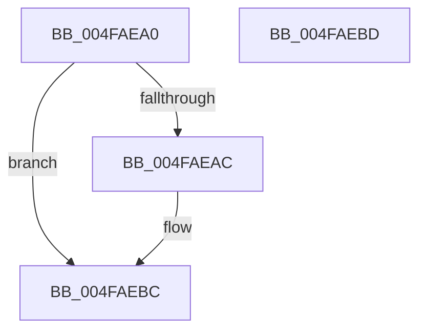

# HalpTimerMarkWake

- RVA: `0x004FAEA0`–`0x004FAEBE` (길이 `30` bytes)
- VA: `0x00000001404FAEA0`
- 실행 섹션: `.text`
- PDB 이름 있음: `예`; PDB Function 태그: `아니요`
- unwind 정보 RVA: `0x000DB714`
- 디코드: `9`개 명령, `30/30` bytes 표시
- 미해석 바이트: `0` (있으면 어셈블리에 `.byte`로 보존)

> 이 문서는 커널 이미지의 기계어와 PDB 기호를 분석해 생성했습니다. 4번과 5번은 함수 원형과 자료형을 바이너리 사용 방식에서 추정한 C 해석이며 원본 소스 복구 결과는 아닙니다.

## 1. Dependencies

- 직접 호출 지점: **0**; 고유 호출 대상: **0**
- 직접 호출자로 확인된 함수: **1**
- RIP 상대 이미지 참조: **1**

### Outgoing calls
- 직접 디코드된 call 명령이 없습니다.

### Direct callers
- [HalpPostSleepMP](../../pagelk/B5/HalpPostSleepMP_function_00B5ECC4.md) at `0x00B5EDC4`

### Static image references
- `0x004FAEB5` → RVA `0x00FC3F98` (`.data`; write)

## 2. Other-region calls and transfers

- 다른 실행 섹션으로 향하는 call: **0**
- 별도 외부 분기/꼬리 이동을 확인하지 못했습니다.

## 3. Assembly (complete function range)

```asm
004FAEA0  65 8B 04 25 A4 01 00 00         mov eax, dword ptr gs:[0x1a4]
004FAEA8  85 C0                           test eax, eax
004FAEAA  75 10                           jne 0x1404faebc
004FAEAC  0F 31                           rdtsc
004FAEAE  48 C1 E2 20                     shl rdx, 0x20
004FAEB2  48 0B C2                        or rax, rdx
004FAEB5  48 89 05 DC 90 AC 00            mov qword ptr [rip + 0xac90dc], rax
004FAEBC  C3                              ret
004FAEBD  CC                              int3
```

## 4. C-style interpretation (structured pseudocode)

```c
__int64 __fastcall HalpTimerMarkWake(__int64 a1, __int64 a2)
{
    __int64 result;

    result = (unsigned int)(*(unsigned int *)(gs_base + (0 + 420)));
    if ((unsigned int)((unsigned int)(*(unsigned int *)(gs_base + (0 + 420)))) == 0) {
        a2 = (a2) << (32);
        result = ((unsigned int)(*(unsigned int *)(gs_base + (0 + 420)))) | (a2);
        *(unsigned __int64 *)(v_rip + 11309276) = result;
    }
    return result;
}
```

## 5. (Beta) C Style

```c
int64_t HalpTimerMarkWake(int64_t Arg1, int64_t Arg2)
{
    int64_t result;

    result = (uint32_t)(*(uint32_t *)(gs_base + (0 + 0x1A4)));
    if ((uint32_t)((uint32_t)(*(uint32_t *)(gs_base + (0 + 0x1A4)))) == 0) {
        Arg2 = (Arg2) << (32);
        result = ((uint32_t)(*(uint32_t *)(gs_base + (0 + 0x1A4)))) | (Arg2);
        *(uint64_t *)(v_rip + 0xAC90DC) = result;
    }
    return result;
}
```

## 6. Execution-region graph

[열기: 2D/3D 그래프와 함수 탐색 컨트롤 패널](../../../control-panel.html?section=text&rva=0x004FAEA0&view=graph)

- 2D 그래프는 위에서 아래로 흐르고, 3D 그래프는 빈 공간을 드래그해 회전합니다. Shift+드래그는 이동, 휠은 확대·축소, 함수 노드 선택은 대상 보고서 이동입니다.

### Static fallback


