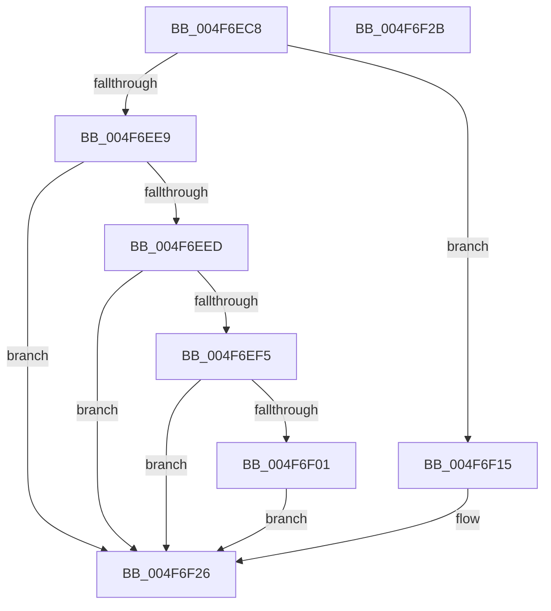

# HalpTimerRestoreProcessorCounter

- RVA: `0x004F6EC8`–`0x004F6F2C` (길이 `100` bytes)
- VA: `0x00000001404F6EC8`
- 실행 섹션: `.text`
- PDB 이름 있음: `예`; PDB Function 태그: `아니요`
- unwind 정보 RVA: `0x0005C788`
- 디코드: `25`개 명령, `100/100` bytes 표시
- 미해석 바이트: `0` (있으면 어셈블리에 `.byte`로 보존)

> 이 문서는 커널 이미지의 기계어와 PDB 기호를 분석해 생성했습니다. 4번과 5번은 함수 원형과 자료형을 바이너리 사용 방식에서 추정한 C 해석이며 원본 소스 복구 결과는 아닙니다.

## 1. Dependencies

- 직접 호출 지점: **1**; 고유 호출 대상: **1**
- 직접 호출자로 확인된 함수: **1**
- RIP 상대 이미지 참조: **6**

### Outgoing calls
- `0x004F6F0E` → [guard_dispatch_icall](../6B/guard_dispatch_icall_function_006BAAD0.md) (function, `0x006BAAD0`)

### Direct callers
- [HalpPostSleepMP](../../pagelk/B5/HalpPostSleepMP_function_00B5ECC4.md) at `0x00B5EDC9`

### Static image references
- `0x004F6ED4` → RVA `0x00FC1C88` (`.data`; read)
- `0x004F6EDC` → RVA `0x00FC4040` (`.data`; read)
- `0x004F6EED` → RVA `0x00FC40D8` (`.data`; read)
- `0x004F6EF5` → RVA `0x00FC1E70` (`.data`; read)
- `0x004F6F01` → RVA `0x00FC3FB0` (`.data`; read)
- `0x004F6F08` → RVA `0x00FC3FA0` (`.data`; read)

## 2. Other-region calls and transfers

- 다른 실행 섹션으로 향하는 call: **0**
- 별도 외부 분기/꼬리 이동을 확인하지 못했습니다.

## 3. Assembly (complete function range)

```asm
004F6EC8  48 83 EC 28                     sub rsp, 0x28
004F6ECC  65 8B 14 25 A4 01 00 00         mov edx, dword ptr gs:[0x1a4]
004F6ED4  48 83 3D AC AD AC 00 00         cmp qword ptr [rip + 0xacadac], 0
004F6EDC  48 8B 05 5D D1 AC 00            mov rax, qword ptr [rip + 0xacd15d]
004F6EE3  4C 8B 04 D0                     mov r8, qword ptr [rax + rdx*8]
004F6EE7  74 2C                           je 0x1404f6f15
004F6EE9  85 D2                           test edx, edx
004F6EEB  75 39                           jne 0x1404f6f26
004F6EED  38 15 E5 D1 AC 00               cmp byte ptr [rip + 0xacd1e5], dl
004F6EF3  74 31                           je 0x1404f6f26
004F6EF5  48 8B 05 74 AF AC 00            mov rax, qword ptr [rip + 0xacaf74]
004F6EFC  48 85 C0                        test rax, rax
004F6EFF  74 25                           je 0x1404f6f26
004F6F01  48 8B 15 A8 D0 AC 00            mov rdx, qword ptr [rip + 0xacd0a8]
004F6F08  8B 0D 92 D0 AC 00               mov ecx, dword ptr [rip + 0xacd092]
004F6F0E  E8 BD 3B 1C 00                  call 0x1406baad0
004F6F13  EB 11                           jmp 0x1404f6f26
004F6F15  49 8B D0                        mov rdx, r8
004F6F18  49 8B C0                        mov rax, r8
004F6F1B  48 C1 EA 20                     shr rdx, 0x20
004F6F1F  B9 10 00 00 00                  mov ecx, 0x10
004F6F24  0F 30                           wrmsr
004F6F26  48 83 C4 28                     add rsp, 0x28
004F6F2A  C3                              ret
004F6F2B  CC                              int3
```

## 4. C-style interpretation (structured pseudocode)

```c
__int64 __fastcall HalpTimerRestoreProcessorCounter(void)
{
    __int64 result;
    __int64 v_rsp;

    v_rsp = (v_rsp) - (40);
    if ((*(unsigned __int64 *)(v_rip + 11316652)) == 0) goto loc_004F6F15;
    if ((unsigned int)((unsigned int)(*(unsigned int *)(gs_base + (0 + 420)))) != 0) goto loc_004F6F26;
    if ((*(unsigned __int8 *)(v_rip + 11325925)) == ((unsigned __int8)((unsigned int)(*(unsigned int *)(gs_base + (0 + 420)))))) goto loc_004F6F26;
    if (*(unsigned __int64 *)(v_rip + 11317108) == 0) goto loc_004F6F26;
    result = guard_dispatch_icall((unsigned int)(*(unsigned int *)(v_rip + 11325586)), *(unsigned __int64 *)(v_rip + 11325608), *(unsigned __int64 *)(*(unsigned __int64 *)(v_rip + 11325789) + (unsigned int)(*(unsigned int *)(gs_base + (0 + 420))) * 8), a4);
    goto loc_004F6F26;
loc_004F6F15:
    a2 = (*(unsigned __int64 *)(*(unsigned __int64 *)(v_rip + 11325789) + (unsigned int)(*(unsigned int *)(gs_base + (0 + 420))) * 8)) >> (32);
loc_004F6F26:
    v_rsp = (v_rsp) + (40);
    return *(unsigned __int64 *)(*(unsigned __int64 *)(v_rip + 11325789) + (unsigned int)(*(unsigned int *)(gs_base + (0 + 420))) * 8);
}
```

## 5. (Beta) C Style

```c
void HalpTimerRestoreProcessorCounter(void)
{
    int64_t result;
    int64_t local_rsp;

    local_rsp = (local_rsp) - (40);
    if ((*(uint64_t *)(v_rip + 0xACADAC)) == 0) goto loc_004F6F15;
    if ((uint32_t)((uint32_t)(*(uint32_t *)(gs_base + (0 + 0x1A4)))) != 0) goto loc_004F6F26;
    if ((*(uint8_t *)(v_rip + 0xACD1E5)) == ((uint8_t)((uint32_t)(*(uint32_t *)(gs_base + (0 + 0x1A4)))))) goto loc_004F6F26;
    if (*(uint64_t *)(v_rip + 0xACAF74) == 0) goto loc_004F6F26;
    result = guard_dispatch_icall((uint32_t)(*(uint32_t *)(v_rip + 0xACD092)), *(uint64_t *)(v_rip + 0xACD0A8), *(uint64_t *)(*(uint64_t *)(v_rip + 0xACD15D) + (uint32_t)(*(uint32_t *)(gs_base + (0 + 0x1A4))) * 8), a4);
    goto loc_004F6F26;
loc_004F6F15:
    a2 = (*(uint64_t *)(*(uint64_t *)(v_rip + 0xACD15D) + (uint32_t)(*(uint32_t *)(gs_base + (0 + 0x1A4))) * 8)) >> (32);
loc_004F6F26:
    local_rsp = (local_rsp) + (40);
    return *(uint64_t *)(*(uint64_t *)(v_rip + 0xACD15D) + (uint32_t)(*(uint32_t *)(gs_base + (0 + 0x1A4))) * 8);
}
```

## 6. Execution-region graph

[열기: 2D/3D 그래프와 함수 탐색 컨트롤 패널](../../../control-panel.html?section=text&rva=0x004F6EC8&view=graph)

- 2D 그래프는 위에서 아래로 흐르고, 3D 그래프는 빈 공간을 드래그해 회전합니다. Shift+드래그는 이동, 휠은 확대·축소, 함수 노드 선택은 대상 보고서 이동입니다.

### Static fallback


