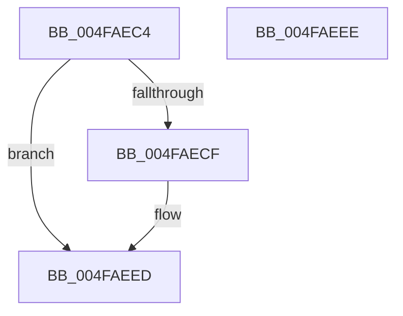

# HalpTimerSetProblemEx

- RVA: `0x004FAEC4`–`0x004FAEEF` (길이 `43` bytes)
- VA: `0x00000001404FAEC4`
- 실행 섹션: `.text`
- PDB 이름 있음: `예`; PDB Function 태그: `아니요`
- unwind 정보 RVA: `0x000DB714`
- 디코드: `10`개 명령, `43/43` bytes 표시
- 미해석 바이트: `0` (있으면 어셈블리에 `.byte`로 보존)

> 이 문서는 커널 이미지의 기계어와 PDB 기호를 분석해 생성했습니다. 4번과 5번은 함수 원형과 자료형을 바이너리 사용 방식에서 추정한 C 해석이며 원본 소스 복구 결과는 아닙니다.

## 1. Dependencies

- 직접 호출 지점: **0**; 고유 호출 대상: **0**
- 직접 호출자로 확인된 함수: **14**
- RIP 상대 이미지 참조: **1**

### Outgoing calls
- 직접 디코드된 call 명령이 없습니다.

### Direct callers
- [sub_0042BC55](../42/Unknown_function_0042BC55.md) at `0x0042BCA4`
- [sub_0042BCAE](../42/Unknown_function_0042BCAE.md) at `0x0042BCCD`
- [sub_0042BCAE](../42/Unknown_function_0042BCAE.md) at `0x0042BCFE`
- [HalpSetTimer](../42/HalpSetTimer_function_0042BD30.md) at `0x0042BF5E`
- [HalpInitializePnTimers](../53/HalpInitializePnTimers_function_0053C120.md) at `0x0053C18E`
- [HalpInitializeTimers](../53/HalpInitializeTimers_function_0053C1E0.md) at `0x0053C24E`
- [HalpTimerInitialize](../53/HalpTimerInitialize_function_0053CF38.md) at `0x0053CF84`
- [HalpTimerInitializeEarlyStallSource](../53/HalpTimerInitializeEarlyStallSource_function_0053CFDC.md) at `0x0053D0E9`
- [HalpTimerReinitializeThisProcessor](../53/HalpTimerReinitializeThisProcessor_function_0053D2F0.md) at `0x0053D35A`
- [HalpTimerSelectRoles](../53/HalpTimerSelectRoles_function_0053D4B0.md) at `0x0053D887`
- [HalpTimerClockInitialize](../54/HalpTimerClockInitialize_function_00548130.md) at `0x0054816F`
- [HalpTimerInitializeClock](../54/HalpTimerInitializeClock_function_00548424.md) at `0x005485F1`
- [HalpTimerConfigureInterrupt](../54/HalpTimerConfigureInterrupt_function_00548AB0.md) at `0x00548CB9`
- [HalpTimerConfigureInterrupt](../54/HalpTimerConfigureInterrupt_function_00548AB0.md) at `0x00548D08`
- [HalpTimerConfigureInterrupt](../54/HalpTimerConfigureInterrupt_function_00548AB0.md) at `0x00548EE6`
- [HalpTimerRestartProfileInterrupt](../54/HalpTimerRestartProfileInterrupt_function_0054B6A4.md) at `0x0054B70A`
- [HalUpdateTimerCapabilities](../56/HalUpdateTimerCapabilities_function_005615E0.md) at `0x00561693`

### Static image references
- `0x004FAEC4` → RVA `0x00E10358` (`.data`; write)

## 2. Other-region calls and transfers

- 다른 실행 섹션으로 향하는 call: **0**
- 별도 외부 분기/꼬리 이동을 확인하지 못했습니다.

## 3. Assembly (complete function range)

```asm
004FAEC4  89 15 8E 54 91 00               mov dword ptr [rip + 0x91548e], edx
004FAECA  48 85 C9                        test rcx, rcx
004FAECD  74 1E                           je 0x1404faeed
004FAECF  8B 44 24 28                     mov eax, dword ptr [rsp + 0x28]
004FAED3  89 81 10 01 00 00               mov dword ptr [rcx + 0x110], eax
004FAED9  89 91 FC 00 00 00               mov dword ptr [rcx + 0xfc], edx
004FAEDF  44 89 81 00 01 00 00            mov dword ptr [rcx + 0x100], r8d
004FAEE6  4C 89 89 08 01 00 00            mov qword ptr [rcx + 0x108], r9
004FAEED  C3                              ret
004FAEEE  CC                              int3
```

## 4. C-style interpretation (structured pseudocode)

```c
__int64 __fastcall HalpTimerSetProblemEx(__int64 a1, int a2, int a3, __int64 a4, unsigned int a5)
{
    __int64 result;

    *(unsigned int *)(v_rip + 9524366) = a2;
    if (a1 != 0) {
        result = a5;
        *(unsigned int *)(a1 + 272) = (unsigned int)(result);
        *(unsigned int *)(a1 + 252) = a2;
        *(unsigned int *)(a1 + 256) = a3;
        *(unsigned __int64 *)(a1 + 264) = a4;
    }
    return result;
}
```

## 5. (Beta) C Style

```c
int64_t HalpTimerSetProblemEx(int64_t Arg1, int32_t Arg2, int32_t Arg3, int64_t Arg4, uint32_t Arg5)
{
    int64_t result;

    *(uint32_t *)(v_rip + 0x91548E) = Arg2;
    if (Arg1 != 0) {
        result = Arg5;
        *(uint32_t *)(Arg1 + 0x110) = (uint32_t)(result);
        *(uint32_t *)(Arg1 + 0xFC) = Arg2;
        *(uint32_t *)(Arg1 + 0x100) = Arg3;
        *(uint64_t *)(Arg1 + 0x108) = Arg4;
    }
    return result;
}
```

## 6. Execution-region graph

[열기: 2D/3D 그래프와 함수 탐색 컨트롤 패널](../../../control-panel.html?section=text&rva=0x004FAEC4&view=graph)

- 2D 그래프는 위에서 아래로 흐르고, 3D 그래프는 빈 공간을 드래그해 회전합니다. Shift+드래그는 이동, 휠은 확대·축소, 함수 노드 선택은 대상 보고서 이동입니다.

### Static fallback


