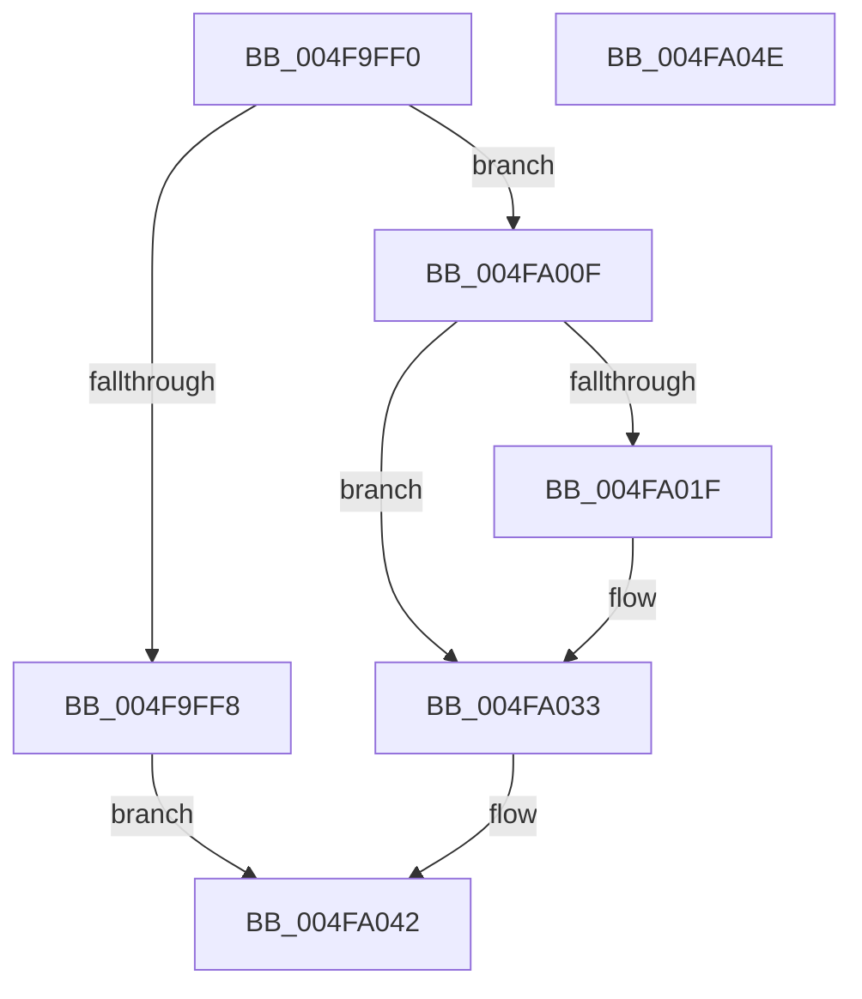

# HalpTimerSwitchStallSource

- RVA: `0x004F9FF0`–`0x004FA04F` (길이 `95` bytes)
- VA: `0x00000001404F9FF0`
- 실행 섹션: `.text`
- PDB 이름 있음: `예`; PDB Function 태그: `아니요`
- unwind 정보 RVA: `0x0005C788`
- 디코드: `21`개 명령, `95/95` bytes 표시
- 미해석 바이트: `0` (있으면 어셈블리에 `.byte`로 보존)

> 이 문서는 커널 이미지의 기계어와 PDB 기호를 분석해 생성했습니다. 4번과 5번은 함수 원형과 자료형을 바이너리 사용 방식에서 추정한 C 해석이며 원본 소스 복구 결과는 아닙니다.

## 1. Dependencies

- 직접 호출 지점: **2**; 고유 호출 대상: **2**
- 직접 호출자로 확인된 함수: **2**
- RIP 상대 이미지 참조: **7**

### Outgoing calls
- `0x004FA022` → [HalpTimerGetInternalData](../20/HalpTimerGetInternalData_function_00209500.md) (function, `0x00209500`)
- `0x004FA02E` → [guard_dispatch_icall](../6B/guard_dispatch_icall_function_006BAAD0.md) (function, `0x006BAAD0`)

### Direct callers
- [HalpAcpiPostSleep](../../pagelk/B7/HalpAcpiPostSleep_function_00B79990.md) at `0x00B79ACB`
- [HalpAcpiPreSleep](../../pagelk/B7/HalpAcpiPreSleep_function_00B7BFD4.md) at `0x00B7BFFD`

### Static image references
- `0x004F9FF8` → RVA `0x00FC4100` (`.data`; read)
- `0x004F9FFF` → RVA `0x00FC40C8` (`.data`; write)
- `0x004FA006` → RVA `0x00FC4038` (`.data`; read)
- `0x004FA00F` → RVA `0x00FC40C8` (`.data`; read)
- `0x004FA016` → RVA `0x00FC3FD0` (`.data`; read)
- `0x004FA03A` → RVA `0x00FC40C8` (`.data`; read/write)
- `0x004FA042` → RVA `0x00FC4100` (`.data`; write)

## 2. Other-region calls and transfers

- 다른 실행 섹션으로 향하는 call: **0**
- 별도 외부 분기/꼬리 이동을 확인하지 못했습니다.

## 3. Assembly (complete function range)

```asm
004F9FF0  48 83 EC 28                     sub rsp, 0x28
004F9FF4  84 C9                           test cl, cl
004F9FF6  74 17                           je 0x1404fa00f
004F9FF8  48 8B 05 01 A1 AC 00            mov rax, qword ptr [rip + 0xaca101]
004F9FFF  48 89 05 C2 A0 AC 00            mov qword ptr [rip + 0xaca0c2], rax
004FA006  48 8B 05 2B A0 AC 00            mov rax, qword ptr [rip + 0xaca02b]
004FA00D  EB 33                           jmp 0x1404fa042
004FA00F  48 8B 15 B2 A0 AC 00            mov rdx, qword ptr [rip + 0xaca0b2]
004FA016  48 3B 15 B3 9F AC 00            cmp rdx, qword ptr [rip + 0xac9fb3]
004FA01D  74 14                           je 0x1404fa033
004FA01F  48 8B CA                        mov rcx, rdx
004FA022  E8 D9 F4 D0 FF                  call 0x140209500
004FA027  48 8B C8                        mov rcx, rax
004FA02A  48 8B 42 68                     mov rax, qword ptr [rdx + 0x68]
004FA02E  E8 9D 0A 1C 00                  call 0x1406baad0
004FA033  48 8B 05 8E A0 AC 00            mov rax, qword ptr [rip + 0xaca08e]
004FA03A  48 83 25 86 A0 AC 00 00         and qword ptr [rip + 0xaca086], 0
004FA042  48 89 05 B7 A0 AC 00            mov qword ptr [rip + 0xaca0b7], rax
004FA049  48 83 C4 28                     add rsp, 0x28
004FA04D  C3                              ret
004FA04E  CC                              int3
```

## 4. C-style interpretation (structured pseudocode)

```c
__int64 __fastcall HalpTimerSwitchStallSource(unsigned __int8 a1)
{
    __int64 result;
    __int64 v_rsp;

    v_rsp = (v_rsp) - (40);
    if (a1 == 0) goto loc_004FA00F;
    *(unsigned __int64 *)(v_rip + 11313346) = *(unsigned __int64 *)(v_rip + 11313409);
    goto loc_004FA042;
loc_004FA00F:
    result = *(unsigned __int64 *)(v_rip + 11313195);
    if ((*(unsigned __int64 *)(v_rip + 11313330)) != (*(unsigned __int64 *)(v_rip + 11313075))) {
        a1 = *(unsigned __int64 *)(v_rip + 11313330);
        result = HalpTimerGetInternalData(a1, *(unsigned __int64 *)(v_rip + 11313330), a3, a4);
        a1 = result;
        result = *(unsigned __int64 *)(*(unsigned __int64 *)(v_rip + 11313330) + 104);
        result = guard_dispatch_icall(a1, *(unsigned __int64 *)(v_rip + 11313330), a3, a4);
    }
loc_004FA042:
    *(unsigned __int64 *)(v_rip + 11313335) = *(unsigned __int64 *)(v_rip + 11313294);
    v_rsp = (v_rsp) + (40);
    return *(unsigned __int64 *)(v_rip + 11313294);
}
```

## 5. (Beta) C Style

```c
int64_t HalpTimerSwitchStallSource(uint8_t Arg1)
{
    int64_t result;
    int64_t local_rsp;

    local_rsp = (local_rsp) - (40);
    if (Arg1 == 0) goto loc_004FA00F;
    *(uint64_t *)(v_rip + 0xACA0C2) = *(uint64_t *)(v_rip + 0xACA101);
    goto loc_004FA042;
loc_004FA00F:
    result = *(uint64_t *)(v_rip + 0xACA02B);
    if ((*(uint64_t *)(v_rip + 0xACA0B2)) != (*(uint64_t *)(v_rip + 0xAC9FB3))) {
        Arg1 = *(uint64_t *)(v_rip + 0xACA0B2);
        result = HalpTimerGetInternalData(Arg1, *(uint64_t *)(v_rip + 0xACA0B2), a3, a4);
        Arg1 = result;
        result = *(uint64_t *)(*(uint64_t *)(v_rip + 0xACA0B2) + 0x68);
        result = guard_dispatch_icall(Arg1, *(uint64_t *)(v_rip + 0xACA0B2), a3, a4);
    }
loc_004FA042:
    *(uint64_t *)(v_rip + 0xACA0B7) = *(uint64_t *)(v_rip + 0xACA08E);
    local_rsp = (local_rsp) + (40);
    return *(uint64_t *)(v_rip + 0xACA08E);
}
```

## 6. Execution-region graph

[열기: 2D/3D 그래프와 함수 탐색 컨트롤 패널](../../../control-panel.html?section=text&rva=0x004F9FF0&view=graph)

- 2D 그래프는 위에서 아래로 흐르고, 3D 그래프는 빈 공간을 드래그해 회전합니다. Shift+드래그는 이동, 휠은 확대·축소, 함수 노드 선택은 대상 보고서 이동입니다.

### Static fallback


