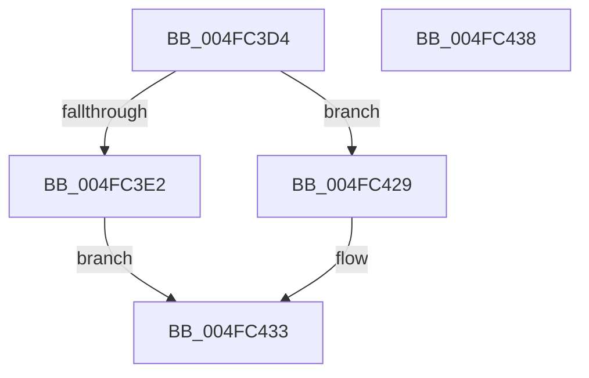

# HsaBuildInterruptRemappingEntry

- RVA: `0x004FC3D4`–`0x004FC439` (길이 `101` bytes)
- VA: `0x00000001404FC3D4`
- 실행 섹션: `.text`
- PDB 이름 있음: `예`; PDB Function 태그: `아니요`
- unwind 정보 RVA: `0x000DB714`
- 디코드: `24`개 명령, `101/101` bytes 표시
- 미해석 바이트: `0` (있으면 어셈블리에 `.byte`로 보존)

> 이 문서는 커널 이미지의 기계어와 PDB 기호를 분석해 생성했습니다. 4번과 5번은 함수 원형과 자료형을 바이너리 사용 방식에서 추정한 C 해석이며 원본 소스 복구 결과는 아닙니다.

## 1. Dependencies

- 직접 호출 지점: **0**; 고유 호출 대상: **0**
- 직접 호출자로 확인된 함수: **2**
- RIP 상대 이미지 참조: **0**

### Outgoing calls
- 직접 디코드된 call 명령이 없습니다.

### Direct callers
- [HsaBuildDeviceTableEntry](../44/HsaBuildDeviceTableEntry_function_0044E6B4.md) at `0x0044E7BE`
- [HsaUpdateRemappingTableInDeviceTableEntry](../57/HsaUpdateRemappingTableInDeviceTableEntry_function_005751DC.md) at `0x0057525E`

### Static image references
- 디코드된 RIP-relative 메모리 참조가 없습니다.

## 2. Other-region calls and transfers

- 다른 실행 섹션으로 향하는 call: **0**
- 별도 외부 분기/꼬리 이동을 확인하지 못했습니다.

## 3. Assembly (complete function range)

```asm
004FC3D4  33 C0                           xor eax, eax
004FC3D6  49 89 40 10                     mov qword ptr [r8 + 0x10], rax
004FC3DA  39 81 B0 00 00 00               cmp dword ptr [rcx + 0xb0], eax
004FC3E0  74 47                           je 0x1404fc429
004FC3E2  49 B9 01 00 00 00 00 00 00 20   movabs r9, 0x2000000000000001
004FC3EC  4D 89 48 10                     mov qword ptr [r8 + 0x10], r9
004FC3F0  8B 42 14                        mov eax, dword ptr [rdx + 0x14]
004FC3F3  0F BC C8                        bsf ecx, eax
004FC3F6  83 E1 0F                        and ecx, 0xf
004FC3F9  48 03 C9                        add rcx, rcx
004FC3FC  49 0B C9                        or rcx, r9
004FC3FF  49 89 48 10                     mov qword ptr [r8 + 0x10], rcx
004FC403  48 8B 02                        mov rax, qword ptr [rdx]
004FC406  48 BA C0 FF FF FF FF FF 0F 00   movabs rdx, 0xfffffffffffc0
004FC410  48 23 C2                        and rax, rdx
004FC413  48 BA 00 00 00 00 00 00 00 04   movabs rdx, 0x400000000000000
004FC41D  48 0B C2                        or rax, rdx
004FC420  48 83 E0 C0                     and rax, 0xffffffffffffffc0
004FC424  48 0B C1                        or rax, rcx
004FC427  EB 0A                           jmp 0x1404fc433
004FC429  48 B8 20 00 00 00 00 00 00 10   movabs rax, 0x1000000000000020
004FC433  49 89 40 10                     mov qword ptr [r8 + 0x10], rax
004FC437  C3                              ret
004FC438  CC                              int3
```

## 4. C-style interpretation (structured pseudocode)

```c
__int64 __fastcall HsaBuildInterruptRemappingEntry(__int64 a1, __int64 a2, __int64 a3)
{
    __int64 result;

    result = 0;
    *(unsigned __int64 *)(a3 + 16) = 0;
    if ((*(unsigned int *)(a1 + 176)) == 0) goto loc_004FC429;
    *(unsigned __int64 *)(a3 + 16) = a4;
    a1 = (unsigned int)((a1) & (15));
    a1 = (a1) + (a1);
    a1 = (a1) | (a4);
    *(unsigned __int64 *)(a3 + 16) = a1;
    result = (*(unsigned __int64 *)(a2)) & (a2);
    result = (result) | (a2);
    result = (result) & (-64);
    result = (result) | (a1);
    goto loc_004FC433;
loc_004FC429:
loc_004FC433:
    *(unsigned __int64 *)(a3 + 16) = result;
    return result;
}
```

## 5. (Beta) C Style

```c
int64_t HsaBuildInterruptRemappingEntry(void *Arg1, void *Arg2, void *Arg3)
{
    uint8_t *arg1 = (uint8_t *)Arg1;
    uint8_t *arg2 = (uint8_t *)Arg2;
    uint8_t *arg3 = (uint8_t *)Arg3;

    int64_t result;

    result = 0;
    *(uint64_t *)(arg3 + 0x10) = 0;
    if ((*(uint32_t *)(arg1 + 0xB0)) == 0) goto loc_004FC429;
    *(uint64_t *)(arg3 + 0x10) = a4;
    Arg1 = (uint32_t)((Arg1) & (15));
    Arg1 = (Arg1) + (Arg1);
    Arg1 = (Arg1) | (a4);
    *(void **)(arg3 + 0x10) = Arg1;
    result = (*(uint64_t *)(arg2)) & (Arg2);
    result = (result) | (Arg2);
    result = (result) & (-64);
    result = (result) | (Arg1);
    goto loc_004FC433;
loc_004FC429:
loc_004FC433:
    *(uint64_t *)(arg3 + 0x10) = result;
    return result;
}
```

### 관측된 메모리 오프셋

구조체 형식이 확인되지 않은 접근은 인자 기준의 오프셋으로만 기록했습니다.

| 기준 인자 | 오프셋 표현 | 폭 (bit) | 접근 |
|---|---:|---:|---|
| `Arg1` | `+ 0xB0` | `32` | `R` |
| `Arg2` | `+ 0x0` | `64` | `R` |
| `Arg2` | `+ 0x14` | `32` | `R` |
| `Arg3` | `+ 0x10` | `64` | `W` |

## 6. Execution-region graph

[열기: 2D/3D 그래프와 함수 탐색 컨트롤 패널](../../../control-panel.html?section=text&rva=0x004FC3D4&view=graph)

- 2D 그래프는 위에서 아래로 흐르고, 3D 그래프는 빈 공간을 드래그해 회전합니다. Shift+드래그는 이동, 휠은 확대·축소, 함수 노드 선택은 대상 보고서 이동입니다.

### Static fallback


