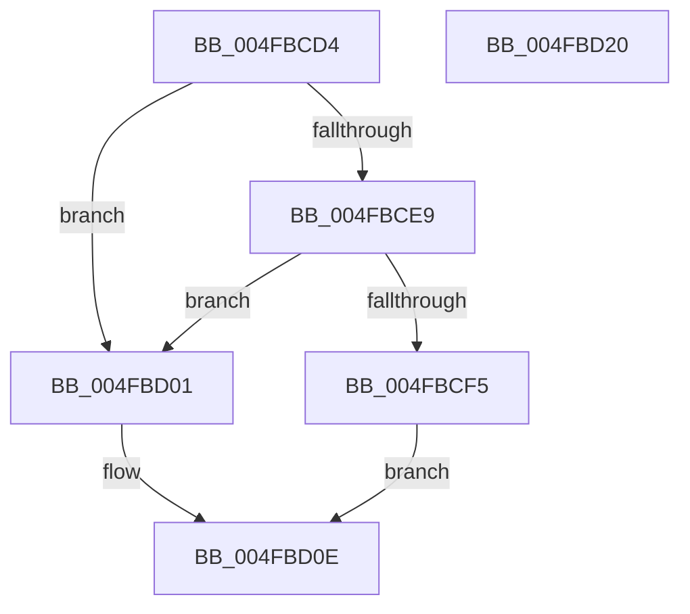

# HsaGetBlockedDomain

- RVA: `0x004FBCD4`–`0x004FBD21` (길이 `77` bytes)
- VA: `0x00000001404FBCD4`
- 실행 섹션: `.text`
- PDB 이름 있음: `예`; PDB Function 태그: `아니요`
- unwind 정보 RVA: `0x0005CAAC`
- 디코드: `24`개 명령, `77/77` bytes 표시
- 미해석 바이트: `0` (있으면 어셈블리에 `.byte`로 보존)

> 이 문서는 커널 이미지의 기계어와 PDB 기호를 분석해 생성했습니다. 4번과 5번은 함수 원형과 자료형을 바이너리 사용 방식에서 추정한 C 해석이며 원본 소스 복구 결과는 아닙니다.

## 1. Dependencies

- 직접 호출 지점: **1**; 고유 호출 대상: **1**
- 직접 호출자로 확인된 함수: **2**
- RIP 상대 이미지 참조: **1**

### Outgoing calls
- `0x004FBCEB` → [HalpHsaFindReservedDomain](HalpHsaFindReservedDomain_function_004FBD28.md) (function, `0x004FBD28`)

### Direct callers
- [HsaUpdateDeviceTableEntry](../44/HsaUpdateDeviceTableEntry_function_0044E404.md) at `0x0044E583`
- [HsaInitializeIommu](../../pagelk/B6/HsaInitializeIommu_function_00B63140.md) at `0x00B63361`

### Static image references
- `0x004FBD01` → RVA `0x00F8F690` (`.data`; read)

## 2. Other-region calls and transfers

- 다른 실행 섹션으로 향하는 call: **0**
- 별도 외부 분기/꼬리 이동을 확인하지 못했습니다.

## 3. Assembly (complete function range)

```asm
004FBCD4  48 89 5C 24 08                  mov qword ptr [rsp + 8], rbx
004FBCD9  57                              push rdi
004FBCDA  48 83 EC 20                     sub rsp, 0x20
004FBCDE  49 8B F8                        mov rdi, r8
004FBCE1  48 8B D9                        mov rbx, rcx
004FBCE4  48 85 D2                        test rdx, rdx
004FBCE7  74 18                           je 0x1404fbd01
004FBCE9  8B 12                           mov edx, dword ptr [rdx]
004FBCEB  E8 38 00 00 00                  call 0x1404fbd28
004FBCF0  48 85 C0                        test rax, rax
004FBCF3  74 0C                           je 0x1404fbd01
004FBCF5  48 8B 48 08                     mov rcx, qword ptr [rax + 8]
004FBCF9  8B 00                           mov eax, dword ptr [rax]
004FBCFB  48 8B 51 10                     mov rdx, qword ptr [rcx + 0x10]
004FBCFF  EB 0D                           jmp 0x1404fbd0e
004FBD01  48 8B 15 88 39 A9 00            mov rdx, qword ptr [rip + 0xa93988]
004FBD08  8B 83 C8 00 00 00               mov eax, dword ptr [rbx + 0xc8]
004FBD0E  48 C1 EA 0C                     shr rdx, 0xc
004FBD12  48 89 17                        mov qword ptr [rdi], rdx
004FBD15  48 8B 5C 24 30                  mov rbx, qword ptr [rsp + 0x30]
004FBD1A  48 83 C4 20                     add rsp, 0x20
004FBD1E  5F                              pop rdi
004FBD1F  C3                              ret
004FBD20  CC                              int3
```

## 4. C-style interpretation (structured pseudocode)

```c
__int64 __fastcall HsaGetBlockedDomain(__int64 a1, __int64 a2, __int64 a3)
{
    __int64 result;
    __int64 v_rsp;
    unsigned __int64 v_stack_p8;

    v_stack_p8 = v_rbx;
    v_rsp = (v_rsp) - (32);
    if (a2 == 0) goto loc_004FBD01;
    result = HalpHsaFindReservedDomain(a1, (unsigned int)(*(unsigned int *)(a2)), a3, a4);
    if (result == 0) goto loc_004FBD01;
    goto loc_004FBD0E;
loc_004FBD01:
loc_004FBD0E:
    a2 = (*(unsigned __int64 *)(v_rip + 11090312)) >> (12);
    *(unsigned __int64 *)(a3) = a2;
    v_rsp = (v_rsp) + (32);
    return (unsigned int)(*(unsigned int *)(a1 + 200));
}
```

## 5. (Beta) C Style

```c
int64_t HsaGetBlockedDomain(void *Arg1, int64_t Arg2, void *Arg3)
{
    uint8_t *arg1 = (uint8_t *)Arg1;
    uint8_t *arg3 = (uint8_t *)Arg3;

    int64_t result;
    int64_t local_rsp;
    uint64_t v_stack_p8;

    v_stack_p8 = local_rbx;
    local_rsp = (local_rsp) - (32);
    if (Arg2 == 0) goto loc_004FBD01;
    result = HalpHsaFindReservedDomain(Arg1, (uint32_t)(*(uint32_t *)(Arg2)), Arg3, a4);
    if (result == 0) goto loc_004FBD01;
    goto loc_004FBD0E;
loc_004FBD01:
loc_004FBD0E:
    Arg2 = (*(uint64_t *)(v_rip + 0xA93988)) >> (12);
    *(uint64_t *)(arg3) = Arg2;
    local_rsp = (local_rsp) + (32);
    return (uint32_t)(*(uint32_t *)(arg1 + 0xC8));
}
```

### 관측된 메모리 오프셋

구조체 형식이 확인되지 않은 접근은 인자 기준의 오프셋으로만 기록했습니다.

| 기준 인자 | 오프셋 표현 | 폭 (bit) | 접근 |
|---|---:|---:|---|
| `Arg1` | `+ 0xC8` | `32` | `R` |
| `Arg3` | `+ 0x0` | `64` | `W` |

## 6. Execution-region graph

[열기: 2D/3D 그래프와 함수 탐색 컨트롤 패널](../../../control-panel.html?section=text&rva=0x004FBCD4&view=graph)

- 2D 그래프는 위에서 아래로 흐르고, 3D 그래프는 빈 공간을 드래그해 회전합니다. Shift+드래그는 이동, 휠은 확대·축소, 함수 노드 선택은 대상 보고서 이동입니다.

### Static fallback


