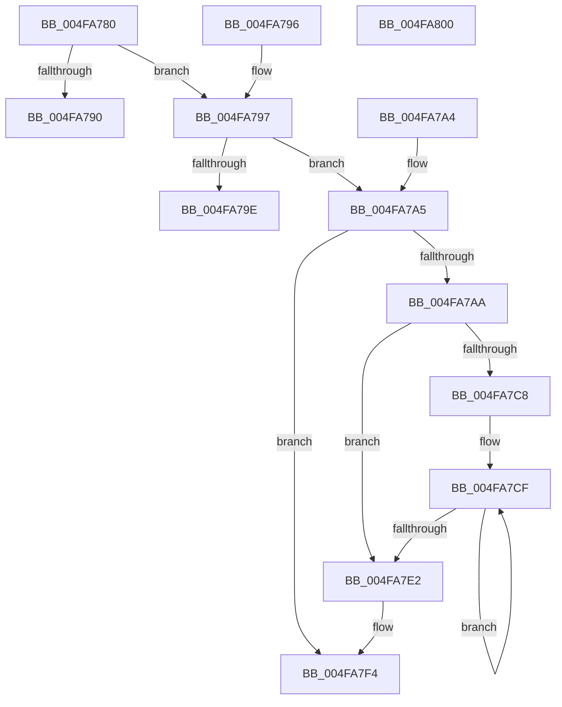

# HvlQueryStartedProcessors

- RVA: `0x004FA780`–`0x004FA801` (길이 `129` bytes)
- VA: `0x00000001404FA780`
- 실행 섹션: `.text`
- PDB 이름 있음: `예`; PDB Function 태그: `아니요`
- unwind 정보 RVA: `0x000DB714`
- 디코드: `40`개 명령, `129/129` bytes 표시
- 미해석 바이트: `0` (있으면 어셈블리에 `.byte`로 보존)

> 이 문서는 커널 이미지의 기계어와 PDB 기호를 분석해 생성했습니다. 4번과 5번은 함수 원형과 자료형을 바이너리 사용 방식에서 추정한 C 해석이며 원본 소스 복구 결과는 아닙니다.

## 1. Dependencies

- 직접 호출 지점: **0**; 고유 호출 대상: **0**
- 직접 호출자로 확인된 함수: **0**
- RIP 상대 이미지 참조: **3**

### Outgoing calls
- 직접 디코드된 call 명령이 없습니다.

### Direct callers
- 이 함수 시작 RVA로 연결되는 직접 call은 확인되지 않았습니다. 간접 호출은 완전히 역산할 수 없습니다.

### Static image references
- `0x004FA780` → RVA `0x00FC6A90` (`ALMOSTRO`; read)
- `0x004FA7AD` → RVA `0x00FC6BA0` (`ALMOSTRO`; read)
- `0x004FA7B4` → RVA `0x00FC6C40` (`ALMOSTRO`; read)

## 2. Other-region calls and transfers

- 다른 실행 섹션으로 향하는 call: **0**
- 별도 외부 분기/꼬리 이동을 확인하지 못했습니다.

## 3. Assembly (complete function range)

```asm
004FA780  8B 05 0A C3 AC 00               mov eax, dword ptr [rip + 0xacc30a]
004FA786  4C 8B C2                        mov r8, rdx
004FA789  4C 8B C9                        mov r9, rcx
004FA78C  A8 02                           test al, 2
004FA78E  75 07                           jne 0x1404fa797
004FA790  B8 22 00 00 C0                  mov eax, 0xc0000022
004FA795  C3                              ret
004FA796  CC                              int3
004FA797  33 D2                           xor edx, edx
004FA799  4D 85 C9                        test r9, r9
004FA79C  75 07                           jne 0x1404fa7a5
004FA79E  B8 0D 00 00 C0                  mov eax, 0xc000000d
004FA7A3  C3                              ret
004FA7A4  CC                              int3
004FA7A5  4D 85 C0                        test r8, r8
004FA7A8  74 4A                           je 0x1404fa7f4
004FA7AA  44 8B 11                        mov r10d, dword ptr [rcx]
004FA7AD  44 39 15 EC C3 AC 00            cmp dword ptr [rip + 0xacc3ec], r10d
004FA7B4  48 8B 0D 85 C4 AC 00            mov rcx, qword ptr [rip + 0xacc485]
004FA7BB  44 0F 42 15 DD C3 AC 00         cmovb r10d, dword ptr [rip + 0xacc3dd]
004FA7C3  45 85 D2                        test r10d, r10d
004FA7C6  74 1A                           je 0x1404fa7e2
004FA7C8  48 83 C1 04                     add rcx, 4
004FA7CC  41 8B D2                        mov edx, r10d
004FA7CF  8B 01                           mov eax, dword ptr [rcx]
004FA7D1  48 8D 49 68                     lea rcx, [rcx + 0x68]
004FA7D5  41 89 00                        mov dword ptr [r8], eax
004FA7D8  4D 8D 40 04                     lea r8, [r8 + 4]
004FA7DC  48 83 EA 01                     sub rdx, 1
004FA7E0  75 ED                           jne 0x1404fa7cf
004FA7E2  8B 05 B8 C3 AC 00               mov eax, dword ptr [rip + 0xacc3b8]
004FA7E8  41 39 01                        cmp dword ptr [r9], eax
004FA7EB  1B C0                           sbb eax, eax
004FA7ED  25 23 00 00 C0                  and eax, 0xc0000023
004FA7F2  8B D0                           mov edx, eax
004FA7F4  8B 0D A6 C3 AC 00               mov ecx, dword ptr [rip + 0xacc3a6]
004FA7FA  8B C2                           mov eax, edx
004FA7FC  41 89 09                        mov dword ptr [r9], ecx
004FA7FF  C3                              ret
004FA800  CC                              int3
```

## 4. C-style interpretation (structured pseudocode)

```c
__int64 __fastcall HvlQueryStartedProcessors(__int64 a1, __int64 a2)
{
    __int64 result;
    __int64 v_r10;

    if ((((unsigned __int8)((unsigned int)(*(unsigned int *)(v_rip + 11322122)))) & (2)) != 0) goto loc_004FA797;
    return (unsigned int)(0xC0000022ULL);
loc_004FA797:
    a2 = 0;
    if (a1 != 0) goto loc_004FA7A5;
    return (unsigned int)(0xC000000DULL);
loc_004FA7A5:
    if (0 == 0) goto loc_004FA7F4;
    v_r10 = (unsigned int)(*(unsigned int *)(a1));
    if ((*(unsigned int *)(v_rip + 11322348)) < ((unsigned int)((unsigned int)(*(unsigned int *)(a1))))) { v_r10 = *(unsigned int *)(v_rip + 11322333); }
    if ((unsigned int)(v_r10) == 0) goto loc_004FA7E2;
    a1 = (*(unsigned __int64 *)(v_rip + 11322501)) + (4);
loc_004FA7CF:
    *(unsigned int *)(a2) = (unsigned int)((unsigned int)(*(unsigned int *)(a1)));
    a2 = ((unsigned int)((unsigned int)(v_r10))) - (1);
    if (condition_is_not_equal) goto loc_004FA7CF;
loc_004FA7E2:
    result = (unsigned int)(((unsigned int)(*(unsigned int *)(v_rip + 11322296))) & (0xC0000023ULL));
loc_004FA7F4:
    *(unsigned int *)(a1) = (unsigned int)((unsigned int)(*(unsigned int *)(v_rip + 11322278)));
    return (unsigned int)((unsigned int)((unsigned int)((unsigned int)(result))));
}
```

## 5. (Beta) C Style

```c
int64_t HvlQueryStartedProcessors(void *Arg1, int64_t Arg2)
{
    uint8_t *arg1 = (uint8_t *)Arg1;

    int64_t result;
    int64_t local_r10;

    if ((((uint8_t)((uint32_t)(*(uint32_t *)(v_rip + 0xACC30A)))) & (2)) != 0) goto loc_004FA797;
    return (uint32_t)(0xC0000022ULL);
loc_004FA797:
    Arg2 = 0;
    if (Arg1 != NULL) goto loc_004FA7A5;
    return (uint32_t)(0xC000000DULL);
loc_004FA7A5:
    if (0 == 0) goto loc_004FA7F4;
    local_r10 = (uint32_t)(*(uint32_t *)(arg1));
    if ((*(uint32_t *)(v_rip + 0xACC3EC)) < ((uint32_t)((uint32_t)(*(uint32_t *)(arg1))))) { local_r10 = *(uint32_t *)(v_rip + 0xACC3DD); }
    if ((uint32_t)(local_r10) == 0) goto loc_004FA7E2;
    Arg1 = (*(uint64_t *)(v_rip + 0xACC485)) + (4);
loc_004FA7CF:
    *(uint32_t *)(Arg2) = (uint32_t)((uint32_t)(*(uint32_t *)(arg1)));
    Arg2 = ((uint32_t)((uint32_t)(local_r10))) - (1);
    if (condition_is_not_equal) goto loc_004FA7CF;
loc_004FA7E2:
    result = (uint32_t)(((uint32_t)(*(uint32_t *)(v_rip + 0xACC3B8))) & (0xC0000023ULL));
loc_004FA7F4:
    *(uint32_t *)(arg1) = (uint32_t)((uint32_t)(*(uint32_t *)(v_rip + 0xACC3A6)));
    return (uint32_t)((uint32_t)((uint32_t)((uint32_t)(result))));
}
```

### 관측된 메모리 오프셋

구조체 형식이 확인되지 않은 접근은 인자 기준의 오프셋으로만 기록했습니다.

| 기준 인자 | 오프셋 표현 | 폭 (bit) | 접근 |
|---|---:|---:|---|
| `Arg1` | `+ 0x0` | `32` | `R` |

## 6. Execution-region graph

[열기: 2D/3D 그래프와 함수 탐색 컨트롤 패널](../../../control-panel.html?section=text&rva=0x004FA780&view=graph)

- 2D 그래프는 위에서 아래로 흐르고, 3D 그래프는 빈 공간을 드래그해 회전합니다. Shift+드래그는 이동, 휠은 확대·축소, 함수 노드 선택은 대상 보고서 이동입니다.

### Static fallback


