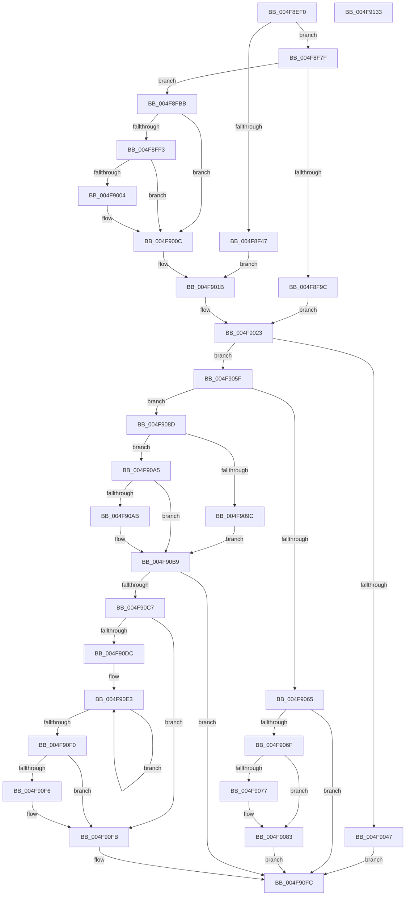

# HvlSetQpcBias

- RVA: `0x004F8EF0`–`0x004F9134` (길이 `580` bytes)
- VA: `0x00000001404F8EF0`
- 실행 섹션: `.text`
- PDB 이름 있음: `예`; PDB Function 태그: `아니요`
- unwind 정보 RVA: `0x000BF814`
- 디코드: `151`개 명령, `580/580` bytes 표시
- 미해석 바이트: `0` (있으면 어셈블리에 `.byte`로 보존)

> 이 문서는 커널 이미지의 기계어와 PDB 기호를 분석해 생성했습니다. 4번과 5번은 함수 원형과 자료형을 바이너리 사용 방식에서 추정한 C 해석이며 원본 소스 복구 결과는 아닙니다.

## 1. Dependencies

- 직접 호출 지점: **9**; 고유 호출 대상: **9**
- 직접 호출자로 확인된 함수: **0**
- RIP 상대 이미지 참조: **3**

### Outgoing calls
- `0x004F8F4E` → [KeDisableInterrupts](../21/KeDisableInterrupts_function_00217BE0.md) (function, `0x00217BE0`)
- `0x004F8F8F` → [ExpInterlockedPopEntrySList](../6B/ExpInterlockedPopEntrySList_function_006BA570.md) (function, `0x006BA570`)
- `0x004F9007` → [KiRaiseIrqlProcessIrqlFlags](KiRaiseIrqlProcessIrqlFlags_function_004F56FC.md) (function, `0x004F56FC`)
- `0x004F900F` → [MmGetPhysicalAddress](../23/MmGetPhysicalAddress_function_0023A500.md) (function, `0x0023A500`)
- `0x004F9037` → [HvcallInitiateHypercall](../31/HvcallInitiateHypercall_function_00313630.md) (function, `0x00313630`)
- `0x004F9055` → [ExpInterlockedPushEntrySList](../6B/ExpInterlockedPushEntrySList_function_006BA5B0.md) (function, `0x006BA5B0`)
- `0x004F907E` → [KiLowerIrqlProcessIrqlFlags](KiLowerIrqlProcessIrqlFlags_function_004F5698.md) (function, `0x004F5698`)
- `0x004F90F6` → [KiRemoveSystemWorkPriorityKick](../26/KiRemoveSystemWorkPriorityKick_function_002631D0.md) (function, `0x002631D0`)
- `0x004F910D` → [_security_check_cookie](../6A/_security_check_cookie_function_006AC640.md) (function, `0x006AC640`)

### Direct callers
- 이 함수 시작 RVA로 연결되는 직접 call은 확인되지 않았습니다. 간접 호출은 완전히 역산할 수 없습니다.

### Static image references
- `0x004F8F13` → RVA `0x00E0A740` (`.data`; read)
- `0x004F8F35` → RVA `0x00FC6A90` (`ALMOSTRO`; read)
- `0x004F8FFB` → RVA `0x00FC6D20` (`ALMOSTRO`; read)

## 2. Other-region calls and transfers

- 다른 실행 섹션으로 향하는 call: **0**
- 별도 외부 분기/꼬리 이동을 확인하지 못했습니다.

## 3. Assembly (complete function range)

```asm
004F8EF0  48 8B C4                        mov rax, rsp
004F8EF3  48 89 58 08                     mov qword ptr [rax + 8], rbx
004F8EF7  48 89 70 10                     mov qword ptr [rax + 0x10], rsi
004F8EFB  48 89 78 18                     mov qword ptr [rax + 0x18], rdi
004F8EFF  55                              push rbp
004F8F00  41 54                           push r12
004F8F02  41 55                           push r13
004F8F04  41 56                           push r14
004F8F06  41 57                           push r15
004F8F08  48 8D 68 A1                     lea rbp, [rax - 0x5f]
004F8F0C  48 81 EC A0 00 00 00            sub rsp, 0xa0
004F8F13  48 8B 05 26 18 91 00            mov rax, qword ptr [rip + 0x911826]
004F8F1A  48 33 C4                        xor rax, rsp
004F8F1D  48 89 45 27                     mov qword ptr [rbp + 0x27], rax
004F8F21  33 C0                           xor eax, eax
004F8F23  BE 02 00 00 00                  mov esi, 2
004F8F28  48 89 45 C7                     mov qword ptr [rbp - 0x39], rax
004F8F2C  0F 57 C0                        xorps xmm0, xmm0
004F8F2F  89 45 CF                        mov dword ptr [rbp - 0x31], eax
004F8F32  4C 8B E9                        mov r13, rcx
004F8F35  8B 05 55 DB AC 00               mov eax, dword ptr [rip + 0xacdb55]
004F8F3B  44 8D 76 FF                     lea r14d, [rsi - 1]
004F8F3F  0F 11 45 B7                     movups xmmword ptr [rbp - 0x49], xmm0
004F8F43  A8 08                           test al, 8
004F8F45  75 38                           jne 0x1404f8f7f
004F8F47  C7 45 B7 04 00 00 00            mov dword ptr [rbp - 0x49], 4
004F8F4E  E8 8D EC D1 FF                  call 0x140217be0
004F8F53  88 45 BF                        mov byte ptr [rbp - 0x41], al
004F8F56  65 48 8B 04 25 20 00 00 00      mov rax, qword ptr gs:[0x20]
004F8F5F  44 8B 65 B7                     mov r12d, dword ptr [rbp - 0x49]
004F8F63  44 89 75 C3                     mov dword ptr [rbp - 0x3d], r14d
004F8F67  44 8A 75 BF                     mov r14b, byte ptr [rbp - 0x41]
004F8F6B  48 8B 98 00 8C 00 00            mov rbx, qword ptr [rax + 0x8c00]
004F8F72  48 8B 73 10                     mov rsi, qword ptr [rbx + 0x10]
004F8F76  48 89 75 CF                     mov qword ptr [rbp - 0x31], rsi
004F8F7A  E9 9C 00 00 00                  jmp 0x1404f901b
004F8F7F  65 48 8B 3C 25 20 00 00 00      mov rdi, qword ptr gs:[0x20]
004F8F88  48 8D 8F C0 8B 00 00            lea rcx, [rdi + 0x8bc0]
004F8F8F  E8 DC 15 1C 00                  call 0x1406ba570
004F8F94  48 8B D8                        mov rbx, rax
004F8F97  48 85 C0                        test rax, rax
004F8F9A  74 1F                           je 0x1404f8fbb
004F8F9C  48 8B 70 10                     mov rsi, qword ptr [rax + 0x10]
004F8FA0  45 8B E6                        mov r12d, r14d
004F8FA3  44 89 75 B7                     mov dword ptr [rbp - 0x49], r14d
004F8FA7  4C 8B F8                        mov r15, rax
004F8FAA  48 89 75 CF                     mov qword ptr [rbp - 0x31], rsi
004F8FAE  4C 8B F7                        mov r14, rdi
004F8FB1  48 89 7D BF                     mov qword ptr [rbp - 0x41], rdi
004F8FB5  48 89 45 C7                     mov qword ptr [rbp - 0x39], rax
004F8FB9  EB 68                           jmp 0x1404f9023
004F8FBB  48 C7 C2 00 F0 FF FF            mov rdx, 0xfffffffffffff000
004F8FC2  89 75 B7                        mov dword ptr [rbp - 0x49], esi
004F8FC5  48 8D 4D DE                     lea rcx, [rbp - 0x22]
004F8FC9  44 8B E6                        mov r12d, esi
004F8FCC  48 83 E1 F8                     and rcx, 0xfffffffffffffff8
004F8FD0  48 8D 59 27                     lea rbx, [rcx + 0x27]
004F8FD4  48 8B C3                        mov rax, rbx
004F8FD7  48 23 DA                        and rbx, rdx
004F8FDA  48 33 C1                        xor rax, rcx
004F8FDD  48 85 C2                        test rdx, rax
004F8FE0  48 0F 44 D9                     cmove rbx, rcx
004F8FE4  44 0F 20 C0                     mov rax, cr8
004F8FE8  88 45 BF                        mov byte ptr [rbp - 0x41], al
004F8FEB  44 8A F0                        mov r14b, al
004F8FEE  40 3A C6                        cmp al, sil
004F8FF1  73 19                           jae 0x1404f900c
004F8FF3  44 0F 20 C1                     mov rcx, cr8
004F8FF7  44 0F 22 C6                     mov cr8, rsi
004F8FFB  83 3D 1E DD AC 00 00            cmp dword ptr [rip + 0xacdd1e], 0
004F9002  74 08                           je 0x1404f900c
004F9004  40 8A D6                        mov dl, sil
004F9007  E8 F0 C6 FF FF                  call 0x1404f56fc
004F900C  48 8B CB                        mov rcx, rbx
004F900F  E8 EC 14 D4 FF                  call 0x14023a500
004F9014  48 8B F0                        mov rsi, rax
004F9017  48 89 45 CF                     mov qword ptr [rbp - 0x31], rax
004F901B  48 8B 7D BF                     mov rdi, qword ptr [rbp - 0x41]
004F901F  4C 8B 7D C7                     mov r15, qword ptr [rbp - 0x39]
004F9023  45 33 C0                        xor r8d, r8d
004F9026  C7 03 12 00 00 00               mov dword ptr [rbx], 0x12
004F902C  48 8B D6                        mov rdx, rsi
004F902F  4C 89 6B 08                     mov qword ptr [rbx + 8], r13
004F9033  41 8D 48 6F                     lea ecx, [r8 + 0x6f]
004F9037  E8 F4 A5 E1 FF                  call 0x140313630
004F903C  33 C9                           xor ecx, ecx
004F903E  48 8B D8                        mov rbx, rax
004F9041  41 F6 C4 01                     test r12b, 1
004F9045  74 18                           je 0x1404f905f
004F9047  48 8D 8F C0 8B 00 00            lea rcx, [rdi + 0x8bc0]
004F904E  49 89 77 10                     mov qword ptr [r15 + 0x10], rsi
004F9052  49 8B D7                        mov rdx, r15
004F9055  E8 56 15 1C 00                  call 0x1406ba5b0
004F905A  E9 9D 00 00 00                  jmp 0x1404f90fc
004F905F  41 F6 C4 02                     test r12b, 2
004F9063  74 28                           je 0x1404f908d
004F9065  41 80 FE 02                     cmp r14b, 2
004F9069  0F 83 8D 00 00 00               jae 0x1404f90fc
004F906F  39 0D AB DC AC 00               cmp dword ptr [rip + 0xacdcab], ecx
004F9075  74 0C                           je 0x1404f9083
004F9077  44 0F 20 C1                     mov rcx, cr8
004F907B  41 8A D6                        mov dl, r14b
004F907E  E8 15 C6 FF FF                  call 0x1404f5698
004F9083  41 0F B6 C6                     movzx eax, r14b
004F9087  44 0F 22 C0                     mov cr8, rax
004F908B  EB 6F                           jmp 0x1404f90fc
004F908D  65 48 8B 04 25 20 00 00 00      mov rax, qword ptr gs:[0x20]
004F9096  F6 45 C3 01                     test byte ptr [rbp - 0x3d], 1
004F909A  74 09                           je 0x1404f90a5
004F909C  48 8B 88 00 8C 00 00            mov rcx, qword ptr [rax + 0x8c00]
004F90A3  EB 14                           jmp 0x1404f90b9
004F90A5  F6 45 C3 02                     test byte ptr [rbp - 0x3d], 2
004F90A9  74 0E                           je 0x1404f90b9
004F90AB  48 8B 88 00 8C 00 00            mov rcx, qword ptr [rax + 0x8c00]
004F90B2  48 81 C1 00 10 00 00            add rcx, 0x1000
004F90B9  80 7D BF 00                     cmp byte ptr [rbp - 0x41], 0
004F90BD  48 8B 45 CF                     mov rax, qword ptr [rbp - 0x31]
004F90C1  48 89 41 10                     mov qword ptr [rcx + 0x10], rax
004F90C5  74 35                           je 0x1404f90fc
004F90C7  65 48 8B 0C 25 20 00 00 00      mov rcx, qword ptr gs:[0x20]
004F90D0  4C 8B 81 B8 8E 00 00            mov r8, qword ptr [rcx + 0x8eb8]
004F90D7  4D 85 C0                        test r8, r8
004F90DA  74 1F                           je 0x1404f90fb
004F90DC  41 0F 0D 08                     prefetchw byte ptr [r8]
004F90E0  41 8B 00                        mov eax, dword ptr [r8]
004F90E3  8B D0                           mov edx, eax
004F90E5  0F BA F2 15                     btr edx, 0x15
004F90E9  F0 41 0F B1 10                  lock cmpxchg dword ptr [r8], edx
004F90EE  75 F3                           jne 0x1404f90e3
004F90F0  0F BA E0 15                     bt eax, 0x15
004F90F4  73 05                           jae 0x1404f90fb
004F90F6  E8 D5 A0 D6 FF                  call 0x1402631d0
004F90FB  FB                              sti
004F90FC  66 F7 DB                        neg bx
004F90FF  1B C0                           sbb eax, eax
004F9101  25 01 00 00 C0                  and eax, 0xc0000001
004F9106  48 8B 4D 27                     mov rcx, qword ptr [rbp + 0x27]
004F910A  48 33 CC                        xor rcx, rsp
004F910D  E8 2E 35 1B 00                  call 0x1406ac640
004F9112  4C 8D 9C 24 A0 00 00 00         lea r11, [rsp + 0xa0]
004F911A  49 8B 5B 30                     mov rbx, qword ptr [r11 + 0x30]
004F911E  49 8B 73 38                     mov rsi, qword ptr [r11 + 0x38]
004F9122  49 8B 7B 40                     mov rdi, qword ptr [r11 + 0x40]
004F9126  49 8B E3                        mov rsp, r11
004F9129  41 5F                           pop r15
004F912B  41 5E                           pop r14
004F912D  41 5D                           pop r13
004F912F  41 5C                           pop r12
004F9131  5D                              pop rbp
004F9132  C3                              ret
004F9133  CC                              int3
```

## 4. C-style interpretation (structured pseudocode)

```c
__int64 __fastcall HvlSetQpcBias(__int64 a1, __int64 a2, int a3)
{
    __int64 result;
    __int64 v_rbx;
    __int64 v_rsp;
    unsigned __int64 v_stack_m28;

    *(unsigned __int64 *)(v_rsp + 8) = v_rbx;
    *(unsigned __int64 *)(v_rsp + 16) = v_rsi;
    *(unsigned __int64 *)(v_rsp + 24) = v_rdi;
    v_rsp = (v_rsp) - (160);
    result = (*(unsigned __int64 *)(v_rip + 9508902)) ^ (v_rsp);
    *(unsigned __int64 *)(v_rsp - 95 + 39) = result;
    result = 0;
    *(unsigned __int64 *)(v_rsp - 95 - 57) = 0;
    *(unsigned int *)(v_rsp - 95 - 49) = 0;
    *(unsigned __int64 *)(v_rsp - 95 - 73) = v_xmm0;
    if ((((unsigned __int8)((unsigned int)(*(unsigned int *)(v_rip + 11328341)))) & (8)) != 0) goto loc_004F8F7F;
    *(unsigned int *)(v_rsp - 95 - 73) = 4;
    result = KeDisableInterrupts(a1, a2, a3, a4);
    *(unsigned __int8 *)(v_rsp - 95 - 65) = (unsigned __int8)(result);
    *(unsigned int *)(v_rsp - 95 - 61) = (unsigned int)(2 - 1);
    *(unsigned __int64 *)(v_rsp - 95 - 49) = *(unsigned __int64 *)(*(unsigned __int64 *)(*(unsigned __int64 *)(gs_base + (0 + 32)) + 35840) + 16);
    goto loc_004F901B;
loc_004F8F7F:
    result = ExpInterlockedPopEntrySList(*(unsigned __int64 *)(gs_base + (0 + 32)) + 35776, a2, a3, a4);
    if (result == 0) goto loc_004F8FBB;
    *(unsigned int *)(v_rsp - 95 - 73) = (unsigned int)(*(unsigned __int8 *)(v_rsp - 95 - 65));
    *(unsigned __int64 *)(v_rsp - 95 - 49) = *(unsigned __int64 *)(result + 16);
    *(unsigned __int64 *)(v_rsp - 95 - 65) = *(unsigned __int64 *)(gs_base + (0 + 32));
    *(unsigned __int64 *)(v_rsp - 95 - 57) = result;
    goto loc_004F9023;
loc_004F8FBB:
    *(unsigned int *)(v_rsp - 95 - 73) = (unsigned int)(*(unsigned __int64 *)(result + 16));
    a1 = (v_rsp - 95 - 34) & (-8);
    v_rbx = (a1 + 39) & (0xFFFFFFFFFFFFF000ULL);
    result = (a1 + 39) ^ (a1);
    if (((0xFFFFFFFFFFFFF000ULL) & (result)) == 0) { v_rbx = a1; }
    *(unsigned __int8 *)(v_rsp - 95 - 65) = (unsigned __int8)(v_cr8);
    if (((unsigned __int8)(v_cr8)) >= ((unsigned __int8)(*(unsigned __int64 *)(result + 16)))) goto loc_004F900C;
    result = v_cr8;
    if ((*(unsigned int *)(v_rip + 11328798)) != 0) {
        a2 = (unsigned __int8)(*(unsigned __int64 *)(result + 16));
        result = KiRaiseIrqlProcessIrqlFlags(v_cr8, a2, a3, a4);
    }
    result = MmGetPhysicalAddress(v_rbx, a2, a3, a4);
    *(unsigned __int64 *)(v_rsp - 95 - 49) = result;
loc_004F901B:
loc_004F9023:
    a3 = 0;
    *(unsigned int *)(v_rbx) = 18;
    *(unsigned __int64 *)(v_rbx + 8) = a1;
    result = HvcallInitiateHypercall(a3 + 111, result, a3, a4);
    a1 = 0;
    if ((((unsigned __int8)((unsigned int)((unsigned int)(*(unsigned __int64 *)(result + 16))))) & (1)) == 0) goto loc_004F905F;
    *(unsigned __int64 *)(*(unsigned __int64 *)(v_rsp - 95 - 57) + 16) = result;
    result = ExpInterlockedPushEntrySList(*(unsigned __int64 *)(v_rsp - 95 - 65) + 35776, *(unsigned __int64 *)(v_rsp - 95 - 57), a3, a4);
    goto loc_004F90FC;
loc_004F905F:
    if ((((unsigned __int8)((unsigned int)((unsigned int)(*(unsigned __int64 *)(result + 16))))) & (2)) == 0) goto loc_004F908D;
    if (((unsigned __int8)((unsigned __int8)(v_cr8))) >= 2) goto loc_004F90FC;
    if ((*(unsigned int *)(v_rip + 11328683)) != ((unsigned int)(*(unsigned __int64 *)(v_rsp - 95 - 65) + 35776))) {
        a1 = *(unsigned __int64 *)(result + 16);
        a2 = (unsigned __int8)((unsigned __int8)(v_cr8));
        result = KiLowerIrqlProcessIrqlFlags(a1, a2, a3, a4);
    }
    goto loc_004F90FC;
loc_004F908D:
    if (((*(unsigned __int8 *)(v_rsp - 95 - 61)) & (1)) == 0) goto loc_004F90A5;
    goto loc_004F90B9;
loc_004F90A5:
    if (((*(unsigned __int8 *)(v_rsp - 95 - 61)) & (2)) != 0) {
        a1 = *(unsigned __int64 *)(*(unsigned __int64 *)(gs_base + (0 + 32)) + 35840);
        a1 = (a1) + (0x1000ULL);
    }
    *(unsigned __int64 *)(a1 + 16) = *(unsigned __int64 *)(v_rsp - 95 - 49);
    if ((*(unsigned __int8 *)(v_rsp - 95 - 65)) == 0) goto loc_004F90FC;
    if (*(unsigned __int64 *)(*(unsigned __int64 *)(gs_base + (0 + 32)) + 36536) == 0) goto loc_004F90FB;
loc_004F90E3:
    if (*(unsigned __int64 *)(*(unsigned __int64 *)(gs_base + (0 + 32)) + 36536) != 0) goto loc_004F90E3;
    result = (unsigned int)(*(unsigned int *)(*(unsigned __int64 *)(*(unsigned __int64 *)(gs_base + (0 + 32)) + 36536)));
    if (!(condition_is_above_or_equal)) {
        result = KiRemoveSystemWorkPriorityKick(*(unsigned __int64 *)(gs_base + (0 + 32)), (unsigned int)((unsigned int)((unsigned int)(*(unsigned int *)(*(unsigned __int64 *)(*(unsigned __int64 *)(gs_base + (0 + 32)) + 36536))))), *(unsigned __int64 *)(*(unsigned __int64 *)(gs_base + (0 + 32)) + 36536), a4);
    }
loc_004F90FC:
    v_rbx = (unsigned __int16)(-(result));
    result = (unsigned int)((result) & (0xC0000001ULL));
    a1 = (*(unsigned __int64 *)(v_rsp - 95 + 39)) ^ (v_rsp);
    result = _security_check_cookie(a1, (unsigned int)((unsigned int)((unsigned int)(*(unsigned int *)(*(unsigned __int64 *)(*(unsigned __int64 *)(gs_base + (0 + 32)) + 36536))))), *(unsigned __int64 *)(*(unsigned __int64 *)(gs_base + (0 + 32)) + 36536), a4);
    return result;
}
```

## 5. (Beta) C Style

```c
int64_t HvlSetQpcBias(int64_t Arg1, int64_t Arg2, int32_t Arg3)
{
    int64_t result;
    int64_t local_rbx;
    int64_t local_rsp;
    uint64_t v_stack_m28;

    *(uint64_t *)(local_rsp + 0x8) = local_rbx;
    *(uint64_t *)(local_rsp + 0x10) = local_rsi;
    *(uint64_t *)(local_rsp + 0x18) = local_rdi;
    local_rsp = (local_rsp) - (160);
    result = (*(uint64_t *)(v_rip + 0x911826)) ^ (local_rsp);
    *(uint64_t *)(local_rsp - 0x5F + 0x27) = result;
    result = 0;
    *(uint64_t *)(local_rsp - 0x5F - 0x39) = 0;
    *(uint32_t *)(local_rsp - 0x5F - 0x31) = 0;
    *(uint64_t *)(local_rsp - 0x5F - 0x49) = v_xmm0;
    if ((((uint8_t)((uint32_t)(*(uint32_t *)(v_rip + 0xACDB55)))) & (8)) != 0) goto loc_004F8F7F;
    *(uint32_t *)(local_rsp - 0x5F - 0x49) = 4;
    result = KeDisableInterrupts(Arg1, Arg2, Arg3, a4);
    *(uint8_t *)(local_rsp - 0x5F - 0x41) = (uint8_t)(result);
    *(uint32_t *)(local_rsp - 0x5F - 0x3D) = (uint32_t)(2 - 1);
    *(uint64_t *)(local_rsp - 0x5F - 0x31) = *(uint64_t *)(*(uint64_t *)(*(uint64_t *)(gs_base + (0 + 0x20)) + 0x8C00) + 0x10);
    goto loc_004F901B;
loc_004F8F7F:
    result = ExpInterlockedPopEntrySList(*(uint64_t *)(gs_base + (0 + 0x20)) + 35776, Arg2, Arg3, a4);
    if (result == 0) goto loc_004F8FBB;
    *(uint32_t *)(local_rsp - 0x5F - 0x49) = (uint32_t)(*(uint8_t *)(local_rsp - 0x5F - 0x41));
    *(uint64_t *)(local_rsp - 0x5F - 0x31) = *(uint64_t *)(result + 0x10);
    *(uint64_t *)(local_rsp - 0x5F - 0x41) = *(uint64_t *)(gs_base + (0 + 0x20));
    *(uint64_t *)(local_rsp - 0x5F - 0x39) = result;
    goto loc_004F9023;
loc_004F8FBB:
    *(uint32_t *)(local_rsp - 0x5F - 0x49) = (uint32_t)(*(uint64_t *)(result + 0x10));
    Arg1 = (local_rsp - 95 - 34) & (-8);
    local_rbx = (Arg1 + 39) & (0xFFFFFFFFFFFFF000ULL);
    result = (Arg1 + 39) ^ (Arg1);
    if (((0xFFFFFFFFFFFFF000ULL) & (result)) == 0) { local_rbx = Arg1; }
    *(uint8_t *)(local_rsp - 0x5F - 0x41) = (uint8_t)(v_cr8);
    if (((uint8_t)(v_cr8)) >= ((uint8_t)(*(uint64_t *)(result + 0x10)))) goto loc_004F900C;
    result = v_cr8;
    if ((*(uint32_t *)(v_rip + 0xACDD1E)) != 0) {
        Arg2 = (uint8_t)(*(uint64_t *)(result + 0x10));
        result = KiRaiseIrqlProcessIrqlFlags(v_cr8, Arg2, Arg3, a4);
    }
    result = MmGetPhysicalAddress(local_rbx, Arg2, Arg3, a4);
    *(uint64_t *)(local_rsp - 0x5F - 0x31) = result;
loc_004F901B:
loc_004F9023:
    Arg3 = 0;
    *(uint32_t *)(local_rbx) = 18;
    *(uint64_t *)(local_rbx + 0x8) = Arg1;
    result = HvcallInitiateHypercall(Arg3 + 111, result, Arg3, a4);
    Arg1 = 0;
    if ((((uint8_t)((uint32_t)((uint32_t)(*(uint64_t *)(result + 0x10))))) & (1)) == 0) goto loc_004F905F;
    *(uint64_t *)(*(uint64_t *)(local_rsp - 0x5F - 0x39) + 0x10) = result;
    result = ExpInterlockedPushEntrySList(*(uint64_t *)(local_rsp - 0x5F - 0x41) + 35776, *(uint64_t *)(local_rsp - 0x5F - 0x39), Arg3, a4);
    goto loc_004F90FC;
loc_004F905F:
    if ((((uint8_t)((uint32_t)((uint32_t)(*(uint64_t *)(result + 0x10))))) & (2)) == 0) goto loc_004F908D;
    if (((uint8_t)((uint8_t)(v_cr8))) >= 2) goto loc_004F90FC;
    if ((*(uint32_t *)(v_rip + 0xACDCAB)) != ((uint32_t)(*(uint64_t *)(local_rsp - 0x5F - 0x41) + 35776))) {
        Arg1 = *(uint64_t *)(result + 0x10);
        Arg2 = (uint8_t)((uint8_t)(v_cr8));
        result = KiLowerIrqlProcessIrqlFlags(Arg1, Arg2, Arg3, a4);
    }
    goto loc_004F90FC;
loc_004F908D:
    if (((*(uint8_t *)(local_rsp - 0x5F - 0x3D)) & (1)) == 0) goto loc_004F90A5;
    goto loc_004F90B9;
loc_004F90A5:
    if (((*(uint8_t *)(local_rsp - 0x5F - 0x3D)) & (2)) != 0) {
        Arg1 = *(uint64_t *)(*(uint64_t *)(gs_base + (0 + 0x20)) + 0x8C00);
        Arg1 = (Arg1) + (0x1000ULL);
    }
    *(uint64_t *)(Arg1 + 0x10) = *(uint64_t *)(local_rsp - 0x5F - 0x31);
    if ((*(uint8_t *)(local_rsp - 0x5F - 0x41)) == 0) goto loc_004F90FC;
    if (*(uint64_t *)(*(uint64_t *)(gs_base + (0 + 0x20)) + 0x8EB8) == 0) goto loc_004F90FB;
loc_004F90E3:
    if (*(uint64_t *)(*(uint64_t *)(gs_base + (0 + 0x20)) + 0x8EB8) != 0) goto loc_004F90E3;
    result = (uint32_t)(*(uint32_t *)(*(uint64_t *)(*(uint64_t *)(gs_base + (0 + 0x20)) + 0x8EB8)));
    if (!(condition_is_above_or_equal)) {
        result = KiRemoveSystemWorkPriorityKick(*(uint64_t *)(gs_base + (0 + 0x20)), (uint32_t)((uint32_t)((uint32_t)(*(uint32_t *)(*(uint64_t *)(*(uint64_t *)(gs_base + (0 + 0x20)) + 0x8EB8))))), *(uint64_t *)(*(uint64_t *)(gs_base + (0 + 0x20)) + 0x8EB8), a4);
    }
loc_004F90FC:
    local_rbx = (uint16_t)(-(result));
    result = (uint32_t)((result) & (0xC0000001ULL));
    Arg1 = (*(uint64_t *)(local_rsp - 0x5F + 0x27)) ^ (local_rsp);
    result = _security_check_cookie(Arg1, (uint32_t)((uint32_t)((uint32_t)(*(uint32_t *)(*(uint64_t *)(*(uint64_t *)(gs_base + (0 + 0x20)) + 0x8EB8))))), *(uint64_t *)(*(uint64_t *)(gs_base + (0 + 0x20)) + 0x8EB8), a4);
    return result;
}
```

## 6. Execution-region graph

[열기: 2D/3D 그래프와 함수 탐색 컨트롤 패널](../../../control-panel.html?section=text&rva=0x004F8EF0&view=graph)

- 2D 그래프는 위에서 아래로 흐르고, 3D 그래프는 빈 공간을 드래그해 회전합니다. Shift+드래그는 이동, 휠은 확대·축소, 함수 노드 선택은 대상 보고서 이동입니다.

### Static fallback


