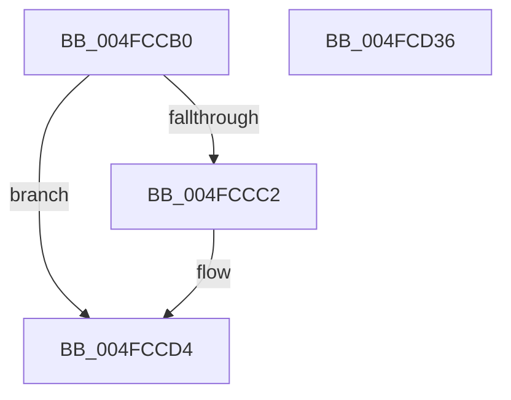

# IoPageRead

- RVA: `0x004FCCB0`–`0x004FCD37` (길이 `135` bytes)
- VA: `0x00000001404FCCB0`
- 실행 섹션: `.text`
- PDB 이름 있음: `예`; PDB Function 태그: `아니요`
- unwind 정보 RVA: `0x00063458`
- 디코드: `42`개 명령, `135/135` bytes 표시
- 미해석 바이트: `0` (있으면 어셈블리에 `.byte`로 보존)

> 이 문서는 커널 이미지의 기계어와 PDB 기호를 분석해 생성했습니다. 4번과 5번은 함수 원형과 자료형을 바이너리 사용 방식에서 추정한 C 해석이며 원본 소스 복구 결과는 아닙니다.

## 1. Dependencies

- 직접 호출 지점: **1**; 고유 호출 대상: **1**
- 직접 호출자로 확인된 함수: **1**
- RIP 상대 이미지 참조: **0**

### Outgoing calls
- `0x004FCD2C` → [IoPageReadEx](../29/IoPageReadEx_function_0029ABF0.md) (function, `0x0029ABF0`)

### Direct callers
- [PopReadPagesFromHiberFile](../../page/AC/PopReadPagesFromHiberFile_function_00AC8F78.md) at `0x00AC9145`

### Static image references
- 디코드된 RIP-relative 메모리 참조가 없습니다.

## 2. Other-region calls and transfers

- 다른 실행 섹션으로 향하는 call: **0**
- 별도 외부 분기/꼬리 이동을 확인하지 못했습니다.

## 3. Assembly (complete function range)

```asm
004FCCB0  48 83 EC 48                     sub rsp, 0x48
004FCCB4  4C 8B D1                        mov r10, rcx
004FCCB7  4D 8B D8                        mov r11, r8
004FCCBA  33 C9                           xor ecx, ecx
004FCCBC  41 F6 C2 03                     test r10b, 3
004FCCC0  74 12                           je 0x1404fccd4
004FCCC2  49 8B C2                        mov rax, r10
004FCCC5  49 83 E2 FC                     and r10, 0xfffffffffffffffc
004FCCC9  83 E0 01                        and eax, 1
004FCCCC  48 F7 D8                        neg rax
004FCCCF  1B C9                           sbb ecx, ecx
004FCCD1  83 C1 02                        add ecx, 2
004FCCD4  48 8B C2                        mov rax, rdx
004FCCD7  4C 8B C2                        mov r8, rdx
004FCCDA  83 E0 01                        and eax, 1
004FCCDD  49 83 E0 FE                     and r8, 0xfffffffffffffffe
004FCCE1  48 85 C0                        test rax, rax
004FCCE4  4C 0F 44 C2                     cmove r8, rdx
004FCCE8  8B D1                           mov edx, ecx
004FCCEA  83 CA 04                        or edx, 4
004FCCED  48 85 C0                        test rax, rax
004FCCF0  0F 44 D1                        cmove edx, ecx
004FCCF3  49 8B C8                        mov rcx, r8
004FCCF6  8B C2                           mov eax, edx
004FCCF8  83 E1 02                        and ecx, 2
004FCCFB  83 C8 08                        or eax, 8
004FCCFE  48 85 C9                        test rcx, rcx
004FCD01  0F 44 C2                        cmove eax, edx
004FCD04  49 8B D0                        mov rdx, r8
004FCD07  48 83 E2 FD                     and rdx, 0xfffffffffffffffd
004FCD0B  48 85 C9                        test rcx, rcx
004FCD0E  49 8B CA                        mov rcx, r10
004FCD11  49 0F 44 D0                     cmove rdx, r8
004FCD15  48 83 64 24 30 00               and qword ptr [rsp + 0x30], 0
004FCD1B  89 44 24 28                     mov dword ptr [rsp + 0x28], eax
004FCD1F  4D 8B C3                        mov r8, r11
004FCD22  48 8B 44 24 70                  mov rax, qword ptr [rsp + 0x70]
004FCD27  48 89 44 24 20                  mov qword ptr [rsp + 0x20], rax
004FCD2C  E8 BF DE D9 FF                  call 0x14029abf0
004FCD31  48 83 C4 48                     add rsp, 0x48
004FCD35  C3                              ret
004FCD36  CC                              int3
```

## 4. C-style interpretation (structured pseudocode)

```c
__int64 __fastcall IoPageRead(__int64 a1, __int64 a2, __int64 a3, __int64 a4, __int64 a5)
{
    __int64 result;
    __int64 v_r10;
    __int64 v_rsp;
    unsigned __int64 v_stack_m18;
    unsigned int v_stack_m20;
    unsigned __int64 v_stack_m28;

    v_rsp = (v_rsp) - (72);
    a1 = 0;
    v_r10 = a1;
    if (((0) & (3)) != 0) {
        result = 0;
        v_r10 = (a1) & (-4);
        result = (unsigned int)((result) & (1));
        result = -(result);
        a1 = (unsigned int)((a1) + (2));
    }
    result = (unsigned int)((a2) & (1));
    a3 = (a2) & (-2);
    if (result == 0) { a3 = a2; }
    a2 = (unsigned int)(((unsigned int)((unsigned int)(a1))) | (4));
    if (result == 0) { a2 = (unsigned int)(a1); }
    a1 = (unsigned int)((a3) & (2));
    result = (unsigned int)(((unsigned int)((unsigned int)(a2))) | (8));
    if (a1 == 0) { result = (unsigned int)(a2); }
    a2 = (a3) & (-3);
    if (a1 == 0) { a2 = a3; }
    v_stack_m20 = (unsigned int)(result);
    v_stack_m28 = a5;
    result = IoPageReadEx(v_r10, a2, a3, a4);
    v_rsp = (v_rsp) + (72);
    return result;
}
```

## 5. (Beta) C Style

```c
int64_t IoPageRead(int64_t Arg1, int64_t Arg2, int64_t Arg3, int64_t Arg4, int64_t Arg5)
{
    int64_t result;
    int64_t local_r10;
    int64_t local_rsp;
    uint64_t v_stack_m18;
    uint32_t v_stack_m20;
    uint64_t v_stack_m28;

    local_rsp = (local_rsp) - (72);
    Arg1 = 0;
    local_r10 = Arg1;
    if (((0) & (3)) != 0) {
        result = 0;
        local_r10 = (Arg1) & (-4);
        result = (uint32_t)((result) & (1));
        result = -(result);
        Arg1 = (uint32_t)((Arg1) + (2));
    }
    result = (uint32_t)((Arg2) & (1));
    Arg3 = (Arg2) & (-2);
    if (result == 0) { Arg3 = Arg2; }
    Arg2 = (uint32_t)(((uint32_t)((uint32_t)(Arg1))) | (4));
    if (result == 0) { Arg2 = (uint32_t)(Arg1); }
    Arg1 = (uint32_t)((Arg3) & (2));
    result = (uint32_t)(((uint32_t)((uint32_t)(Arg2))) | (8));
    if (Arg1 == 0) { result = (uint32_t)(Arg2); }
    Arg2 = (Arg3) & (-3);
    if (Arg1 == 0) { Arg2 = Arg3; }
    v_stack_m20 = (uint32_t)(result);
    v_stack_m28 = Arg5;
    result = IoPageReadEx(local_r10, Arg2, Arg3, Arg4);
    local_rsp = (local_rsp) + (72);
    return result;
}
```

## 6. Execution-region graph

[열기: 2D/3D 그래프와 함수 탐색 컨트롤 패널](../../../control-panel.html?section=text&rva=0x004FCCB0&view=graph)

- 2D 그래프는 위에서 아래로 흐르고, 3D 그래프는 빈 공간을 드래그해 회전합니다. Shift+드래그는 이동, 휠은 확대·축소, 함수 노드 선택은 대상 보고서 이동입니다.

### Static fallback


