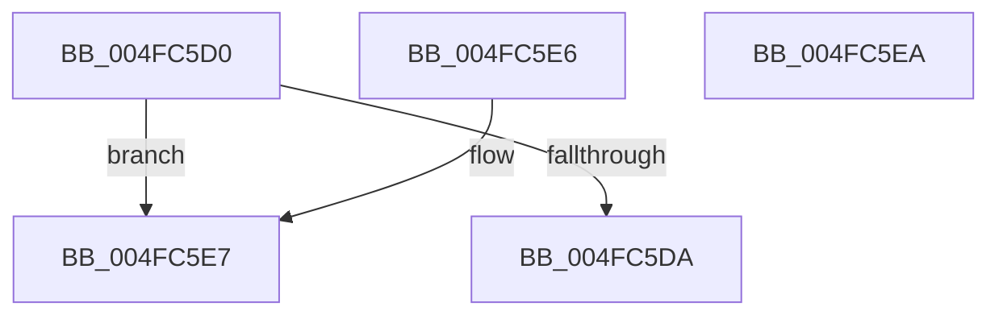

# IopDumpIsTracingEnabled

- RVA: `0x004FC5D0`–`0x004FC5EB` (길이 `27` bytes)
- VA: `0x00000001404FC5D0`
- 실행 섹션: `.text`
- PDB 이름 있음: `예`; PDB Function 태그: `아니요`
- unwind 정보 RVA: `0x000DB714`
- 디코드: `10`개 명령, `27/27` bytes 표시
- 미해석 바이트: `0` (있으면 어셈블리에 `.byte`로 보존)

> 이 문서는 커널 이미지의 기계어와 PDB 기호를 분석해 생성했습니다. 4번과 5번은 함수 원형과 자료형을 바이너리 사용 방식에서 추정한 C 해석이며 원본 소스 복구 결과는 아닙니다.

## 1. Dependencies

- 직접 호출 지점: **0**; 고유 호출 대상: **0**
- 직접 호출자로 확인된 함수: **12**
- RIP 상대 이미지 참조: **2**

### Outgoing calls
- 직접 디코드된 call 명령이 없습니다.

### Direct callers
- [IopDumpTraceLoadCrashDumpDriverFailure](../4E/IopDumpTraceLoadCrashDumpDriverFailure_function_004E2C18.md) at `0x004E2C37`
- [IopDumpTraceCrashDumpDisabled](../59/IopDumpTraceCrashDumpDisabled_function_00594C8C.md) at `0x00594CA2`
- [IopDumpTraceCrashDumpReconfiguration](../59/IopDumpTraceCrashDumpReconfiguration_function_00594D68.md) at `0x00594D87`
- [IopDumpTraceDisableCrashDumpFailure](../59/IopDumpTraceDisableCrashDumpFailure_function_00594E78.md) at `0x00594E97`
- [IopDumpTraceFreeDumpStackFailure](../59/IopDumpTraceFreeDumpStackFailure_function_00594F88.md) at `0x00594FA7`
- [IopDumpTraceInitializeCrashDumpFailure](../59/IopDumpTraceInitializeCrashDumpFailure_function_00595098.md) at `0x005950B7`
- [IopDumpTraceInitializeDumpStackFailure](../59/IopDumpTraceInitializeDumpStackFailure_function_005951A8.md) at `0x005951C7`
- [IopDumpTraceLoadDumpStackFailure](../59/IopDumpTraceLoadDumpStackFailure_function_005952B8.md) at `0x005952D7`
- [IopCrashDumpPolicyChangeWnfCallback](../../page/71/IopCrashDumpPolicyChangeWnfCallback_function_00719E40.md) at `0x00719F6C`
- [IopCrashDumpPolicyChangeWnfCallback](../../page/71/IopCrashDumpPolicyChangeWnfCallback_function_00719E40.md) at `0x0071A065`
- [IopDumpTraceForceDumpDisabled](../../page/71/IopDumpTraceForceDumpDisabled_function_0071A138.md) at `0x0071A154`
- [IopInitializeDumpPolicySettings](../../page/71/IopInitializeDumpPolicySettings_function_0071A444.md) at `0x0071A664`
- [IopTraceCrashDumpDisabledOnBoot](../../page/71/IopTraceCrashDumpDisabledOnBoot_function_0071A81C.md) at `0x0071A838`

### Static image references
- `0x004FC5D0` → RVA `0x00E65EF0` (`.data`; read)
- `0x004FC5DA` → RVA `0x00E65EF8` (`.data`; read)

## 2. Other-region calls and transfers

- 다른 실행 섹션으로 향하는 call: **0**
- 별도 외부 분기/꼬리 이동을 확인하지 못했습니다.

## 3. Assembly (complete function range)

```asm
004FC5D0  48 83 3D 18 99 96 00 00         cmp qword ptr [rip + 0x969918], 0
004FC5D8  74 0D                           je 0x1404fc5e7
004FC5DA  8B 05 18 99 96 00               mov eax, dword ptr [rip + 0x969918]
004FC5E0  85 C0                           test eax, eax
004FC5E2  0F 95 C0                        setne al
004FC5E5  C3                              ret
004FC5E6  CC                              int3
004FC5E7  32 C0                           xor al, al
004FC5E9  C3                              ret
004FC5EA  CC                              int3
```

## 4. C-style interpretation (structured pseudocode)

```c
__int64 __fastcall IopDumpIsTracingEnabled(void)
{
    __int64 result;

    if ((*(unsigned __int64 *)(v_rip + 9869592)) == 0) goto loc_004FC5E7;
    result = ((unsigned int)((unsigned int)(*(unsigned int *)(v_rip + 9869592))) != 0) ? 1 : 0;
    return result;
loc_004FC5E7:
    result = 0;
    return result;
}
```

## 5. (Beta) C Style

```c
void IopDumpIsTracingEnabled(void)
{
    int64_t result;

    if ((*(uint64_t *)(v_rip + 0x969918)) == 0) goto loc_004FC5E7;
    result = ((uint32_t)((uint32_t)(*(uint32_t *)(v_rip + 0x969918))) != 0) ? 1 : 0;
    return result;
loc_004FC5E7:
    result = 0;
    return result;
}
```

## 6. Execution-region graph

[열기: 2D/3D 그래프와 함수 탐색 컨트롤 패널](../../../control-panel.html?section=text&rva=0x004FC5D0&view=graph)

- 2D 그래프는 위에서 아래로 흐르고, 3D 그래프는 빈 공간을 드래그해 회전합니다. Shift+드래그는 이동, 휠은 확대·축소, 함수 노드 선택은 대상 보고서 이동입니다.

### Static fallback


