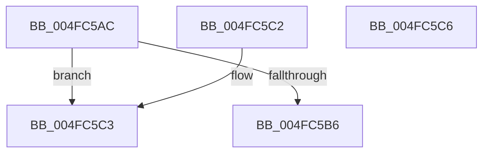

# IopLiveDumpIsTracingEnabled

- RVA: `0x004FC5AC`–`0x004FC5C7` (길이 `27` bytes)
- VA: `0x00000001404FC5AC`
- 실행 섹션: `.text`
- PDB 이름 있음: `예`; PDB Function 태그: `아니요`
- unwind 정보 RVA: `0x000DB714`
- 디코드: `10`개 명령, `27/27` bytes 표시
- 미해석 바이트: `0` (있으면 어셈블리에 `.byte`로 보존)

> 이 문서는 커널 이미지의 기계어와 PDB 기호를 분석해 생성했습니다. 4번과 5번은 함수 원형과 자료형을 바이너리 사용 방식에서 추정한 C 해석이며 원본 소스 복구 결과는 아닙니다.

## 1. Dependencies

- 직접 호출 지점: **0**; 고유 호출 대상: **0**
- 직접 호출자로 확인된 함수: **34**
- RIP 상대 이미지 참조: **2**

### Outgoing calls
- 직접 디코드된 call 명령이 없습니다.

### Direct callers
- [IopLiveDumpTraceEstimatedAndAllocatedPageCount](../3F/IopLiveDumpTraceEstimatedAndAllocatedPageCount_function_003F59B8.md) at `0x003F5A03`
- [IoCaptureLiveDump](../4E/IoCaptureLiveDump_function_004E085C.md) at `0x004E0D04`
- [IopLiveDumpAllocateExtraBuffers](../59/IopLiveDumpAllocateExtraBuffers_function_00599A9C.md) at `0x00599BC6`
- [IopLiveDumpAllocateFromVMMemoryPartition](../59/IopLiveDumpAllocateFromVMMemoryPartition_function_0059A2D8.md) at `0x0059A3AA`
- [IopLiveDumpCallRemovePagesCallbacks](../59/IopLiveDumpCallRemovePagesCallbacks_function_0059AC28.md) at `0x0059ACA4`
- [IopLiveDumpCaptureDumpStart](../59/IopLiveDumpCaptureDumpStart_function_0059B02C.md) at `0x0059B03F`
- [IopLiveDumpCorralProcessors](../59/IopLiveDumpCorralProcessors_function_0059B720.md) at `0x0059B7C3`
- [IopLiveDumpEndMirroringCallback](../59/IopLiveDumpEndMirroringCallback_function_0059B990.md) at `0x0059B9B8`
- [IopLiveDumpEndMirroringCallback](../59/IopLiveDumpEndMirroringCallback_function_0059B990.md) at `0x0059B9E7`
- [IopLiveDumpEstimateMemoryPages](../59/IopLiveDumpEstimateMemoryPages_function_0059BA80.md) at `0x0059BBD8`
- [IopLiveDumpMarkImportantDumpData](../59/IopLiveDumpMarkImportantDumpData_function_0059CCA4.md) at `0x0059CD7E`
- [IopLiveDumpOpenVMMemoryPartition](../59/IopLiveDumpOpenVMMemoryPartition_function_0059D508.md) at `0x0059D5E1`
- [IopLiveDumpPolicyChangeWnfCallback](../59/IopLiveDumpPolicyChangeWnfCallback_function_0059D6E0.md) at `0x0059D800`
- [IopLiveDumpPolicyChangeWnfCallback](../59/IopLiveDumpPolicyChangeWnfCallback_function_0059D6E0.md) at `0x0059D8EB`
- [IopLiveDumpRegisterWnfNotificationCallback](../59/IopLiveDumpRegisterWnfNotificationCallback_function_0059DE08.md) at `0x0059DE60`
- [IopLiveDumpStartMirroringCallback](../59/IopLiveDumpStartMirroringCallback_function_0059E250.md) at `0x0059E25B`
- [IopLiveDumpTraceBufferAllocation](../59/IopLiveDumpTraceBufferAllocation_function_0059E290.md) at `0x0059E2AC`
- [IopLiveDumpTraceBufferEstimation](../59/IopLiveDumpTraceBufferEstimation_function_0059E39C.md) at `0x0059E3B8`
- [IopLiveDumpTraceCaptureGenerateIptSecondaryDataDuration](../59/IopLiveDumpTraceCaptureGenerateIptSecondaryDataDuration_function_0059E50C.md) at `0x0059E534`
- [IopLiveDumpTraceCaptureMemoryPages](../59/IopLiveDumpTraceCaptureMemoryPages_function_0059E638.md) at `0x0059E654`
- [IopLiveDumpTraceCaptureProcessorContextDuration](../59/IopLiveDumpTraceCaptureProcessorContextDuration_function_0059E718.md) at `0x0059E740`
- [IopLiveDumpTraceCorralProcessorsDuration](../59/IopLiveDumpTraceCorralProcessorsDuration_function_0059E854.md) at `0x0059E882`
- [IopLiveDumpTraceDumpDisabledOnBoot](../59/IopLiveDumpTraceDumpDisabledOnBoot_function_0059EA10.md) at `0x0059EA2C`
- [IopLiveDumpTraceDumpFileWriteEnd](../59/IopLiveDumpTraceDumpFileWriteEnd_function_0059EB00.md) at `0x0059EB25`
- [IopLiveDumpTraceInterfaceEnd](../59/IopLiveDumpTraceInterfaceEnd_function_0059EC24.md) at `0x0059EC72`
- [IopLiveDumpTraceInterfaceStart](../59/IopLiveDumpTraceInterfaceStart_function_0059EE0C.md) at `0x0059EE12`
- [IopLiveDumpTraceMarkImportantDumpDataDuration](../59/IopLiveDumpTraceMarkImportantDumpDataDuration_function_0059EE44.md) at `0x0059EE6C`
- [IopLiveDumpTraceMarkRequiredDumpDataDuration](../59/IopLiveDumpTraceMarkRequiredDumpDataDuration_function_0059EF80.md) at `0x0059EFA8`
- [IopLiveDumpTraceMmDuplicateMemoryFailure](../59/IopLiveDumpTraceMmDuplicateMemoryFailure_function_0059F0BC.md) at `0x0059F0E2`
- [IopLiveDumpTracePopulateBitmapForDumpDuration](../59/IopLiveDumpTracePopulateBitmapForDumpDuration_function_0059F158.md) at `0x0059F182`
- [IopLiveDumpTraceRemovePagesCallbackFailure](../59/IopLiveDumpTraceRemovePagesCallbackFailure_function_0059F2AC.md) at `0x0059F2C4`
- [IopLiveDumpTraceUncorralProcessorsDuration](../59/IopLiveDumpTraceUncorralProcessorsDuration_function_0059F324.md) at `0x0059F352`
- [IopLiveDumpUncorralProcessors](../59/IopLiveDumpUncorralProcessors_function_0059F4E0.md) at `0x0059F591`
- [IopLiveDumpTrace](../5A/IopLiveDumpTrace_function_005A4070.md) at `0x005A4074`
- [IopLiveDumpTraceEventGeneric](../5A/IopLiveDumpTraceEventGeneric_function_005A41E4.md) at `0x005A421D`
- [IopLiveDumpTraceNoArgs](../5A/IopLiveDumpTraceNoArgs_function_005A43C0.md) at `0x005A43C4`

### Static image references
- `0x004FC5AC` → RVA `0x00E66228` (`.data`; read)
- `0x004FC5B6` → RVA `0x00E66230` (`.data`; read)

## 2. Other-region calls and transfers

- 다른 실행 섹션으로 향하는 call: **0**
- 별도 외부 분기/꼬리 이동을 확인하지 못했습니다.

## 3. Assembly (complete function range)

```asm
004FC5AC  48 83 3D 74 9C 96 00 00         cmp qword ptr [rip + 0x969c74], 0
004FC5B4  74 0D                           je 0x1404fc5c3
004FC5B6  8B 05 74 9C 96 00               mov eax, dword ptr [rip + 0x969c74]
004FC5BC  85 C0                           test eax, eax
004FC5BE  0F 95 C0                        setne al
004FC5C1  C3                              ret
004FC5C2  CC                              int3
004FC5C3  32 C0                           xor al, al
004FC5C5  C3                              ret
004FC5C6  CC                              int3
```

## 4. C-style interpretation (structured pseudocode)

```c
__int64 __fastcall IopLiveDumpIsTracingEnabled(void)
{
    __int64 result;

    if ((*(unsigned __int64 *)(v_rip + 9870452)) == 0) goto loc_004FC5C3;
    result = ((unsigned int)((unsigned int)(*(unsigned int *)(v_rip + 9870452))) != 0) ? 1 : 0;
    return result;
loc_004FC5C3:
    result = 0;
    return result;
}
```

## 5. (Beta) C Style

```c
void IopLiveDumpIsTracingEnabled(void)
{
    int64_t result;

    if ((*(uint64_t *)(v_rip + 0x969C74)) == 0) goto loc_004FC5C3;
    result = ((uint32_t)((uint32_t)(*(uint32_t *)(v_rip + 0x969C74))) != 0) ? 1 : 0;
    return result;
loc_004FC5C3:
    result = 0;
    return result;
}
```

## 6. Execution-region graph

[열기: 2D/3D 그래프와 함수 탐색 컨트롤 패널](../../../control-panel.html?section=text&rva=0x004FC5AC&view=graph)

- 2D 그래프는 위에서 아래로 흐르고, 3D 그래프는 빈 공간을 드래그해 회전합니다. Shift+드래그는 이동, 휠은 확대·축소, 함수 노드 선택은 대상 보고서 이동입니다.

### Static fallback


