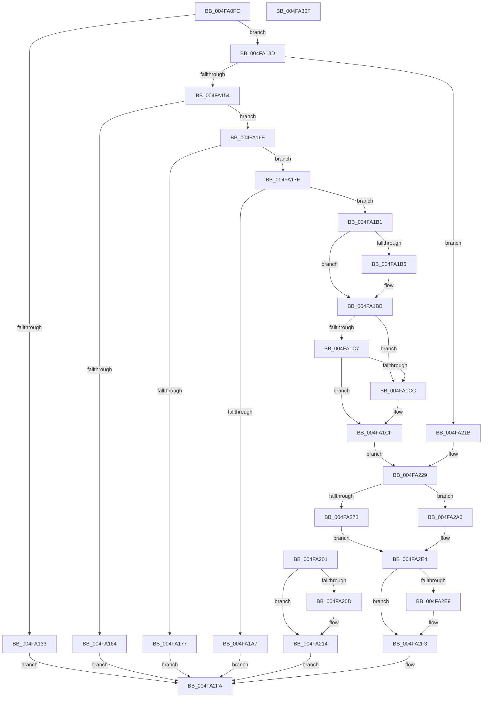

# IopLoadDriverImage

- RVA: `0x004FA0FC`–`0x004FA310` (길이 `532` bytes)
- VA: `0x00000001404FA0FC`
- 실행 섹션: `.text`
- PDB 이름 있음: `예`; PDB Function 태그: `아니요`
- unwind 정보 RVA: `0x000BF924`
- 디코드: `125`개 명령, `532/532` bytes 표시
- 미해석 바이트: `0` (있으면 어셈블리에 `.byte`로 보존)

> 이 문서는 커널 이미지의 기계어와 PDB 기호를 분석해 생성했습니다. 4번과 5번은 함수 원형과 자료형을 바이너리 사용 방식에서 추정한 C 해석이며 원본 소스 복구 결과는 아닙니다.

## 1. Dependencies

- 직접 호출 지점: **11**; 고유 호출 대상: **10**
- 직접 호출자로 확인된 함수: **1**
- RIP 상대 이미지 참조: **3**

### Outgoing calls
- `0x004FA129` → [memset](../6C/memset_function_006C6C40.md) (function, `0x006C6C40`)
- `0x004FA15B` → [SeSinglePrivilegeCheck](../../page/87/SeSinglePrivilegeCheck_function_00871E20.md) (function, `0x00871E20`)
- `0x004FA16E` → [PsIsCurrentThreadInServerSilo](../43/PsIsCurrentThreadInServerSilo_function_004362E0.md) (function, `0x004362E0`)
- `0x004FA1B6` → [ExRaiseDatatypeMisalignment](../../page/89/ExRaiseDatatypeMisalignment_function_00899FD0.md) (function, `0x00899FD0`)
- `0x004FA1DA` → [ExAllocatePool2](../../poolcode/B8/ExAllocatePool2_function_00B820F0.md) (function, `0x00B820F0`)
- `0x004FA1F5` → [memcpy](../6C/memcpy_function_006C6840.md) (function, `0x006C6840`)
- `0x004FA20F` → [ExFreePoolWithTag](../../poolcode/B8/ExFreePoolWithTag_function_00B82870.md) (function, `0x00B82870`)
- `0x004FA28A` → [IopLoadUnloadDriver](../../page/99/IopLoadUnloadDriver_function_00996B80.md) (function, `0x00996B80`)
- `0x004FA2C6` → [ExQueueWorkItem](../2F/ExQueueWorkItem_function_002F9520.md) (function, `0x002F9520`)
- `0x004FA2DF` → [KeWaitForSingleObject](../20/KeWaitForSingleObject_function_0020E6B0.md) (function, `0x0020E6B0`)
- `0x004FA2EE` → [ExFreePoolWithTag](../../poolcode/B8/ExFreePoolWithTag_function_00B82870.md) (function, `0x00B82870`)

### Direct callers
- [NtLoadDriver](../../page/AA/NtLoadDriver_function_00AAE640.md) at `0x00AAE644`

### Static image references
- `0x004FA154` → RVA `0x00FD9B20` (`PAGEDATA`; read)
- `0x004FA25E` → RVA `0x00FC6AB0` (`ALMOSTRO`; read)
- `0x004FA2A6` → RVA `0x00996B80` (`IopLoadUnloadDriver`; read)

## 2. Other-region calls and transfers

- 다른 실행 섹션으로 향하는 call: **6**
  - `0x004FA15B` → [SeSinglePrivilegeCheck](../../page/87/SeSinglePrivilegeCheck_function_00871E20.md) (`.text` → `PAGE`)
  - `0x004FA1B6` → [ExRaiseDatatypeMisalignment](../../page/89/ExRaiseDatatypeMisalignment_function_00899FD0.md) (`.text` → `PAGE`)
  - `0x004FA1DA` → [ExAllocatePool2](../../poolcode/B8/ExAllocatePool2_function_00B820F0.md) (`.text` → `POOLCODE`)
  - `0x004FA20F` → [ExFreePoolWithTag](../../poolcode/B8/ExFreePoolWithTag_function_00B82870.md) (`.text` → `POOLCODE`)
  - `0x004FA28A` → [IopLoadUnloadDriver](../../page/99/IopLoadUnloadDriver_function_00996B80.md) (`.text` → `PAGE`)
  - `0x004FA2EE` → [ExFreePoolWithTag](../../poolcode/B8/ExFreePoolWithTag_function_00B82870.md) (`.text` → `POOLCODE`)
- 별도 외부 분기/꼬리 이동을 확인하지 못했습니다.

## 3. Assembly (complete function range)

```asm
004FA0FC  48 8B C4                        mov rax, rsp
004FA0FF  48 89 58 08                     mov qword ptr [rax + 8], rbx
004FA103  48 89 70 10                     mov qword ptr [rax + 0x10], rsi
004FA107  57                              push rdi
004FA108  48 81 EC A0 00 00 00            sub rsp, 0xa0
004FA10F  48 8B D9                        mov rbx, rcx
004FA112  0F 57 C0                        xorps xmm0, xmm0
004FA115  0F 11 40 90                     movups xmmword ptr [rax - 0x70], xmm0
004FA119  33 F6                           xor esi, esi
004FA11B  48 89 70 88                     mov qword ptr [rax - 0x78], rsi
004FA11F  33 D2                           xor edx, edx
004FA121  44 8D 46 50                     lea r8d, [rsi + 0x50]
004FA125  48 8D 48 A8                     lea rcx, [rax - 0x58]
004FA129  E8 12 CB 1C 00                  call 0x1406c6c40
004FA12E  48 85 DB                        test rbx, rbx
004FA131  75 0A                           jne 0x1404fa13d
004FA133  B8 0D 00 00 C0                  mov eax, 0xc000000d
004FA138  E9 BD 01 00 00                  jmp 0x1404fa2fa
004FA13D  65 48 8B 3C 25 88 01 00 00      mov rdi, qword ptr gs:[0x188]
004FA146  8A 97 32 02 00 00               mov dl, byte ptr [rdi + 0x232]
004FA14C  84 D2                           test dl, dl
004FA14E  0F 84 C7 00 00 00               je 0x1404fa21b
004FA154  48 8B 0D C5 F9 AD 00            mov rcx, qword ptr [rip + 0xadf9c5]
004FA15B  E8 C0 7C 37 00                  call 0x140871e20
004FA160  84 C0                           test al, al
004FA162  75 0A                           jne 0x1404fa16e
004FA164  B8 61 00 00 C0                  mov eax, 0xc0000061
004FA169  E9 8C 01 00 00                  jmp 0x1404fa2fa
004FA16E  E8 6D C1 F3 FF                  call 0x1404362e0
004FA173  84 C0                           test al, al
004FA175  74 07                           je 0x1404fa17e
004FA177  33 C0                           xor eax, eax
004FA179  E9 7C 01 00 00                  jmp 0x1404fa2fa
004FA17E  49 B8 00 00 FF FF FF 7F 00 00   movabs r8, 0x7fffffff0000
004FA188  49 8B C0                        mov rax, r8
004FA18B  49 3B D8                        cmp rbx, r8
004FA18E  48 0F 42 C3                     cmovb rax, rbx
004FA192  90                              nop
004FA193  8B 10                           mov edx, dword ptr [rax]
004FA195  89 54 24 38                     mov dword ptr [rsp + 0x38], edx
004FA199  48 8B 48 08                     mov rcx, qword ptr [rax + 8]
004FA19D  48 89 4C 24 40                  mov qword ptr [rsp + 0x40], rcx
004FA1A2  66 85 D2                        test dx, dx
004FA1A5  75 0A                           jne 0x1404fa1b1
004FA1A7  B8 0D 00 00 C0                  mov eax, 0xc000000d
004FA1AC  E9 49 01 00 00                  jmp 0x1404fa2fa
004FA1B1  F6 C1 01                        test cl, 1
004FA1B4  74 05                           je 0x1404fa1bb
004FA1B6  E8 15 FE 39 00                  call 0x140899fd0
004FA1BB  0F B7 D2                        movzx edx, dx
004FA1BE  48 8D 04 0A                     lea rax, [rdx + rcx]
004FA1C2  49 3B C0                        cmp rax, r8
004FA1C5  77 05                           ja 0x1404fa1cc
004FA1C7  48 3B C1                        cmp rax, rcx
004FA1CA  73 03                           jae 0x1404fa1cf
004FA1CC  41 8A 00                        mov al, byte ptr [r8]
004FA1CF  B9 21 01 00 00                  mov ecx, 0x121
004FA1D4  41 B8 49 6F 4E 32               mov r8d, 0x324e6f49
004FA1DA  E8 11 7F 68 00                  call 0x140b820f0
004FA1DF  48 8B D8                        mov rbx, rax
004FA1E2  48 89 44 24 30                  mov qword ptr [rsp + 0x30], rax
004FA1E7  44 0F B7 44 24 38               movzx r8d, word ptr [rsp + 0x38]
004FA1ED  48 8B 54 24 40                  mov rdx, qword ptr [rsp + 0x40]
004FA1F2  48 8B C8                        mov rcx, rax
004FA1F5  E8 46 C6 1C 00                  call 0x1406c6840
004FA1FA  48 89 5C 24 40                  mov qword ptr [rsp + 0x40], rbx
004FA1FF  EB 28                           jmp 0x1404fa229
004FA201  8B D8                           mov ebx, eax
004FA203  48 8B 4C 24 30                  mov rcx, qword ptr [rsp + 0x30]
004FA208  48 85 C9                        test rcx, rcx
004FA20B  74 07                           je 0x1404fa214
004FA20D  33 D2                           xor edx, edx
004FA20F  E8 5C 86 68 00                  call 0x140b82870
004FA214  8B C3                           mov eax, ebx
004FA216  E9 DF 00 00 00                  jmp 0x1404fa2fa
004FA21B  0F 10 03                        movups xmm0, xmmword ptr [rbx]
004FA21E  F3 0F 7F 44 24 38               movdqu xmmword ptr [rsp + 0x38], xmm0
004FA224  48 8B 5C 24 30                  mov rbx, qword ptr [rsp + 0x30]
004FA229  C6 44 24 72 06                  mov byte ptr [rsp + 0x72], 6
004FA22E  89 74 24 74                     mov dword ptr [rsp + 0x74], esi
004FA232  48 8D 44 24 78                  lea rax, [rsp + 0x78]
004FA237  48 89 84 24 80 00 00 00         mov qword ptr [rsp + 0x80], rax
004FA23F  48 8D 44 24 78                  lea rax, [rsp + 0x78]
004FA244  48 89 44 24 78                  mov qword ptr [rsp + 0x78], rax
004FA249  48 89 B4 24 88 00 00 00         mov qword ptr [rsp + 0x88], rsi
004FA251  48 8D 44 24 38                  lea rax, [rsp + 0x38]
004FA256  48 89 84 24 90 00 00 00         mov qword ptr [rsp + 0x90], rax
004FA25E  48 8B 05 4B C8 AC 00            mov rax, qword ptr [rip + 0xacc84b]
004FA265  48 8D 4C 24 50                  lea rcx, [rsp + 0x50]
004FA26A  48 39 87 B8 00 00 00            cmp qword ptr [rdi + 0xb8], rax
004FA271  75 33                           jne 0x1404fa2a6
004FA273  65 48 8B 04 25 88 01 00 00      mov rax, qword ptr gs:[0x188]
004FA27C  48 8B 98 98 06 00 00            mov rbx, qword ptr [rax + 0x698]
004FA283  48 89 B0 98 06 00 00            mov qword ptr [rax + 0x698], rsi
004FA28A  E8 F1 C8 49 00                  call 0x140996b80
004FA28F  65 48 8B 04 25 88 01 00 00      mov rax, qword ptr gs:[0x188]
004FA298  48 89 98 98 06 00 00            mov qword ptr [rax + 0x698], rbx
004FA29F  48 8B 5C 24 30                  mov rbx, qword ptr [rsp + 0x30]
004FA2A4  EB 3E                           jmp 0x1404fa2e4
004FA2A6  48 8D 05 D3 C8 49 00            lea rax, [rip + 0x49c8d3]
004FA2AD  48 89 44 24 60                  mov qword ptr [rsp + 0x60], rax
004FA2B2  48 8D 44 24 50                  lea rax, [rsp + 0x50]
004FA2B7  48 89 44 24 68                  mov qword ptr [rsp + 0x68], rax
004FA2BC  48 89 74 24 50                  mov qword ptr [rsp + 0x50], rsi
004FA2C1  BA 01 00 00 00                  mov edx, 1
004FA2C6  E8 55 F2 DF FF                  call 0x1402f9520
004FA2CB  48 89 74 24 20                  mov qword ptr [rsp + 0x20], rsi
004FA2D0  45 33 C9                        xor r9d, r9d
004FA2D3  45 33 C0                        xor r8d, r8d
004FA2D6  41 8D 51 06                     lea edx, [r9 + 6]
004FA2DA  48 8D 4C 24 70                  lea rcx, [rsp + 0x70]
004FA2DF  E8 CC 43 D1 FF                  call 0x14020e6b0
004FA2E4  48 85 DB                        test rbx, rbx
004FA2E7  74 0A                           je 0x1404fa2f3
004FA2E9  33 D2                           xor edx, edx
004FA2EB  48 8B CB                        mov rcx, rbx
004FA2EE  E8 7D 85 68 00                  call 0x140b82870
004FA2F3  8B 84 24 98 00 00 00            mov eax, dword ptr [rsp + 0x98]
004FA2FA  4C 8D 9C 24 A0 00 00 00         lea r11, [rsp + 0xa0]
004FA302  49 8B 5B 10                     mov rbx, qword ptr [r11 + 0x10]
004FA306  49 8B 73 18                     mov rsi, qword ptr [r11 + 0x18]
004FA30A  49 8B E3                        mov rsp, r11
004FA30D  5F                              pop rdi
004FA30E  C3                              ret
004FA30F  CC                              int3
```

## 4. C-style interpretation (structured pseudocode)

```c
__int64 __fastcall IopLoadDriverImage(__int64 a1, int a2, __int64 a3, int a4)
{
    __int64 result;
    __int64 v_rsi;
    __int64 v_rsp;
    unsigned int v_stack_m10;
    unsigned __int64 v_stack_m18;
    unsigned __int64 v_stack_m20;
    unsigned __int64 v_stack_m28;
    unsigned __int64 v_stack_m30;
    unsigned int v_stack_m34;
    unsigned __int8 v_stack_m36;
    unsigned __int64 v_stack_m38;
    unsigned __int64 v_stack_m40;
    unsigned __int64 v_stack_m48;
    unsigned __int64 v_stack_m58;
    unsigned __int64 v_stack_m68;
    unsigned int v_stack_m70;
    unsigned __int64 v_stack_m78;
    unsigned __int64 v_stack_m8;
    unsigned __int64 v_stack_m88;

    *(unsigned __int64 *)(v_rsp + 8) = v_rbx;
    *(unsigned __int64 *)(v_rsp + 16) = v_rsi;
    v_rsp = (v_rsp) - (160);
    *(unsigned __int64 *)(v_rsp - 112) = v_xmm0;
    v_rsi = 0;
    *(unsigned __int64 *)(v_rsp - 120) = 0;
    a2 = 0;
    result = memset(v_rsp - 88, a2, v_rsi + 80, a4);
    if (a1 != 0) goto loc_004FA13D;
    goto loc_004FA2FA;
loc_004FA13D:
    if ((unsigned __int8)(*(unsigned __int8 *)(*(unsigned __int64 *)(gs_base + (0 + 392)) + 562)) == 0) goto loc_004FA21B;
    result = SeSinglePrivilegeCheck(*(unsigned __int64 *)(v_rip + 11401669), *(unsigned __int8 *)(*(unsigned __int64 *)(gs_base + (0 + 392)) + 562), v_rsi + 80, a4);
    if ((unsigned __int8)(result) != 0) goto loc_004FA16E;
    goto loc_004FA2FA;
loc_004FA16E:
    result = PsIsCurrentThreadInServerSilo(*(unsigned __int64 *)(v_rip + 11401669), *(unsigned __int8 *)(*(unsigned __int64 *)(gs_base + (0 + 392)) + 562), v_rsi + 80, a4);
    if ((unsigned __int8)(result) == 0) goto loc_004FA17E;
    result = 0;
    goto loc_004FA2FA;
loc_004FA17E:
    result = v_rsi + 80;
    if (a1 < (v_rsi + 80)) { result = a1; }
    v_stack_m70 = (unsigned int)((unsigned int)(*(unsigned int *)(result)));
    v_stack_m68 = *(unsigned __int64 *)(result + 8);
    if ((unsigned __int16)((unsigned int)(*(unsigned int *)(result))) != 0) goto loc_004FA1B1;
    goto loc_004FA2FA;
loc_004FA1B1:
    result = (unsigned int)(0xC000000DULL);
    if ((((unsigned __int8)(*(unsigned __int64 *)(result + 8))) & (1)) != 0) {
        result = ExRaiseDatatypeMisalignment(*(unsigned __int64 *)(result + 8), (unsigned int)(*(unsigned int *)(result)), v_rsi + 80, a4);
    }
    if (((unsigned __int16)((unsigned int)(*(unsigned int *)(result))) + *(unsigned __int64 *)(result + 8) * 1) > (v_rsi + 80)) goto loc_004FA1CC;
    result = (unsigned __int16)((unsigned int)(*(unsigned int *)(result))) + *(unsigned __int64 *)(result + 8) * 1;
    if (((unsigned __int16)((unsigned int)(*(unsigned int *)(result))) + *(unsigned __int64 *)(result + 8) * 1) < (*(unsigned __int64 *)(result + 8))) {
        result = *(unsigned __int8 *)(v_rsi + 80);
    }
    result = ExAllocatePool2(289, (unsigned __int16)((unsigned int)(*(unsigned int *)(result))), (unsigned int)(0x324E6F49ULL), a4);
    v_stack_m78 = result;
    result = memcpy(result, v_stack_m68, v_stack_m70, a4);
    v_stack_m68 = result;
    goto loc_004FA229;
loc_004FA21B:
    v_stack_m70 = v_xmm0;
loc_004FA229:
    v_stack_m36 = 6;
    v_stack_m34 = 0;
    v_stack_m28 = v_stack_m30;
    v_stack_m30 = v_stack_m30;
    v_stack_m20 = 0;
    v_stack_m18 = v_stack_m70;
    if ((*(unsigned __int64 *)(*(unsigned __int64 *)(gs_base + (0 + 392)) + 184)) != (*(unsigned __int64 *)(v_rip + 11323467))) goto loc_004FA2A6;
    *(unsigned __int64 *)(*(unsigned __int64 *)(gs_base + (0 + 392)) + 1688) = 0;
    result = IopLoadUnloadDriver(v_stack_m58, v_stack_m68, v_stack_m70, a4);
    *(unsigned __int64 *)(*(unsigned __int64 *)(gs_base + (0 + 392)) + 1688) = *(unsigned __int64 *)(*(unsigned __int64 *)(gs_base + (0 + 392)) + 1688);
    goto loc_004FA2E4;
loc_004FA2A6:
    v_stack_m48 = v_rip + 4835539;
    v_stack_m40 = v_stack_m58;
    v_stack_m58 = 0;
    result = ExQueueWorkItem(v_stack_m58, 1, v_stack_m70, a4);
    v_stack_m88 = 0;
    a4 = 0;
    a3 = 0;
    result = KeWaitForSingleObject(v_stack_m38, a4 + 6, a3, a4);
loc_004FA2E4:
    if (v_stack_m78 != 0) {
        a2 = 0;
        a1 = v_stack_m78;
        result = ExFreePoolWithTag(a1, a2, a3, a4);
    }
loc_004FA2FA:
    return (unsigned int)(v_stack_m10);
}
```

## 5. (Beta) C Style

```c
int64_t IopLoadDriverImage(int64_t Arg1, int32_t Arg2, int64_t Arg3, int32_t Arg4)
{
    int64_t result;
    int64_t local_rsi;
    int64_t local_rsp;
    uint32_t v_stack_m10;
    uint64_t v_stack_m18;
    uint64_t v_stack_m20;
    uint64_t v_stack_m28;
    uint64_t v_stack_m30;
    uint32_t v_stack_m34;
    uint8_t v_stack_m36;
    uint64_t v_stack_m38;
    uint64_t v_stack_m40;
    uint64_t v_stack_m48;
    uint64_t v_stack_m58;
    uint64_t v_stack_m68;
    uint32_t v_stack_m70;
    uint64_t v_stack_m78;
    uint64_t v_stack_m8;
    uint64_t v_stack_m88;

    *(uint64_t *)(local_rsp + 0x8) = local_rbx;
    *(uint64_t *)(local_rsp + 0x10) = local_rsi;
    local_rsp = (local_rsp) - (160);
    *(uint64_t *)(local_rsp - 0x70) = v_xmm0;
    local_rsi = 0;
    *(uint64_t *)(local_rsp - 0x78) = 0;
    Arg2 = 0;
    result = memset(local_rsp - 88, Arg2, local_rsi + 80, Arg4);
    if (Arg1 != 0) goto loc_004FA13D;
    goto loc_004FA2FA;
loc_004FA13D:
    if ((uint8_t)(*(uint8_t *)(*(uint64_t *)(gs_base + (0 + 0x188)) + 0x232)) == 0) goto loc_004FA21B;
    result = SeSinglePrivilegeCheck(*(uint64_t *)(v_rip + 0xADF9C5), *(uint8_t *)(*(uint64_t *)(gs_base + (0 + 0x188)) + 0x232), local_rsi + 80, Arg4);
    if ((uint8_t)(result) != 0) goto loc_004FA16E;
    goto loc_004FA2FA;
loc_004FA16E:
    result = PsIsCurrentThreadInServerSilo(*(uint64_t *)(v_rip + 0xADF9C5), *(uint8_t *)(*(uint64_t *)(gs_base + (0 + 0x188)) + 0x232), local_rsi + 80, Arg4);
    if ((uint8_t)(result) == 0) goto loc_004FA17E;
    result = 0;
    goto loc_004FA2FA;
loc_004FA17E:
    result = local_rsi + 80;
    if (Arg1 < (local_rsi + 80)) { result = Arg1; }
    v_stack_m70 = (uint32_t)((uint32_t)(*(uint32_t *)(result)));
    v_stack_m68 = *(uint64_t *)(result + 0x8);
    if ((uint16_t)((uint32_t)(*(uint32_t *)(result))) != 0) goto loc_004FA1B1;
    goto loc_004FA2FA;
loc_004FA1B1:
    result = (uint32_t)(0xC000000DULL);
    if ((((uint8_t)(*(uint64_t *)(result + 0x8))) & (1)) != 0) {
        result = ExRaiseDatatypeMisalignment(*(uint64_t *)(result + 0x8), (uint32_t)(*(uint32_t *)(result)), local_rsi + 80, Arg4);
    }
    if (((uint16_t)((uint32_t)(*(uint32_t *)(result))) + *(uint64_t *)(result + 0x8) * 1) > (local_rsi + 80)) goto loc_004FA1CC;
    result = (uint16_t)((uint32_t)(*(uint32_t *)(result))) + *(uint64_t *)(result + 0x8) * 1;
    if (((uint16_t)((uint32_t)(*(uint32_t *)(result))) + *(uint64_t *)(result + 0x8) * 1) < (*(uint64_t *)(result + 0x8))) {
        result = *(uint8_t *)(local_rsi + 0x50);
    }
    result = ExAllocatePool2(289, (uint16_t)((uint32_t)(*(uint32_t *)(result))), (uint32_t)(0x324E6F49ULL), Arg4);
    v_stack_m78 = result;
    result = memcpy(result, v_stack_m68, v_stack_m70, Arg4);
    v_stack_m68 = result;
    goto loc_004FA229;
loc_004FA21B:
    v_stack_m70 = v_xmm0;
loc_004FA229:
    v_stack_m36 = 6;
    v_stack_m34 = 0;
    v_stack_m28 = v_stack_m30;
    v_stack_m30 = v_stack_m30;
    v_stack_m20 = 0;
    v_stack_m18 = v_stack_m70;
    if ((*(uint64_t *)(*(uint64_t *)(gs_base + (0 + 0x188)) + 0xB8)) != (*(uint64_t *)(v_rip + 0xACC84B))) goto loc_004FA2A6;
    *(uint64_t *)(*(uint64_t *)(gs_base + (0 + 0x188)) + 0x698) = 0;
    result = IopLoadUnloadDriver(v_stack_m58, v_stack_m68, v_stack_m70, Arg4);
    *(uint64_t *)(*(uint64_t *)(gs_base + (0 + 0x188)) + 0x698) = *(uint64_t *)(*(uint64_t *)(gs_base + (0 + 0x188)) + 0x698);
    goto loc_004FA2E4;
loc_004FA2A6:
    v_stack_m48 = v_rip + 4835539;
    v_stack_m40 = v_stack_m58;
    v_stack_m58 = 0;
    result = ExQueueWorkItem(v_stack_m58, 1, v_stack_m70, Arg4);
    v_stack_m88 = 0;
    Arg4 = 0;
    Arg3 = 0;
    result = KeWaitForSingleObject(v_stack_m38, Arg4 + 6, Arg3, Arg4);
loc_004FA2E4:
    if (v_stack_m78 != 0) {
        Arg2 = 0;
        Arg1 = v_stack_m78;
        result = ExFreePoolWithTag(Arg1, Arg2, Arg3, Arg4);
    }
loc_004FA2FA:
    return (uint32_t)(v_stack_m10);
}
```

## 6. Execution-region graph

[열기: 2D/3D 그래프와 함수 탐색 컨트롤 패널](../../../control-panel.html?section=text&rva=0x004FA0FC&view=graph)

- 2D 그래프는 위에서 아래로 흐르고, 3D 그래프는 빈 공간을 드래그해 회전합니다. Shift+드래그는 이동, 휠은 확대·축소, 함수 노드 선택은 대상 보고서 이동입니다.

### Static fallback


