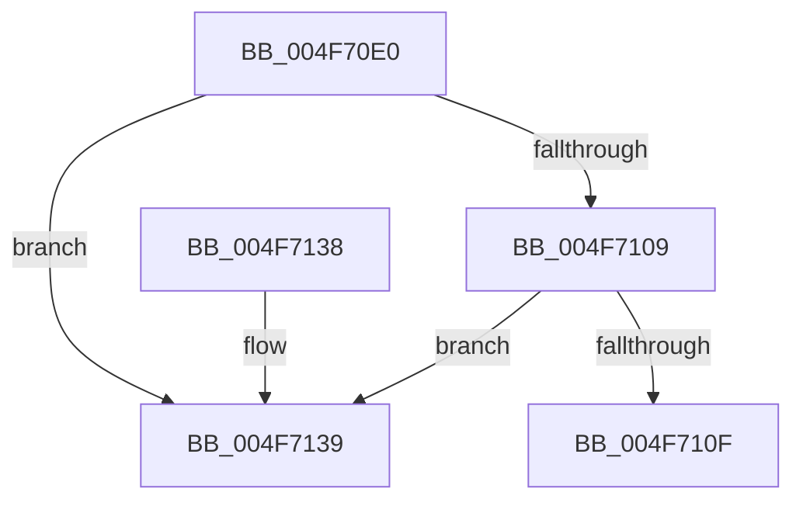

# IopRemoveHardErrorPacket

- RVA: `0x004F70E0`–`0x004F7140` (길이 `96` bytes)
- VA: `0x00000001404F70E0`
- 실행 섹션: `.text`
- PDB 이름 있음: `예`; PDB Function 태그: `아니요`
- unwind 정보 RVA: `0x0005DAC8`
- 디코드: `24`개 명령, `96/96` bytes 표시
- 미해석 바이트: `0` (있으면 어셈블리에 `.byte`로 보존)

> 이 문서는 커널 이미지의 기계어와 PDB 기호를 분석해 생성했습니다. 4번과 5번은 함수 원형과 자료형을 바이너리 사용 방식에서 추정한 C 해석이며 원본 소스 복구 결과는 아닙니다.

## 1. Dependencies

- 직접 호출 지점: **2**; 고유 호출 대상: **2**
- 직접 호출자로 확인된 함수: **1**
- RIP 상대 이미지 참조: **4**

### Outgoing calls
- `0x004F70ED` → [KeAcquireSpinLockRaiseToDpc](../20/KeAcquireSpinLockRaiseToDpc_function_00208470.md) (function, `0x00208470`)
- `0x004F712A` → [KeReleaseSpinLock](../39/KeReleaseSpinLock_function_00392BA0.md) (function, `0x00392BA0`)

### Direct callers
- [IopHardErrorThread](../../page/71/IopHardErrorThread_function_0071B690.md) at `0x0071B6B9`

### Static image references
- `0x004F70E6` → RVA `0x00F8D7B0` (`.data`; read)
- `0x004F70F2` → RVA `0x00F8D7A0` (`.data`; read)
- `0x004F710F` → RVA `0x00F8D7A0` (`.data`; write)
- `0x004F7123` → RVA `0x00F8D1F8` (`.data`; write)

## 2. Other-region calls and transfers

- 다른 실행 섹션으로 향하는 call: **0**
- 별도 외부 분기/꼬리 이동을 확인하지 못했습니다.

## 3. Assembly (complete function range)

```asm
004F70E0  40 53                           push rbx
004F70E2  48 83 EC 20                     sub rsp, 0x20
004F70E6  48 8D 0D C3 66 A9 00            lea rcx, [rip + 0xa966c3]
004F70ED  E8 7E 13 D1 FF                  call 0x140208470
004F70F2  48 8B 1D A7 66 A9 00            mov rbx, qword ptr [rip + 0xa966a7]
004F70F9  48 8D 0D A0 66 A9 00            lea rcx, [rip + 0xa966a0]
004F7100  48 8B 13                        mov rdx, qword ptr [rbx]
004F7103  48 39 4B 08                     cmp qword ptr [rbx + 8], rcx
004F7107  75 30                           jne 0x1404f7139
004F7109  48 39 5A 08                     cmp qword ptr [rdx + 8], rbx
004F710D  75 2A                           jne 0x1404f7139
004F710F  48 89 15 8A 66 A9 00            mov qword ptr [rip + 0xa9668a], rdx
004F7116  48 89 4A 08                     mov qword ptr [rdx + 8], rcx
004F711A  8A D0                           mov dl, al
004F711C  48 8D 0D 8D 66 A9 00            lea rcx, [rip + 0xa9668d]
004F7123  48 89 1D CE 60 A9 00            mov qword ptr [rip + 0xa960ce], rbx
004F712A  E8 71 BA E9 FF                  call 0x140392ba0
004F712F  48 8B C3                        mov rax, rbx
004F7132  48 83 C4 20                     add rsp, 0x20
004F7136  5B                              pop rbx
004F7137  C3                              ret
004F7138  CC                              int3
004F7139  B9 03 00 00 00                  mov ecx, 3
004F713E  CD 29                           int 0x29
```

## 4. C-style interpretation (structured pseudocode)

```c
__int64 __fastcall IopRemoveHardErrorPacket(void)
{
    __int64 result;
    __int64 v_rsp;

    v_rsp = (v_rsp) - (32);
    result = KeAcquireSpinLockRaiseToDpc(v_rip + 11101891, a2, a3, a4);
    if ((*(unsigned __int64 *)(*(unsigned __int64 *)(v_rip + 11101863) + 8)) != (v_rip + 11101856)) goto loc_004F7139;
    if ((*(unsigned __int64 *)(*(unsigned __int64 *)(*(unsigned __int64 *)(v_rip + 11101863)) + 8)) != (*(unsigned __int64 *)(v_rip + 11101863))) goto loc_004F7139;
    *(unsigned __int64 *)(v_rip + 11101834) = *(unsigned __int64 *)(*(unsigned __int64 *)(v_rip + 11101863));
    *(unsigned __int64 *)(*(unsigned __int64 *)(*(unsigned __int64 *)(v_rip + 11101863)) + 8) = v_rip + 11101856;
    *(unsigned __int64 *)(v_rip + 11100366) = *(unsigned __int64 *)(v_rip + 11101863);
    result = KeReleaseSpinLock(v_rip + 11101837, (unsigned __int8)(result), a3, a4);
    v_rsp = (v_rsp) + (32);
    return *(unsigned __int64 *)(v_rip + 11101863);
loc_004F7139:
    return *(unsigned __int64 *)(v_rip + 11101863);
}
```

## 5. (Beta) C Style

```c
void IopRemoveHardErrorPacket(void)
{
    int64_t result;
    int64_t local_rsp;

    local_rsp = (local_rsp) - (32);
    result = KeAcquireSpinLockRaiseToDpc(v_rip + 11101891, a2, a3, a4);
    if ((*(uint64_t *)(*(uint64_t *)(v_rip + 0xA966A7) + 0x8)) != (v_rip + 11101856)) goto loc_004F7139;
    if ((*(uint64_t *)(*(uint64_t *)(*(uint64_t *)(v_rip + 0xA966A7)) + 0x8)) != (*(uint64_t *)(v_rip + 0xA966A7))) goto loc_004F7139;
    *(uint64_t *)(v_rip + 0xA9668A) = *(uint64_t *)(*(uint64_t *)(v_rip + 0xA966A7));
    *(uint64_t *)(*(uint64_t *)(*(uint64_t *)(v_rip + 0xA966A7)) + 0x8) = v_rip + 11101856;
    *(uint64_t *)(v_rip + 0xA960CE) = *(uint64_t *)(v_rip + 0xA966A7);
    result = KeReleaseSpinLock(v_rip + 11101837, (uint8_t)(result), a3, a4);
    local_rsp = (local_rsp) + (32);
    return *(uint64_t *)(v_rip + 0xA966A7);
loc_004F7139:
    return *(uint64_t *)(v_rip + 0xA966A7);
}
```

## 6. Execution-region graph

[열기: 2D/3D 그래프와 함수 탐색 컨트롤 패널](../../../control-panel.html?section=text&rva=0x004F70E0&view=graph)

- 2D 그래프는 위에서 아래로 흐르고, 3D 그래프는 빈 공간을 드래그해 회전합니다. Shift+드래그는 이동, 휠은 확대·축소, 함수 노드 선택은 대상 보고서 이동입니다.

### Static fallback


