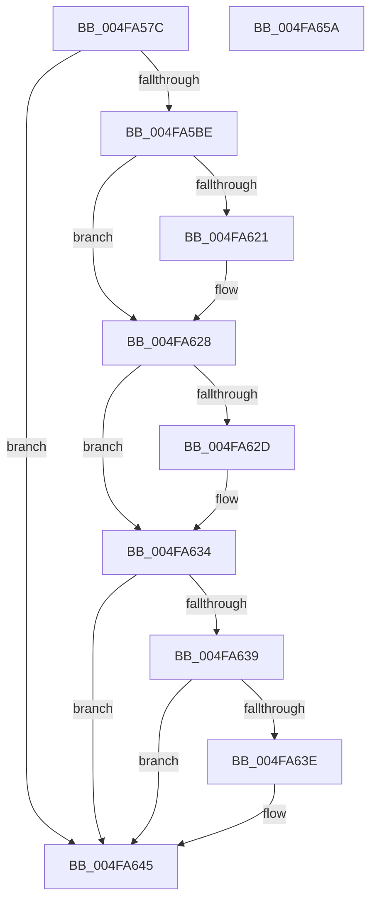

# IvtBuildScalableModeContextEntry

- RVA: `0x004FA57C`–`0x004FA65B` (길이 `223` bytes)
- VA: `0x00000001404FA57C`
- 실행 섹션: `.text`
- PDB 이름 있음: `예`; PDB Function 태그: `아니요`
- unwind 정보 RVA: `0x0005C954`
- 디코드: `62`개 명령, `223/223` bytes 표시
- 미해석 바이트: `0` (있으면 어셈블리에 `.byte`로 보존)

> 이 문서는 커널 이미지의 기계어와 PDB 기호를 분석해 생성했습니다. 4번과 5번은 함수 원형과 자료형을 바이너리 사용 방식에서 추정한 C 해석이며 원본 소스 복구 결과는 아닙니다.

## 1. Dependencies

- 직접 호출 지점: **1**; 고유 호출 대상: **1**
- 직접 호출자로 확인된 함수: **2**
- RIP 상대 이미지 참조: **0**

### Outgoing calls
- `0x004FA5C9` → [MmGetPhysicalAddress](../23/MmGetPhysicalAddress_function_0023A500.md) (function, `0x0023A500`)

### Direct callers
- [IvtUpdateScalableModeContextEntry](../4C/IvtUpdateScalableModeContextEntry_function_004CD880.md) at `0x004CD994`
- [IvtInitializeIommu](../../pagelk/B6/IvtInitializeIommu_function_00B61FE0.md) at `0x00B623D8`

### Static image references
- 디코드된 RIP-relative 메모리 참조가 없습니다.

## 2. Other-region calls and transfers

- 다른 실행 섹션으로 향하는 call: **0**
- 별도 외부 분기/꼬리 이동을 확인하지 못했습니다.

## 3. Assembly (complete function range)

```asm
004FA57C  48 8B C4                        mov rax, rsp
004FA57F  48 89 58 08                     mov qword ptr [rax + 8], rbx
004FA583  48 89 68 10                     mov qword ptr [rax + 0x10], rbp
004FA587  48 89 70 18                     mov qword ptr [rax + 0x18], rsi
004FA58B  57                              push rdi
004FA58C  48 83 EC 20                     sub rsp, 0x20
004FA590  48 8B 5C 24 58                  mov rbx, qword ptr [rsp + 0x58]
004FA595  41 8A E9                        mov bpl, r9b
004FA598  83 60 28 00                     and dword ptr [rax + 0x28], 0
004FA59C  41 8A F8                        mov dil, r8b
004FA59F  48 8B F2                        mov rsi, rdx
004FA5A2  48 83 63 08 00                  and qword ptr [rbx + 8], 0
004FA5A7  48 83 63 10 00                  and qword ptr [rbx + 0x10], 0
004FA5AC  48 83 63 18 00                  and qword ptr [rbx + 0x18], 0
004FA5B1  48 83 23 00                     and qword ptr [rbx], 0
004FA5B5  48 85 D2                        test rdx, rdx
004FA5B8  0F 84 87 00 00 00               je 0x1404fa645
004FA5BE  48 C7 03 01 00 00 00            mov qword ptr [rbx], 1
004FA5C5  48 8B 4A 38                     mov rcx, qword ptr [rdx + 0x38]
004FA5C9  E8 32 FF D3 FF                  call 0x14023a500
004FA5CE  48 8B 0B                        mov rcx, qword ptr [rbx]
004FA5D1  48 8B D1                        mov rdx, rcx
004FA5D4  48 33 D0                        xor rdx, rax
004FA5D7  48 81 E2 00 F0 FF FF            and rdx, 0xfffffffffffff000
004FA5DE  48 33 D1                        xor rdx, rcx
004FA5E1  B9 00 02 00 00                  mov ecx, 0x200
004FA5E6  48 89 13                        mov qword ptr [rbx], rdx
004FA5E9  8B 46 24                        mov eax, dword ptr [rsi + 0x24]
004FA5EC  C1 E8 06                        shr eax, 6
004FA5EF  25 FF 3F 00 00                  and eax, 0x3fff
004FA5F4  3B C1                           cmp eax, ecx
004FA5F6  0F 42 C1                        cmovb eax, ecx
004FA5F9  48 81 63 08 00 00 F0 FF         and qword ptr [rbx + 8], 0xfffffffffff00000
004FA601  0F BD C8                        bsr ecx, eax
004FA604  FF C1                           inc ecx
004FA606  48 C1 E1 09                     shl rcx, 9
004FA60A  48 8B C1                        mov rax, rcx
004FA60D  48 33 C2                        xor rax, rdx
004FA610  48 25 FF F1 FF FF               and rax, 0xfffffffffffff1ff
004FA616  48 33 C1                        xor rax, rcx
004FA619  48 89 03                        mov qword ptr [rbx], rax
004FA61C  40 84 ED                        test bpl, bpl
004FA61F  74 07                           je 0x1404fa628
004FA621  48 83 C8 08                     or rax, 8
004FA625  48 89 03                        mov qword ptr [rbx], rax
004FA628  40 84 FF                        test dil, dil
004FA62B  74 07                           je 0x1404fa634
004FA62D  48 83 C8 04                     or rax, 4
004FA631  48 89 03                        mov qword ptr [rbx], rax
004FA634  40 84 ED                        test bpl, bpl
004FA637  74 0C                           je 0x1404fa645
004FA639  40 84 FF                        test dil, dil
004FA63C  74 07                           je 0x1404fa645
004FA63E  48 83 C8 10                     or rax, 0x10
004FA642  48 89 03                        mov qword ptr [rbx], rax
004FA645  48 8B 5C 24 30                  mov rbx, qword ptr [rsp + 0x30]
004FA64A  48 8B 6C 24 38                  mov rbp, qword ptr [rsp + 0x38]
004FA64F  48 8B 74 24 40                  mov rsi, qword ptr [rsp + 0x40]
004FA654  48 83 C4 20                     add rsp, 0x20
004FA658  5F                              pop rdi
004FA659  C3                              ret
004FA65A  CC                              int3
```

## 4. C-style interpretation (structured pseudocode)

```c
__int64 __fastcall IvtBuildScalableModeContextEntry(__int64 a1, __int64 a2, unsigned __int8 a3, unsigned __int8 a4, __int64 a5, __int64 a6)
{
    __int64 result;
    __int64 v_rsp;
    unsigned __int64 v_stack_p10;
    unsigned __int64 v_stack_p18;
    unsigned __int64 v_stack_p8;

    *(unsigned __int64 *)(v_rsp + 8) = v_rbx;
    *(unsigned __int64 *)(v_rsp + 16) = v_rbp;
    *(unsigned __int64 *)(v_rsp + 24) = v_rsi;
    v_rsp = (v_rsp) - (32);
    if (a2 == 0) goto loc_004FA645;
    *(unsigned __int64 *)(a6) = 1;
    result = MmGetPhysicalAddress(*(unsigned __int64 *)(a2 + 56), a2, a3, a4);
    a2 = (*(unsigned __int64 *)(a6)) ^ (result);
    a2 = (a2) & (0xFFFFFFFFFFFFF000ULL);
    a2 = (a2) ^ (*(unsigned __int64 *)(a6));
    *(unsigned __int64 *)(a6) = a2;
    result = (unsigned int)(((unsigned int)(*(unsigned int *)(a2 + 36))) >> (6));
    result = (unsigned int)((result) & (0x3FFFULL));
    if (((unsigned int)(result)) < 512) { result = 512; }
    a1 = (unsigned int)((512) + 1);
    a1 = (a1) << (9);
    result = (a1) ^ (a2);
    result = (result) & (0xFFFFFFFFFFFFF1FFULL);
    result = (result) ^ (a1);
    *(unsigned __int64 *)(a6) = result;
    if (a4 != 0) {
        result = (result) | (8);
        *(unsigned __int64 *)(a6) = result;
    }
    if (a3 != 0) {
        result = (result) | (4);
        *(unsigned __int64 *)(a6) = result;
    }
    if (a4 == 0) goto loc_004FA645;
    if (a3 != 0) {
        result = (result) | (16);
        *(unsigned __int64 *)(a6) = result;
    }
    v_rsp = (v_rsp) + (32);
    return result;
}
```

## 5. (Beta) C Style

```c
int64_t IvtBuildScalableModeContextEntry(int64_t Arg1, void *Arg2, uint8_t Arg3, uint8_t Arg4, uint64_t Arg5, void *Arg6)
{
    uint8_t *arg2 = (uint8_t *)Arg2;
    uint8_t *arg6 = (uint8_t *)Arg6;

    int64_t result;
    int64_t local_rsp;
    uint64_t v_stack_p10;
    uint64_t v_stack_p18;
    uint64_t v_stack_p8;

    *(uint64_t *)(local_rsp + 0x8) = local_rbx;
    *(uint64_t *)(local_rsp + 0x10) = local_rbp;
    *(uint64_t *)(local_rsp + 0x18) = local_rsi;
    local_rsp = (local_rsp) - (32);
    if (Arg2 == NULL) goto loc_004FA645;
    *(uint64_t *)(arg6) = 1;
    result = MmGetPhysicalAddress(*(uint64_t *)(arg2 + 0x38), Arg2, Arg3, Arg4);
    Arg2 = (*(uint64_t *)(arg6)) ^ (result);
    Arg2 = (Arg2) & (0xFFFFFFFFFFFFF000ULL);
    Arg2 = (Arg2) ^ (*(uint64_t *)(arg6));
    *(void **)(arg6) = Arg2;
    result = (uint32_t)(((uint32_t)(*(uint32_t *)(arg2 + 0x24))) >> (6));
    result = (uint32_t)((result) & (0x3FFFULL));
    if (((uint32_t)(result)) < 512) { result = 512; }
    Arg1 = (uint32_t)((512) + 1);
    Arg1 = (Arg1) << (9);
    result = (Arg1) ^ (Arg2);
    result = (result) & (0xFFFFFFFFFFFFF1FFULL);
    result = (result) ^ (Arg1);
    *(uint64_t *)(arg6) = result;
    if (Arg4 != 0) {
        result = (result) | (8);
        *(uint64_t *)(arg6) = result;
    }
    if (Arg3 != 0) {
        result = (result) | (4);
        *(uint64_t *)(arg6) = result;
    }
    if (Arg4 == 0) goto loc_004FA645;
    if (Arg3 != 0) {
        result = (result) | (16);
        *(uint64_t *)(arg6) = result;
    }
    local_rsp = (local_rsp) + (32);
    return result;
}
```

### 관측된 메모리 오프셋

구조체 형식이 확인되지 않은 접근은 인자 기준의 오프셋으로만 기록했습니다.

| 기준 인자 | 오프셋 표현 | 폭 (bit) | 접근 |
|---|---:|---:|---|
| `Arg2` | `+ 0x24` | `32` | `R` |
| `Arg6` | `+ 0x0` | `64` | `R` |
| `Arg6` | `+ 0x0` | `64` | `R/W` |
| `Arg6` | `+ 0x0` | `64` | `W` |
| `Arg6` | `+ 0x8` | `64` | `R/W` |
| `Arg6` | `+ 0x10` | `64` | `R/W` |
| `Arg6` | `+ 0x18` | `64` | `R/W` |

## 6. Execution-region graph

[열기: 2D/3D 그래프와 함수 탐색 컨트롤 패널](../../../control-panel.html?section=text&rva=0x004FA57C&view=graph)

- 2D 그래프는 위에서 아래로 흐르고, 3D 그래프는 빈 공간을 드래그해 회전합니다. Shift+드래그는 이동, 휠은 확대·축소, 함수 노드 선택은 대상 보고서 이동입니다.

### Static fallback


