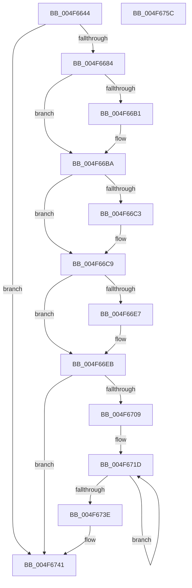

# IvtBuildScalableModePasidTableS1Entry

- RVA: `0x004F6644`–`0x004F675D` (길이 `281` bytes)
- VA: `0x00000001404F6644`
- 실행 섹션: `.text`
- PDB 이름 있음: `예`; PDB Function 태그: `아니요`
- unwind 정보 RVA: `0x0005E6B4`
- 디코드: `78`개 명령, `281/281` bytes 표시
- 미해석 바이트: `0` (있으면 어셈블리에 `.byte`로 보존)

> 이 문서는 커널 이미지의 기계어와 PDB 기호를 분석해 생성했습니다. 4번과 5번은 함수 원형과 자료형을 바이너리 사용 방식에서 추정한 C 해석이며 원본 소스 복구 결과는 아닙니다.

## 1. Dependencies

- 직접 호출 지점: **2**; 고유 호출 대상: **2**
- 직접 호출자로 확인된 함수: **4**
- RIP 상대 이미지 참조: **0**

### Outgoing calls
- `0x004F6674` → [memset](../6C/memset_function_006C6C40.md) (function, `0x006C6C40`)
- `0x004F66A8` → [Feature_Test57481295__private_IsEnabledDeviceUsageNoInline](Feature_Test57481295__private_IsEnabledDeviceUsageNoInline_function_004F7B90.md) (function, `0x004F7B90`)

### Direct callers
- [IvtUpdateScalableModePasidTablesForPasid](../4C/IvtUpdateScalableModePasidTablesForPasid_function_004CD628.md) at `0x004CD68E`
- [IvtInitializeScalableModePasidTables](../57/IvtInitializeScalableModePasidTables_function_00570728.md) at `0x005707B3`
- [IvtLegacySetPasidAddressSpace](../57/IvtLegacySetPasidAddressSpace_function_00571FD0.md) at `0x005720E0`
- [IvtSetPasidAddressSpace](../57/IvtSetPasidAddressSpace_function_00572630.md) at `0x00572772`

### Static image references
- 디코드된 RIP-relative 메모리 참조가 없습니다.

## 2. Other-region calls and transfers

- 다른 실행 섹션으로 향하는 call: **0**
- 별도 외부 분기/꼬리 이동을 확인하지 못했습니다.

## 3. Assembly (complete function range)

```asm
004F6644  48 8B C4                        mov rax, rsp
004F6647  48 89 58 08                     mov qword ptr [rax + 8], rbx
004F664B  48 89 68 10                     mov qword ptr [rax + 0x10], rbp
004F664F  48 89 70 18                     mov qword ptr [rax + 0x18], rsi
004F6653  48 89 78 20                     mov qword ptr [rax + 0x20], rdi
004F6657  41 56                           push r14
004F6659  48 83 EC 20                     sub rsp, 0x20
004F665D  48 8B 5C 24 60                  mov rbx, qword ptr [rsp + 0x60]
004F6662  44 8B F2                        mov r14d, edx
004F6665  33 D2                           xor edx, edx
004F6667  49 8B F0                        mov rsi, r8
004F666A  48 8B E9                        mov rbp, rcx
004F666D  48 8B CB                        mov rcx, rbx
004F6670  44 8D 42 40                     lea r8d, [rdx + 0x40]
004F6674  E8 C7 05 1D 00                  call 0x1406c6c40
004F6679  33 FF                           xor edi, edi
004F667B  48 85 F6                        test rsi, rsi
004F667E  0F 84 BD 00 00 00               je 0x1404f6741
004F6684  41 8B D6                        mov edx, r14d
004F6687  83 E2 07                        and edx, 7
004F668A  48 C1 E2 06                     shl rdx, 6
004F668E  48 83 CA 01                     or rdx, 1
004F6692  48 89 13                        mov qword ptr [rbx], rdx
004F6695  8B 85 F8 00 00 00               mov eax, dword ptr [rbp + 0xf8]
004F669B  83 E0 07                        and eax, 7
004F669E  48 C1 E0 02                     shl rax, 2
004F66A2  48 0B C2                        or rax, rdx
004F66A5  48 89 03                        mov qword ptr [rbx], rax
004F66A8  E8 E3 14 00 00                  call 0x1404f7b90
004F66AD  85 C0                           test eax, eax
004F66AF  74 09                           je 0x1404f66ba
004F66B1  0F B7 44 24 58                  movzx eax, word ptr [rsp + 0x58]
004F66B6  66 89 43 08                     mov word ptr [rbx + 8], ax
004F66BA  F6 85 E6 00 00 00 01            test byte ptr [rbp + 0xe6], 1
004F66C1  74 06                           je 0x1404f66c9
004F66C3  48 0F BA 6B 08 17               bts qword ptr [rbx + 8], 0x17
004F66C9  0F B6 44 24 50                  movzx eax, byte ptr [rsp + 0x50]
004F66CE  48 8B 4B 10                     mov rcx, qword ptr [rbx + 0x10]
004F66D2  83 E0 01                        and eax, 1
004F66D5  48 83 E1 FC                     and rcx, 0xfffffffffffffffc
004F66D9  48 83 C9 20                     or rcx, 0x20
004F66DD  48 33 C8                        xor rcx, rax
004F66E0  40 38 7C 24 50                  cmp byte ptr [rsp + 0x50], dil
004F66E5  74 04                           je 0x1404f66eb
004F66E7  48 83 C9 50                     or rcx, 0x50
004F66EB  81 E1 F3 0F 00 00               and ecx, 0xff3
004F66F1  48 C1 E6 0C                     shl rsi, 0xc
004F66F5  48 0B CE                        or rcx, rsi
004F66F8  48 89 4B 10                     mov qword ptr [rbx + 0x10], rcx
004F66FC  8B 85 E0 00 00 00               mov eax, dword ptr [rbp + 0xe0]
004F6702  48 0F BA E0 19                  bt rax, 0x19
004F6707  73 38                           jae 0x1404f6741
004F6709  B9 77 02 00 00                  mov ecx, 0x277
004F670E  0F 32                           rdmsr
004F6710  48 C1 E2 20                     shl rdx, 0x20
004F6714  44 8B CF                        mov r9d, edi
004F6717  48 0B C2                        or rax, rdx
004F671A  44 8B C7                        mov r8d, edi
004F671D  41 8B C8                        mov ecx, r8d
004F6720  48 8B D0                        mov rdx, rax
004F6723  48 D3 EA                        shr rdx, cl
004F6726  41 83 C0 08                     add r8d, 8
004F672A  83 E2 0F                        and edx, 0xf
004F672D  41 8B C9                        mov ecx, r9d
004F6730  D3 E2                           shl edx, cl
004F6732  41 83 C1 04                     add r9d, 4
004F6736  0B FA                           or edi, edx
004F6738  41 83 F8 40                     cmp r8d, 0x40
004F673C  72 DF                           jb 0x1404f671d
004F673E  89 7B 0C                        mov dword ptr [rbx + 0xc], edi
004F6741  48 8B 5C 24 30                  mov rbx, qword ptr [rsp + 0x30]
004F6746  48 8B 6C 24 38                  mov rbp, qword ptr [rsp + 0x38]
004F674B  48 8B 74 24 40                  mov rsi, qword ptr [rsp + 0x40]
004F6750  48 8B 7C 24 48                  mov rdi, qword ptr [rsp + 0x48]
004F6755  48 83 C4 20                     add rsp, 0x20
004F6759  41 5E                           pop r14
004F675B  C3                              ret
004F675C  CC                              int3
```

## 4. C-style interpretation (structured pseudocode)

```c
__int64 __fastcall IvtBuildScalableModePasidTableS1Entry(__int64 a1, int a2, __int64 a3, __int64 a4, unsigned __int8 a5, unsigned __int16 a6, __int64 a7)
{
    __int64 result;
    __int64 v_rdi;
    __int64 v_rsi;
    __int64 v_rsp;
    unsigned __int64 v_stack_p10;
    unsigned __int64 v_stack_p18;
    unsigned __int64 v_stack_p20;
    unsigned __int64 v_stack_p8;

    *(unsigned __int64 *)(v_rsp + 8) = v_rbx;
    *(unsigned __int64 *)(v_rsp + 16) = v_rbp;
    *(unsigned __int64 *)(v_rsp + 24) = v_rsi;
    *(unsigned __int64 *)(v_rsp + 32) = v_rdi;
    v_rsp = (v_rsp) - (32);
    a2 = 0;
    result = memset(a7, a2, a2 + 64, a4);
    v_rdi = 0;
    if (a3 == 0) goto loc_004F6741;
    a2 = (unsigned int)(((unsigned int)((unsigned int)((unsigned int)(a2)))) & (7));
    a2 = (a2) << (6);
    a2 = (a2) | (1);
    *(unsigned __int64 *)(a7) = a2;
    result = (unsigned int)(((unsigned int)(*(unsigned int *)(a1 + 248))) & (7));
    result = (result) << (2);
    result = (result) | (a2);
    *(unsigned __int64 *)(a7) = result;
    result = Feature_Test57481295__private_IsEnabledDeviceUsageNoInline(a7, a2, a2 + 64, a4);
    if ((unsigned int)(result) != 0) {
        result = a6;
        *(unsigned __int16 *)(a7 + 8) = (unsigned __int16)(result);
    }
    if (((*(unsigned __int8 *)(a1 + 230)) & (1)) != 0) {
    }
    result = (unsigned int)((a5) & (1));
    a1 = (*(unsigned __int64 *)(a7 + 16)) & (-4);
    a1 = (a1) | (32);
    a1 = (a1) ^ (result);
    if (a5 != 0) {
        a1 = (a1) | (80);
    }
    a1 = (unsigned int)((a1) & (0xFF3ULL));
    v_rsi = (a3) << (12);
    a1 = (a1) | (v_rsi);
    *(unsigned __int64 *)(a7 + 16) = a1;
    if (condition_is_above_or_equal) goto loc_004F6741;
    a2 = (a2) << (32);
    result = ((unsigned int)(*(unsigned int *)(a1 + 224))) | (a2);
loc_004F671D:
    a2 = (result) >> (0);
    a3 = (unsigned int)((0) + (8));
    a2 = (unsigned int)((a2) & (15));
    a2 = (unsigned int)((a2) << (0));
    a4 = (unsigned int)((0) + (4));
    v_rdi = (unsigned int)((v_rdi) | (a2));
    if (((unsigned int)(a3)) < 64) goto loc_004F671D;
    *(unsigned int *)(a7 + 12) = (unsigned int)(v_rdi);
loc_004F6741:
    v_rsp = (v_rsp) + (32);
    return result;
}
```

## 5. (Beta) C Style

```c
int64_t IvtBuildScalableModePasidTableS1Entry(void *Arg1, int32_t Arg2, int64_t Arg3, int64_t Arg4, uint8_t Arg5, uint16_t Arg6, void *Arg7)
{
    uint8_t *arg1 = (uint8_t *)Arg1;
    uint8_t *arg7 = (uint8_t *)Arg7;

    int64_t result;
    int64_t local_rdi;
    int64_t local_rsi;
    int64_t local_rsp;
    uint64_t v_stack_p10;
    uint64_t v_stack_p18;
    uint64_t v_stack_p20;
    uint64_t v_stack_p8;

    *(uint64_t *)(local_rsp + 0x8) = local_rbx;
    *(uint64_t *)(local_rsp + 0x10) = local_rbp;
    *(uint64_t *)(local_rsp + 0x18) = local_rsi;
    *(uint64_t *)(local_rsp + 0x20) = local_rdi;
    local_rsp = (local_rsp) - (32);
    Arg2 = 0;
    result = memset(Arg7, Arg2, Arg2 + 64, Arg4);
    local_rdi = 0;
    if (Arg3 == 0) goto loc_004F6741;
    Arg2 = (uint32_t)(((uint32_t)((uint32_t)((uint32_t)(Arg2)))) & (7));
    Arg2 = (Arg2) << (6);
    Arg2 = (Arg2) | (1);
    *(uint64_t *)(arg7) = Arg2;
    result = (uint32_t)(((uint32_t)(*(uint32_t *)(arg1 + 0xF8))) & (7));
    result = (result) << (2);
    result = (result) | (Arg2);
    *(uint64_t *)(arg7) = result;
    result = Feature_Test57481295__private_IsEnabledDeviceUsageNoInline(Arg7, Arg2, Arg2 + 64, Arg4);
    if ((uint32_t)(result) != 0) {
        result = Arg6;
        *(uint16_t *)(arg7 + 0x8) = (uint16_t)(result);
    }
    if (((*(uint8_t *)(arg1 + 0xE6)) & (1)) != 0) {
    }
    result = (uint32_t)((Arg5) & (1));
    Arg1 = (*(uint64_t *)(arg7 + 0x10)) & (-4);
    Arg1 = (Arg1) | (32);
    Arg1 = (Arg1) ^ (result);
    if (Arg5 != 0) {
        Arg1 = (Arg1) | (80);
    }
    Arg1 = (uint32_t)((Arg1) & (0xFF3ULL));
    local_rsi = (Arg3) << (12);
    Arg1 = (Arg1) | (local_rsi);
    *(void **)(arg7 + 0x10) = Arg1;
    if (condition_is_above_or_equal) goto loc_004F6741;
    Arg2 = (Arg2) << (32);
    result = ((uint32_t)(*(uint32_t *)(arg1 + 0xE0))) | (Arg2);
loc_004F671D:
    Arg2 = (result) >> (0);
    Arg3 = (uint32_t)((0) + (8));
    Arg2 = (uint32_t)((Arg2) & (15));
    Arg2 = (uint32_t)((Arg2) << (0));
    Arg4 = (uint32_t)((0) + (4));
    local_rdi = (uint32_t)((local_rdi) | (Arg2));
    if (((uint32_t)(Arg3)) < 64) goto loc_004F671D;
    *(uint32_t *)(arg7 + 0xC) = (uint32_t)(local_rdi);
loc_004F6741:
    local_rsp = (local_rsp) + (32);
    return result;
}
```

### 관측된 메모리 오프셋

구조체 형식이 확인되지 않은 접근은 인자 기준의 오프셋으로만 기록했습니다.

| 기준 인자 | 오프셋 표현 | 폭 (bit) | 접근 |
|---|---:|---:|---|
| `Arg1` | `+ 0xE0` | `32` | `R` |
| `Arg1` | `+ 0xE6` | `8` | `R` |
| `Arg1` | `+ 0xF8` | `32` | `R` |
| `Arg7` | `+ 0x0` | `64` | `W` |
| `Arg7` | `+ 0x8` | `16` | `W` |
| `Arg7` | `+ 0x8` | `64` | `R/W` |
| `Arg7` | `+ 0xC` | `32` | `W` |
| `Arg7` | `+ 0x10` | `64` | `R` |
| `Arg7` | `+ 0x10` | `64` | `W` |

## 6. Execution-region graph

[열기: 2D/3D 그래프와 함수 탐색 컨트롤 패널](../../../control-panel.html?section=text&rva=0x004F6644&view=graph)

- 2D 그래프는 위에서 아래로 흐르고, 3D 그래프는 빈 공간을 드래그해 회전합니다. Shift+드래그는 이동, 휠은 확대·축소, 함수 노드 선택은 대상 보고서 이동입니다.

### Static fallback


