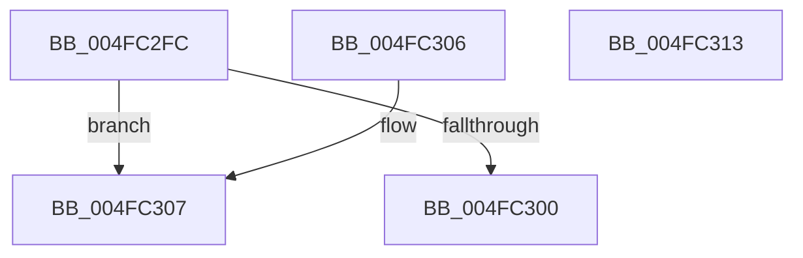

# IvtGetPasidGranularTranslationType

- RVA: `0x004FC2FC`–`0x004FC314` (길이 `24` bytes)
- VA: `0x00000001404FC2FC`
- 실행 섹션: `.text`
- PDB 이름 있음: `예`; PDB Function 태그: `아니요`
- unwind 정보 RVA: `0x000DB714`
- 디코드: `11`개 명령, `24/24` bytes 표시
- 미해석 바이트: `0` (있으면 어셈블리에 `.byte`로 보존)

> 이 문서는 커널 이미지의 기계어와 PDB 기호를 분석해 생성했습니다. 4번과 5번은 함수 원형과 자료형을 바이너리 사용 방식에서 추정한 C 해석이며 원본 소스 복구 결과는 아닙니다.

## 1. Dependencies

- 직접 호출 지점: **0**; 고유 호출 대상: **0**
- 직접 호출자로 확인된 함수: **4**
- RIP 상대 이미지 참조: **0**

### Outgoing calls
- 직접 디코드된 call 명령이 없습니다.

### Direct callers
- [IvtUpdateScalableModeTranslationStructures](../4C/IvtUpdateScalableModeTranslationStructures_function_004CD52C.md) at `0x004CD59E`
- [IvtAllocateTranslationStructures](../56/IvtAllocateTranslationStructures_function_0056EC58.md) at `0x0056ECC3`
- [IvtLegacyUpdateScalableModeTranslationStructures](../57/IvtLegacyUpdateScalableModeTranslationStructures_function_0057237C.md) at `0x005723FE`
- [IvtInitializeIommu](../../pagelk/B6/IvtInitializeIommu_function_00B61FE0.md) at `0x00B62373`

### Static image references
- 디코드된 RIP-relative 메모리 참조가 없습니다.

## 2. Other-region calls and transfers

- 다른 실행 섹션으로 향하는 call: **0**
- 별도 외부 분기/꼬리 이동을 확인하지 못했습니다.

## 3. Assembly (complete function range)

```asm
004FC2FC  84 D2                           test dl, dl
004FC2FE  74 07                           je 0x1404fc307
004FC300  B8 01 00 00 00                  mov eax, 1
004FC305  C3                              ret
004FC306  CC                              int3
004FC307  41 F6 D8                        neg r8b
004FC30A  1B C0                           sbb eax, eax
004FC30C  83 E0 FE                        and eax, 0xfffffffe
004FC30F  83 C0 04                        add eax, 4
004FC312  C3                              ret
004FC313  CC                              int3
```

## 4. C-style interpretation (structured pseudocode)

```c
__int64 __fastcall IvtGetPasidGranularTranslationType(__int64 a1, unsigned __int8 a2, unsigned __int8 a3)
{
    __int64 result;

    if (a2 == 0) goto loc_004FC307;
    return 1;
loc_004FC307:
    a3 = (unsigned __int8)(-(a3));
    result = (unsigned int)((1) & (0xFFFFFFFEULL));
    result = (unsigned int)((result) + (4));
    return result;
}
```

## 5. (Beta) C Style

```c
int64_t IvtGetPasidGranularTranslationType(int64_t Arg1, uint8_t Arg2, uint8_t Arg3)
{
    int64_t result;

    if (Arg2 == 0) goto loc_004FC307;
    return 1;
loc_004FC307:
    Arg3 = (uint8_t)(-(Arg3));
    result = (uint32_t)((1) & (0xFFFFFFFEULL));
    result = (uint32_t)((result) + (4));
    return result;
}
```

## 6. Execution-region graph

[열기: 2D/3D 그래프와 함수 탐색 컨트롤 패널](../../../control-panel.html?section=text&rva=0x004FC2FC&view=graph)

- 2D 그래프는 위에서 아래로 흐르고, 3D 그래프는 빈 공간을 드래그해 회전합니다. Shift+드래그는 이동, 휠은 확대·축소, 함수 노드 선택은 대상 보고서 이동입니다.

### Static fallback


