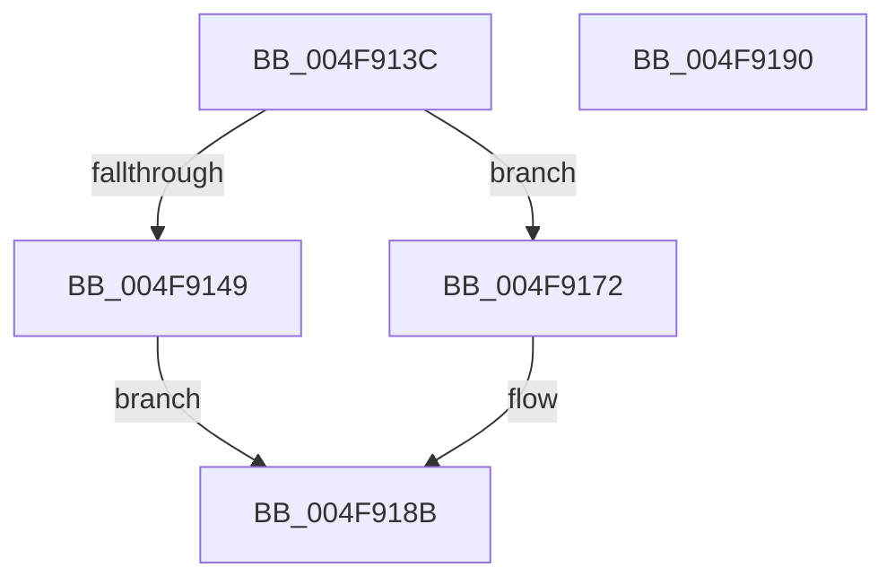

# IvtUpdateTranslationStructures

- RVA: `0x004F913C`–`0x004F9191` (길이 `85` bytes)
- VA: `0x00000001404F913C`
- 실행 섹션: `.text`
- PDB 이름 있음: `예`; PDB Function 태그: `아니요`
- unwind 정보 RVA: `0x00063458`
- 디코드: `19`개 명령, `85/85` bytes 표시
- 미해석 바이트: `0` (있으면 어셈블리에 `.byte`로 보존)

> 이 문서는 커널 이미지의 기계어와 PDB 기호를 분석해 생성했습니다. 4번과 5번은 함수 원형과 자료형을 바이너리 사용 방식에서 추정한 C 해석이며 원본 소스 복구 결과는 아닙니다.

## 1. Dependencies

- 직접 호출 지점: **2**; 고유 호출 대상: **2**
- 직접 호출자로 확인된 함수: **3**
- RIP 상대 이미지 참조: **0**

### Outgoing calls
- `0x004F916B` → [IvtUpdateScalableModeTranslationStructures](../4C/IvtUpdateScalableModeTranslationStructures_function_004CD52C.md) (function, `0x004CD52C`)
- `0x004F9186` → [IvtUpdateContextEntry](../4D/IvtUpdateContextEntry_function_004D207C.md) (function, `0x004D207C`)

### Direct callers
- [IvtAttachDeviceDomainInternal](../56/IvtAttachDeviceDomainInternal_function_0056ED90.md) at `0x0056EECD`
- [IvtProcessDeviceExceptions](../../pagelk/B6/IvtProcessDeviceExceptions_function_00B62C34.md) at `0x00B62D5E`
- [HalpIvtpInitializeReservedDomain](../../pagelk/B6/HalpIvtpInitializeReservedDomain_function_00B63838.md) at `0x00B638FF`

### Static image references
- 디코드된 RIP-relative 메모리 참조가 없습니다.

## 2. Other-region calls and transfers

- 다른 실행 섹션으로 향하는 call: **0**
- 별도 외부 분기/꼬리 이동을 확인하지 못했습니다.

## 3. Assembly (complete function range)

```asm
004F913C  48 83 EC 48                     sub rsp, 0x48
004F9140  80 B9 40 01 00 00 00            cmp byte ptr [rcx + 0x140], 0
004F9147  74 29                           je 0x1404f9172
004F9149  48 8B 84 24 88 00 00 00         mov rax, qword ptr [rsp + 0x88]
004F9151  48 89 44 24 38                  mov qword ptr [rsp + 0x38], rax
004F9156  8B 84 24 80 00 00 00            mov eax, dword ptr [rsp + 0x80]
004F915D  89 44 24 30                     mov dword ptr [rsp + 0x30], eax
004F9161  48 8B 44 24 78                  mov rax, qword ptr [rsp + 0x78]
004F9166  48 89 44 24 28                  mov qword ptr [rsp + 0x28], rax
004F916B  E8 BC 43 FD FF                  call 0x1404cd52c
004F9170  EB 19                           jmp 0x1404f918b
004F9172  8B 84 24 80 00 00 00            mov eax, dword ptr [rsp + 0x80]
004F9179  4C 8B 44 24 78                  mov r8, qword ptr [rsp + 0x78]
004F917E  48 8B 52 38                     mov rdx, qword ptr [rdx + 0x38]
004F9182  89 44 24 20                     mov dword ptr [rsp + 0x20], eax
004F9186  E8 F1 8E FD FF                  call 0x1404d207c
004F918B  48 83 C4 48                     add rsp, 0x48
004F918F  C3                              ret
004F9190  CC                              int3
```

## 4. C-style interpretation (structured pseudocode)

```c
__int64 __fastcall IvtUpdateTranslationStructures(__int64 a1, __int64 a2, __int64 a3, __int64 a4, __int64 a5, __int64 a6, unsigned int a7, __int64 a8)
{
    __int64 result;
    __int64 v_rsp;
    unsigned __int64 v_stack_m10;
    unsigned int v_stack_m18;
    unsigned __int64 v_stack_m20;
    unsigned int v_stack_m28;

    v_rsp = (v_rsp) - (72);
    if ((*(unsigned __int8 *)(a1 + 320)) == 0) goto loc_004F9172;
    v_stack_m10 = a8;
    v_stack_m18 = (unsigned int)((unsigned int)(a7));
    v_stack_m20 = a6;
    result = IvtUpdateScalableModeTranslationStructures(a1, a2, a3, a4);
    goto loc_004F918B;
loc_004F9172:
    v_stack_m28 = (unsigned int)((unsigned int)(a7));
    result = IvtUpdateContextEntry(a1, *(unsigned __int64 *)(a2 + 56), a6, a4);
loc_004F918B:
    v_rsp = (v_rsp) + (72);
    return result;
}
```

## 5. (Beta) C Style

```c
int64_t IvtUpdateTranslationStructures(void *Arg1, void *Arg2, int64_t Arg3, int64_t Arg4, uint64_t Arg5, int64_t Arg6, uint32_t Arg7, int64_t Arg8)
{
    uint8_t *arg1 = (uint8_t *)Arg1;
    uint8_t *arg2 = (uint8_t *)Arg2;

    int64_t result;
    int64_t local_rsp;
    uint64_t v_stack_m10;
    uint32_t v_stack_m18;
    uint64_t v_stack_m20;
    uint32_t v_stack_m28;

    local_rsp = (local_rsp) - (72);
    if ((*(uint8_t *)(arg1 + 0x140)) == 0) goto loc_004F9172;
    v_stack_m10 = Arg8;
    v_stack_m18 = (uint32_t)((uint32_t)(Arg7));
    v_stack_m20 = Arg6;
    result = IvtUpdateScalableModeTranslationStructures(Arg1, Arg2, Arg3, Arg4);
    goto loc_004F918B;
loc_004F9172:
    v_stack_m28 = (uint32_t)((uint32_t)(Arg7));
    result = IvtUpdateContextEntry(Arg1, *(uint64_t *)(arg2 + 0x38), Arg6, Arg4);
loc_004F918B:
    local_rsp = (local_rsp) + (72);
    return result;
}
```

### 관측된 메모리 오프셋

구조체 형식이 확인되지 않은 접근은 인자 기준의 오프셋으로만 기록했습니다.

| 기준 인자 | 오프셋 표현 | 폭 (bit) | 접근 |
|---|---:|---:|---|
| `Arg1` | `+ 0x140` | `8` | `R` |
| `Arg2` | `+ 0x38` | `64` | `R` |

## 6. Execution-region graph

[열기: 2D/3D 그래프와 함수 탐색 컨트롤 패널](../../../control-panel.html?section=text&rva=0x004F913C&view=graph)

- 2D 그래프는 위에서 아래로 흐르고, 3D 그래프는 빈 공간을 드래그해 회전합니다. Shift+드래그는 이동, 휠은 확대·축소, 함수 노드 선택은 대상 보고서 이동입니다.

### Static fallback


