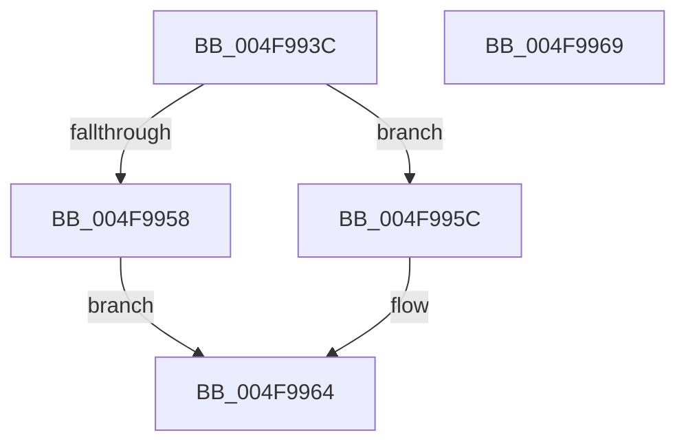

# IvtpGetNextInternalDeviceScope

- RVA: `0x004F993C`–`0x004F996A` (길이 `46` bytes)
- VA: `0x00000001404F993C`
- 실행 섹션: `.text`
- PDB 이름 있음: `예`; PDB Function 태그: `아니요`
- unwind 정보 RVA: `0x0005C788`
- 디코드: `14`개 명령, `46/46` bytes 표시
- 미해석 바이트: `0` (있으면 어셈블리에 `.byte`로 보존)

> 이 문서는 커널 이미지의 기계어와 PDB 기호를 분석해 생성했습니다. 4번과 5번은 함수 원형과 자료형을 바이너리 사용 방식에서 추정한 C 해석이며 원본 소스 복구 결과는 아닙니다.

## 1. Dependencies

- 직접 호출 지점: **1**; 고유 호출 대상: **1**
- 직접 호출자로 확인된 함수: **2**
- RIP 상대 이미지 참조: **0**

### Outgoing calls
- `0x004F995F` → [DmrGetNextDeviceScope](../57/DmrGetNextDeviceScope_function_0057AA30.md) (function, `0x0057AA30`)

### Direct callers
- [IvtCreateDevice](../57/IvtCreateDevice_function_00579DE0.md) at `0x00579E34`
- [IvtFindDevice](../57/IvtFindDevice_function_00579F10.md) at `0x00579F5C`

### Static image references
- 디코드된 RIP-relative 메모리 참조가 없습니다.

## 2. Other-region calls and transfers

- 다른 실행 섹션으로 향하는 call: **0**
- 별도 외부 분기/꼬리 이동을 확인하지 못했습니다.

## 3. Assembly (complete function range)

```asm
004F993C  48 83 EC 28                     sub rsp, 0x28
004F9940  48 8B 81 18 01 00 00            mov rax, qword ptr [rcx + 0x118]
004F9947  4C 8B C2                        mov r8, rdx
004F994A  8B 91 00 01 00 00               mov edx, dword ptr [rcx + 0x100]
004F9950  48 03 D0                        add rdx, rax
004F9953  48 3B D0                        cmp rdx, rax
004F9956  77 04                           ja 0x1404f995c
004F9958  33 C0                           xor eax, eax
004F995A  EB 08                           jmp 0x1404f9964
004F995C  48 8B C8                        mov rcx, rax
004F995F  E8 CC 10 08 00                  call 0x14057aa30
004F9964  48 83 C4 28                     add rsp, 0x28
004F9968  C3                              ret
004F9969  CC                              int3
```

## 4. C-style interpretation (structured pseudocode)

```c
__int64 __fastcall IvtpGetNextInternalDeviceScope(__int64 a1, __int64 a2)
{
    __int64 result;
    __int64 v_rsp;

    v_rsp = (v_rsp) - (40);
    a2 = ((unsigned int)(*(unsigned int *)(a1 + 256))) + (*(unsigned __int64 *)(a1 + 280));
    if (a2 > (*(unsigned __int64 *)(a1 + 280))) goto loc_004F995C;
    result = 0;
    goto loc_004F9964;
loc_004F995C:
    result = DmrGetNextDeviceScope(0, a2, a2, a4);
loc_004F9964:
    v_rsp = (v_rsp) + (40);
    return result;
}
```

## 5. (Beta) C Style

```c
int64_t IvtpGetNextInternalDeviceScope(void *Arg1, int64_t Arg2)
{
    uint8_t *arg1 = (uint8_t *)Arg1;

    int64_t result;
    int64_t local_rsp;

    local_rsp = (local_rsp) - (40);
    Arg2 = ((uint32_t)(*(uint32_t *)(arg1 + 0x100))) + (*(uint64_t *)(arg1 + 0x118));
    if (Arg2 > (*(uint64_t *)(arg1 + 0x118))) goto loc_004F995C;
    result = 0;
    goto loc_004F9964;
loc_004F995C:
    result = DmrGetNextDeviceScope(0, Arg2, Arg2, a4);
loc_004F9964:
    local_rsp = (local_rsp) + (40);
    return result;
}
```

### 관측된 메모리 오프셋

구조체 형식이 확인되지 않은 접근은 인자 기준의 오프셋으로만 기록했습니다.

| 기준 인자 | 오프셋 표현 | 폭 (bit) | 접근 |
|---|---:|---:|---|
| `Arg1` | `+ 0x100` | `32` | `R` |
| `Arg1` | `+ 0x118` | `64` | `R` |

## 6. Execution-region graph

[열기: 2D/3D 그래프와 함수 탐색 컨트롤 패널](../../../control-panel.html?section=text&rva=0x004F993C&view=graph)

- 2D 그래프는 위에서 아래로 흐르고, 3D 그래프는 빈 공간을 드래그해 회전합니다. Shift+드래그는 이동, 휠은 확대·축소, 함수 노드 선택은 대상 보고서 이동입니다.

### Static fallback


