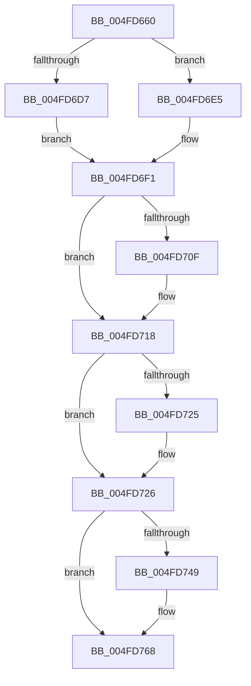

# KeBugCheckEx

- RVA: `0x004FD660`–`0x004FD780` (길이 `288` bytes)
- VA: `0x00000001404FD660`
- 실행 섹션: `.text`
- PDB 이름 있음: `예`; PDB Function 태그: `아니요`
- unwind 정보 RVA: `0x000C1594`
- 디코드: `59`개 명령, `288/288` bytes 표시
- 미해석 바이트: `0` (있으면 어셈블리에 `.byte`로 보존)

> 이 문서는 커널 이미지의 기계어와 PDB 기호를 분석해 생성했습니다. 4번과 5번은 함수 원형과 자료형을 바이너리 사용 방식에서 추정한 C 해석이며 원본 소스 복구 결과는 아닙니다.

## 1. Dependencies

- 직접 호출 지점: **4**; 고유 호출 대상: **3**
- 직접 호출자로 확인된 함수: **1333**
- RIP 상대 이미지 참조: **4**

### Outgoing calls
- `0x004FD68A` → [RtlCaptureContext](RtlCaptureContext_function_004FE570.md) (function, `0x004FE570`)
- `0x004FD69F` → [KiSaveProcessorControlState](../6B/KiSaveProcessorControlState_function_006B0EF0.md) (function, `0x006B0EF0`)
- `0x004FD762` → [KeBugCheck2](../5B/KeBugCheck2_function_005B27D0.md) (function, `0x005B27D0`)
- `0x004FD779` → [KeBugCheck2](../5B/KeBugCheck2_function_005B27D0.md) (function, `0x005B27D0`)

### Direct callers
- [sub_00207CE9](../20/Unknown_function_00207CE9.md) at `0x00207D28`
- [sub_002099FA](../20/Unknown_function_002099FA.md) at `0x00209A65`
- [IoRemoveIoCompletion](../20/IoRemoveIoCompletion_function_0020B580.md) at `0x0020B9F4`
- [IoRemoveIoCompletion](../20/IoRemoveIoCompletion_function_0020B580.md) at `0x0020BA3F`
- [IoRemoveIoCompletion](../20/IoRemoveIoCompletion_function_0020B580.md) at `0x0020BA65`
- [IoRemoveIoCompletion](../20/IoRemoveIoCompletion_function_0020B580.md) at `0x0020BAB4`
- [IoRemoveIoCompletion](../20/IoRemoveIoCompletion_function_0020B580.md) at `0x0020BAF4`
- [IoRemoveIoCompletion](../20/IoRemoveIoCompletion_function_0020B580.md) at `0x0020BB37`
- [sub_0020BDAA](../20/Unknown_function_0020BDAA.md) at `0x0020C055`
- [sub_0020C2D4](../20/Unknown_function_0020C2D4.md) at `0x0020C3AE`
- [sub_0020C2D4](../20/Unknown_function_0020C2D4.md) at `0x0020C489`
- [sub_0020C2D4](../20/Unknown_function_0020C2D4.md) at `0x0020C75B`
- [KeWaitForSingleObject](../20/KeWaitForSingleObject_function_0020E6B0.md) at `0x0020ED57`
- [KeWaitForSingleObject](../20/KeWaitForSingleObject_function_0020E6B0.md) at `0x0020F1A9`
- [ExTryAcquirePushLockExclusiveEx](../20/ExTryAcquirePushLockExclusiveEx_function_0020F6C0.md) at `0x0020F6E5`
- [ExpFreeOwnerEntry](../20/ExpFreeOwnerEntry_function_0020F740.md) at `0x0020F861`
- [ExpFreeOwnerEntry](../20/ExpFreeOwnerEntry_function_0020F740.md) at `0x0020F8A0`
- [ExAcquireCacheAwarePushLockSharedEx](../20/ExAcquireCacheAwarePushLockSharedEx_function_0020FA40.md) at `0x0020FA71`
- [ExAcquireAutoExpandPushLockShared](../20/ExAcquireAutoExpandPushLockShared_function_0020FAF0.md) at `0x0020FB22`
- [ExAcquirePushLockExclusiveEx](../20/ExAcquirePushLockExclusiveEx_function_0020FC10.md) at `0x0020FC39`
- [sub_00210084](../21/Unknown_function_00210084.md) at `0x00210157`
- [sub_00210084](../21/Unknown_function_00210084.md) at `0x0021017A`
- [ExAcquirePushLockSharedEx](../21/ExAcquirePushLockSharedEx_function_002103C0.md) at `0x002103F0`
- [ObfReferenceObjectWithTag](../21/ObfReferenceObjectWithTag_function_00210710.md) at `0x0021076B`
- [sub_00210BCA](../21/Unknown_function_00210BCA.md) at `0x00210CBD`
- [ExAcquireFastResourceShared](../21/ExAcquireFastResourceShared_function_00210F40.md) at `0x00210F97`
- [sub_00210F9D](../21/Unknown_function_00210F9D.md) at `0x00210FC9`
- [sub_00210F9D](../21/Unknown_function_00210F9D.md) at `0x00210FF9`
- [sub_00210F9D](../21/Unknown_function_00210F9D.md) at `0x00211020`
- [sub_00210F9D](../21/Unknown_function_00210F9D.md) at `0x0021104A`
- [sub_00210F9D](../21/Unknown_function_00210F9D.md) at `0x0021106F`
- [sub_00211104](../21/Unknown_function_00211104.md) at `0x0021112D`
- [ExAcquireResourceSharedLite](../21/ExAcquireResourceSharedLite_function_00211BC0.md) at `0x00211C13`
- [sub_00211CF4](../21/Unknown_function_00211CF4.md) at `0x00211D0F`
- [sub_00211D20](../21/Unknown_function_00211D20.md) at `0x00211D9E`
- [sub_00211D20](../21/Unknown_function_00211D20.md) at `0x00211DCB`
- [sub_00211D20](../21/Unknown_function_00211D20.md) at `0x00211DFC`
- [sub_00211D20](../21/Unknown_function_00211D20.md) at `0x00211E2E`
- [sub_00211D20](../21/Unknown_function_00211D20.md) at `0x00211E58`
- [sub_00211D20](../21/Unknown_function_00211D20.md) at `0x00211E81`
- [sub_00211FA9](../21/Unknown_function_00211FA9.md) at `0x00211FD0`
- [ExIsFastResourceHeldExclusive](../21/ExIsFastResourceHeldExclusive_function_00213450.md) at `0x00213472`
- [ExIsFastResourceHeldExclusive](../21/ExIsFastResourceHeldExclusive_function_00213450.md) at `0x00213498`
- [sub_00213536](../21/Unknown_function_00213536.md) at `0x0021354F`
- [sub_00213555](../21/Unknown_function_00213555.md) at `0x002135B1`
- [sub_00213555](../21/Unknown_function_00213555.md) at `0x002135D8`
- [sub_00213555](../21/Unknown_function_00213555.md) at `0x00213619`
- [sub_00213756](../21/Unknown_function_00213756.md) at `0x0021376E`
- [sub_00213798](../21/Unknown_function_00213798.md) at `0x002137FB`
- [sub_00213798](../21/Unknown_function_00213798.md) at `0x00213822`
- [sub_00213798](../21/Unknown_function_00213798.md) at `0x00213863`
- [ExEnterPriorityRegionAndAcquireResourceShared](../21/ExEnterPriorityRegionAndAcquireResourceShared_function_00213870.md) at `0x00213952`
- [ExEnterPriorityRegionAndAcquireResourceShared](../21/ExEnterPriorityRegionAndAcquireResourceShared_function_00213870.md) at `0x00213ADA`
- [ExEnterPriorityRegionAndAcquireResourceShared](../21/ExEnterPriorityRegionAndAcquireResourceShared_function_00213870.md) at `0x00213B01`
- [ExEnterPriorityRegionAndAcquireResourceShared](../21/ExEnterPriorityRegionAndAcquireResourceShared_function_00213870.md) at `0x00213B42`
- [sub_00213C43](../21/Unknown_function_00213C43.md) at `0x00213CA0`
- [sub_00213CA6](../21/Unknown_function_00213CA6.md) at `0x00213CBE`
- [sub_00213D42](../21/Unknown_function_00213D42.md) at `0x00213D67`
- [sub_00213D42](../21/Unknown_function_00213D42.md) at `0x00213D97`
- [sub_00213D42](../21/Unknown_function_00213D42.md) at `0x00213DC7`
- [sub_00213D42](../21/Unknown_function_00213D42.md) at `0x00213E39`
- [sub_002142F9](../21/Unknown_function_002142F9.md) at `0x00214A11`
- [sub_002142F9](../21/Unknown_function_002142F9.md) at `0x00214A3E`
- [sub_002142F9](../21/Unknown_function_002142F9.md) at `0x00214AE9`
- [sub_002142F9](../21/Unknown_function_002142F9.md) at `0x00214B95`
- [sub_0021514C](../21/Unknown_function_0021514C.md) at `0x00215160`
- [sub_00215166](../21/Unknown_function_00215166.md) at `0x00215841`
- [sub_00215166](../21/Unknown_function_00215166.md) at `0x00215871`
- [sub_00215166](../21/Unknown_function_00215166.md) at `0x002158A3`
- [sub_00215166](../21/Unknown_function_00215166.md) at `0x002158CC`
- [sub_00215166](../21/Unknown_function_00215166.md) at `0x00215A82`
- [KeForceAttachProcess](../21/KeForceAttachProcess_function_00216650.md) at `0x002166D2`
- [sub_00216E41](../21/Unknown_function_00216E41.md) at `0x00216E6A`
- [sub_00217146](../21/Unknown_function_00217146.md) at `0x0021715C`
- [sub_0021D7F8](../21/Unknown_function_0021D7F8.md) at `0x0021EB21`
- [sub_0021F244](../21/Unknown_function_0021F244.md) at `0x0021F2D1`
- [KiAdjustRealtimePriorityFloor](../21/KiAdjustRealtimePriorityFloor_function_0021FBE0.md) at `0x0021FC27`
- [KiAdjustRealtimePriorityFloor](../21/KiAdjustRealtimePriorityFloor_function_0021FBE0.md) at `0x0021FC77`
- [sub_0021FD23](../21/Unknown_function_0021FD23.md) at `0x0021FE2B`
- [sub_002202B6](../22/Unknown_function_002202B6.md) at `0x002202C9`
- [sub_002204DE](../22/Unknown_function_002204DE.md) at `0x0022050B`
- [sub_002206D0](../22/Unknown_function_002206D0.md) at `0x002207D6`
- [KiFastExitThreadWait](../22/KiFastExitThreadWait_function_00220BB0.md) at `0x00220CC1`
- [EtwpEventWriteFull](../22/EtwpEventWriteFull_function_00225C10.md) at `0x0022783B`
- [EtwpEventWriteFull](../22/EtwpEventWriteFull_function_00225C10.md) at `0x00227856`
- [MiDecrementCloneBlockReference](../22/MiDecrementCloneBlockReference_function_0022B9D0.md) at `0x0022BA80`
- [MiHandleForkTransitionPte](../22/MiHandleForkTransitionPte_function_0022D34C.md) at `0x0022DAA7`
- [CcRescheduleLazyWriteScanOnVolume](../22/CcRescheduleLazyWriteScanOnVolume_function_0022FE00.md) at `0x0022FEBC`
- [CcRescheduleLazyWriteScanOnVolume](../22/CcRescheduleLazyWriteScanOnVolume_function_0022FE00.md) at `0x0022FF0A`
- [NtCancelTimer](../23/NtCancelTimer_function_00230D90.md) at `0x0023111C`
- [NtCancelTimer](../23/NtCancelTimer_function_00230D90.md) at `0x00231137`
- [ExpSetTimerObject](../23/ExpSetTimerObject_function_00231730.md) at `0x002326A7`
- [ExpSetTimerObject](../23/ExpSetTimerObject_function_00231730.md) at `0x002326C0`
- [KiProcessExpiredTimerList](../23/KiProcessExpiredTimerList_function_00234200.md) at `0x002344E1`
- [KiProcessExpiredTimerList](../23/KiProcessExpiredTimerList_function_00234200.md) at `0x00234576`
- [KiSendClockInterruptToTargetProcessor](../23/KiSendClockInterruptToTargetProcessor_function_00234700.md) at `0x00234828`
- [sub_00234B6E](../23/Unknown_function_00234B6E.md) at `0x00234DD6`
- [sub_00234B6E](../23/Unknown_function_00234B6E.md) at `0x00234E35`
- [sub_00235B5D](../23/Unknown_function_00235B5D.md) at `0x00235D0C`
- [CcFlushCacheOneRange](../23/CcFlushCacheOneRange_function_00236A30.md) at `0x00236EE1`
- [sub_00237945](../23/Unknown_function_00237945.md) at `0x00237964`
- [sub_00237945](../23/Unknown_function_00237945.md) at `0x002379A3`
- [CcReferenceSharedCacheMapFileObject](../23/CcReferenceSharedCacheMapFileObject_function_002379BC.md) at `0x00237A8D`
- [sub_00237DE0](../23/Unknown_function_00237DE0.md) at `0x00237ECD`
- [sub_00237DE0](../23/Unknown_function_00237DE0.md) at `0x00237FDB`
- [sub_00237DE0](../23/Unknown_function_00237DE0.md) at `0x00238357`
- [MiReacquireHigherPageTableLock](../23/MiReacquireHigherPageTableLock_function_00239650.md) at `0x00239C9E`
- [ExReleaseSpinLockRegardlessFromDpcLevel](../23/ExReleaseSpinLockRegardlessFromDpcLevel_function_0023A330.md) at `0x0023A388`
- [MmBuildMdlForNonPagedPool](../23/MmBuildMdlForNonPagedPool_function_0023A870.md) at `0x0023AA80`
- [MmBuildMdlForNonPagedPool](../23/MmBuildMdlForNonPagedPool_function_0023A870.md) at `0x0023AD23`
- [MmStoreProbeAndLockPages](../23/MmStoreProbeAndLockPages_function_0023E570.md) at `0x0023E80C`
- [MiDecommitHandleTransitionPte](../24/MiDecommitHandleTransitionPte_function_0024037C.md) at `0x00240681`
- [MiFreeWsleList](../24/MiFreeWsleList_function_00241168.md) at `0x0024120B`
- [MiFreeWsleList](../24/MiFreeWsleList_function_00241168.md) at `0x00241392`
- [MiFreeWsleList](../24/MiFreeWsleList_function_00241168.md) at `0x002413AD`
- [MiDecommitHandlePageFileFormatPte](../24/MiDecommitHandlePageFileFormatPte_function_00242A5C.md) at `0x00242C3B`
- [MiGetProcessorFlushList](../24/MiGetProcessorFlushList_function_00242C90.md) at `0x00242D48`
- [MiActOnPte](../24/MiActOnPte_function_00244C90.md) at `0x002458BB`
- [sub_00245E7F](../24/Unknown_function_00245E7F.md) at `0x00245F17`
- [sub_00246798](../24/Unknown_function_00246798.md) at `0x002467B3`
- [MiBadRefCount](../24/MiBadRefCount_function_00246E08.md) at `0x00246E47`
- [sub_002471FA](../24/Unknown_function_002471FA.md) at `0x0024721C`
- [MiReleasePtes](../24/MiReleasePtes_function_00247240.md) at `0x0024733E`
- [sub_002493E4](../24/Unknown_function_002493E4.md) at `0x002493F8`
- [sub_0024969C](../24/Unknown_function_0024969C.md) at `0x002496B4`
- [sub_0024B51A](../24/Unknown_function_0024B51A.md) at `0x0024B532`
- [sub_0024B51A](../24/Unknown_function_0024B51A.md) at `0x0024B550`
- [sub_0024B727](../24/Unknown_function_0024B727.md) at `0x0024B7B9`
- [sub_0024B727](../24/Unknown_function_0024B727.md) at `0x0024B7DD`
- [IoCleanupIrp](../24/IoCleanupIrp_function_0024DF20.md) at `0x0024DF40`
- [sub_0024DF8A](../24/Unknown_function_0024DF8A.md) at `0x0024DFAC`
- [sub_0024E38F](../24/Unknown_function_0024E38F.md) at `0x0024E471`
- [sub_0024E38F](../24/Unknown_function_0024E38F.md) at `0x0024E533`
- [sub_0024E38F](../24/Unknown_function_0024E38F.md) at `0x0024E5AA`
- [sub_0024E5BF](../24/Unknown_function_0024E5BF.md) at `0x0024E5FC`
- [sub_0024E5BF](../24/Unknown_function_0024E5BF.md) at `0x0024E620`
- [IopFreeIrp](../24/IopFreeIrp_function_0024E6A0.md) at `0x0024E6C9`
- [sub_0024EAB1](../24/Unknown_function_0024EAB1.md) at `0x0024EB96`
- [sub_0024EAB1](../24/Unknown_function_0024EAB1.md) at `0x0024EC58`
- [sub_0024EAB1](../24/Unknown_function_0024EAB1.md) at `0x0024ECCF`
- [sub_0024EAB1](../24/Unknown_function_0024EAB1.md) at `0x0024ED12`
- [sub_0024EAB1](../24/Unknown_function_0024EAB1.md) at `0x0024ED36`
- [ExReleaseFastMutexUnsafe](../25/ExReleaseFastMutexUnsafe_function_002503A0.md) at `0x002504FC`
- [IopReleaseFileObjectLock](../25/IopReleaseFileObjectLock_function_00250A90.md) at `0x00250BE3`
- [IopReleaseFileObjectLock](../25/IopReleaseFileObjectLock_function_00250A90.md) at `0x00250D57`
- [IopReleaseFileObjectLock](../25/IopReleaseFileObjectLock_function_00250A90.md) at `0x00250D99`
- [sub_00250F85](../25/Unknown_function_00250F85.md) at `0x002511CB`
- [FsRtlReleaseHeaderMutex](../25/FsRtlReleaseHeaderMutex_function_002516C0.md) at `0x00251861`
- [ExReleaseFastMutex](../25/ExReleaseFastMutex_function_002519C0.md) at `0x00251B3A`
- [sub_002546EC](../25/Unknown_function_002546EC.md) at `0x00255236`
- [KiExecuteAllDpcs](../25/KiExecuteAllDpcs_function_0025B740.md) at `0x0025C094`
- [KiExecuteAllDpcs](../25/KiExecuteAllDpcs_function_0025B740.md) at `0x0025C41E`
- [sub_0025D903](../25/Unknown_function_0025D903.md) at `0x0025D9F2`
- [sub_0025D903](../25/Unknown_function_0025D903.md) at `0x0025DCE7`
- [sub_0025D903](../25/Unknown_function_0025D903.md) at `0x0025E148`
- [sub_0025EB42](../25/Unknown_function_0025EB42.md) at `0x0025EB57`
- [sub_0025EB5D](../25/Unknown_function_0025EB5D.md) at `0x0025EBC1`
- [sub_0025EB5D](../25/Unknown_function_0025EB5D.md) at `0x0025EC35`
- [sub_0025EB5D](../25/Unknown_function_0025EB5D.md) at `0x0025ED64`
- [sub_0025EB5D](../25/Unknown_function_0025EB5D.md) at `0x0025EE43`
- [sub_0025EB5D](../25/Unknown_function_0025EB5D.md) at `0x0025EE80`
- [sub_0025F800](../25/Unknown_function_0025F800.md) at `0x0025F8CA`
- [sub_0025F912](../25/Unknown_function_0025F912.md) at `0x0025F99A`
- [sub_0025F912](../25/Unknown_function_0025F912.md) at `0x0025F9BD`
- [sub_0025F912](../25/Unknown_function_0025F912.md) at `0x0025F9F9`
- [sub_0025FAF3](../25/Unknown_function_0025FAF3.md) at `0x0025FB36`
- [sub_0025FB5C](../25/Unknown_function_0025FB5C.md) at `0x0025FE1F`
- [sub_0026025E](../26/Unknown_function_0026025E.md) at `0x00260285`
- [sub_00260D3F](../26/Unknown_function_00260D3F.md) at `0x00260D54`
- [sub_00260D5A](../26/Unknown_function_00260D5A.md) at `0x00260D9D`
- [sub_00260D5A](../26/Unknown_function_00260D5A.md) at `0x00260DCA`
- [sub_00260D5A](../26/Unknown_function_00260D5A.md) at `0x00260E3E`
- [sub_00260D5A](../26/Unknown_function_00260D5A.md) at `0x00260EAF`
- [sub_00260FEE](../26/Unknown_function_00260FEE.md) at `0x00261016`
- [sub_00261120](../26/Unknown_function_00261120.md) at `0x00261147`
- [sub_00261120](../26/Unknown_function_00261120.md) at `0x00261184`
- [ExReleaseFastResource](../26/ExReleaseFastResource_function_002613D0.md) at `0x00261413`
- [ExReleaseFastResource](../26/ExReleaseFastResource_function_002613D0.md) at `0x0026144D`
- [ExReleaseFastResource](../26/ExReleaseFastResource_function_002613D0.md) at `0x0026147A`
- [ExReleaseFastResource](../26/ExReleaseFastResource_function_002613D0.md) at `0x002614AB`
- [ExReleaseFastResource](../26/ExReleaseFastResource_function_002613D0.md) at `0x002614D3`
- [ExReleaseFastResource](../26/ExReleaseFastResource_function_002613D0.md) at `0x00261567`
- [ExReleaseFastResource](../26/ExReleaseFastResource_function_002613D0.md) at `0x00261A54`
- [ExReleaseFastResource](../26/ExReleaseFastResource_function_002613D0.md) at `0x00261B37`
- [ExReleaseFastResource](../26/ExReleaseFastResource_function_002613D0.md) at `0x00261B9F`
- [ExReleaseFastResource](../26/ExReleaseFastResource_function_002613D0.md) at `0x00261BC3`
- [KeAbPostReleaseEx](../26/KeAbPostReleaseEx_function_00262210.md) at `0x00262281`
- [ExReleasePushLockSharedEx](../26/ExReleasePushLockSharedEx_function_00263300.md) at `0x00263330`
- [ExReleasePushLockSharedEx](../26/ExReleasePushLockSharedEx_function_00263300.md) at `0x002633B6`
- [ExReleasePushLockExclusiveEx](../26/ExReleasePushLockExclusiveEx_function_00263510.md) at `0x0026353D`
- [ExReleasePushLockExclusiveEx](../26/ExReleasePushLockExclusiveEx_function_00263510.md) at `0x002635CB`
- [ExReleaseAutoExpandPushLockShared](../26/ExReleaseAutoExpandPushLockShared_function_00263660.md) at `0x0026368F`
- [sub_00263695](../26/Unknown_function_00263695.md) at `0x00263718`
- [PspUnlockProcessShared](../26/PspUnlockProcessShared_function_00263950.md) at `0x002639E9`
- [ExReleasePushLockEx](../26/ExReleasePushLockEx_function_00263A80.md) at `0x00263B35`
- [ExReleasePushLockEx](../26/ExReleasePushLockEx_function_00263A80.md) at `0x00263BCB`
- [ExReleaseCacheAwarePushLockSharedEx](../26/ExReleaseCacheAwarePushLockSharedEx_function_00263BE0.md) at `0x00263C10`
- [ExReleaseCacheAwarePushLockSharedEx](../26/ExReleaseCacheAwarePushLockSharedEx_function_00263BE0.md) at `0x00263C98`
- [sub_00263D49](../26/Unknown_function_00263D49.md) at `0x00263DE8`
- [ObDereferenceObjectDeferDeleteWithTag](../26/ObDereferenceObjectDeferDeleteWithTag_function_00263EA0.md) at `0x00263F06`
- [ObDereferenceObjectDeferDeleteWithTag](../26/ObDereferenceObjectDeferDeleteWithTag_function_00263EA0.md) at `0x00263F45`
- [MiPostInsertVad](../26/MiPostInsertVad_function_002643C0.md) at `0x00264505`
- [ExAcquireAutoExpandPushLockExclusive](../26/ExAcquireAutoExpandPushLockExclusive_function_00264B70.md) at `0x00264B9D`
- [ExReleaseAutoExpandPushLockExclusive](../26/ExReleaseAutoExpandPushLockExclusive_function_00264DE0.md) at `0x00264E11`
- [ExReleaseAutoExpandPushLockExclusive](../26/ExReleaseAutoExpandPushLockExclusive_function_00264DE0.md) at `0x00264EDC`
- [StLockReleaseExclusive](../26/StLockReleaseExclusive_function_00267050.md) at `0x002670E2`
- [sub_002674A9](../26/Unknown_function_002674A9.md) at `0x002674C0`
- [IoBuildPartialMdl](../26/IoBuildPartialMdl_function_00267BE0.md) at `0x00267D0A`
- [SmHpChunkUnprotect](../26/SmHpChunkUnprotect_function_002687A0.md) at `0x002688C3`
- [sub_002689C7](../26/Unknown_function_002689C7.md) at `0x00268B06`
- [ST_STORE&lt;SM_TRAITS&gt;::StDmPageRecordUnprotect](../26/ST_STORE_SM_TRAITS_StDmPageRecordUnprotect_function_00268B30.md) at `0x00268D02`
- [sub_00268EBD](../26/Unknown_function_00268EBD.md) at `0x00268F5D`
- [sub_0026925A](../26/Unknown_function_0026925A.md) at `0x00269284`
- [SmHpUnprotectListNeighbors](../26/SmHpUnprotectListNeighbors_function_002692A4.md) at `0x002693D4`
- [SmHpUnprotectListNeighbors](../26/SmHpUnprotectListNeighbors_function_002692A4.md) at `0x0026947A`
- [SmHpUnprotectListNeighbors](../26/SmHpUnprotectListNeighbors_function_002692A4.md) at `0x002694A8`
- [SmHpBufferProtectEx](../26/SmHpBufferProtectEx_function_002694C0.md) at `0x002695C4`
- [PopIrpWorker](../26/PopIrpWorker_function_0026D410.md) at `0x0026D893`
- [CcExtendVacbArray](../26/CcExtendVacbArray_function_0026DCD0.md) at `0x0026E0C4`
- [CcSetVacbInFreeList](../26/CcSetVacbInFreeList_function_0026FBB0.md) at `0x0026FC4C`
- [IopCheckVpbMounted](../27/IopCheckVpbMounted_function_00270540.md) at `0x00270914`
- [IopCheckVpbMounted](../27/IopCheckVpbMounted_function_00270540.md) at `0x00270955`
- [IopDecrementDeviceObjectRef](../27/IopDecrementDeviceObjectRef_function_00270970.md) at `0x00270BBA`
- [PopAllocateIrp](../27/PopAllocateIrp_function_0027116C.md) at `0x002714AE`
- [CcGetVacbFromFreeList](../27/CcGetVacbFromFreeList_function_00271630.md) at `0x0027171E`
- [CcGetVacbFromFreeList](../27/CcGetVacbFromFreeList_function_00271630.md) at `0x00271740`
- [CcReferenceVacbArray](../27/CcReferenceVacbArray_function_00271D70.md) at `0x00271DB7`
- [IoCancelIrp](../27/IoCancelIrp_function_002720E0.md) at `0x00272197`
- [IoCancelIrp](../27/IoCancelIrp_function_002720E0.md) at `0x002721C4`
- [sub_0027289E](../27/Unknown_function_0027289E.md) at `0x002728F3`
- [CcGetVacbMiss](../27/CcGetVacbMiss_function_00272900.md) at `0x00272E60`
- [CcGetVacbMiss](../27/CcGetVacbMiss_function_00272900.md) at `0x00272FD3`
- [CcGetVacbMiss](../27/CcGetVacbMiss_function_00272900.md) at `0x00273042`
- [CcGetVacbMiss](../27/CcGetVacbMiss_function_00272900.md) at `0x00273060`
- [CcGetVacbMiss](../27/CcGetVacbMiss_function_00272900.md) at `0x00273086`
- [ExReleaseResourceForThreadLite](../27/ExReleaseResourceForThreadLite_function_00273C10.md) at `0x00273C4B`
- [ExReleaseResourceForThreadLite](../27/ExReleaseResourceForThreadLite_function_00273C10.md) at `0x00273C77`
- [ExReleaseResourceForThreadLite](../27/ExReleaseResourceForThreadLite_function_00273C10.md) at `0x00273CAB`
- [ExReleaseResourceForThreadLite](../27/ExReleaseResourceForThreadLite_function_00273C10.md) at `0x00273CD9`
- [sub_00273F20](../27/Unknown_function_00273F20.md) at `0x00273F6F`
- [sub_00273F95](../27/Unknown_function_00273F95.md) at `0x00274268`
- [sub_002746AC](../27/Unknown_function_002746AC.md) at `0x002746D3`
- [sub_0027475D](../27/Unknown_function_0027475D.md) at `0x00275223`
- [sub_0027475D](../27/Unknown_function_0027475D.md) at `0x00275250`
- [sub_0027475D](../27/Unknown_function_0027475D.md) at `0x002752C5`
- [sub_0027475D](../27/Unknown_function_0027475D.md) at `0x0027532C`
- [sub_002760C1](../27/Unknown_function_002760C1.md) at `0x002762BC`
- [MiFastLockLeafPageTable](../27/MiFastLockLeafPageTable_function_00276340.md) at `0x00277310`
- [MiDeleteVaDirect](../27/MiDeleteVaDirect_function_00277560.md) at `0x002788DA`
- [MiWalkPageTablesRecursively](../27/MiWalkPageTablesRecursively_function_002796C0.md) at `0x0027B632`
- [sub_0027BB85](../27/Unknown_function_0027BB85.md) at `0x0027BD09`
- [MiAcquirePageListLock](../27/MiAcquirePageListLock_function_0027C450.md) at `0x0027C8D1`
- [MiAcquirePageListLock](../27/MiAcquirePageListLock_function_0027C450.md) at `0x0027CA9E`
- [MiReleaseFaultState](../27/MiReleaseFaultState_function_0027D290.md) at `0x0027D643`
- [sub_0027D95C](../27/Unknown_function_0027D95C.md) at `0x0027DBAC`
- [sub_0027E69B](../27/Unknown_function_0027E69B.md) at `0x0027E749`
- [sub_0027E69B](../27/Unknown_function_0027E69B.md) at `0x0027E7B4`
- [sub_0027E807](../27/Unknown_function_0027E807.md) at `0x0027E81C`
- [sub_0027E83C](../27/Unknown_function_0027E83C.md) at `0x0027E857`
- [sub_0027F353](../27/Unknown_function_0027F353.md) at `0x0027F368`
- [sub_0027F5A9](../27/Unknown_function_0027F5A9.md) at `0x0027F5E4`
- [MiCaptureDeleteHierarchy](../27/MiCaptureDeleteHierarchy_function_0027F5F0.md) at `0x0027FD51`
- [MiMakeSystemAddressValid](../27/MiMakeSystemAddressValid_function_0027FF70.md) at `0x00280B7F`
- [MiMakeSystemAddressValid](../27/MiMakeSystemAddressValid_function_0027FF70.md) at `0x00280C80`
- [MiLockLowestValidPageTableEx](../28/MiLockLowestValidPageTableEx_function_00280D10.md) at `0x00281672`
- [sub_00282570](../28/Unknown_function_00282570.md) at `0x00282690`
- [sub_002826A2](../28/Unknown_function_002826A2.md) at `0x0028270C`
- [MiResolveTransitionFault](../28/MiResolveTransitionFault_function_00282940.md) at `0x00283577`
- [sub_00283AC5](../28/Unknown_function_00283AC5.md) at `0x00283AF6`
- [MiWsleFree](../28/MiWsleFree_function_00284600.md) at `0x00285388`
- [MiWsleFree](../28/MiWsleFree_function_00284600.md) at `0x002853B6`
- [sub_00285E76](../28/Unknown_function_00285E76.md) at `0x00285F95`
- [sub_00285E76](../28/Unknown_function_00285E76.md) at `0x00286078`
- [sub_00287E28](../28/Unknown_function_00287E28.md) at `0x00287E64`
- [sub_00287E6A](../28/Unknown_function_00287E6A.md) at `0x00287E7E`
- [sub_00287E84](../28/Unknown_function_00287E84.md) at `0x0028809A`
- [sub_00287E84](../28/Unknown_function_00287E84.md) at `0x002880CA`
- [MiGetPage](../28/MiGetPage_function_002884C0.md) at `0x00288CB8`
- [MiGetPage](../28/MiGetPage_function_002884C0.md) at `0x00289300`
- [sub_002901B8](../29/Unknown_function_002901B8.md) at `0x002905FA`
- [sub_002942F1](../29/Unknown_function_002942F1.md) at `0x00294306`
- [sub_0029430C](../29/Unknown_function_0029430C.md) at `0x0029434A`
- [MiObtainReferencedSecureVad](../29/MiObtainReferencedSecureVad_function_00295688.md) at `0x002957D8`
- [MiRemoveFromSystemSpace](../29/MiRemoveFromSystemSpace_function_002962FC.md) at `0x00296615`
- [MiSetVadDeleted](../29/MiSetVadDeleted_function_00296E00.md) at `0x00296F56`
- [MiFlushRelease](../29/MiFlushRelease_function_002982C0.md) at `0x002983E2`
- [MiFlushRelease](../29/MiFlushRelease_function_002982C0.md) at `0x0029842F`
- [MiFlushRelease](../29/MiFlushRelease_function_002982C0.md) at `0x002984D4`
- [MiFlushRelease](../29/MiFlushRelease_function_002982C0.md) at `0x002985B3`
- [MiRemoveViewsFromSectionWithPfn](../29/MiRemoveViewsFromSectionWithPfn_function_002986D4.md) at `0x00298756`
- [MiRemoveViewsFromSectionWithPfn](../29/MiRemoveViewsFromSectionWithPfn_function_002986D4.md) at `0x002987F9`
- [MiRemoveViewsFromSection](../29/MiRemoveViewsFromSection_function_00298960.md) at `0x002989BF`
- [MiRemoveViewsFromSection](../29/MiRemoveViewsFromSection_function_00298960.md) at `0x00298A6B`
- [MiDecrementSubsections](../29/MiDecrementSubsections_function_00298B50.md) at `0x00298BF5`
- [MiDecrementSubsections](../29/MiDecrementSubsections_function_00298B50.md) at `0x00298CA5`
- [MiDecrementSubsectionViewCount](../29/MiDecrementSubsectionViewCount_function_00298E90.md) at `0x00298ED1`
- [MiDecrementSubsectionViewCount](../29/MiDecrementSubsectionViewCount_function_00298E90.md) at `0x00298F15`
- [FsFilterPerformCallbacks](../29/FsFilterPerformCallbacks_function_00299590.md) at `0x0029985C`
- [FsFilterPerformCallbacks](../29/FsFilterPerformCallbacks_function_00299590.md) at `0x0029988C`
- [sub_0029B3F6](../29/Unknown_function_0029B3F6.md) at `0x0029B419`
- [sub_0029B44F](../29/Unknown_function_0029B44F.md) at `0x0029B488`
- [IofCallDriver](../29/IofCallDriver_function_0029B4B0.md) at `0x0029B57D`
- [IopfCompleteRequest](../29/IopfCompleteRequest_function_0029B5F8.md) at `0x0029BD9D`
- [IopfCallDriver](../29/IopfCallDriver_function_0029C474.md) at `0x0029C506`
- [NtSetInformationFile](../29/NtSetInformationFile_function_0029C5E0.md) at `0x0029C9CB`
- [NtSetInformationFile](../29/NtSetInformationFile_function_0029C5E0.md) at `0x0029CAFB`
- [MiUpdateSlabPagePlaceholderState](../2A/MiUpdateSlabPagePlaceholderState_function_002A0FB0.md) at `0x002A1065`
- [MiDecreaseUsedPtesInPfn](../2A/MiDecreaseUsedPtesInPfn_function_002A27AC.md) at `0x002A2846`
- [MmUnlockPagableImageSection](../2A/MmUnlockPagableImageSection_function_002A39F0.md) at `0x002A3A52`
- [MiLockPagableImageSection](../2A/MiLockPagableImageSection_function_002A3A60.md) at `0x002A3AE1`
- [MiUnlockImageSection](../2A/MiUnlockImageSection_function_002A3AF0.md) at `0x002A3BFF`
- [ExUnblockOnAddressPushLockEx](../2A/ExUnblockOnAddressPushLockEx_function_002A4060.md) at `0x002A409A`
- [ExUnblockPushLockEx](../2A/ExUnblockPushLockEx_function_002A40B0.md) at `0x002A40ED`
- [MiReleaseInPageRefs](../2A/MiReleaseInPageRefs_function_002A4214.md) at `0x002A436D`
- [sub_002A6937](../2A/Unknown_function_002A6937.md) at `0x002A69AA`
- [MmForceSectionClosedEx](../2A/MmForceSectionClosedEx_function_002AB100.md) at `0x002AB19E`
- [MiDereferenceIoPages](../2A/MiDereferenceIoPages_function_002AB1B0.md) at `0x002AB4A3`
- [MiDereferenceIoPages](../2A/MiDereferenceIoPages_function_002AB1B0.md) at `0x002AB73B`
- [MiDereferenceIoPages](../2A/MiDereferenceIoPages_function_002AB1B0.md) at `0x002AB75B`
- [MiGetProtectionFromPte](../2A/MiGetProtectionFromPte_function_002AEE78.md) at `0x002AEEE7`
- [MiUnlockAndDereferenceVadShared](../2A/MiUnlockAndDereferenceVadShared_function_002AEF10.md) at `0x002AEFBD`
- [MiGetWorkingSetInfoList](../2A/MiGetWorkingSetInfoList_function_002AF770.md) at `0x002B0CE4`
- [MI_NODE_FROM_PFN](../2B/MI_NODE_FROM_PFN_function_002B0F30.md) at `0x002B0FD5`
- [MI_NODE_FROM_PFN](../2B/MI_NODE_FROM_PFN_function_002B0F30.md) at `0x002B1001`
- [sub_002B1D4E](../2B/Unknown_function_002B1D4E.md) at `0x002B1F7B`
- [sub_002B1D4E](../2B/Unknown_function_002B1D4E.md) at `0x002B20A8`
- [MiGetTopLevelPfn](../2B/MiGetTopLevelPfn_function_002B44E0.md) at `0x002B458F`
- [sub_002B97FC](../2B/Unknown_function_002B97FC.md) at `0x002B9810`
- [sub_002B9816](../2B/Unknown_function_002B9816.md) at `0x002B9828`
- [sub_002B982E](../2B/Unknown_function_002B982E.md) at `0x002B9842`
- [sub_002B99D7](../2B/Unknown_function_002B99D7.md) at `0x002B99F4`
- [sub_002B99FA](../2B/Unknown_function_002B99FA.md) at `0x002B9A18`
- [sub_002B99FA](../2B/Unknown_function_002B99FA.md) at `0x002B9A3C`
- [MiPfnReferenceCountIsZero](../2B/MiPfnReferenceCountIsZero_function_002B9E40.md) at `0x002B9FE6`
- [MiSynchronizeFastPageInsert](../2B/MiSynchronizeFastPageInsert_function_002BAE80.md) at `0x002BB37B`
- [MiSynchronizeFastPageInsert](../2B/MiSynchronizeFastPageInsert_function_002BAE80.md) at `0x002BB4D8`
- [PopFxBugCheck](../2B/PopFxBugCheck_function_002BFC6C.md) at `0x002BFC83`
- [MmFreePoolMemory](../2C/MmFreePoolMemory_function_002C1578.md) at `0x002C1732`
- [sub_002C1E57](../2C/Unknown_function_002C1E57.md) at `0x002C1EED`
- [MiProtectPrivateMemory](../2C/MiProtectPrivateMemory_function_002C45B0.md) at `0x002C5120`
- [MiSetProtectionOnTransitionPte](../2C/MiSetProtectionOnTransitionPte_function_002C586C.md) at `0x002C5A91`
- [MiPfnBestZeroAttribute](../2C/MiPfnBestZeroAttribute_function_002C8600.md) at `0x002C86D2`
- [MiPfnBestZeroAttribute](../2C/MiPfnBestZeroAttribute_function_002C8600.md) at `0x002C86F9`
- [MiStartDpcGang](../2C/MiStartDpcGang_function_002C8C34.md) at `0x002C8E07`
- [MiFindBestZeroingProcessor](../2C/MiFindBestZeroingProcessor_function_002CC73C.md) at `0x002CCA46`
- [MiGetNextAffinityWalker](../2C/MiGetNextAffinityWalker_function_002CCC28.md) at `0x002CD083`
- [PpmIdleExecuteTransition](../2D/PpmIdleExecuteTransition_function_002D0A1C.md) at `0x002D1182`
- [KiIntRedirectQueueRequestOnProcessor](../2D/KiIntRedirectQueueRequestOnProcessor_function_002D1240.md) at `0x002D1362`
- [HalRequestClockInterrupt](../2D/HalRequestClockInterrupt_function_002D14C0.md) at `0x002D1554`
- [HalRequestIpi](../2D/HalRequestIpi_function_002D1720.md) at `0x002D17C3`
- [KiIntSteerSetDestination](../2D/KiIntSteerSetDestination_function_002D581C.md) at `0x002D5890`
- [MiDeleteCachedKernelStack](../2D/MiDeleteCachedKernelStack_function_002D986C.md) at `0x002D9929`
- [KiSetSystemPriorityThread](../2D/KiSetSystemPriorityThread_function_002D9FF8.md) at `0x002DA04C`
- [sub_002E0B15](../2E/Unknown_function_002E0B15.md) at `0x002E0DF1`
- [sub_002E0B15](../2E/Unknown_function_002E0B15.md) at `0x002E0ED7`
- [KeAbPostRelease](../2E/KeAbPostRelease_function_002E1600.md) at `0x002E1677`
- [MiUnlockControlAreaFileObjectExclusive](../2E/MiUnlockControlAreaFileObjectExclusive_function_002E22D0.md) at `0x002E2372`
- [MiUnlockVadShared](../2E/MiUnlockVadShared_function_002E2420.md) at `0x002E24C6`
- [MiManageSubsectionView](../2E/MiManageSubsectionView_function_002E2570.md) at `0x002E26A9`
- [UNLOCK_PAGE_TABLE_COMMITMENT](../2E/UNLOCK_PAGE_TABLE_COMMITMENT_function_002E27D0.md) at `0x002E2872`
- [PspUnlockProcessListShared](../2E/PspUnlockProcessListShared_function_002E2920.md) at `0x002E29C2`
- [RtlpHpReleaseQueuedLockExclusive](../2E/RtlpHpReleaseQueuedLockExclusive_function_002E2A70.md) at `0x002E2B16`
- [sub_002E3191](../2E/Unknown_function_002E3191.md) at `0x002E322A`
- [KasanPoolAllocate](../2E/KasanPoolAllocate_function_002EE3E0.md) at `0x002EE49F`
- [KasanPoolAllocate](../2E/KasanPoolAllocate_function_002EE3E0.md) at `0x002EE4C5`
- [KasanPoolAllocate](../2E/KasanPoolAllocate_function_002EE3E0.md) at `0x002EE4E5`
- [KasanPoolAllocate](../2E/KasanPoolAllocate_function_002EE3E0.md) at `0x002EE505`
- [KasanPoolAllocate](../2E/KasanPoolAllocate_function_002EE3E0.md) at `0x002EE52A`
- [KasanPoolAllocate](../2E/KasanPoolAllocate_function_002EE3E0.md) at `0x002EE54B`
- [ExpFreeHeapSpecialPool](../2E/ExpFreeHeapSpecialPool_function_002EE600.md) at `0x002EE693`
- [ExpFreeHeapSpecialPool](../2E/ExpFreeHeapSpecialPool_function_002EE600.md) at `0x002EE6C6`
- [ExpFreeHeapSpecialPool](../2E/ExpFreeHeapSpecialPool_function_002EE600.md) at `0x002EE7F9`
- [ExpFreeHeapSpecialPool](../2E/ExpFreeHeapSpecialPool_function_002EE600.md) at `0x002EE81F`
- [ExpFreeHeapSpecialPool](../2E/ExpFreeHeapSpecialPool_function_002EE600.md) at `0x002EE895`
- [ExpFreeHeapSpecialPool](../2E/ExpFreeHeapSpecialPool_function_002EE600.md) at `0x002EE917`
- [sub_002F0454](../2F/Unknown_function_002F0454.md) at `0x002F0536`
- [sub_002F0454](../2F/Unknown_function_002F0454.md) at `0x002F05F1`
- [sub_002F0454](../2F/Unknown_function_002F0454.md) at `0x002F065E`
- [sub_002F0454](../2F/Unknown_function_002F0454.md) at `0x002F06A1`
- [sub_002F0454](../2F/Unknown_function_002F0454.md) at `0x002F06C4`
- [InsertEventEntryInLookUpTable](../2F/InsertEventEntryInLookUpTable_function_002F1424.md) at `0x002F172E`
- [InsertEventEntryInLookUpTable](../2F/InsertEventEntryInLookUpTable_function_002F1424.md) at `0x002F1763`
- [sub_002F1C24](../2F/Unknown_function_002F1C24.md) at `0x002F1C39`
- [ObfDereferenceObjectWithTag](../2F/ObfDereferenceObjectWithTag_function_002F78E0.md) at `0x002F7955`
- [ObfDereferenceObjectWithTag](../2F/ObfDereferenceObjectWithTag_function_002F78E0.md) at `0x002F7997`
- [sub_002F819C](../2F/Unknown_function_002F819C.md) at `0x002F8226`
- [KeExpandKernelStackAndCalloutInternal](../2F/KeExpandKernelStackAndCalloutInternal_function_002F8450.md) at `0x002F85A3`
- [sub_002F8BF2](../2F/Unknown_function_002F8BF2.md) at `0x002F8CE0`
- [sub_002F90AE](../2F/Unknown_function_002F90AE.md) at `0x002F90C0`
- [sub_002F92E7](../2F/Unknown_function_002F92E7.md) at `0x002F92FB`
- [sub_002F92E7](../2F/Unknown_function_002F92E7.md) at `0x002F931D`
- [ObfDereferenceObject](../2F/ObfDereferenceObject_function_002F9350.md) at `0x002F93C8`
- [ObfDereferenceObject](../2F/ObfDereferenceObject_function_002F9350.md) at `0x002F940A`
- [sub_002F95A6](../2F/Unknown_function_002F95A6.md) at `0x002F95C5`
- [sub_002F95CB](../2F/Unknown_function_002F95CB.md) at `0x002F95E0`
- [sub_002F95CB](../2F/Unknown_function_002F95CB.md) at `0x002F95F8`
- [sub_002F95CB](../2F/Unknown_function_002F95CB.md) at `0x002F9613`
- [NtTraceEvent](../2F/NtTraceEvent_function_002FA6C0.md) at `0x002FAA58`
- [NtTraceEvent](../2F/NtTraceEvent_function_002FA6C0.md) at `0x002FAC29`
- [EtwpEnqueueAvailableBuffer](../2F/EtwpEnqueueAvailableBuffer_function_002FE7DC.md) at `0x002FE95C`
- [SepCanTokenMatchAllPackageSid](../2F/SepCanTokenMatchAllPackageSid_function_002FFE90.md) at `0x002FFFB7`
- [SepCanTokenMatchAllPackageSid](../2F/SepCanTokenMatchAllPackageSid_function_002FFE90.md) at `0x0030001D`
- [SepCanTokenMatchAllPackageSid](../2F/SepCanTokenMatchAllPackageSid_function_002FFE90.md) at `0x0030003D`
- [SepCanTokenMatchAllPackageSid](../2F/SepCanTokenMatchAllPackageSid_function_002FFE90.md) at `0x00300077`
- [KiUpdateVpBackingThreadPriorityFromTopLevel](../30/KiUpdateVpBackingThreadPriorityFromTopLevel_function_00303BA0.md) at `0x00303C2F`
- [KiUpdateVpBackingThreadPriorityFromTopLevel](../30/KiUpdateVpBackingThreadPriorityFromTopLevel_function_00303BA0.md) at `0x00303C7A`
- [KiUpdateVPBackingThreadPriority](../30/KiUpdateVPBackingThreadPriority_function_00306040.md) at `0x00306193`
- [IommupHvMapDeviceLogicalRange](../30/IommupHvMapDeviceLogicalRange_function_00306C94.md) at `0x00306D2D`
- [IommupHvUnmapDeviceLogicalRange](../30/IommupHvUnmapDeviceLogicalRange_function_0030730C.md) at `0x00307377`
- [IommupHvMapDeviceLogical](../30/IommupHvMapDeviceLogical_function_003076F4.md) at `0x003077B5`
- [KiIpiSendRequest](../31/KiIpiSendRequest_function_003113C0.md) at `0x0031183D`
- [KiIpiSendRequest](../31/KiIpiSendRequest_function_003113C0.md) at `0x00311A57`
- [MiFlushTbAsNeeded](../31/MiFlushTbAsNeeded_function_00313730.md) at `0x003138A7`
- [MiLinkPoolCommitChain](../31/MiLinkPoolCommitChain_function_00313D20.md) at `0x00313E4C`
- [MiLinkPoolCommitChain](../31/MiLinkPoolCommitChain_function_00313D20.md) at `0x0031407C`
- [MiSharePages](../31/MiSharePages_function_00315110.md) at `0x00316070`
- [MiUnlockAndDereferenceVad](../31/MiUnlockAndDereferenceVad_function_00316E60.md) at `0x00316F0D`
- [MiReservePtes](../31/MiReservePtes_function_00318D20.md) at `0x00318F3A`
- [MiFillSystemPtes](../31/MiFillSystemPtes_function_00319850.md) at `0x0031A298`
- [MiGetBaseResidentPage](../31/MiGetBaseResidentPage_function_0031C750.md) at `0x0031C8C7`
- [MiGetBaseResidentPage](../31/MiGetBaseResidentPage_function_0031C750.md) at `0x0031C8E3`
- [sub_00324249](../32/Unknown_function_00324249.md) at `0x003242D2`
- [MiAddViewsForSection](../32/MiAddViewsForSection_function_00324990.md) at `0x00324BCA`
- [MiReferenceActiveSubsection](../32/MiReferenceActiveSubsection_function_00325060.md) at `0x00325424`
- [RtlpHpEnvCompactionSchedule](../32/RtlpHpEnvCompactionSchedule_function_003264A0.md) at `0x00326549`
- [MiMapContiguousMemory](../32/MiMapContiguousMemory_function_0032787C.md) at `0x00327B4D`
- [MiMapContiguousMemory](../32/MiMapContiguousMemory_function_0032787C.md) at `0x00327B7C`
- [MiMapContiguousMemory](../32/MiMapContiguousMemory_function_0032787C.md) at `0x00327B99`
- [MiMapContiguousMemory](../32/MiMapContiguousMemory_function_0032787C.md) at `0x00327BB6`
- [MiMapContiguousMemory](../32/MiMapContiguousMemory_function_0032787C.md) at `0x00327BE3`
- [MiMapContiguousMemory](../32/MiMapContiguousMemory_function_0032787C.md) at `0x00327C04`
- [MiMapContiguousMemory](../32/MiMapContiguousMemory_function_0032787C.md) at `0x00327C29`
- [MiValidFault](../32/MiValidFault_function_003280B4.md) at `0x00328512`
- [MiLockPoolCommitPageTable](../32/MiLockPoolCommitPageTable_function_00328BAC.md) at `0x00328D0D`
- [MiLockPoolCommitPageTable](../32/MiLockPoolCommitPageTable_function_00328BAC.md) at `0x00328D30`
- [MiInitializePoolCommitPacket](../32/MiInitializePoolCommitPacket_function_00328DD0.md) at `0x00328F43`
- [sub_00328FA3](../32/Unknown_function_00328FA3.md) at `0x00329390`
- [MiReducePteUseCount](../32/MiReducePteUseCount_function_0032A160.md) at `0x0032A35D`
- [sub_0032BD21](../32/Unknown_function_0032BD21.md) at `0x0032C1CA`
- [sub_0032C29C](../32/Unknown_function_0032C29C.md) at `0x0032C340`
- [sub_0032DDAC](../32/Unknown_function_0032DDAC.md) at `0x0032DE38`
- [sub_0032DE99](../32/Unknown_function_0032DE99.md) at `0x0032DF47`
- [sub_0032DE99](../32/Unknown_function_0032DE99.md) at `0x0032DF6D`
- [MiPfnShareCountIsZero](../33/MiPfnShareCountIsZero_function_00330930.md) at `0x00330CA2`
- [MiCompletePrivateZeroFault](../33/MiCompletePrivateZeroFault_function_00330CC0.md) at `0x00331DE5`
- [sub_0033278A](../33/Unknown_function_0033278A.md) at `0x003327AD`
- [sub_0033278A](../33/Unknown_function_0033278A.md) at `0x003327E3`
- [MiAllocateWsle](../33/MiAllocateWsle_function_003332C0.md) at `0x003337C4`
- [MiAllocateWsle](../33/MiAllocateWsle_function_003332C0.md) at `0x00333EC4`
- [sub_003341DB](../33/Unknown_function_003341DB.md) at `0x00334357`
- [sub_003354FB](../33/Unknown_function_003354FB.md) at `0x0033596E`
- [sub_003354FB](../33/Unknown_function_003354FB.md) at `0x00335D18`
- [sub_00336276](../33/Unknown_function_00336276.md) at `0x0033628B`
- [sub_00336291](../33/Unknown_function_00336291.md) at `0x003362E2`
- [MiCoalesceFreeSmallPages](../33/MiCoalesceFreeSmallPages_function_00336340.md) at `0x003365C0`
- [MiCoalesceFreeSmallPages](../33/MiCoalesceFreeSmallPages_function_00336340.md) at `0x00336616`
- [MiCoalesceFreeSmallPages](../33/MiCoalesceFreeSmallPages_function_00336340.md) at `0x0033663A`
- [MI_PAGE_TO_FULL_COLOR](../33/MI_PAGE_TO_FULL_COLOR_function_00337820.md) at `0x00337979`
- [MI_PAGE_TO_FULL_COLOR](../33/MI_PAGE_TO_FULL_COLOR_function_00337820.md) at `0x003379CA`
- [MiPageFreeToZero](../33/MiPageFreeToZero_function_00337A30.md) at `0x00337C4A`
- [sub_00337DD2](../33/Unknown_function_00337DD2.md) at `0x00337EE5`
- [sub_0033800D](../33/Unknown_function_0033800D.md) at `0x003380DA`
- [MiPageToNode](../33/MiPageToNode_function_00338CD0.md) at `0x00338D56`
- [MiPageToNode](../33/MiPageToNode_function_00338CD0.md) at `0x00338D82`
- [MiValidateKernelShadowStackPage](../33/MiValidateKernelShadowStackPage_function_00338D98.md) at `0x00338DE0`
- [sub_00338E63](../33/Unknown_function_00338E63.md) at `0x00339429`
- [sub_00338E63](../33/Unknown_function_00338E63.md) at `0x003395CD`
- [sub_00339CFE](../33/Unknown_function_00339CFE.md) at `0x00339D13`
- [sub_00339D19](../33/Unknown_function_00339D19.md) at `0x00339D31`
- [sub_00339DE2](../33/Unknown_function_00339DE2.md) at `0x00339ED2`
- [sub_00339F40](../33/Unknown_function_00339F40.md) at `0x00339F62`
- [MiFindSuitableLookasideReplacement](../33/MiFindSuitableLookasideReplacement_function_0033A0C0.md) at `0x0033A577`
- [MiFindSuitableLookasideReplacement](../33/MiFindSuitableLookasideReplacement_function_0033A0C0.md) at `0x0033A7D7`
- [MmDeleteKernelStack](../33/MmDeleteKernelStack_function_0033A960.md) at `0x0033AE62`
- [MmDeleteKernelStack](../33/MmDeleteKernelStack_function_0033A960.md) at `0x0033AEAF`
- [MmDeleteKernelStack](../33/MmDeleteKernelStack_function_0033A960.md) at `0x0033AF97`
- [MmDeleteKernelStack](../33/MmDeleteKernelStack_function_0033A960.md) at `0x0033B068`
- [sub_0033B2B6](../33/Unknown_function_0033B2B6.md) at `0x0033B38A`
- [sub_0033B472](../33/Unknown_function_0033B472.md) at `0x0033B491`
- [sub_0033B833](../33/Unknown_function_0033B833.md) at `0x0033B85E`
- [sub_0033B98C](../33/Unknown_function_0033B98C.md) at `0x0033B9AE`
- [sub_0033BB42](../33/Unknown_function_0033BB42.md) at `0x0033BC5D`
- [sub_0033BCB7](../33/Unknown_function_0033BCB7.md) at `0x0033BD97`
- [MiSearchChannelTable](../33/MiSearchChannelTable_function_0033BE24.md) at `0x0033BEAA`
- [MiSearchChannelTable](../33/MiSearchChannelTable_function_0033BE24.md) at `0x0033BED1`
- [sub_0033C2ED](../33/Unknown_function_0033C2ED.md) at `0x0033C302`
- [sub_0033C41D](../33/Unknown_function_0033C41D.md) at `0x0033C43B`
- [MiSharedInsertPfnChainInList](../33/MiSharedInsertPfnChainInList_function_0033CA70.md) at `0x0033D10C`
- [MiSharedInsertPfnChainInList](../33/MiSharedInsertPfnChainInList_function_0033CA70.md) at `0x0033D260`
- [sub_0033DA89](../33/Unknown_function_0033DA89.md) at `0x0033DAB5`
- [sub_0033DA89](../33/Unknown_function_0033DA89.md) at `0x0033DBD0`
- [sub_0033DD64](../33/Unknown_function_0033DD64.md) at `0x0033DD7A`
- [MiRestoreTransitionPte](../33/MiRestoreTransitionPte_function_0033DD90.md) at `0x0033E24F`
- [sub_0033EABD](../33/Unknown_function_0033EABD.md) at `0x0033EF63`
- [sub_0033F181](../33/Unknown_function_0033F181.md) at `0x0033F1A3`
- [sub_0033F181](../33/Unknown_function_0033F181.md) at `0x0033F1EC`
- [CcPinFileData](../33/CcPinFileData_function_0033FB40.md) at `0x003404BD`
- [CcPinFileData](../33/CcPinFileData_function_0033FB40.md) at `0x0034051F`
- [CcPinFileData](../33/CcPinFileData_function_0033FB40.md) at `0x0034072A`
- [CcPinFileData](../33/CcPinFileData_function_0033FB40.md) at `0x003407D8`
- [CcPinFileData](../33/CcPinFileData_function_0033FB40.md) at `0x0034089E`
- [CcPinFileData](../33/CcPinFileData_function_0033FB40.md) at `0x003409AE`
- [CcPinFileData](../33/CcPinFileData_function_0033FB40.md) at `0x003409D4`
- [CcPinFileData](../33/CcPinFileData_function_0033FB40.md) at `0x00340A0A`
- [CcPinFileData](../33/CcPinFileData_function_0033FB40.md) at `0x00340A5B`
- [CcPinFileData](../33/CcPinFileData_function_0033FB40.md) at `0x00340A86`
- [CcPinFileData](../33/CcPinFileData_function_0033FB40.md) at `0x00340C5D`
- [CcGetVirtualAddress](../34/CcGetVirtualAddress_function_00340C9C.md) at `0x00340FFA`
- [sub_00341C85](../34/Unknown_function_00341C85.md) at `0x00341C9A`
- [sub_00341C85](../34/Unknown_function_00341C85.md) at `0x00341CBE`
- [PfSnGetFileInformation](../34/PfSnGetFileInformation_function_00343210.md) at `0x00343447`
- [PfSnGetFileInformation](../34/PfSnGetFileInformation_function_00343210.md) at `0x003435AB`
- [sub_00343BFF](../34/Unknown_function_00343BFF.md) at `0x00343C2A`
- [sub_00343C9D](../34/Unknown_function_00343C9D.md) at `0x00343CF0`
- [ExpSetResourceOwnerPointerEx](../34/ExpSetResourceOwnerPointerEx_function_00343E20.md) at `0x00343F52`
- [ExpSetResourceOwnerPointerEx](../34/ExpSetResourceOwnerPointerEx_function_00343E20.md) at `0x0034422E`
- [ExpSetResourceOwnerPointerEx](../34/ExpSetResourceOwnerPointerEx_function_00343E20.md) at `0x00344248`
- [ExpSetResourceOwnerPointerEx](../34/ExpSetResourceOwnerPointerEx_function_00343E20.md) at `0x0034427C`
- [ExpSetResourceOwnerPointerEx](../34/ExpSetResourceOwnerPointerEx_function_00343E20.md) at `0x00344307`
- [sub_0034512B](../34/Unknown_function_0034512B.md) at `0x0034515C`
- [MiCompleteProtoPteFault](../34/MiCompleteProtoPteFault_function_00345710.md) at `0x003464E4`
- [MmCopyToCachedPage](../34/MmCopyToCachedPage_function_00347B44.md) at `0x003481EB`
- [MiReferenceControlAreaFileWithTag](../34/MiReferenceControlAreaFileWithTag_function_00348390.md) at `0x00348479`
- [MiRaisedIrqlFault](../34/MiRaisedIrqlFault_function_0034A6C8.md) at `0x0034A7EE`
- [MiRaisedIrqlFault](../34/MiRaisedIrqlFault_function_0034A6C8.md) at `0x0034A986`
- [MiRaisedIrqlFault](../34/MiRaisedIrqlFault_function_0034A6C8.md) at `0x0034A9A5`
- [MiRaisedIrqlFault](../34/MiRaisedIrqlFault_function_0034A6C8.md) at `0x0034A9C8`
- [MiRaisedIrqlFault](../34/MiRaisedIrqlFault_function_0034A6C8.md) at `0x0034AA57`
- [MiSystemFault](../34/MiSystemFault_function_0034AA64.md) at `0x0034ADA2`
- [MiSystemFault](../34/MiSystemFault_function_0034AA64.md) at `0x0034AF4D`
- [MiSystemFault](../34/MiSystemFault_function_0034AA64.md) at `0x0034B0C0`
- [MiSystemFault](../34/MiSystemFault_function_0034AA64.md) at `0x0034B13E`
- [MiSystemFault](../34/MiSystemFault_function_0034AA64.md) at `0x0034B177`
- [MiSystemFault](../34/MiSystemFault_function_0034AA64.md) at `0x0034B1E2`
- [sub_0034B2F9](../34/Unknown_function_0034B2F9.md) at `0x0034B33D`
- [sub_0034B2F9](../34/Unknown_function_0034B2F9.md) at `0x0034B391`
- [ExConvertExclusiveToSharedLite](../34/ExConvertExclusiveToSharedLite_function_0034F700.md) at `0x0034F73C`
- [ExConvertExclusiveToSharedLite](../34/ExConvertExclusiveToSharedLite_function_0034F700.md) at `0x0034F765`
- [ExConvertExclusiveToSharedLite](../34/ExConvertExclusiveToSharedLite_function_0034F700.md) at `0x0034F794`
- [IopFreeWaitCompletionPacket](../35/IopFreeWaitCompletionPacket_function_00351A50.md) at `0x00351BF3`
- [IopFreeWaitCompletionPacket](../35/IopFreeWaitCompletionPacket_function_00351A50.md) at `0x00351C1F`
- [IopFreeWaitCompletionPacket](../35/IopFreeWaitCompletionPacket_function_00351A50.md) at `0x00351C4B`
- [IopFreeWaitCompletionPacket](../35/IopFreeWaitCompletionPacket_function_00351A50.md) at `0x00351CA0`
- [IopFreeWaitCompletionPacket](../35/IopFreeWaitCompletionPacket_function_00351A50.md) at `0x00351CDD`
- [IopFreeWaitCompletionPacket](../35/IopFreeWaitCompletionPacket_function_00351A50.md) at `0x00351D19`
- [sub_00352B97](../35/Unknown_function_00352B97.md) at `0x00352CE7`
- [KiGetNextIdleSearchTargetInGeneration](../35/KiGetNextIdleSearchTargetInGeneration_function_00353840.md) at `0x00353AD7`
- [KiGetNextIdleSearchTargetInGeneration](../35/KiGetNextIdleSearchTargetInGeneration_function_00353840.md) at `0x00353B24`
- [CcAsyncLazywriteWorker](../35/CcAsyncLazywriteWorker_function_00354C28.md) at `0x00354F58`
- [KiCheckIfStackExpandCalloutActive](../35/KiCheckIfStackExpandCalloutActive_function_003564E0.md) at `0x00356501`
- [CcCachemapUninitWorkerThread](../35/CcCachemapUninitWorkerThread_function_003569D0.md) at `0x00356BEE`
- [ExQueueWorkItemToPartition](../35/ExQueueWorkItemToPartition_function_00356E2C.md) at `0x00356EA0`
- [sub_0035832F](../35/Unknown_function_0035832F.md) at `0x00358385`
- [sub_0035839C](../35/Unknown_function_0035839C.md) at `0x003583B6`
- [sub_0035839C](../35/Unknown_function_0035839C.md) at `0x003583D2`
- [sub_0035839C](../35/Unknown_function_0035839C.md) at `0x003583F1`
- [ExpValidateWorkItem](../35/ExpValidateWorkItem_function_00358680.md) at `0x003586C9`
- [ExpValidateWorkItem](../35/ExpValidateWorkItem_function_00358680.md) at `0x003586E5`
- [ExpValidateWorkItem](../35/ExpValidateWorkItem_function_00358680.md) at `0x00358704`
- [CcAsyncCopyRead](../35/CcAsyncCopyRead_function_00358880.md) at `0x00358B89`
- [CcAsyncCopyRead](../35/CcAsyncCopyRead_function_00358880.md) at `0x00358BA8`
- [CcGetDirtyPagesHelper](../35/CcGetDirtyPagesHelper_function_00358D40.md) at `0x003590C3`
- [CcFlushCachePostProcessOneRange](../35/CcFlushCachePostProcessOneRange_function_00359710.md) at `0x00359C64`
- [CcFlushCachePostProcessOneRange](../35/CcFlushCachePostProcessOneRange_function_00359710.md) at `0x00359C82`
- [CcReleaseByteRangeFromWrite](../35/CcReleaseByteRangeFromWrite_function_00359C90.md) at `0x00359DBF`
- [CcReleaseByteRangeFromWrite](../35/CcReleaseByteRangeFromWrite_function_00359C90.md) at `0x00359DDD`
- [CcUnpinFileDataEx](../35/CcUnpinFileDataEx_function_00359DEC.md) at `0x00359ED7`
- [CcUnpinFileDataEx](../35/CcUnpinFileDataEx_function_00359DEC.md) at `0x00359FD9`
- [CcSetDirtyPinnedData](../35/CcSetDirtyPinnedData_function_0035A120.md) at `0x0035A382`
- [CcSetDirtyPinnedData](../35/CcSetDirtyPinnedData_function_0035A120.md) at `0x0035A3FA`
- [CcFlushCachePreProcess](../35/CcFlushCachePreProcess_function_0035A9B0.md) at `0x0035AF24`
- [ExAllocateHeapPool](../35/ExAllocateHeapPool_function_0035BA30.md) at `0x0035BF1A`
- [ExAllocateHeapPool](../35/ExAllocateHeapPool_function_0035BA30.md) at `0x0035BF83`
- [ExAllocateHeapPool](../35/ExAllocateHeapPool_function_0035BA30.md) at `0x0035C0BC`
- [ExAllocateHeapPool](../35/ExAllocateHeapPool_function_0035BA30.md) at `0x0035CF33`
- [ExAllocateHeapPool](../35/ExAllocateHeapPool_function_0035BA30.md) at `0x0035D6C2`
- [ExAllocateHeapPool](../35/ExAllocateHeapPool_function_0035BA30.md) at `0x0035D80C`
- [ExAllocateHeapPool](../35/ExAllocateHeapPool_function_0035BA30.md) at `0x0035DA14`
- [ExAllocateHeapPool](../35/ExAllocateHeapPool_function_0035BA30.md) at `0x0035DA43`
- [ExAllocateHeapPool](../35/ExAllocateHeapPool_function_0035BA30.md) at `0x0035DECA`
- [ExAllocateHeapPool](../35/ExAllocateHeapPool_function_0035BA30.md) at `0x0035DEEE`
- [ExAllocateHeapPool](../35/ExAllocateHeapPool_function_0035BA30.md) at `0x0035E234`
- [ExAllocateHeapPool](../35/ExAllocateHeapPool_function_0035BA30.md) at `0x0035E3E2`
- [ExAllocateHeapPool](../35/ExAllocateHeapPool_function_0035BA30.md) at `0x0035E414`
- [ExAllocateHeapPool](../35/ExAllocateHeapPool_function_0035BA30.md) at `0x0035E4BD`
- [ExAllocateHeapPool](../35/ExAllocateHeapPool_function_0035BA30.md) at `0x0035E6A9`
- [ExAllocateHeapPool](../35/ExAllocateHeapPool_function_0035BA30.md) at `0x0035E9B4`
- [ExAllocateHeapPool](../35/ExAllocateHeapPool_function_0035BA30.md) at `0x0035EB4E`
- [ExAllocateHeapPool](../35/ExAllocateHeapPool_function_0035BA30.md) at `0x0035EB71`
- [ExAllocateHeapPool](../35/ExAllocateHeapPool_function_0035BA30.md) at `0x0035EC92`
- [ExAllocateHeapPool](../35/ExAllocateHeapPool_function_0035BA30.md) at `0x0035ECC9`
- [ExAllocateHeapPool](../35/ExAllocateHeapPool_function_0035BA30.md) at `0x0035ECF8`
- [ExAllocateHeapPool](../35/ExAllocateHeapPool_function_0035BA30.md) at `0x0035F16C`
- [ExAllocateHeapPool](../35/ExAllocateHeapPool_function_0035BA30.md) at `0x0035F191`
- [ExAllocateHeapPool](../35/ExAllocateHeapPool_function_0035BA30.md) at `0x0035F1FC`
- [ExAllocateHeapPool](../35/ExAllocateHeapPool_function_0035BA30.md) at `0x0035F2B5`
- [ExAllocateHeapPool](../35/ExAllocateHeapPool_function_0035BA30.md) at `0x0035F328`
- [ExAllocateHeapPool](../35/ExAllocateHeapPool_function_0035BA30.md) at `0x0035F352`
- [ExAllocateHeapPool](../35/ExAllocateHeapPool_function_0035BA30.md) at `0x0035F373`
- [ExAllocateHeapPool](../35/ExAllocateHeapPool_function_0035BA30.md) at `0x0035F39E`
- [ExAllocateHeapPool](../35/ExAllocateHeapPool_function_0035BA30.md) at `0x0035F3C0`
- [ExAllocateHeapPool](../35/ExAllocateHeapPool_function_0035BA30.md) at `0x0035F435`
- [ExFreeHeapPool](../35/ExFreeHeapPool_function_0035FAE0.md) at `0x0035FB79`
- [sub_003602E3](../36/Unknown_function_003602E3.md) at `0x003603EC`
- [sub_00360968](../36/Unknown_function_00360968.md) at `0x00360AFF`
- [sub_00360968](../36/Unknown_function_00360968.md) at `0x00360B8E`
- [sub_00360968](../36/Unknown_function_00360968.md) at `0x00360BBD`
- [sub_00360968](../36/Unknown_function_00360968.md) at `0x00360CDE`
- [sub_00360968](../36/Unknown_function_00360968.md) at `0x00360D01`
- [sub_00360968](../36/Unknown_function_00360968.md) at `0x00360D44`
- [sub_00360968](../36/Unknown_function_00360968.md) at `0x00360DCC`
- [sub_00360968](../36/Unknown_function_00360968.md) at `0x00361026`
- [sub_00360968](../36/Unknown_function_00360968.md) at `0x003610A1`
- [sub_00360968](../36/Unknown_function_00360968.md) at `0x003610C4`
- [sub_00360968](../36/Unknown_function_00360968.md) at `0x0036114C`
- [sub_00360968](../36/Unknown_function_00360968.md) at `0x00361183`
- [sub_00360968](../36/Unknown_function_00360968.md) at `0x003611B2`
- [sub_00360968](../36/Unknown_function_00360968.md) at `0x003611FF`
- [sub_00360968](../36/Unknown_function_00360968.md) at `0x00361224`
- [sub_00360968](../36/Unknown_function_00360968.md) at `0x0036128C`
- [ExGetHeapFromVA](../36/ExGetHeapFromVA_function_00361840.md) at `0x003618A0`
- [MiCopyOnWrite](../36/MiCopyOnWrite_function_00362A0C.md) at `0x0036326C`
- [MiCopyOnWrite](../36/MiCopyOnWrite_function_00362A0C.md) at `0x00363410`
- [MiCopyOnWrite](../36/MiCopyOnWrite_function_00362A0C.md) at `0x0036348D`
- [MiWalkEntireImage](../36/MiWalkEntireImage_function_00365D70.md) at `0x003664FC`
- [MiWalkEntireImage](../36/MiWalkEntireImage_function_00365D70.md) at `0x00366D69`
- [MiInPageSingleKernelStack](../36/MiInPageSingleKernelStack_function_0036A3E8.md) at `0x0036A7ED`
- [MiInPageSingleKernelStack](../36/MiInPageSingleKernelStack_function_0036A3E8.md) at `0x0036A83D`
- [MiPfCompleteCoalescedIo](../36/MiPfCompleteCoalescedIo_function_0036C344.md) at `0x0036C49D`
- [MiDecommitPrivatePageTail](../36/MiDecommitPrivatePageTail_function_0036F564.md) at `0x0036F8C6`
- [MiLockCode](../36/MiLockCode_function_0036F91C.md) at `0x003701A8`
- [sub_00370B5B](../37/Unknown_function_00370B5B.md) at `0x00370D9F`
- [MiBadShareCount](../37/MiBadShareCount_function_00370EF8.md) at `0x00370F42`
- [MiTryDeleteTransitionPte](../37/MiTryDeleteTransitionPte_function_003710DC.md) at `0x003712BC`
- [MiPurgeSubsection](../37/MiPurgeSubsection_function_003712F0.md) at `0x0037161E`
- [sub_00371F65](../37/Unknown_function_00371F65.md) at `0x00371F7E`
- [MiOutSwapWorkingSetPte](../37/MiOutSwapWorkingSetPte_function_00372190.md) at `0x003727B6`
- [MiDeleteSectionCluster](../37/MiDeleteSectionCluster_function_00373DF0.md) at `0x003743B3`
- [MiDecreaseUsedPtes](../37/MiDecreaseUsedPtes_function_00378080.md) at `0x00378270`
- [sub_0038093F](../38/Unknown_function_0038093F.md) at `0x00380A25`
- [MiWaitForInPageComplete](../38/MiWaitForInPageComplete_function_00380AB8.md) at `0x00380DBC`
- [MiWaitForInPageComplete](../38/MiWaitForInPageComplete_function_00380AB8.md) at `0x0038106B`
- [MiWaitForInPageComplete](../38/MiWaitForInPageComplete_function_00380AB8.md) at `0x00381085`
- [MiStoreFaultComplete](../38/MiStoreFaultComplete_function_00381240.md) at `0x003812E0`
- [MiReservePageFileSpaceForPage](../38/MiReservePageFileSpaceForPage_function_0038377C.md) at `0x00383DBE`
- [MiSetSystemCodeProtection](../38/MiSetSystemCodeProtection_function_00384420.md) at `0x00384AF9`
- [ExFreeToPagedLookasideList](../38/ExFreeToPagedLookasideList_function_00387D30.md) at `0x00387DFB`
- [ExFreeToPagedLookasideList](../38/ExFreeToPagedLookasideList_function_00387D30.md) at `0x00387E1B`
- [ExFreeToPagedLookasideList](../38/ExFreeToPagedLookasideList_function_00387D30.md) at `0x00387E40`
- [CcDecrementPrivateVolumeUseCount](../38/CcDecrementPrivateVolumeUseCount_function_00389760.md) at `0x0038978F`
- [CcDeleteBcbs](../38/CcDeleteBcbs_function_00389BF0.md) at `0x00389D32`
- [CcDeleteSharedCacheMap](../38/CcDeleteSharedCacheMap_function_0038A804.md) at `0x0038AC1E`
- [ExFreeToLookasideListEx](../38/ExFreeToLookasideListEx_function_0038ACC0.md) at `0x0038AD5F`
- [ExFreeToLookasideListEx](../38/ExFreeToLookasideListEx_function_0038ACC0.md) at `0x0038AD7F`
- [ExFreeToLookasideListEx](../38/ExFreeToLookasideListEx_function_0038ACC0.md) at `0x0038ADA4`
- [CcUnmapVacbArray](../38/CcUnmapVacbArray_function_0038AEAC.md) at `0x0038AFB0`
- [CcPurgeCacheSection](../38/CcPurgeCacheSection_function_0038B130.md) at `0x0038B443`
- [ExDeleteResourceLite](../38/ExDeleteResourceLite_function_0038BA60.md) at `0x0038BA85`
- [sub_0038BBFB](../38/Unknown_function_0038BBFB.md) at `0x0038BD34`
- [sub_0038BBFB](../38/Unknown_function_0038BBFB.md) at `0x0038BD98`
- [ExReinitializeResourceLite](../38/ExReinitializeResourceLite_function_0038BDD0.md) at `0x0038BDF5`
- [sub_0038BEEF](../38/Unknown_function_0038BEEF.md) at `0x0038BF95`
- [sub_0038BEEF](../38/Unknown_function_0038BEEF.md) at `0x0038BFD2`
- [CcDeductDirtyPages](../38/CcDeductDirtyPages_function_0038C20C.md) at `0x0038C328`
- [sub_0038C58B](../38/Unknown_function_0038C58B.md) at `0x0038C63E`
- [sub_0038C58B](../38/Unknown_function_0038C58B.md) at `0x0038C6E1`
- [sub_0038D6CF](../38/Unknown_function_0038D6CF.md) at `0x0038D6F4`
- [sub_0038D6CF](../38/Unknown_function_0038D6CF.md) at `0x0038D729`
- [sub_0038D73D](../38/Unknown_function_0038D73D.md) at `0x0038D753`
- [sub_0038D73D](../38/Unknown_function_0038D73D.md) at `0x0038D770`
- [sub_0038D785](../38/Unknown_function_0038D785.md) at `0x0038D7A1`
- [sub_0038D785](../38/Unknown_function_0038D785.md) at `0x0038D7C3`
- [ExFreeToNPagedLookasideList](../38/ExFreeToNPagedLookasideList_function_0038D9D0.md) at `0x0038DA7E`
- [ExFreeToNPagedLookasideList](../38/ExFreeToNPagedLookasideList_function_0038D9D0.md) at `0x0038DA9E`
- [ExFreeToNPagedLookasideList](../38/ExFreeToNPagedLookasideList_function_0038D9D0.md) at `0x0038DAC3`
- [ExAllocateFromNPagedLookasideList](../38/ExAllocateFromNPagedLookasideList_function_0038E6C0.md) at `0x0038E75C`
- [ExAllocateFromNPagedLookasideList](../38/ExAllocateFromNPagedLookasideList_function_0038E6C0.md) at `0x0038E77C`
- [ExAllocateFromNPagedLookasideList](../38/ExAllocateFromNPagedLookasideList_function_0038E6C0.md) at `0x0038E7A1`
- [sub_0038FDAD](../38/Unknown_function_0038FDAD.md) at `0x0038FE18`
- [PspReturnQuota](../39/PspReturnQuota_function_00390C40.md) at `0x00390DE8`
- [PspUpdateContainerImpersonation](../39/PspUpdateContainerImpersonation_function_003931EC.md) at `0x003933F0`
- [PspUpdateContainerImpersonation](../39/PspUpdateContainerImpersonation_function_003931EC.md) at `0x0039342E`
- [KeAdjustWobPriority](../39/KeAdjustWobPriority_function_00393570.md) at `0x0039360A`
- [KeAdjustWobPriority](../39/KeAdjustWobPriority_function_00393570.md) at `0x00393640`
- [sub_00393E0F](../39/Unknown_function_00393E0F.md) at `0x00393E7D`
- [sub_00393E0F](../39/Unknown_function_00393E0F.md) at `0x00393EAA`
- [sub_00393E0F](../39/Unknown_function_00393E0F.md) at `0x00393F16`
- [sub_00393E0F](../39/Unknown_function_00393E0F.md) at `0x00393F52`
- [sub_00394132](../39/Unknown_function_00394132.md) at `0x00394151`
- [sub_00394132](../39/Unknown_function_00394132.md) at `0x00394194`
- [sub_003941F0](../39/Unknown_function_003941F0.md) at `0x0039425F`
- [NtWaitForWorkViaWorkerFactory](../39/NtWaitForWorkViaWorkerFactory_function_00394270.md) at `0x003946D2`
- [NtWaitForWorkViaWorkerFactory](../39/NtWaitForWorkViaWorkerFactory_function_00394270.md) at `0x00394BE3`
- [sub_0039555D](../39/Unknown_function_0039555D.md) at `0x0039557C`
- [sub_0039555D](../39/Unknown_function_0039555D.md) at `0x003955BB`
- [KiClearPriorityFloor](../39/KiClearPriorityFloor_function_00396314.md) at `0x0039636F`
- [KeAccumulateTicks](../39/KeAccumulateTicks_function_0039C140.md) at `0x0039C6D7`
- [KeAccumulateTicks](../39/KeAccumulateTicks_function_0039C140.md) at `0x0039C826`
- [WdtpArmTimer](../39/WdtpArmTimer_function_0039F230.md) at `0x0039F2AC`
- [ExDeleteTimer](../39/ExDeleteTimer_function_0039F2E0.md) at `0x0039F365`
- [ExpCheckForFreedEnhancedTimer](../3A/ExpCheckForFreedEnhancedTimer_function_003A0148.md) at `0x003A0185`
- [ObpDereferenceNamedObject](../3A/ObpDereferenceNamedObject_function_003A0310.md) at `0x003A03B0`
- [ObpDereferenceNamedObject](../3A/ObpDereferenceNamedObject_function_003A0310.md) at `0x003A03EC`
- [ExpSetTimerObject2](../3A/ExpSetTimerObject2_function_003A0658.md) at `0x003A0726`
- [ExpSetTimerObject2](../3A/ExpSetTimerObject2_function_003A0658.md) at `0x003A0784`
- [ExSetTimer](../3A/ExSetTimer_function_003A0800.md) at `0x003A082E`
- [ExSetTimer](../3A/ExSetTimer_function_003A0800.md) at `0x003A0858`
- [ExSetTimer](../3A/ExSetTimer_function_003A0800.md) at `0x003A089D`
- [ExSetTimer](../3A/ExSetTimer_function_003A0800.md) at `0x003A08C7`
- [NtSignalAndWaitForSingleObject](../3A/NtSignalAndWaitForSingleObject_function_003A11D0.md) at `0x003A1455`
- [NtSignalAndWaitForSingleObject](../3A/NtSignalAndWaitForSingleObject_function_003A11D0.md) at `0x003A1480`
- [NtSignalAndWaitForSingleObject](../3A/NtSignalAndWaitForSingleObject_function_003A11D0.md) at `0x003A14C6`
- [NtSignalAndWaitForSingleObject](../3A/NtSignalAndWaitForSingleObject_function_003A11D0.md) at `0x003A1501`
- [IopUnloadSafeCompletion](../3A/IopUnloadSafeCompletion_function_003A16A0.md) at `0x003A1789`
- [IopUnloadSafeCompletion](../3A/IopUnloadSafeCompletion_function_003A16A0.md) at `0x003A17C8`
- [KiExpireTimer2](../3A/KiExpireTimer2_function_003A24E0.md) at `0x003A278E`
- [KiExpireTimer2](../3A/KiExpireTimer2_function_003A24E0.md) at `0x003A29F5`
- [ExAllocateTimer](../3A/ExAllocateTimer_function_003A30D0.md) at `0x003A3100`
- [ExAllocateTimerInternal2](../3A/ExAllocateTimerInternal2_function_003A3110.md) at `0x003A3155`
- [KiIpiGenericCallTarget](../3A/KiIpiGenericCallTarget_function_003A4000.md) at `0x003A40DC`
- [SmHpChunkHeapProtect](../3A/SmHpChunkHeapProtect_function_003AFD8C.md) at `0x003AFEC4`
- [ExSaAllocate](../3B/ExSaAllocate_function_003B3FB0.md) at `0x003B401F`
- [MiMapContiguousMemoryLarge](../3B/MiMapContiguousMemoryLarge_function_003B44CC.md) at `0x003B470F`
- [MmQueryMemoryListInformation](../3B/MmQueryMemoryListInformation_function_003B9EDC.md) at `0x003BA0A1`
- [MiReplenishPageSlist](../3B/MiReplenishPageSlist_function_003BADE0.md) at `0x003BB325`
- [ExAcquireSharedStarveExclusive](../3B/ExAcquireSharedStarveExclusive_function_003BDB00.md) at `0x003BDB4A`
- [ExAcquireSharedStarveExclusive](../3B/ExAcquireSharedStarveExclusive_function_003BDB00.md) at `0x003BDB77`
- [ExAcquireSharedStarveExclusive](../3B/ExAcquireSharedStarveExclusive_function_003BDB00.md) at `0x003BDBA6`
- [ExAcquireSharedStarveExclusive](../3B/ExAcquireSharedStarveExclusive_function_003BDB00.md) at `0x003BDBCA`
- [ExAcquireSharedStarveExclusive](../3B/ExAcquireSharedStarveExclusive_function_003BDB00.md) at `0x003BDBFC`
- [ExAcquireFastResourceSharedStarveExclusive](../3B/ExAcquireFastResourceSharedStarveExclusive_function_003BDC80.md) at `0x003BDCF2`
- [ExAcquireFastResourceSharedStarveExclusive](../3B/ExAcquireFastResourceSharedStarveExclusive_function_003BDC80.md) at `0x003BDD1E`
- [ExAcquireFastResourceSharedStarveExclusive](../3B/ExAcquireFastResourceSharedStarveExclusive_function_003BDC80.md) at `0x003BDD4F`
- [ExAcquireFastResourceSharedStarveExclusive](../3B/ExAcquireFastResourceSharedStarveExclusive_function_003BDC80.md) at `0x003BDD80`
- [ExAcquireFastResourceSharedStarveExclusive](../3B/ExAcquireFastResourceSharedStarveExclusive_function_003BDC80.md) at `0x003BDDA9`
- [ExAcquireFastResourceSharedStarveExclusive](../3B/ExAcquireFastResourceSharedStarveExclusive_function_003BDC80.md) at `0x003BDDCE`
- [ExAcquireFastResourceSharedStarveExclusive](../3B/ExAcquireFastResourceSharedStarveExclusive_function_003BDC80.md) at `0x003BDF89`
- [ExAcquireFastResourceExclusive](../3B/ExAcquireFastResourceExclusive_function_003BDFF0.md) at `0x003BE04C`
- [ExAcquireFastResourceExclusive](../3B/ExAcquireFastResourceExclusive_function_003BDFF0.md) at `0x003BE077`
- [ExAcquireFastResourceExclusive](../3B/ExAcquireFastResourceExclusive_function_003BDFF0.md) at `0x003BE0A7`
- [ExAcquireFastResourceExclusive](../3B/ExAcquireFastResourceExclusive_function_003BDFF0.md) at `0x003BE0D8`
- [ExAcquireFastResourceExclusive](../3B/ExAcquireFastResourceExclusive_function_003BDFF0.md) at `0x003BE101`
- [KeAdjustPriorityFloor](../3C/KeAdjustPriorityFloor_function_003C3574.md) at `0x003C35FC`
- [KeAdjustPriorityFloor](../3C/KeAdjustPriorityFloor_function_003C3574.md) at `0x003C3668`
- [KiAttemptFastRemovePriQueue](../3C/KiAttemptFastRemovePriQueue_function_003C6AA0.md) at `0x003C6B8D`
- [CcQueueLazyWriteScanThreadForVolume](../3C/CcQueueLazyWriteScanThreadForVolume_function_003C9AF0.md) at `0x003C9DA7`
- [CcRescheduleLazyWriteScan](../3C/CcRescheduleLazyWriteScan_function_003CA134.md) at `0x003CA1E7`
- [sub_003CB5B3](../3C/Unknown_function_003CB5B3.md) at `0x003CB5D6`
- [sub_003CB628](../3C/Unknown_function_003CB628.md) at `0x003CB661`
- [CcSetDirtyInMask](../3C/CcSetDirtyInMask_function_003CB688.md) at `0x003CBB90`
- [CcSetDirtyInMask](../3C/CcSetDirtyInMask_function_003CB688.md) at `0x003CBBAC`
- [CcScheduleLazyWriteScan](../3C/CcScheduleLazyWriteScan_function_003CBD20.md) at `0x003CBDF1`
- [CcScheduleLazyWriteScan](../3C/CcScheduleLazyWriteScan_function_003CBD20.md) at `0x003CBE58`
- [CcNotifyWriteBehindVolume](../3C/CcNotifyWriteBehindVolume_function_003CC134.md) at `0x003CC1F0`
- [CcInitializeCacheMapInternal](../3C/CcInitializeCacheMapInternal_function_003CC720.md) at `0x003CD1D0`
- [CcGetPartitionWithCreate](../3C/CcGetPartitionWithCreate_function_003CD310.md) at `0x003CD37F`
- [ExAllocateFromLookasideListEx](../3C/ExAllocateFromLookasideListEx_function_003CD390.md) at `0x003CD458`
- [ExAllocateFromLookasideListEx](../3C/ExAllocateFromLookasideListEx_function_003CD390.md) at `0x003CD478`
- [ExAllocateFromLookasideListEx](../3C/ExAllocateFromLookasideListEx_function_003CD390.md) at `0x003CD49D`
- [CcUninitializeCacheMap](../3C/CcUninitializeCacheMap_function_003CD520.md) at `0x003CD724`
- [CcUninitializeCacheMap](../3C/CcUninitializeCacheMap_function_003CD520.md) at `0x003CD8CE`
- [CcUninitializeCacheMap](../3C/CcUninitializeCacheMap_function_003CD520.md) at `0x003CD8EC`
- [CcInitializeQuickLWSThreadItem](../3C/CcInitializeQuickLWSThreadItem_function_003CF0EC.md) at `0x003CF1AC`
- [ExReinitializeFastResource](../3C/ExReinitializeFastResource_function_003CF400.md) at `0x003CF421`
- [ExReinitializeFastResource](../3C/ExReinitializeFastResource_function_003CF400.md) at `0x003CF446`
- [ExReinitializeFastResource](../3C/ExReinitializeFastResource_function_003CF400.md) at `0x003CF4AB`
- [ExDeleteFastResource](../3C/ExDeleteFastResource_function_003CF4C0.md) at `0x003CF4E5`
- [ExDeleteFastResource](../3C/ExDeleteFastResource_function_003CF4C0.md) at `0x003CF505`
- [ExDeleteFastResource](../3C/ExDeleteFastResource_function_003CF4C0.md) at `0x003CF538`
- [MiQueryLeafPte](../3D/MiQueryLeafPte_function_003D2160.md) at `0x003D2337`
- [MiQueryLeafPte](../3D/MiQueryLeafPte_function_003D2160.md) at `0x003D25A8`
- [KasanMarkAddressRedZone](../3D/KasanMarkAddressRedZone_function_003D4250.md) at `0x003D42A3`
- [KasanMarkAddressRedZone](../3D/KasanMarkAddressRedZone_function_003D4250.md) at `0x003D42C3`
- [KasanMarkAddressRedZone](../3D/KasanMarkAddressRedZone_function_003D4250.md) at `0x003D42E4`
- [KasanMarkAddressRedZone](../3D/KasanMarkAddressRedZone_function_003D4250.md) at `0x003D4309`
- [ExAcquireSharedWaitForExclusive](../3D/ExAcquireSharedWaitForExclusive_function_003D43F0.md) at `0x003D4456`
- [KeRestoreExtendedAndSupervisorState](../3D/KeRestoreExtendedAndSupervisorState_function_003D60D0.md) at `0x003D6269`
- [KeRestoreExtendedAndSupervisorState](../3D/KeRestoreExtendedAndSupervisorState_function_003D60D0.md) at `0x003D6289`
- [KeRestoreExtendedAndSupervisorState](../3D/KeRestoreExtendedAndSupervisorState_function_003D60D0.md) at `0x003D62A8`
- [KeRestoreExtendedAndSupervisorState](../3D/KeRestoreExtendedAndSupervisorState_function_003D60D0.md) at `0x003D62C7`
- [KeRestoreExtendedAndSupervisorState](../3D/KeRestoreExtendedAndSupervisorState_function_003D60D0.md) at `0x003D62E6`
- [KiDispatchException](../3D/KiDispatchException_function_003D7650.md) at `0x003D7A06`
- [KiPreprocessFault](../3D/KiPreprocessFault_function_003D7E70.md) at `0x003D8193`
- [KiOpPreprocessSecureFault](../3D/KiOpPreprocessSecureFault_function_003D8B00.md) at `0x003D8B67`
- [KiOpPreprocessSecureFault](../3D/KiOpPreprocessSecureFault_function_003D8B00.md) at `0x003D8BDA`
- [KeSaveExtendedProcessorState](../3D/KeSaveExtendedProcessorState_function_003D99B0.md) at `0x003D9A0D`
- [KiSaveExtendedAndSupervisorState](../3D/KiSaveExtendedAndSupervisorState_function_003D9A1C.md) at `0x003D9A9B`
- [KiSaveExtendedAndSupervisorState](../3D/KiSaveExtendedAndSupervisorState_function_003D9A1C.md) at `0x003D9C95`
- [KiSaveExtendedAndSupervisorState](../3D/KiSaveExtendedAndSupervisorState_function_003D9A1C.md) at `0x003D9CC0`
- [HalpDmaControllerFlushChannel](../3D/HalpDmaControllerFlushChannel_function_003DB25C.md) at `0x003DB36C`
- [HalpDmaFlushBuffer](../3D/HalpDmaFlushBuffer_function_003DC1DC.md) at `0x003DC3B9`
- [sub_003DF230](../3D/Unknown_function_003DF230.md) at `0x003DF2A1`
- [sub_003DF2A7](../3D/Unknown_function_003DF2A7.md) at `0x003DF2C3`
- [HalpDmaFreeMapRegisters](../3D/HalpDmaFreeMapRegisters_function_003DF5F4.md) at `0x003DF883`
- [HalpMmAllocCtxAlloc](../3E/HalpMmAllocCtxAlloc_function_003E10B8.md) at `0x003E15E8`
- [MmUnmapReservedMapping](../3E/MmUnmapReservedMapping_function_003E7BE0.md) at `0x003E7D91`
- [MmUnmapReservedMapping](../3E/MmUnmapReservedMapping_function_003E7BE0.md) at `0x003E7DAA`
- [MmUnmapReservedMapping](../3E/MmUnmapReservedMapping_function_003E7BE0.md) at `0x003E7DBB`
- [MmUnmapReservedMapping](../3E/MmUnmapReservedMapping_function_003E7BE0.md) at `0x003E7DD4`
- [MiUnmapMdlCommon](../3E/MiUnmapMdlCommon_function_003E7DF0.md) at `0x003E8189`
- [MiUnmapMdlCommon](../3E/MiUnmapMdlCommon_function_003E7DF0.md) at `0x003E81AF`
- [HalpAllocateCommonBufferVectorInternal](../3E/HalpAllocateCommonBufferVectorInternal_function_003E848C.md) at `0x003E87BA`
- [MmMapLockedPagesWithReservedMapping](../3E/MmMapLockedPagesWithReservedMapping_function_003E8910.md) at `0x003E8B0E`
- [MmMapLockedPagesWithReservedMapping](../3E/MmMapLockedPagesWithReservedMapping_function_003E8910.md) at `0x003E8B27`
- [MmMapLockedPagesWithReservedMapping](../3E/MmMapLockedPagesWithReservedMapping_function_003E8910.md) at `0x003E8B57`
- [MmFreeNonChargedSecurePages](../3E/MmFreeNonChargedSecurePages_function_003E9218.md) at `0x003E9320`
- [MiPartitionObjectToPartition](../3E/MiPartitionObjectToPartition_function_003EAB0C.md) at `0x003EAB6C`
- [MiPartitionObjectToPartition](../3E/MiPartitionObjectToPartition_function_003EAB0C.md) at `0x003EABDD`
- [EtwpAllocateTraceBuffer](../3E/EtwpAllocateTraceBuffer_function_003EB070.md) at `0x003EB11E`
- [EtwpValidateBuffer](../3E/EtwpValidateBuffer_function_003EB3FC.md) at `0x003EB426`
- [PspUnlockProcessThreadListShared](../3E/PspUnlockProcessThreadListShared_function_003ECC10.md) at `0x003ECCA9`
- [sub_003ED675](../3E/Unknown_function_003ED675.md) at `0x003ED694`
- [sub_003ED675](../3E/Unknown_function_003ED675.md) at `0x003ED6D7`
- [MiInPagePageTable](../3E/MiInPagePageTable_function_003EF8DC.md) at `0x003EFD89`
- [MiCheckFatalAccessViolation](../3F/MiCheckFatalAccessViolation_function_003F00F0.md) at `0x003F0167`
- [MiCheckFatalAccessViolation](../3F/MiCheckFatalAccessViolation_function_003F00F0.md) at `0x003F017F`
- [KasanMarkAddressInvalid](../3F/KasanMarkAddressInvalid_function_003F40C0.md) at `0x003F4104`
- [KasanMarkAddressInvalid](../3F/KasanMarkAddressInvalid_function_003F40C0.md) at `0x003F4124`
- [KasanMarkAddressInvalid](../3F/KasanMarkAddressInvalid_function_003F40C0.md) at `0x003F4149`
- [MmFreeContiguousMemory](../3F/MmFreeContiguousMemory_function_003F6F60.md) at `0x003F70E7`
- [MmFreeContiguousMemory](../3F/MmFreeContiguousMemory_function_003F6F60.md) at `0x003F7116`
- [MmFreeContiguousMemory](../3F/MmFreeContiguousMemory_function_003F6F60.md) at `0x003F712F`
- [MiUnmapContiguousMemory](../3F/MiUnmapContiguousMemory_function_003F7908.md) at `0x003F7B20`
- [MiUnmapContiguousMemory](../3F/MiUnmapContiguousMemory_function_003F7908.md) at `0x003F7B3C`
- [ExRemovePoolTag](../3F/ExRemovePoolTag_function_003F7CBC.md) at `0x003F7D64`
- [MmFreePagesFromMdlEx](../3F/MmFreePagesFromMdlEx_function_003F8290.md) at `0x003F82CE`
- [MiFreePagesFromMdl](../3F/MiFreePagesFromMdl_function_003F8300.md) at `0x003F8776`
- [MiFreePagesFromMdl](../3F/MiFreePagesFromMdl_function_003F8300.md) at `0x003F8794`
- [MiFreePagesFromMdl](../3F/MiFreePagesFromMdl_function_003F8300.md) at `0x003F87B2`
- [HalFreeCommonBufferVector](../3F/HalFreeCommonBufferVector_function_003F87C0.md) at `0x003F87F8`
- [ExAllocateFromPagedLookasideList](../3F/ExAllocateFromPagedLookasideList_function_003FB730.md) at `0x003FB7E9`
- [ExAllocateFromPagedLookasideList](../3F/ExAllocateFromPagedLookasideList_function_003FB730.md) at `0x003FB809`
- [ExAllocateFromPagedLookasideList](../3F/ExAllocateFromPagedLookasideList_function_003FB730.md) at `0x003FB82E`
- [ExTryAcquireAutoExpandPushLockShared](../3F/ExTryAcquireAutoExpandPushLockShared_function_003FBF00.md) at `0x003FBF97`
- [ExTryAcquireAutoExpandPushLockShared](../3F/ExTryAcquireAutoExpandPushLockShared_function_003FBF00.md) at `0x003FBFED`
- [ExpTryAcquireFannedOutPushLockShared](../3F/ExpTryAcquireFannedOutPushLockShared_function_003FC024.md) at `0x003FC096`
- [ExTryAcquirePushLockSharedEx](../3F/ExTryAcquirePushLockSharedEx_function_003FC160.md) at `0x003FC190`
- [ObDereferenceObjectDeferDelete](../3F/ObDereferenceObjectDeferDelete_function_003FCE40.md) at `0x003FCEA9`
- [ObDereferenceObjectDeferDelete](../3F/ObDereferenceObjectDeferDelete_function_003FCE40.md) at `0x003FCEE8`
- [MiSearchNumaNodeTable](../40/MiSearchNumaNodeTable_function_00401A20.md) at `0x00401AA5`
- [MiSearchNumaNodeTable](../40/MiSearchNumaNodeTable_function_00401A20.md) at `0x00401ACE`
- [ExIsFastResourceHeld](../40/ExIsFastResourceHeld_function_00401AE0.md) at `0x00401B16`
- [ExIsFastResourceHeld](../40/ExIsFastResourceHeld_function_00401AE0.md) at `0x00401B3A`
- [CcAcquireByteRangeForWrite](../40/CcAcquireByteRangeForWrite_function_00401E74.md) at `0x004028B1`
- [CcAcquireByteRangeForWrite](../40/CcAcquireByteRangeForWrite_function_00401E74.md) at `0x0040290B`
- [CcGetFlushedValidData](../40/CcGetFlushedValidData_function_00402920.md) at `0x00402AE5`
- [MiUpdatePrefetchPriority](../40/MiUpdatePrefetchPriority_function_00402CB0.md) at `0x00403024`
- [MiFlushFileOnlyMdl](../40/MiFlushFileOnlyMdl_function_00403208.md) at `0x00403277`
- [CcNotifyOfMappedWrite](../40/CcNotifyOfMappedWrite_function_0040338C.md) at `0x0040366E`
- [CcNotifyOfMappedWrite](../40/CcNotifyOfMappedWrite_function_0040338C.md) at `0x004036A0`
- [MiLockTransitionLeafPageEx](../40/MiLockTransitionLeafPageEx_function_00405884.md) at `0x00405AD9`
- [MiWriteComplete](../40/MiWriteComplete_function_004069B0.md) at `0x00406E99`
- [sub_0040710D](../40/Unknown_function_0040710D.md) at `0x00407191`
- [sub_00408324](../40/Unknown_function_00408324.md) at `0x00408344`
- [CcIsFatalWriteError](../40/CcIsFatalWriteError_function_0040855C.md) at `0x0040862B`
- [CcNotifyOfMappedWriteComplete](../40/CcNotifyOfMappedWriteComplete_function_0040873C.md) at `0x00408893`
- [ObFastReferenceObject](../40/ObFastReferenceObject_function_004099C0.md) at `0x00409A71`
- [ExIsResourceAcquiredExclusiveLite](../40/ExIsResourceAcquiredExclusiveLite_function_0040B750.md) at `0x0040B7B1`
- [ExIsResourceAcquiredExclusiveLite](../40/ExIsResourceAcquiredExclusiveLite_function_0040B750.md) at `0x0040B7D5`
- [ExIsResourceAcquiredExclusiveLite](../40/ExIsResourceAcquiredExclusiveLite_function_0040B750.md) at `0x0040B7F9`
- [sub_0040D91B](../40/Unknown_function_0040D91B.md) at `0x0040DA88`
- [KasanMarkAddressValid](../40/KasanMarkAddressValid_function_0040DD40.md) at `0x0040DD86`
- [KasanMarkAddressValid](../40/KasanMarkAddressValid_function_0040DD40.md) at `0x0040DDA6`
- [KasanMarkAddressValid](../40/KasanMarkAddressValid_function_0040DD40.md) at `0x0040DDCB`
- [CcRemapBcb](../40/CcRemapBcb_function_0040FBC0.md) at `0x0040FC44`
- [CcRemapBcb](../40/CcRemapBcb_function_0040FBC0.md) at `0x0040FC63`
- [CcIncrementVacbActiveCount](../40/CcIncrementVacbActiveCount_function_0040FC70.md) at `0x0040FCB8`
- [ExpRemoveTagForBigPages](../41/ExpRemoveTagForBigPages_function_00411980.md) at `0x00411A54`
- [ExConvertFastResourceExclusiveToShared](../41/ExConvertFastResourceExclusiveToShared_function_00415AB0.md) at `0x00415AD9`
- [ExConvertFastResourceExclusiveToShared](../41/ExConvertFastResourceExclusiveToShared_function_00415AB0.md) at `0x00415B04`
- [ExConvertFastResourceExclusiveToShared](../41/ExConvertFastResourceExclusiveToShared_function_00415AB0.md) at `0x00415B33`
- [ExConvertFastResourceExclusiveToShared](../41/ExConvertFastResourceExclusiveToShared_function_00415AB0.md) at `0x00415B58`
- [ExConvertFastResourceExclusiveToShared](../41/ExConvertFastResourceExclusiveToShared_function_00415AB0.md) at `0x00415B8F`
- [ExConvertFastResourceExclusiveToShared](../41/ExConvertFastResourceExclusiveToShared_function_00415AB0.md) at `0x00415BAC`
- [ExConvertFastResourceExclusiveToShared](../41/ExConvertFastResourceExclusiveToShared_function_00415AB0.md) at `0x00415BD5`
- [ExConvertFastResourceExclusiveToShared](../41/ExConvertFastResourceExclusiveToShared_function_00415AB0.md) at `0x00415BF6`
- [ExpMoveSharedFastResourceOwnershipWithFlags](../41/ExpMoveSharedFastResourceOwnershipWithFlags_function_00415C4C.md) at `0x00415C9F`
- [ExpMoveSharedFastResourceOwnershipWithFlags](../41/ExpMoveSharedFastResourceOwnershipWithFlags_function_00415C4C.md) at `0x00415CCF`
- [ExpMoveSharedFastResourceOwnershipWithFlags](../41/ExpMoveSharedFastResourceOwnershipWithFlags_function_00415C4C.md) at `0x00415CFD`
- [ExpMoveSharedFastResourceOwnershipWithFlags](../41/ExpMoveSharedFastResourceOwnershipWithFlags_function_00415C4C.md) at `0x00415D25`
- [ExpMoveSharedFastResourceOwnershipWithFlags](../41/ExpMoveSharedFastResourceOwnershipWithFlags_function_00415C4C.md) at `0x00415D5A`
- [ExpMoveSharedFastResourceOwnershipWithFlags](../41/ExpMoveSharedFastResourceOwnershipWithFlags_function_00415C4C.md) at `0x00415D7A`
- [ExpMoveSharedFastResourceOwnershipWithFlags](../41/ExpMoveSharedFastResourceOwnershipWithFlags_function_00415C4C.md) at `0x00415DA5`
- [ExpMoveSharedFastResourceOwnershipWithFlags](../41/ExpMoveSharedFastResourceOwnershipWithFlags_function_00415C4C.md) at `0x00415DD4`
- [ExpMoveSharedFastResourceOwnershipWithFlags](../41/ExpMoveSharedFastResourceOwnershipWithFlags_function_00415C4C.md) at `0x00415E13`
- [ExpMoveSharedFastResourceOwnershipWithFlags](../41/ExpMoveSharedFastResourceOwnershipWithFlags_function_00415C4C.md) at `0x00415E3C`
- [ExpMoveSharedFastResourceOwnershipWithFlags](../41/ExpMoveSharedFastResourceOwnershipWithFlags_function_00415C4C.md) at `0x00415F40`
- [ExpMoveSharedFastResourceOwnershipWithFlags](../41/ExpMoveSharedFastResourceOwnershipWithFlags_function_00415C4C.md) at `0x00415F6B`
- [ExpMoveSharedFastResourceOwnershipWithFlags](../41/ExpMoveSharedFastResourceOwnershipWithFlags_function_00415C4C.md) at `0x00415F92`
- [ExpFastResourceLegacyConvertExclusiveToShared](../41/ExpFastResourceLegacyConvertExclusiveToShared_function_00416000.md) at `0x0041607E`
- [ExpFastResourceLegacyConvertExclusiveToShared](../41/ExpFastResourceLegacyConvertExclusiveToShared_function_00416000.md) at `0x00416104`
- [ExReleaseDisownedFastResource](../41/ExReleaseDisownedFastResource_function_00416230.md) at `0x0041625E`
- [ExReleaseDisownedFastResource](../41/ExReleaseDisownedFastResource_function_00416230.md) at `0x0041628A`
- [ExReleaseDisownedFastResource](../41/ExReleaseDisownedFastResource_function_00416230.md) at `0x004162BE`
- [ExReleaseDisownedFastResource](../41/ExReleaseDisownedFastResource_function_00416230.md) at `0x00416308`
- [ExReleaseDisownedFastResource](../41/ExReleaseDisownedFastResource_function_00416230.md) at `0x0041632C`
- [ExInitializeFastOwnerEntry](../41/ExInitializeFastOwnerEntry_function_004188D0.md) at `0x004188F4`
- [sub_004198DF](../41/Unknown_function_004198DF.md) at `0x004198F1`
- [KiAttemptFastRemoveQueue](../41/KiAttemptFastRemoveQueue_function_00419900.md) at `0x00419942`
- [ObpIncrPointerCountEx](../41/ObpIncrPointerCountEx_function_00419CB0.md) at `0x00419CE6`
- [sub_0041C2D3](../41/Unknown_function_0041C2D3.md) at `0x0041C341`
- [EtwpReleaseStackLookasideListEntry](../41/EtwpReleaseStackLookasideListEntry_function_0041D770.md) at `0x0041D7D6`
- [MiDecommitPagesCoalesce](../41/MiDecommitPagesCoalesce_function_0041F0F0.md) at `0x0041F2C9`
- [MiDecommitPagesCoalesce](../41/MiDecommitPagesCoalesce_function_0041F0F0.md) at `0x0041F319`
- [ExDisableResourceBoostLite](../41/ExDisableResourceBoostLite_function_0041F840.md) at `0x0041F871`
- [ObReferenceObjectExWithTag](../41/ObReferenceObjectExWithTag_function_0041FDB0.md) at `0x0041FE09`
- [ObpFastReplenishReference](../42/ObpFastReplenishReference_function_00428130.md) at `0x00428191`
- [IopDecrementDeviceObjectRefCount](../42/IopDecrementDeviceObjectRefCount_function_00428220.md) at `0x00428294`
- [MiQueryVpabAccessedState](../42/MiQueryVpabAccessedState_function_00428E70.md) at `0x00428F9F`
- [sub_0042BC55](../42/Unknown_function_0042BC55.md) at `0x0042BC6B`
- [sub_0042BD08](../42/Unknown_function_0042BD08.md) at `0x0042BD24`
- [ExAllocatePool](../42/ExAllocatePool_function_0042F010.md) at `0x0042F0D0`
- [ObpIncrPointerCount](../43/ObpIncrPointerCount_function_00430BB0.md) at `0x00430BDF`
- [MiRemoveSecureEntry](../43/MiRemoveSecureEntry_function_00430D5C.md) at `0x00430E68`
- [MiReferenceControlAreaFile](../43/MiReferenceControlAreaFile_function_00431554.md) at `0x0043162E`
- [MiUpdateDriverLoadInProgress](../43/MiUpdateDriverLoadInProgress_function_004318DC.md) at `0x00431A9D`
- [MiCheckKernelShadow](../43/MiCheckKernelShadow_function_00432540.md) at `0x00432646`
- [MiReadWriteAnyLevelShadowPte](../43/MiReadWriteAnyLevelShadowPte_function_00432654.md) at `0x0043277A`
- [MiGetZeroExceptionInfo](../43/MiGetZeroExceptionInfo_function_00434EA8.md) at `0x00434F1B`
- [MiZeroVaToActiveEntry](../43/MiZeroVaToActiveEntry_function_00434F28.md) at `0x00434F99`
- [MiStopPageAccessor](../43/MiStopPageAccessor_function_00436BB8.md) at `0x00436CA9`
- [ObReferenceObjectByPointer](../43/ObReferenceObjectByPointer_function_00438D00.md) at `0x00438D7C`
- [HaliPciInterfaceReadConfig](../43/HaliPciInterfaceReadConfig_function_004391A0.md) at `0x00439384`
- [ObDereferenceObjectEx](../43/ObDereferenceObjectEx_function_0043BD80.md) at `0x0043BE37`
- [ObDereferenceObjectEx](../43/ObDereferenceObjectEx_function_0043BD80.md) at `0x0043BE50`
- [ObDereferenceObjectExWithTag](../43/ObDereferenceObjectExWithTag_function_0043CBC0.md) at `0x0043CC74`
- [ObDereferenceObjectExWithTag](../43/ObDereferenceObjectExWithTag_function_0043CBC0.md) at `0x0043CC8D`
- [PfSnNameRemove](../43/PfSnNameRemove_function_0043E3C0.md) at `0x0043E51E`
- [ExAllocatePoolWithTagPriority](../43/ExAllocatePoolWithTagPriority_function_0043E5F0.md) at `0x0043E73E`
- [CcDereferenceVacbArray](../44/CcDereferenceVacbArray_function_004427B0.md) at `0x0044287C`
- [IopMcDereferenceBufferEntry](../44/IopMcDereferenceBufferEntry_function_00442BE8.md) at `0x00442C17`
- [MiAttachWorkingSet](../44/MiAttachWorkingSet_function_00443BBC.md) at `0x00443C31`
- [IopIncrementCompletionContextUsageCountAndReadData](../44/IopIncrementCompletionContextUsageCountAndReadData_function_00443C60.md) at `0x00443D52`
- [EtwpExpandStackAndWalkFrameChain](../44/EtwpExpandStackAndWalkFrameChain_function_00443F80.md) at `0x00444088`
- [MiConvertStaticSubsections](../44/MiConvertStaticSubsections_function_004445C8.md) at `0x00444625`
- [MiLockNonPagedPoolPte](../44/MiLockNonPagedPoolPte_function_004450EC.md) at `0x004451DA`
- [FsRtlUninitializeBaseMcb](../44/FsRtlUninitializeBaseMcb_function_00446CB0.md) at `0x00446DC8`
- [FsRtlUninitializeBaseMcb](../44/FsRtlUninitializeBaseMcb_function_00446CB0.md) at `0x00446DE4`
- [FsRtlUninitializeBaseMcb](../44/FsRtlUninitializeBaseMcb_function_00446CB0.md) at `0x00446E09`
- [LZNT1DecompressChunkWorkItem](../44/LZNT1DecompressChunkWorkItem_function_00448A20.md) at `0x00448B16`
- [LZNT1DecompressChunkWorkItem](../44/LZNT1DecompressChunkWorkItem_function_00448A20.md) at `0x00448B33`
- [LZNT1DecompressChunkWorkItem](../44/LZNT1DecompressChunkWorkItem_function_00448A20.md) at `0x00448B58`
- [ExTryConvertPushLockSharedToExclusiveEx](../44/ExTryConvertPushLockSharedToExclusiveEx_function_0044B4D0.md) at `0x0044B50A`
- [KeCleanupThreadState](../44/KeCleanupThreadState_function_0044B518.md) at `0x0044B566`
- [KiAbCleanupLockEntriesState](../44/KiAbCleanupLockEntriesState_function_0044B600.md) at `0x0044B6AE`
- [KeAcquireInterruptSpinLock](../44/KeAcquireInterruptSpinLock_function_0044B9F0.md) at `0x0044BA6F`
- [KeReleaseInterruptSpinLock](../44/KeReleaseInterruptSpinLock_function_0044D7A0.md) at `0x0044D80B`
- [CcSetLogHandleForFileEx](../44/CcSetLogHandleForFileEx_function_0044EA30.md) at `0x0044EBA8`
- [CcSetLogHandleForFileEx](../44/CcSetLogHandleForFileEx_function_0044EA30.md) at `0x0044EDBD`
- [IopDecrementCompletionContextUsageCount](../45/IopDecrementCompletionContextUsageCount_function_00452678.md) at `0x00452728`
- [ExGetExclusiveWaiterCount](../45/ExGetExclusiveWaiterCount_function_004545D0.md) at `0x004545EF`
- [CmpGetThreadInfo](../45/CmpGetThreadInfo_function_00456AB8.md) at `0x00456AFB`
- [ObFastReplaceObject](../45/ObFastReplaceObject_function_0045819C.md) at `0x00458200`
- [ExSetResourceOwnerPointerEx](../45/ExSetResourceOwnerPointerEx_function_00459140.md) at `0x0045915F`
- [EnableFlushTimer](../45/EnableFlushTimer_function_0045B5B8.md) at `0x0045B61F`
- [EnableFlushTimer](../45/EnableFlushTimer_function_0045B5B8.md) at `0x0045B67F`
- [RtlpGetStackLimitsEx](../45/RtlpGetStackLimitsEx_function_0045D2E0.md) at `0x0045D338`
- [IoInitializeWorkItem](../45/IoInitializeWorkItem_function_0045D380.md) at `0x0045D3E1`
- [CcCopyReadEx](../45/CcCopyReadEx_function_0045E160.md) at `0x0045E534`
- [CcCompleteAsyncRead](../45/CcCompleteAsyncRead_function_0045E7DC.md) at `0x0045EB1B`
- [MiDeleteFinalPageTables](../46/MiDeleteFinalPageTables_function_004659AC.md) at `0x00465BB1`
- [ExSetResourceOwnerPointer](../46/ExSetResourceOwnerPointer_function_004663D0.md) at `0x004663EF`
- [IoUninitializeWorkItem](../46/IoUninitializeWorkItem_function_0046CFF0.md) at `0x0046D017`
- [HalGetCommonBufferFromVectorByIndex](../47/HalGetCommonBufferFromVectorByIndex_function_00470230.md) at `0x00470285`
- [HalGetCommonBufferFromVectorByIndex](../47/HalGetCommonBufferFromVectorByIndex_function_00470230.md) at `0x004702A0`
- [IoFreeWorkItem](../47/IoFreeWorkItem_function_00472010.md) at `0x0047203E`
- [ExpFastResourceLegacyRelease](../47/ExpFastResourceLegacyRelease_function_00474224.md) at `0x004742B4`
- [IoReportTargetDeviceChangeAsynchronous](../47/IoReportTargetDeviceChangeAsynchronous_function_00475DA0.md) at `0x00475EDA`
- [IoInvalidateDeviceState](../47/IoInvalidateDeviceState_function_00477F10.md) at `0x00477F9D`
- [IoReportInterruptActive](../47/IoReportInterruptActive_function_00479B60.md) at `0x00479BAC`
- [PfpFileCheckAttributesForPrefetch](../47/PfpFileCheckAttributesForPrefetch_function_0047AF1C.md) at `0x0047AF83`
- [PoSetHiberRange](../47/PoSetHiberRange_function_0047C580.md) at `0x0047C6CD`
- [PoSetHiberRange](../47/PoSetHiberRange_function_0047C580.md) at `0x0047C6E9`
- [PopSetRange](../47/PopSetRange_function_0047C750.md) at `0x0047C7B8`
- [ExQueueWorkItemToPrivatePool](../47/ExQueueWorkItemToPrivatePool_function_0047D3B4.md) at `0x0047D434`
- [ExFlushLookasideListEx](../48/ExFlushLookasideListEx_function_00481E80.md) at `0x00481F28`
- [ExFlushLookasideListEx](../48/ExFlushLookasideListEx_function_00481E80.md) at `0x00481F42`
- [ExFlushLookasideListEx](../48/ExFlushLookasideListEx_function_00481E80.md) at `0x00481F64`
- [KiExceptionStackSwitchHandler](../48/KiExceptionStackSwitchHandler_function_00482E64.md) at `0x00482E93`
- [MiLockPagedAddress](../48/MiLockPagedAddress_function_00484CDC.md) at `0x00484F3F`
- [KeAttachProcess](../48/KeAttachProcess_function_00486540.md) at `0x004865E2`
- [HalpCmciInitializeErrorPacket](../48/HalpCmciInitializeErrorPacket_function_00487010.md) at `0x00487063`
- [CcAllocateVacbLevel](../48/CcAllocateVacbLevel_function_004885C4.md) at `0x00488608`
- [HalpInterruptSetLineState](../48/HalpInterruptSetLineState_function_0048A0C8.md) at `0x0048A522`
- [HalpInterruptSetDestinationInternal](../48/HalpInterruptSetDestinationInternal_function_0048A530.md) at `0x0048A776`
- [CcWorkerThread](../48/CcWorkerThread_function_0048F0F0.md) at `0x0048F5A7`
- [CcPerformReadAhead](../48/CcPerformReadAhead_function_0048F738.md) at `0x0048FBC6`
- [IvtUpdateRemappingTableEntry](../49/IvtUpdateRemappingTableEntry_function_00490120.md) at `0x0049030B`
- [IvtUpdateInterruptDestination](../49/IvtUpdateInterruptDestination_function_00490318.md) at `0x00490390`
- [MiDeleteSystemPageTable](../49/MiDeleteSystemPageTable_function_004916B0.md) at `0x00491832`
- [SmBugCheck](../49/SmBugCheck_function_00491D6C.md) at `0x00491D7A`
- [MiDeleteShadowStackPtes](../49/MiDeleteShadowStackPtes_function_00493AE4.md) at `0x00493E38`
- [MiFreeMdlTracker](../49/MiFreeMdlTracker_function_00494838.md) at `0x004948DE`
- [ExGetSharedWaiterCount](../49/ExGetSharedWaiterCount_function_00494C30.md) at `0x00494C4F`
- [CcInsertVacbArray](../49/CcInsertVacbArray_function_00495768.md) at `0x00495809`
- [CcInsertVacbArray](../49/CcInsertVacbArray_function_00495768.md) at `0x0049583D`
- [MiNonPagedPoolToNode](../49/MiNonPagedPoolToNode_function_00496978.md) at `0x004969C5`
- [IommupHvMapDeviceIdentityRange](../49/IommupHvMapDeviceIdentityRange_function_00498728.md) at `0x004987C6`
- [ExAllocatePoolWithQuotaTag](../49/ExAllocatePoolWithQuotaTag_function_004987E0.md) at `0x00498843`
- [MiAddMdlTracker](../49/MiAddMdlTracker_function_0049A240.md) at `0x0049A438`
- [ExInitializeFastResource2](../49/ExInitializeFastResource2_function_0049AF90.md) at `0x0049AFD7`
- [ExInitializeFastResource2](../49/ExInitializeFastResource2_function_0049AF90.md) at `0x0049B0AB`
- [ExtEnvSetVpptTarget](../49/ExtEnvSetVpptTarget_function_0049D8FC.md) at `0x0049DB08`
- [ExtEnvSetVpptTarget](../49/ExtEnvSetVpptTarget_function_0049D8FC.md) at `0x0049DBBC`
- [ExtEnvSetVpptTarget](../49/ExtEnvSetVpptTarget_function_0049D8FC.md) at `0x0049DBDB`
- [ExtEnvSetVpptTarget](../49/ExtEnvSetVpptTarget_function_0049D8FC.md) at `0x0049DBFE`
- [ExtEnvSetVpptTarget](../49/ExtEnvSetVpptTarget_function_0049D8FC.md) at `0x0049DC1D`
- [IoInvalidateDeviceRelations](../49/IoInvalidateDeviceRelations_function_0049E160.md) at `0x0049E1FD`
- [IopQueueInvalidateBusRelationsRequest](../49/IopQueueInvalidateBusRelationsRequest_function_0049E28C.md) at `0x0049E2CA`
- [CcUnpinRepinnedBcb](../49/CcUnpinRepinnedBcb_function_0049F560.md) at `0x0049F721`
- [CmpKeySecurityIncrementReferenceCount](../49/CmpKeySecurityIncrementReferenceCount_function_0049FC64.md) at `0x0049FCAB`
- [HalpIommuDomainUnmapIdentityRange](../4A/HalpIommuDomainUnmapIdentityRange_function_004A0070.md) at `0x004A00FC`
- [ExDisownFastResource](../4A/ExDisownFastResource_function_004A2C10.md) at `0x004A2C57`
- [ExDisownFastResource](../4A/ExDisownFastResource_function_004A2C10.md) at `0x004A2C83`
- [ExDisownFastResource](../4A/ExDisownFastResource_function_004A2C10.md) at `0x004A2CB4`
- [ExDisownFastResource](../4A/ExDisownFastResource_function_004A2C10.md) at `0x004A2CDD`
- [ExDisownFastResource](../4A/ExDisownFastResource_function_004A2C10.md) at `0x004A2D4F`
- [ExDisownFastResource](../4A/ExDisownFastResource_function_004A2C10.md) at `0x004A2D6F`
- [ExDisownFastResource](../4A/ExDisownFastResource_function_004A2C10.md) at `0x004A2E09`
- [CcApplyLowIoPriorityToThread](../4A/CcApplyLowIoPriorityToThread_function_004A4210.md) at `0x004A42C7`
- [MiCheckSystemNxFault](../4A/MiCheckSystemNxFault_function_004A44C0.md) at `0x004A44FA`
- [MiCheckSystemNxFault](../4A/MiCheckSystemNxFault_function_004A44C0.md) at `0x004A4520`
- [CcSetAdditionalCacheAttributesEx](../4A/CcSetAdditionalCacheAttributesEx_function_004A5000.md) at `0x004A50F6`
- [CcSetAdditionalCacheAttributes](../4A/CcSetAdditionalCacheAttributes_function_004A5110.md) at `0x004A515C`
- [CmpKeySecurityDecrementReferenceCount](../4A/CmpKeySecurityDecrementReferenceCount_function_004A67DC.md) at `0x004A680D`
- [CcRepinBcb](../4A/CcRepinBcb_function_004A7BF0.md) at `0x004A7C4C`
- [CcDeductDirtyPagesInternal](../4A/CcDeductDirtyPagesInternal_function_004A994C.md) at `0x004A9A35`
- [ExTryAcquireAutoExpandPushLockExclusive](../4A/ExTryAcquireAutoExpandPushLockExclusive_function_004A9AA0.md) at `0x004A9B16`
- [IoGetDeviceInstanceName](../4A/IoGetDeviceInstanceName_function_004AADA4.md) at `0x004AAE1B`
- [HalpTimerRestorePerformanceCounter](../4A/HalpTimerRestorePerformanceCounter_function_004AB768.md) at `0x004AB811`
- [MiRemoveMappingNode](../4A/MiRemoveMappingNode_function_004AC85C.md) at `0x004AC90E`
- [HalQueryMaximumProcessorCount](../4A/HalQueryMaximumProcessorCount_function_004AC9A0.md) at `0x004ACA2C`
- [HalpInterruptEnableNmi](../4A/HalpInterruptEnableNmi_function_004AD9E0.md) at `0x004ADB2D`
- [KcsanMarkAddressIgnored](../4A/KcsanMarkAddressIgnored_function_004AE500.md) at `0x004AE543`
- [KcsanMarkAddressIgnored](../4A/KcsanMarkAddressIgnored_function_004AE500.md) at `0x004AE57F`
- [KcsanMarkAddressIgnored](../4A/KcsanMarkAddressIgnored_function_004AE500.md) at `0x004AE5A3`
- [KcsanMarkAddressIgnored](../4A/KcsanMarkAddressIgnored_function_004AE500.md) at `0x004AE5C8`
- [IoReportInterruptInactive](../4B/IoReportInterruptInactive_function_004B02E0.md) at `0x004B032C`
- [HalpTimerDpcRoutine](../4B/HalpTimerDpcRoutine_function_004B2870.md) at `0x004B2A59`
- [MiValidateMdlTracker](../4B/MiValidateMdlTracker_function_004B894C.md) at `0x004B89C1`
- [MiValidateMdlTracker](../4B/MiValidateMdlTracker_function_004B894C.md) at `0x004B89E1`
- [MiValidateMdlTracker](../4B/MiValidateMdlTracker_function_004B894C.md) at `0x004B8A1C`
- [MiFreePrivateFixupEntryForSystemImage](../4B/MiFreePrivateFixupEntryForSystemImage_function_004B8F54.md) at `0x004B8FE6`
- [CcChargeThreadForReadAhead](../4B/CcChargeThreadForReadAhead_function_004BE2BC.md) at `0x004BE365`
- [MiAdjustSecureDriverStateForIatCapture](../4B/MiAdjustSecureDriverStateForIatCapture_function_004BE864.md) at `0x004BEA74`
- [HalpIommuLeaveDmaDomain](../4B/HalpIommuLeaveDmaDomain_function_004BF220.md) at `0x004BF27E`
- [HalpIommuReportIommuFault](../4C/HalpIommuReportIommuFault_function_004C02D0.md) at `0x004C0310`
- [CcUnmapFileOffsetFromSystemCache](../4C/CcUnmapFileOffsetFromSystemCache_function_004C0A90.md) at `0x004C0AD4`
- [MiSwitchToTransition](../4C/MiSwitchToTransition_function_004C0F5C.md) at `0x004C15A5`
- [MiSwitchToTransition](../4C/MiSwitchToTransition_function_004C0F5C.md) at `0x004C15C0`
- [MiSwitchToTransition](../4C/MiSwitchToTransition_function_004C0F5C.md) at `0x004C15E0`
- [KasanDriverLoadImageInternal](../4C/KasanDriverLoadImageInternal_function_004C2840.md) at `0x004C2B83`
- [KasanDriverLoadImageInternal](../4C/KasanDriverLoadImageInternal_function_004C2840.md) at `0x004C2B9F`
- [KasanDriverLoadImageInternal](../4C/KasanDriverLoadImageInternal_function_004C2840.md) at `0x004C2BBB`
- [KasanDriverLoadImageInternal](../4C/KasanDriverLoadImageInternal_function_004C2840.md) at `0x004C2BD6`
- [KasanDriverLoadImageInternal](../4C/KasanDriverLoadImageInternal_function_004C2840.md) at `0x004C2C9B`
- [KasanDriverLoadImageInternal](../4C/KasanDriverLoadImageInternal_function_004C2840.md) at `0x004C2CB7`
- [KasanDriverLoadImageInternal](../4C/KasanDriverLoadImageInternal_function_004C2840.md) at `0x004C2CD0`
- [IopMcAddMdlPagesToTable](../4C/IopMcAddMdlPagesToTable_function_004C82F8.md) at `0x004C8350`
- [HalpDispatchSystemStateTransition](../4C/HalpDispatchSystemStateTransition_function_004C8E34.md) at `0x004C8EB4`
- [MiTransferFileExtent](../4C/MiTransferFileExtent_function_004CAADC.md) at `0x004CAC1C`
- [MiTransferFileExtent](../4C/MiTransferFileExtent_function_004CAADC.md) at `0x004CAC5D`
- [MiCheckPteReserve](../4D/MiCheckPteReserve_function_004D2988.md) at `0x004D29E3`
- [MiCheckPteReserve](../4D/MiCheckPteReserve_function_004D2988.md) at `0x004D2AFD`
- [HalpHvInitMcaPcrContext](../4D/HalpHvInitMcaPcrContext_function_004D7D88.md) at `0x004D7E1B`
- [HalpHvInitMcaPcrContext](../4D/HalpHvInitMcaPcrContext_function_004D7D88.md) at `0x004D7E8F`
- [HalpHvInitMcaPcrContext](../4D/HalpHvInitMcaPcrContext_function_004D7D88.md) at `0x004D7FC1`
- [HalpDmaFlushBufferWithEmergencyResources](../4D/HalpDmaFlushBufferWithEmergencyResources_function_004D8024.md) at `0x004D80FA`
- [MiRemovePteTracker](../4D/MiRemovePteTracker_function_004D8200.md) at `0x004D8313`
- [MiRemovePteTracker](../4D/MiRemovePteTracker_function_004D8200.md) at `0x004D832B`
- [MiRemovePteTracker](../4D/MiRemovePteTracker_function_004D8200.md) at `0x004D8340`
- [MiRemovePteTracker](../4D/MiRemovePteTracker_function_004D8200.md) at `0x004D835C`
- [MiRemovePteTracker](../4D/MiRemovePteTracker_function_004D8200.md) at `0x004D8374`
- [MiRemovePteTracker](../4D/MiRemovePteTracker_function_004D8200.md) at `0x004D839A`
- [KeCheckForTimer](../4D/KeCheckForTimer_function_004D870C.md) at `0x004D8835`
- [KeCheckForTimer](../4D/KeCheckForTimer_function_004D870C.md) at `0x004D88A3`
- [KeCheckForTimer](../4D/KeCheckForTimer_function_004D870C.md) at `0x004D88BB`
- [KeRevertToUserMultipleGroupAffinityThread](../4D/KeRevertToUserMultipleGroupAffinityThread_function_004D8A90.md) at `0x004D8BAA`
- [KeRevertToUserMultipleGroupAffinityThread](../4D/KeRevertToUserMultipleGroupAffinityThread_function_004D8A90.md) at `0x004D8BF0`
- [KeRevertToUserMultipleGroupAffinityThread](../4D/KeRevertToUserMultipleGroupAffinityThread_function_004D8A90.md) at `0x004D8C8F`
- [HalpMcUpdateMicrocode](../4D/HalpMcUpdateMicrocode_function_004DB3FC.md) at `0x004DB49E`
- [MiMapKernelScp](../4D/MiMapKernelScp_function_004DCAD4.md) at `0x004DCB3E`
- [MiDoGangAssignment](../4D/MiDoGangAssignment_function_004DE270.md) at `0x004DE44B`
- [HalpDmaSyncMapBuffersWithEmergencyResources](../4D/HalpDmaSyncMapBuffersWithEmergencyResources_function_004DE714.md) at `0x004DE871`
- [HalpDmaSyncMapBuffersWithEmergencyResources](../4D/HalpDmaSyncMapBuffersWithEmergencyResources_function_004DE714.md) at `0x004DE9EB`
- [HalpInterruptReinitializeThisProcessor](../4E/HalpInterruptReinitializeThisProcessor_function_004E29E0.md) at `0x004E2A24`
- [ExpCheckForWorker](../4E/ExpCheckForWorker_function_004EC8FC.md) at `0x004ECAD7`
- [ExpWorkerThread](../4E/ExpWorkerThread_function_004ECAF0.md) at `0x004ED0C3`
- [ExpWorkerThread](../4E/ExpWorkerThread_function_004ECAF0.md) at `0x004ED0E4`
- [ExpWorkerThread](../4E/ExpWorkerThread_function_004ECAF0.md) at `0x004ED102`
- [ExpWorkerThread](../4E/ExpWorkerThread_function_004ECAF0.md) at `0x004ED121`
- [ExpWorkerThread](../4E/ExpWorkerThread_function_004ECAF0.md) at `0x004ED142`
- [ExpWorkerThread](../4E/ExpWorkerThread_function_004ECAF0.md) at `0x004ED15B`
- [ExpWorkerThread](../4E/ExpWorkerThread_function_004ECAF0.md) at `0x004ED181`
- [ExpWorkerThread](../4E/ExpWorkerThread_function_004ECAF0.md) at `0x004ED19A`
- [ExpWorkerThread](../4E/ExpWorkerThread_function_004ECAF0.md) at `0x004ED1B8`
- [ExpWorkerThread](../4E/ExpWorkerThread_function_004ECAF0.md) at `0x004ED1D8`
- [ExpWorkerThread](../4E/ExpWorkerThread_function_004ECAF0.md) at `0x004ED1F1`
- [WheaReportHwError](../4E/WheaReportHwError_function_004ED200.md) at `0x004ED648`
- [WheaReportHwError](../4E/WheaReportHwError_function_004ED200.md) at `0x004ED665`
- [WheaReportHwError](../4E/WheaReportHwError_function_004ED200.md) at `0x004ED682`
- [WheaReportHwError](../4E/WheaReportHwError_function_004ED200.md) at `0x004ED6A5`
- [WheaReportHwError](../4E/WheaReportHwError_function_004ED200.md) at `0x004ED6BF`
- [MiMakeSystemRangeAvailable](../4E/MiMakeSystemRangeAvailable_function_004EE174.md) at `0x004EE3BB`
- [ExReleaseFastResourceShared](ExReleaseFastResourceShared_function_004F59C0.md) at `0x004F59E3`
- [ExReleaseFastResourceShared](ExReleaseFastResourceShared_function_004F59C0.md) at `0x004F5A0E`
- [ExReleaseFastResourceShared](ExReleaseFastResourceShared_function_004F59C0.md) at `0x004F5A3F`
- [ExReleaseFastResourceShared](ExReleaseFastResourceShared_function_004F59C0.md) at `0x004F5A64`
- [ExReleaseFastResourceShared](ExReleaseFastResourceShared_function_004F59C0.md) at `0x004F5A9B`
- [ExReleaseFastResourceShared](ExReleaseFastResourceShared_function_004F59C0.md) at `0x004F5AB8`
- [ExReleaseFastResourceShared](ExReleaseFastResourceShared_function_004F59C0.md) at `0x004F5ADD`
- [_report_rangecheckfailure](_report_rangecheckfailure_function_004F5FDC.md) at `0x004F5FFE`
- [MiStopHugePageAccessor](MiStopHugePageAccessor_function_004F6A68.md) at `0x004F6B46`
- [MiIssueNoPtesBugcheck](MiIssueNoPtesBugcheck_function_004F6B9C.md) at `0x004F6BDB`
- [MiIssueNoPtesBugcheck](MiIssueNoPtesBugcheck_function_004F6B9C.md) at `0x004F6BF7`
- [CcRemoveVacbArray](CcRemoveVacbArray_function_004F6FD4.md) at `0x004F7098`
- [CcRemoveVacbArray](CcRemoveVacbArray_function_004F6FD4.md) at `0x004F70B6`
- [CcRemoveVacbArray](CcRemoveVacbArray_function_004F6FD4.md) at `0x004F70D4`
- [MiApplyDebuggerPatches](MiApplyDebuggerPatches_function_004F7BE4.md) at `0x004F7D94`
- [CmpIsRegistryLockContended](CmpIsRegistryLockContended_function_004FB868.md) at `0x004FB89B`
- [KeBugCheck](KeBugCheck_function_004FD640.md) at `0x004FD644`
- [sub_0050C0E0](../50/Unknown_function_0050C0E0.md) at `0x0051A881`
- [sub_0050C0E0](../50/Unknown_function_0050C0E0.md) at `0x0051A8B2`
- [sub_0050C0E0](../50/Unknown_function_0050C0E0.md) at `0x0051A8E3`
- [sub_0050C0E0](../50/Unknown_function_0050C0E0.md) at `0x0051A90E`
- [sub_0050C0E0](../50/Unknown_function_0050C0E0.md) at `0x0051A938`
- [sub_0050C0E0](../50/Unknown_function_0050C0E0.md) at `0x0051A960`
- [sub_0050C0E0](../50/Unknown_function_0050C0E0.md) at `0x0051A98B`
- [sub_0050C0E0](../50/Unknown_function_0050C0E0.md) at `0x0051A9B4`
- [sub_0050C0E0](../50/Unknown_function_0050C0E0.md) at `0x0051A9DA`
- [sub_0050C0E0](../50/Unknown_function_0050C0E0.md) at `0x0051AA05`
- [sub_0050C0E0](../50/Unknown_function_0050C0E0.md) at `0x0051AA30`
- [sub_0050C0E0](../50/Unknown_function_0050C0E0.md) at `0x0051AA5C`
- [sub_0050C0E0](../50/Unknown_function_0050C0E0.md) at `0x0051ABFA`
- [_report_gsfailure](../53/_report_gsfailure_function_0053BFE0.md) at `0x0053C000`
- [HalpInitializePnTimers](../53/HalpInitializePnTimers_function_0053C120.md) at `0x0053C1C3`
- [HalpInitializeTimers](../53/HalpInitializeTimers_function_0053C1E0.md) at `0x0053C272`
- [HalpTimerInitSystem](../53/HalpTimerInitSystem_function_0053CB70.md) at `0x0053CEBD`
- [HalpTimerReinitializeThisProcessor](../53/HalpTimerReinitializeThisProcessor_function_0053D2F0.md) at `0x0053D373`
- [HalpAcpiCopyBiosTable](../53/HalpAcpiCopyBiosTable_function_0053EDD0.md) at `0x0053EE88`
- [HalpAcpiGetFacsMapping](../53/HalpAcpiGetFacsMapping_function_0053F0F0.md) at `0x0053F14D`
- [HalBugCheckSystem](../54/HalBugCheckSystem_function_00540060.md) at `0x0054011B`
- [HalpMcaReportError](../54/HalpMcaReportError_function_00541D04.md) at `0x00541E03`
- [HalpMcaReportError](../54/HalpMcaReportError_function_00541D04.md) at `0x00541E53`
- [HalpMcaReportError](../54/HalpMcaReportError_function_00541D04.md) at `0x00541E5B`
- [HalpInitializeInterruptsBspLate](../54/HalpInitializeInterruptsBspLate_function_00543D70.md) at `0x00543DA8`
- [HalpInitializeInterruptsPn](../54/HalpInitializeInterruptsPn_function_00543E38.md) at `0x00543F54`
- [HalpInterruptGetHighestPriorityInterrupt](../54/HalpInterruptGetHighestPriorityInterrupt_function_00543F90.md) at `0x00544010`
- [HalpInterruptGetHighestPriorityInterrupt](../54/HalpInterruptGetHighestPriorityInterrupt_function_00543F90.md) at `0x0054407A`
- [HalpInterruptRestoreClock](../54/HalpInterruptRestoreClock_function_00544580.md) at `0x00544657`
- [HalpMmAllocateMemoryInternal](../54/HalpMmAllocateMemoryInternal_function_00544990.md) at `0x00544A9A`
- [HalpNMIHalt](../54/HalpNMIHalt_function_00545B44.md) at `0x00545B6D`
- [HalpInterruptServiceActiveBoth](../54/HalpInterruptServiceActiveBoth_function_00545CFC.md) at `0x00545DAC`
- [HalpInterruptInitializeIpis](../54/HalpInterruptInitializeIpis_function_005462AC.md) at `0x005464A3`
- [HalpTimerClockInitialize](../54/HalpTimerClockInitialize_function_00548130.md) at `0x0054818D`
- [HalpTimerClockPowerChange](../54/HalpTimerClockPowerChange_function_005481A0.md) at `0x005481E4`
- [HalpTimerClockPowerChange](../54/HalpTimerClockPowerChange_function_005481A0.md) at `0x00548267`
- [HalpTimerClockPowerChange](../54/HalpTimerClockPowerChange_function_005481A0.md) at `0x0054829D`
- [HalpTimerClockPowerChange](../54/HalpTimerClockPowerChange_function_005481A0.md) at `0x005482CE`
- [HalpTimerInitializeClock](../54/HalpTimerInitializeClock_function_00548424.md) at `0x00548534`
- [HalpTimerPrepareClockInterrupt](../54/HalpTimerPrepareClockInterrupt_function_00548750.md) at `0x005487EE`
- [HalpTimerPerformanceCounterPowerChange](../54/HalpTimerPerformanceCounterPowerChange_function_00549738.md) at `0x005497A6`
- [HalpTimerPerformanceCounterPowerChange](../54/HalpTimerPerformanceCounterPowerChange_function_00549738.md) at `0x00549948`
- [HalpTimerPerformanceCounterPowerChange](../54/HalpTimerPerformanceCounterPowerChange_function_00549738.md) at `0x005499A5`
- [HalpTimerPerformanceCounterPowerChange](../54/HalpTimerPerformanceCounterPowerChange_function_00549738.md) at `0x00549D94`
- [HalpTimerPowerChange](../54/HalpTimerPowerChange_function_00549DF0.md) at `0x00549E27`
- [HalpTimerStallCounterPowerChange](../54/HalpTimerStallCounterPowerChange_function_0054A078.md) at `0x0054A0D6`
- [HalpTimerStallCounterPowerChange](../54/HalpTimerStallCounterPowerChange_function_0054A078.md) at `0x0054A11D`
- [HalpTscFallback](../54/HalpTscFallback_function_0054AC40.md) at `0x0054ACB5`
- [HalpTscReserveResources](../54/HalpTscReserveResources_function_0054AE20.md) at `0x0054AECA`
- [HalpHvInitMcaStatusMsrCache](../54/HalpHvInitMcaStatusMsrCache_function_0054C170.md) at `0x0054C1EB`
- [HalpHvInitMcaStatusMsrCache](../54/HalpHvInitMcaStatusMsrCache_function_0054C170.md) at `0x0054C28F`
- [HalpWatchdogCheckPreResetNMI](../54/HalpWatchdogCheckPreResetNMI_function_0054C7F4.md) at `0x0054C8A9`
- [HalpWatchdogCheckPreResetNMI](../54/HalpWatchdogCheckPreResetNMI_function_0054C7F4.md) at `0x0054C8CC`
- [HalpEfiInitializeOnResume](../54/HalpEfiInitializeOnResume_function_0054E324.md) at `0x0054E3FD`
- [HalpEfiInitializeOnResume](../54/HalpEfiInitializeOnResume_function_0054E324.md) at `0x0054E487`
- [HalpExtRegisterResourceDescriptor](../54/HalpExtRegisterResourceDescriptor_function_0054E640.md) at `0x0054E723`
- [HalFreeCommonBufferFromVector](../55/HalFreeCommonBufferFromVector_function_00550360.md) at `0x00550385`
- [HalFreeCommonBufferFromVector](../55/HalFreeCommonBufferFromVector_function_00550360.md) at `0x005503B1`
- [HalpDmaZeroMapBuffers](../55/HalpDmaZeroMapBuffers_function_005511EC.md) at `0x00551282`
- [HalpDmaDeleteDomain](../55/HalpDmaDeleteDomain_function_00551FC8.md) at `0x00551FFC`
- [HalpIommuProcessMemoryErrata](../55/HalpIommuProcessMemoryErrata_function_005557B0.md) at `0x00555896`
- [HalpConnectThermalInterrupt](../55/HalpConnectThermalInterrupt_function_00557310.md) at `0x0055747F`
- [HalpInterruptInitializeLocalUnit](../55/HalpInterruptInitializeLocalUnit_function_00557A2C.md) at `0x00557D3B`
- [HalpInterruptInitializeLocalUnit](../55/HalpInterruptInitializeLocalUnit_function_00557A2C.md) at `0x00557DC6`
- [HalpInterruptPowerChange](../55/HalpInterruptPowerChange_function_00558690.md) at `0x005586D4`
- [HalpInterruptPowerChange](../55/HalpInterruptPowerChange_function_00558690.md) at `0x00558703`
- [HalpCreateInterrupt](../55/HalpCreateInterrupt_function_0055BA00.md) at `0x0055BA59`
- [EmonAllocateCounters](../55/EmonAllocateCounters_function_0055C32C.md) at `0x0055C400`
- [HalpTimerWatchdogPreResetInterrupt](../56/HalpTimerWatchdogPreResetInterrupt_function_005605C0.md) at `0x00560638`
- [ExtEnvCriticalFailure](../56/ExtEnvCriticalFailure_function_00561300.md) at `0x00561313`
- [IommuDisableDevicePasid](../56/IommuDisableDevicePasid_function_00564E80.md) at `0x00564F92`
- [IommuProcessPageRequestQueue](../56/IommuProcessPageRequestQueue_function_00565BA0.md) at `0x00565D28`
- [IommuProcessPageRequestQueue](../56/IommuProcessPageRequestQueue_function_00565BA0.md) at `0x00565D60`
- [IommuProcessPageRequestQueue](../56/IommuProcessPageRequestQueue_function_00565BA0.md) at `0x00565E4C`
- [IommuProcessPageRequestQueue](../56/IommuProcessPageRequestQueue_function_00565BA0.md) at `0x00565FBB`
- [IommuProcessPageRequestQueue](../56/IommuProcessPageRequestQueue_function_00565BA0.md) at `0x00565FE3`
- [IommuProcessPageRequestQueue](../56/IommuProcessPageRequestQueue_function_00565BA0.md) at `0x00566008`
- [IommuHvDevicePowerChange](../56/IommuHvDevicePowerChange_function_005669C0.md) at `0x00566A09`
- [IommuHvDevicePowerChange](../56/IommuHvDevicePowerChange_function_005669C0.md) at `0x00566A29`
- [IommuHvSetAddressSpace](../56/IommuHvSetAddressSpace_function_00566A50.md) at `0x00566AA1`
- [IommupHvDismissPageFault](../56/IommupHvDismissPageFault_function_00567288.md) at `0x00567390`
- [IommupHvUnmapDevice](../56/IommupHvUnmapDevice_function_0056780C.md) at `0x0056783E`
- [HalpDmaConfigureInterrupt](../56/HalpDmaConfigureInterrupt_function_005693FC.md) at `0x0056947E`
- [Amd64InitializeCacheStatusEnhanced](../56/Amd64InitializeCacheStatusEnhanced_function_0056C804.md) at `0x0056CA33`
- [Amd64InitializeDataFabricStatusEnhanced](../56/Amd64InitializeDataFabricStatusEnhanced_function_0056CC3C.md) at `0x0056CCE3`
- [Amd64InitializeUncoreStatusEnhanced](../56/Amd64InitializeUncoreStatusEnhanced_function_0056D178.md) at `0x0056D1C8`
- [HalpBlkPoBusyWait](../56/HalpBlkPoBusyWait_function_0056E128.md) at `0x0056E18A`
- [HalpBlkPoGetPackageId](../56/HalpBlkPoGetPackageId_function_0056E1F0.md) at `0x0056E227`
- [HalpBlkPoReadPerfIoPort](../56/HalpBlkPoReadPerfIoPort_function_0056E2E0.md) at `0x0056E393`
- [HalpBlkPoReadPerfMsr](../56/HalpBlkPoReadPerfMsr_function_0056E3F0.md) at `0x0056E494`
- [HalpBlkPoRegisterIdleState](../56/HalpBlkPoRegisterIdleState_function_0056E4F0.md) at `0x0056E58C`
- [HalpBlkPoWritePerfIoPort](../56/HalpBlkPoWritePerfIoPort_function_0056E5C0.md) at `0x0056E66E`
- [HalpBlkPoWritePerfMsr](../56/HalpBlkPoWritePerfMsr_function_0056E6B0.md) at `0x0056E74A`
- [HalpBlkWdFatalExceptionCheck](../56/HalpBlkWdFatalExceptionCheck_function_0056E784.md) at `0x0056E7B3`
- [IvtHandleInterrupt](../56/IvtHandleInterrupt_function_0056FF00.md) at `0x0056FFCA`
- [IvtHandleInterrupt](../56/IvtHandleInterrupt_function_0056FF00.md) at `0x005700B1`
- [IvtHandleInterrupt](../56/IvtHandleInterrupt_function_0056FF00.md) at `0x005701EB`
- [IvtHandleInterrupt](../56/IvtHandleInterrupt_function_0056FF00.md) at `0x005701F9`
- [IvtHandleInterrupt](../56/IvtHandleInterrupt_function_0056FF00.md) at `0x00570263`
- [IvtLegacySetPasidAddressSpace](../57/IvtLegacySetPasidAddressSpace_function_00571FD0.md) at `0x005720B9`
- [IvtSetPasidAddressSpace](../57/IvtSetPasidAddressSpace_function_00572630.md) at `0x00572745`
- [IvtUpdateGlobalCommand](../57/IvtUpdateGlobalCommand_function_00572854.md) at `0x005728DD`
- [HsaGetPageFault](../57/HsaGetPageFault_function_005742E0.md) at `0x005743F2`
- [HsaSetPasidAddressSpace](../57/HsaSetPasidAddressSpace_function_00574C40.md) at `0x00574CC2`
- [HsaUpdateInterruptDestination](../57/HsaUpdateInterruptDestination_function_00574CE4.md) at `0x00574D17`
- [HsaUpdateRemappingTableEntry](../57/HsaUpdateRemappingTableEntry_function_00575000.md) at `0x00575176`
- [HalpIvtLegacyProcessDrhdEntry](../57/HalpIvtLegacyProcessDrhdEntry_function_00578C58.md) at `0x0057925F`
- [HalpIvtProcessDrhdEntry](../57/HalpIvtProcessDrhdEntry_function_005794B4.md) at `0x00579B43`
- [CcAddExternalCacheInternal](../57/CcAddExternalCacheInternal_function_0057B304.md) at `0x0057B38C`
- [CcAddExternalCacheInternalEx](../57/CcAddExternalCacheInternalEx_function_0057B398.md) at `0x0057B420`
- [CcBoostLowPriorityWorkerThread](../57/CcBoostLowPriorityWorkerThread_function_0057B704.md) at `0x0057B741`
- [CcBoostLowPriorityWorkerThread](../57/CcBoostLowPriorityWorkerThread_function_0057B704.md) at `0x0057B871`
- [CcDebugExceptionFilter](../57/CcDebugExceptionFilter_function_0057B880.md) at `0x0057B89E`
- [CcQueueLazyWriteScanThread](../57/CcQueueLazyWriteScanThread_function_0057BBD0.md) at `0x0057BE53`
- [CcRegisterExternalCache](../57/CcRegisterExternalCache_function_0057BFC0.md) at `0x0057C09E`
- [CcRegisterExternalCacheEx](../57/CcRegisterExternalCacheEx_function_0057C0B0.md) at `0x0057C21B`
- [CcRemoveExternalCache](../57/CcRemoveExternalCache_function_0057C228.md) at `0x0057C2BE`
- [CcRemoveExternalCacheEx](../57/CcRemoveExternalCacheEx_function_0057C2D4.md) at `0x0057C36A`
- [CcSetLogHandleForFile](../57/CcSetLogHandleForFile_function_0057D890.md) at `0x0057DA42`
- [CcSetLogHandleForFile](../57/CcSetLogHandleForFile_function_0057D890.md) at `0x0057DA61`
- [CcDeleteSectionsForPartition](../57/CcDeleteSectionsForPartition_function_0057E0F8.md) at `0x0057E2F8`
- [CcUninitializePartitionVacbs](../57/CcUninitializePartitionVacbs_function_0057EC70.md) at `0x0057ED18`
- [CcUninitializePartitionVacbs](../57/CcUninitializePartitionVacbs_function_0057EC70.md) at `0x0057ED47`
- [FsRtlWorkerThread](../58/FsRtlWorkerThread_function_00583480.md) at `0x0058350E`
- [xHalAssignSlotResources](../58/xHalAssignSlotResources_function_005836D0.md) at `0x005836E8`
- [HvlRestoreEnlightenment](../58/HvlRestoreEnlightenment_function_005843CC.md) at `0x00584413`
- [HvlRestoreEnlightenment](../58/HvlRestoreEnlightenment_function_005843CC.md) at `0x00584438`
- [HvlCrashdumpCallbackRoutine](../58/HvlCrashdumpCallbackRoutine_function_0058B650.md) at `0x0058B6AC`
- [HvlSkCrashdumpCallbackRoutine](../58/HvlSkCrashdumpCallbackRoutine_function_0058B870.md) at `0x0058B8F5`
- [HvlpVtlCallExceptionHandler](../58/HvlpVtlCallExceptionHandler_function_0058D528.md) at `0x0058D551`
- [VslpIumPhase4Initialize](../58/VslpIumPhase4Initialize_function_0058FAE0.md) at `0x0058FB43`
- [IopAllocateBackpocketIrp](../59/IopAllocateBackpocketIrp_function_00596CE0.md) at `0x00596E36`
- [IopMcDereferenceMdl](../5A/IopMcDereferenceMdl_function_005A3C18.md) at `0x005A3C5B`
- [IopMcReferenceBufferEntry](../5A/IopMcReferenceBufferEntry_function_005A3CAC.md) at `0x005A3CD5`
- [IopMcReleaseMdl](../5A/IopMcReleaseMdl_function_005A3CE8.md) at `0x005A3D4D`
- [IopMcReleaseMdl](../5A/IopMcReleaseMdl_function_005A3CE8.md) at `0x005A3D88`
- [IopMcRemoveMdlPagesFromTable](../5A/IopMcRemoveMdlPagesFromTable_function_005A3D94.md) at `0x005A3DDC`
- [IopMcRemoveMdlPagesFromTable](../5A/IopMcRemoveMdlPagesFromTable_function_005A3D94.md) at `0x005A3EBD`
- [PnpBootDeviceWait](../5A/PnpBootDeviceWait_function_005A4D68.md) at `0x005A4E94`
- [IoEnumerateKsrPersistentMemoryEx](../5A/IoEnumerateKsrPersistentMemoryEx_function_005A5230.md) at `0x005A5288`
- [IoRequestDeviceEjectEx](../5A/IoRequestDeviceEjectEx_function_005A59D0.md) at `0x005A5BF9`
- [PiProcessDeviceResetAction](../5A/PiProcessDeviceResetAction_function_005A5CD8.md) at `0x005A5F45`
- [PnpWatchdogBugcheck](../5A/PnpWatchdogBugcheck_function_005A6494.md) at `0x005A67E3`
- [PnpBugcheckPowerTimeout](../5A/PnpBugcheckPowerTimeout_function_005A6A34.md) at `0x005A6A94`
- [sub_005AABB5](../5A/Unknown_function_005AABB5.md) at `0x005AABC8`
- [sub_005AABB5](../5A/Unknown_function_005AABB5.md) at `0x005AABE4`
- [sub_005AABB5](../5A/Unknown_function_005AABB5.md) at `0x005AAC01`
- [KasanHibernationGetStackLow](../5A/KasanHibernationGetStackLow_function_005AAC30.md) at `0x005AAC90`
- [KasanHibernationGetStackLow](../5A/KasanHibernationGetStackLow_function_005AAC30.md) at `0x005AACD1`
- [KasanHibernationResume](../5A/KasanHibernationResume_function_005AACE0.md) at `0x005AAD12`
- [KasanHibernationResume](../5A/KasanHibernationResume_function_005AACE0.md) at `0x005AAD41`
- [KasanHibernationResume](../5A/KasanHibernationResume_function_005AACE0.md) at `0x005AAD65`
- [KasanHibernationResume](../5A/KasanHibernationResume_function_005AACE0.md) at `0x005AAD86`
- [KasanValidateAddress](../5A/KasanValidateAddress_function_005AADF0.md) at `0x005AAE4C`
- [KasanValidateAddress](../5A/KasanValidateAddress_function_005AADF0.md) at `0x005AAE6C`
- [KasaniReport](../5A/KasaniReport_function_005AB0B0.md) at `0x005AB0EC`
- [_asan_alloca_poison](../5A/_asan_alloca_poison_function_005ABEF0.md) at `0x005ABF33`
- [_asan_alloca_poison](../5A/_asan_alloca_poison_function_005ABEF0.md) at `0x005ABF56`
- [_asan_alloca_poison](../5A/_asan_alloca_poison_function_005ABEF0.md) at `0x005ABF7B`
- [sub_005ABF92](../5A/Unknown_function_005ABF92.md) at `0x005ABFDD`
- [sub_005ABF92](../5A/Unknown_function_005ABF92.md) at `0x005AC001`
- [sub_005ABF92](../5A/Unknown_function_005ABF92.md) at `0x005AC022`
- [sub_005ABF92](../5A/Unknown_function_005ABF92.md) at `0x005AC047`
- [sub_005AC0D9](../5A/Unknown_function_005AC0D9.md) at `0x005AC10F`
- [sub_005AC0D9](../5A/Unknown_function_005AC0D9.md) at `0x005AC133`
- [sub_005AC0D9](../5A/Unknown_function_005AC0D9.md) at `0x005AC15C`
- [_asan_allocas_unpoison](../5A/_asan_allocas_unpoison_function_005AC190.md) at `0x005AC1EB`
- [_asan_allocas_unpoison](../5A/_asan_allocas_unpoison_function_005AC190.md) at `0x005AC20F`
- [KcsanInitSystem](../5A/KcsanInitSystem_function_005AF2A0.md) at `0x005AF2EA`
- [KiFatalExceptionHandler](../5B/KiFatalExceptionHandler_function_005B1F14.md) at `0x005B1F31`
- [KiFatalFilter](../5B/KiFatalFilter_function_005B1F40.md) at `0x005B1F5A`
- [KiAddProcessorToCoreControlBlock](../5B/KiAddProcessorToCoreControlBlock_function_005BBECC.md) at `0x005BBF0A`
- [KiInterruptHandler](../5B/KiInterruptHandler_function_005BD900.md) at `0x005BD91C`
- [KiFlushRangeAllCaches](../5B/KiFlushRangeAllCaches_function_005BE110.md) at `0x005BE146`
- [KiFlushRangeAllCaches](../5B/KiFlushRangeAllCaches_function_005BE110.md) at `0x005BE167`
- [KiFlushRangeAllCaches](../5B/KiFlushRangeAllCaches_function_005BE110.md) at `0x005BE18D`
- [KiSetHardwareSpeculationControlFeatures](../5C/KiSetHardwareSpeculationControlFeatures_function_005C03A8.md) at `0x005C04A0`
- [IntPartCriticalFailure](../5C/IntPartCriticalFailure_function_005C0818.md) at `0x005C0833`
- [KiSetProcessorSignature](../5C/KiSetProcessorSignature_function_005C48C0.md) at `0x005C494B`
- [KiInvokeDeferredDpcWatchdogViolation](../5C/KiInvokeDeferredDpcWatchdogViolation_function_005C79C0.md) at `0x005C79E5`
- [KiMcheckFastForward](../5C/KiMcheckFastForward_function_005CB550.md) at `0x005CB6DE`
- [KiMcheckFastForward](../5C/KiMcheckFastForward_function_005CB550.md) at `0x005CB710`
- [PopIrpWatchdogBugcheck](../5C/PopIrpWatchdogBugcheck_function_005CE868.md) at `0x005CEA58`
- [PopInternalError](../5C/PopInternalError_function_005CEBD0.md) at `0x005CEBE9`
- [PpmIdleTransitionStall](../5D/PpmIdleTransitionStall_function_005D039C.md) at `0x005D040C`
- [PpmIdleTransitionStall](../5D/PpmIdleTransitionStall_function_005D039C.md) at `0x005D0423`
- [PopFxDirectedWorkOrderWatchdog](../5D/PopFxDirectedWorkOrderWatchdog_function_005D2820.md) at `0x005D28C3`
- [PopFxEnforceDirectedPowerTransition](../5D/PopFxEnforceDirectedPowerTransition_function_005D2ACC.md) at `0x005D2B48`
- [PopWriteSecurePages](../5D/PopWriteSecurePages_function_005D4F94.md) at `0x005D5015`
- [PopStateTransitionTimeoutDispatch](../5D/PopStateTransitionTimeoutDispatch_function_005D51F0.md) at `0x005D52FB`
- [PpmHeteroHgsProcessorInit](../5D/PpmHeteroHgsProcessorInit_function_005D8C08.md) at `0x005D8CEF`
- [PopPowerButtonWorkCallback](../5D/PopPowerButtonWorkCallback_function_005D9A70.md) at `0x005D9E30`
- [PopWatchdogWorker](../5D/PopWatchdogWorker_function_005DA200.md) at `0x005DA3DE`
- [PsInitializeWin32kKernelExports](../5E/PsInitializeWin32kKernelExports_function_005E2190.md) at `0x005E226F`
- [NtosSecureKernelImportBugcheck](../5E/NtosSecureKernelImportBugcheck_function_005E4300.md) at `0x005E4317`
- [RtlMarkHiberPhase](../5F/RtlMarkHiberPhase_function_005F03E0.md) at `0x005F0414`
- [RtlMarkHiberPhase](../5F/RtlMarkHiberPhase_function_005F03E0.md) at `0x005F0448`
- [RtlpHeapHandleError](../5F/RtlpHeapHandleError_function_005F12AC.md) at `0x005F12D2`
- [RtlpHeapHandleError](../5F/RtlpHeapHandleError_function_005F12AC.md) at `0x005F12E7`
- [SMKM_STORE&lt;SM_TRAITS&gt;::SmStUnhandledExceptionFilter](../60/SMKM_STORE_SM_TRAITS_SmStUnhandledExceptionFilter_function_0060CC08.md) at `0x0060CC81`
- [ST_STORE&lt;SM_TRAITS&gt;::StDmPageError](../60/ST_STORE_SM_TRAITS_StDmPageError_function_0060DDDC.md) at `0x0060DF0C`
- [VfBugCheckNoStackUsage](../61/VfBugCheckNoStackUsage_function_00613F98.md) at `0x00613FC3`
- [CarInitiateBugcheck](../61/CarInitiateBugcheck_function_0061BAB0.md) at `0x0061BAF2`
- [DifExDeleteFastResourceWrapper](../61/DifExDeleteFastResourceWrapper_function_0061F420.md) at `0x0061F504`
- [DifExDeleteFastResourceWrapper](../61/DifExDeleteFastResourceWrapper_function_0061F420.md) at `0x0061F524`
- [DifExDeleteFastResourceWrapper](../61/DifExDeleteFastResourceWrapper_function_0061F420.md) at `0x0061F54B`
- [ExAllocatePoolWithQuota](../65/ExAllocatePoolWithQuota_function_00655E00.md) at `0x00655E45`
- [ExDestroyPool](../65/ExDestroyPool_function_00656030.md) at `0x0065606C`
- [ExDestroyPool](../65/ExDestroyPool_function_00656030.md) at `0x00656094`
- [ExFreePool2](../65/ExFreePool2_function_006560A0.md) at `0x0065610D`
- [ExFreePool2](../65/ExFreePool2_function_006560A0.md) at `0x00656126`
- [ExFreePool2](../65/ExFreePool2_function_006560A0.md) at `0x0065614F`
- [ExFreePool2](../65/ExFreePool2_function_006560A0.md) at `0x00656155`
- [ExpCleanupBigTag](../65/ExpCleanupBigTag_function_006567D4.md) at `0x0065684D`
- [ExpWaitForBootDevices](../65/ExpWaitForBootDevices_function_00657D90.md) at `0x00657E67`
- [ExTryAcquireCacheAwarePushLockExclusiveEx](../65/ExTryAcquireCacheAwarePushLockExclusiveEx_function_00657F20.md) at `0x00657F51`
- [ExTryAcquireCacheAwarePushLockSharedEx](../65/ExTryAcquireCacheAwarePushLockSharedEx_function_00657FF0.md) at `0x00658021`
- [ExAcquireFastResourceWithFlags](../65/ExAcquireFastResourceWithFlags_function_00658120.md) at `0x006581A0`
- [ExAcquireFastResourceWithFlags](../65/ExAcquireFastResourceWithFlags_function_00658120.md) at `0x006583A4`
- [ExAcquireFastResourceWithFlags](../65/ExAcquireFastResourceWithFlags_function_00658120.md) at `0x006583D1`
- [ExAcquireFastResourceWithFlags](../65/ExAcquireFastResourceWithFlags_function_00658120.md) at `0x00658400`
- [ExAcquireFastResourceWithFlags](../65/ExAcquireFastResourceWithFlags_function_00658120.md) at `0x0065842C`
- [ExAcquireFastResourceWithFlags](../65/ExAcquireFastResourceWithFlags_function_00658120.md) at `0x0065845E`
- [ExAcquireFastResourceWithFlags](../65/ExAcquireFastResourceWithFlags_function_00658120.md) at `0x00658484`
- [ExAcquireFastResourceWithFlags](../65/ExAcquireFastResourceWithFlags_function_00658120.md) at `0x006584B2`
- [ExIsFastResourceContended](../65/ExIsFastResourceContended_function_00658660.md) at `0x0065867F`
- [ExIsFastResourceContended](../65/ExIsFastResourceContended_function_00658660.md) at `0x006586A5`
- [ExReleaseDisownedFastResourceExclusive](../65/ExReleaseDisownedFastResourceExclusive_function_006586D0.md) at `0x006586F3`
- [ExReleaseDisownedFastResourceExclusive](../65/ExReleaseDisownedFastResourceExclusive_function_006586D0.md) at `0x00658725`
- [ExReleaseDisownedFastResourceExclusive](../65/ExReleaseDisownedFastResourceExclusive_function_006586D0.md) at `0x00658758`
- [ExReleaseDisownedFastResourceExclusive](../65/ExReleaseDisownedFastResourceExclusive_function_006586D0.md) at `0x00658788`
- [ExReleaseDisownedFastResourceExclusive](../65/ExReleaseDisownedFastResourceExclusive_function_006586D0.md) at `0x006587A9`
- [ExReleaseDisownedFastResourceShared](../65/ExReleaseDisownedFastResourceShared_function_006587C0.md) at `0x006587EE`
- [ExReleaseDisownedFastResourceShared](../65/ExReleaseDisownedFastResourceShared_function_006587C0.md) at `0x00658820`
- [ExReleaseDisownedFastResourceShared](../65/ExReleaseDisownedFastResourceShared_function_006587C0.md) at `0x00658854`
- [ExReleaseDisownedFastResourceShared](../65/ExReleaseDisownedFastResourceShared_function_006587C0.md) at `0x00658880`
- [ExReleaseDisownedFastResourceShared](../65/ExReleaseDisownedFastResourceShared_function_006587C0.md) at `0x006588A4`
- [ExReleaseDisownedFastResourceShared](../65/ExReleaseDisownedFastResourceShared_function_006587C0.md) at `0x006588C5`
- [ExReleaseFastResourceExclusive](../65/ExReleaseFastResourceExclusive_function_006588F0.md) at `0x00658914`
- [ExReleaseFastResourceExclusive](../65/ExReleaseFastResourceExclusive_function_006588F0.md) at `0x0065893F`
- [ExReleaseFastResourceExclusive](../65/ExReleaseFastResourceExclusive_function_006588F0.md) at `0x00658970`
- [ExReleaseFastResourceExclusive](../65/ExReleaseFastResourceExclusive_function_006588F0.md) at `0x00658995`
- [ExReleaseFastResourceExclusive](../65/ExReleaseFastResourceExclusive_function_006588F0.md) at `0x006589CC`
- [ExReleaseFastResourceExclusive](../65/ExReleaseFastResourceExclusive_function_006588F0.md) at `0x006589E9`
- [ExReleaseFastResourceExclusive](../65/ExReleaseFastResourceExclusive_function_006588F0.md) at `0x00658A12`
- [ExTryToConvertFastResourceSharedToExclusive](../65/ExTryToConvertFastResourceSharedToExclusive_function_00658A30.md) at `0x00658A6B`
- [ExTryToConvertFastResourceSharedToExclusive](../65/ExTryToConvertFastResourceSharedToExclusive_function_00658A30.md) at `0x00658A97`
- [ExTryToConvertFastResourceSharedToExclusive](../65/ExTryToConvertFastResourceSharedToExclusive_function_00658A30.md) at `0x00658AC6`
- [ExTryToConvertFastResourceSharedToExclusive](../65/ExTryToConvertFastResourceSharedToExclusive_function_00658A30.md) at `0x00658AEF`
- [ExTryToConvertFastResourceSharedToExclusive](../65/ExTryToConvertFastResourceSharedToExclusive_function_00658A30.md) at `0x00658B21`
- [ExTryToConvertFastResourceSharedToExclusive](../65/ExTryToConvertFastResourceSharedToExclusive_function_00658A30.md) at `0x00658B41`
- [ExTryToConvertFastResourceSharedToExclusive](../65/ExTryToConvertFastResourceSharedToExclusive_function_00658A30.md) at `0x00658B6A`
- [ExTryToConvertFastResourceSharedToExclusive](../65/ExTryToConvertFastResourceSharedToExclusive_function_00658A30.md) at `0x00658B8B`
- [ExTryConvertSharedToExclusiveLite](../65/ExTryConvertSharedToExclusiveLite_function_00658DDC.md) at `0x00658E02`
- [ExTryToAcquireResourceExclusiveLite](../65/ExTryToAcquireResourceExclusiveLite_function_00658E20.md) at `0x00658E4C`
- [ExTryToAcquireResourceExclusiveLite](../65/ExTryToAcquireResourceExclusiveLite_function_00658E20.md) at `0x00658E84`
- [ExTryToAcquireResourceExclusiveLite](../65/ExTryToAcquireResourceExclusiveLite_function_00658E20.md) at `0x00658EB0`
- [ExTryToAcquireResourceExclusiveLite](../65/ExTryToAcquireResourceExclusiveLite_function_00658E20.md) at `0x00658ED4`
- [ExTryToAcquireResourceExclusiveLite](../65/ExTryToAcquireResourceExclusiveLite_function_00658E20.md) at `0x00658F06`
- [ExInitializeDeviceAts](../65/ExInitializeDeviceAts_function_00659B80.md) at `0x00659D58`
- [ExAtsSvmSecureDevicePowerCallback](../65/ExAtsSvmSecureDevicePowerCallback_function_0065AC50.md) at `0x0065AC98`
- [ExpSvmReferenceAsid](../65/ExpSvmReferenceAsid_function_0065BDF0.md) at `0x0065BEAD`
- [MUIBugCheck](../65/MUIBugCheck_function_0065CE80.md) at `0x0065CE99`
- [CmpApplyAdminSdOnHiveFiles](../66/CmpApplyAdminSdOnHiveFiles_function_0066A168.md) at `0x0066A1AF`
- [CmpInitializeLoadOptions](../66/CmpInitializeLoadOptions_function_0066A228.md) at `0x0066A2A7`
- [CmSiBugCheck](../66/CmSiBugCheck_function_0066DF38.md) at `0x0066DF4F`
- [MiReadPagefilePage](../66/MiReadPagefilePage_function_0066F78C.md) at `0x0066FA8B`
- [MiReadPagefilePage](../66/MiReadPagefilePage_function_0066F78C.md) at `0x0066FAB8`
- [MiProtectDriverSectionPte](../67/MiProtectDriverSectionPte_function_006706C0.md) at `0x006709D6`
- [MiProtectDriverSectionPte](../67/MiProtectDriverSectionPte_function_006706C0.md) at `0x00670A30`
- [MmProtectDriverSection](../67/MmProtectDriverSection_function_00670A80.md) at `0x00670B4D`
- [MmProtectDriverSection](../67/MmProtectDriverSection_function_00670A80.md) at `0x00670D45`
- [MiReplaceImportEntry](../67/MiReplaceImportEntry_function_00671440.md) at `0x006716FF`
- [MxInstallMoreMemory](../67/MxInstallMoreMemory_function_00671A04.md) at `0x00671A2A`
- [MiUnlockPhysicalPageByVa](../67/MiUnlockPhysicalPageByVa_function_00673EB0.md) at `0x00673FE0`
- [MmUpdateMdlTrackerForMdlSwitch](../67/MmUpdateMdlTrackerForMdlSwitch_function_00674298.md) at `0x00674361`
- [MmUpdateMdlTrackerForMdlSwitch](../67/MmUpdateMdlTrackerForMdlSwitch_function_00674298.md) at `0x006743F2`
- [MmUpdateMdlTrackerForMdlSwitch](../67/MmUpdateMdlTrackerForMdlSwitch_function_00674298.md) at `0x006744AA`
- [MmGetCacheAttributeEx](../67/MmGetCacheAttributeEx_function_00674F80.md) at `0x0067500F`
- [MiReleaseMemoryRuns](../67/MiReleaseMemoryRuns_function_00676EF0.md) at `0x00676F8C`
- [MiReleasePartitionHugeIoSpace](../67/MiReleasePartitionHugeIoSpace_function_00677038.md) at `0x00677197`
- [MiPageNotZero](../67/MiPageNotZero_function_00679DAC.md) at `0x00679F5E`
- [MiMarkHugeRangeIoPfnDeleted](../67/MiMarkHugeRangeIoPfnDeleted_function_0067C770.md) at `0x0067C8E6`
- [MiFillPageWithImageExtentContents](../68/MiFillPageWithImageExtentContents_function_00680E44.md) at `0x00680F9C`
- [MiFillPageWithImageExtentContents](../68/MiFillPageWithImageExtentContents_function_00680E44.md) at `0x006810B6`
- [MiFillPageWithImageExtentContents](../68/MiFillPageWithImageExtentContents_function_00680E44.md) at `0x00681197`
- [MiInsertExtentList](../68/MiInsertExtentList_function_006814EC.md) at `0x0068159F`
- [MiMergeCopyExtents](../68/MiMergeCopyExtents_function_00681844.md) at `0x00681993`
- [MiPurgeFileOnlyPfn](../68/MiPurgeFileOnlyPfn_function_00681CEC.md) at `0x00681ECD`
- [MmAllocateSecurePoolMemory](../68/MmAllocateSecurePoolMemory_function_00682CC8.md) at `0x00682D5B`
- [MmAllocateSecurePoolMemory](../68/MmAllocateSecurePoolMemory_function_00682CC8.md) at `0x00682D84`
- [MmFreeSecurePoolMemory](../68/MmFreeSecurePoolMemory_function_00682E10.md) at `0x00682E4E`
- [MmFreeSecurePoolMemory](../68/MmFreeSecurePoolMemory_function_00682E10.md) at `0x00682E77`
- [MiClearDriverTablePtes](../68/MiClearDriverTablePtes_function_00683024.md) at `0x006833DA`
- [MiCompactDebuggerPatchTable](../68/MiCompactDebuggerPatchTable_function_006844C0.md) at `0x00684701`
- [MmManageFaultRange](../68/MmManageFaultRange_function_00686AD4.md) at `0x00686CB7`
- [MiNoPagesLastChance](../68/MiNoPagesLastChance_function_0068B22C.md) at `0x0068B6E5`
- [MiSoloZeroHugeRange](../68/MiSoloZeroHugeRange_function_0068C6E4.md) at `0x0068C888`
- [MiZeroHugeRangeWorker](../68/MiZeroHugeRangeWorker_function_0068C960.md) at `0x0068CA97`
- [MiInsertPartitionPageNodes](../69/MiInsertPartitionPageNodes_function_00690F94.md) at `0x0069116C`
- [MiTransferPartitionPageRun](../69/MiTransferPartitionPageRun_function_00691DCC.md) at `0x0069219F`
- [MiScrubLargePage](../69/MiScrubLargePage_function_006942E8.md) at `0x0069445C`
- [MiCheckPteRelease](../69/MiCheckPteRelease_function_006948C4.md) at `0x0069491F`
- [MiCheckPteRelease](../69/MiCheckPteRelease_function_006948C4.md) at `0x0069499D`
- [MiCheckPteRelease](../69/MiCheckPteRelease_function_006948C4.md) at `0x006949DC`
- [MiCheckPteRelease](../69/MiCheckPteRelease_function_006948C4.md) at `0x00694A2C`
- [MiCheckPteRelease](../69/MiCheckPteRelease_function_006948C4.md) at `0x00694A85`
- [MiCheckPteRelease](../69/MiCheckPteRelease_function_006948C4.md) at `0x00694BDA`
- [MiPageHashBugCheck](../69/MiPageHashBugCheck_function_00697AC8.md) at `0x00697B12`
- [KiLockServiceTable](../69/KiLockServiceTable_function_0069BC98.md) at `0x0069BE0F`
- [NtCallbackReturn](../6B/NtCallbackReturn_function_006B2730.md) at `0x006B28F8`
- [SwapContext](../6B/SwapContext_function_006B9820.md) at `0x006B9E60`
- [SwapContext](../6B/SwapContext_function_006B9820.md) at `0x006B9E79`
- [guard_icall_bugcheck](../6B/guard_icall_bugcheck_function_006BAA20.md) at `0x006BAA39`
- [guard_icall_handler](../6B/guard_icall_handler_function_006BAA50.md) at `0x006BAA69`
- [KiBugCheckDispatch](../6C/KiBugCheckDispatch_function_006C5880.md) at `0x006C58E4`
- [MiCopySinglePage$filt$0](../6D/MiCopySinglePage_filt_0_function_006D1CD6.md) at `0x006D1D3D`
- [CcCompleteAsyncRead$fin$1](../6D/CcCompleteAsyncRead_fin_1_function_006D3387.md) at `0x006D34DD`
- [PspSystemThreadStartup$filt$0](../6D/PspSystemThreadStartup_filt_0_function_006D3A5D.md) at `0x006D3A9C`
- [sub_006D6954](../6D/Unknown_function_006D6954.md) at `0x006D69A2`
- [sub_006D6DBE](../6D/Unknown_function_006D6DBE.md) at `0x006D6DFF`
- [sub_006D7BC0](../6D/Unknown_function_006D7BC0.md) at `0x006D7BD5`
- [sub_006D7C5C](../6D/Unknown_function_006D7C5C.md) at `0x006D7CB8`
- [sub_006D8004](../6D/Unknown_function_006D8004.md) at `0x006D806E`
- [sub_006D8004](../6D/Unknown_function_006D8004.md) at `0x006D80A7`
- [sub_006D8004](../6D/Unknown_function_006D8004.md) at `0x006D80BF`
- [sub_006D8004](../6D/Unknown_function_006D8004.md) at `0x006D80DE`
- [sub_006D8004](../6D/Unknown_function_006D8004.md) at `0x006D80F6`
- [sub_006D8256](../6D/Unknown_function_006D8256.md) at `0x006D829D`
- [sub_006DA56C](../6D/Unknown_function_006DA56C.md) at `0x006DA59E`
- [sub_006DAE30](../6D/Unknown_function_006DAE30.md) at `0x006DAE53`
- [sub_006DB2A4](../6D/Unknown_function_006DB2A4.md) at `0x006DB2C9`
- [sub_006DB4D8](../6D/Unknown_function_006DB4D8.md) at `0x006DB4EE`
- [sub_006DC9C6](../6D/Unknown_function_006DC9C6.md) at `0x006DCA32`
- [sub_006DC9C6](../6D/Unknown_function_006DC9C6.md) at `0x006DCA6B`
- [sub_006DD378](../6D/Unknown_function_006DD378.md) at `0x006DD537`
- [sub_006E0886](../6E/Unknown_function_006E0886.md) at `0x006E08CB`
- [sub_006E1C8E](../6E/Unknown_function_006E1C8E.md) at `0x006E1CF1`
- [sub_006E1E26](../6E/Unknown_function_006E1E26.md) at `0x006E1E45`
- [sub_006E2130](../6E/Unknown_function_006E2130.md) at `0x006E2183`
- [sub_006E218A](../6E/Unknown_function_006E218A.md) at `0x006E21B1`
- [sub_006E218A](../6E/Unknown_function_006E218A.md) at `0x006E21EE`
- [sub_006E21F4](../6E/Unknown_function_006E21F4.md) at `0x006E2236`
- [sub_006E362E](../6E/Unknown_function_006E362E.md) at `0x006E3968`
- [sub_006E362E](../6E/Unknown_function_006E362E.md) at `0x006E3A05`
- [sub_006E3D4A](../6E/Unknown_function_006E3D4A.md) at `0x006E3DDD`
- [sub_006E3E8A](../6E/Unknown_function_006E3E8A.md) at `0x006E3E9F`
- [sub_006E4582](../6E/Unknown_function_006E4582.md) at `0x006E46D4`
- [sub_006E46EA](../6E/Unknown_function_006E46EA.md) at `0x006E475F`
- [sub_006E48C2](../6E/Unknown_function_006E48C2.md) at `0x006E4977`
- [sub_006E49FE](../6E/Unknown_function_006E49FE.md) at `0x006E4A13`
- [sub_006E59F0](../6E/Unknown_function_006E59F0.md) at `0x006E5A13`
- [sub_006E8616](../6E/Unknown_function_006E8616.md) at `0x006E86A9`
- [sub_006E86B0](../6E/Unknown_function_006E86B0.md) at `0x006E8727`
- [sub_006E8840](../6E/Unknown_function_006E8840.md) at `0x006E88C6`
- [sub_006E8840](../6E/Unknown_function_006E8840.md) at `0x006E890F`
- [sub_006E97E8](../6E/Unknown_function_006E97E8.md) at `0x006E9836`
- [sub_006E99E0](../6E/Unknown_function_006E99E0.md) at `0x006E9A00`
- [sub_006E9A0A](../6E/Unknown_function_006E9A0A.md) at `0x006E9A83`
- [sub_006EA56C](../6E/Unknown_function_006EA56C.md) at `0x006EA703`
- [sub_006EB9F2](../6E/Unknown_function_006EB9F2.md) at `0x006EBA1A`
- [sub_006EBCD6](../6E/Unknown_function_006EBCD6.md) at `0x006EBCED`
- [sub_006EC390](../6E/Unknown_function_006EC390.md) at `0x006EC436`
- [sub_006ED524](../6E/Unknown_function_006ED524.md) at `0x006ED53B`
- [sub_006EE99A](../6E/Unknown_function_006EE99A.md) at `0x006EE9AF`
- [sub_006EF914](../6E/Unknown_function_006EF914.md) at `0x006EF9CE`
- [sub_006EFA24](../6E/Unknown_function_006EFA24.md) at `0x006EFA47`
- [sub_006F0080](../6F/Unknown_function_006F0080.md) at `0x006F00F1`
- [sub_006F0080](../6F/Unknown_function_006F0080.md) at `0x006F0170`
- [sub_006F0B5A](../6F/Unknown_function_006F0B5A.md) at `0x006F0BCA`
- [sub_006F13AA](../6F/Unknown_function_006F13AA.md) at `0x006F143D`
- [sub_006F13AA](../6F/Unknown_function_006F13AA.md) at `0x006F1461`
- [sub_006F13AA](../6F/Unknown_function_006F13AA.md) at `0x006F1486`
- [sub_006F13AA](../6F/Unknown_function_006F13AA.md) at `0x006F1531`
- [sub_006F13AA](../6F/Unknown_function_006F13AA.md) at `0x006F1555`
- [sub_006F13AA](../6F/Unknown_function_006F13AA.md) at `0x006F157A`
- [sub_006F1FE8](../6F/Unknown_function_006F1FE8.md) at `0x006F1FF3`
- [sub_006F4AC2](../6F/Unknown_function_006F4AC2.md) at `0x006F4AEC`
- [sub_006F4B48](../6F/Unknown_function_006F4B48.md) at `0x006F4B6C`
- [sub_006F59B4](../6F/Unknown_function_006F59B4.md) at `0x006F5C2C`
- [sub_006F5FE0](../6F/Unknown_function_006F5FE0.md) at `0x006F6014`
- [sub_006FBE7C](../6F/Unknown_function_006FBE7C.md) at `0x006FBEC8`
- [ExpWatchProductTypeWork](../../page/6F/ExpWatchProductTypeWork_function_006FFCA0.md) at `0x006FFE00`
- [ExpWatchProductTypeWork](../../page/6F/ExpWatchProductTypeWork_function_006FFCA0.md) at `0x007000B9`
- [ExpWatchProductTypeWork](../../page/6F/ExpWatchProductTypeWork_function_006FFCA0.md) at `0x00700176`
- [ExpWatchProductTypeWork](../../page/6F/ExpWatchProductTypeWork_function_006FFCA0.md) at `0x007001A6`
- [ExpWatchProductTypeWork](../../page/6F/ExpWatchProductTypeWork_function_006FFCA0.md) at `0x007002C7`
- [IoCancelFileOpen](../../page/70/IoCancelFileOpen_function_007034A0.md) at `0x007034DC`
- [PopFreeHiberContext](../../page/70/PopFreeHiberContext_function_00704F1C.md) at `0x00705070`
- [Phase1Initialization](../../page/70/Phase1Initialization_function_007062C0.md) at `0x00706315`
- [HalpAddDevice](../../page/70/HalpAddDevice_function_00708060.md) at `0x007080D6`
- [HalpDmaCvmMakeMdlDeviceShared](../../page/70/HalpDmaCvmMakeMdlDeviceShared_function_00709634.md) at `0x00709715`
- [CcFreeVacbArray](../../page/71/CcFreeVacbArray_function_007102DC.md) at `0x0071030F`
- [FsRtlSetDriverBacking](../../page/71/FsRtlSetDriverBacking_function_00716310.md) at `0x00716353`
- [IoAcquireKsrPersistentMemoryEx](../../page/72/IoAcquireKsrPersistentMemoryEx_function_007241A0.md) at `0x007241D8`
- [IoAcquireKsrPersistentMemoryEx](../../page/72/IoAcquireKsrPersistentMemoryEx_function_007241A0.md) at `0x00724312`
- [IoFreeKsrPersistentMemory](../../page/72/IoFreeKsrPersistentMemory_function_00724370.md) at `0x0072439B`
- [IoGetKsrPersistentMemoryBuffer](../../page/72/IoGetKsrPersistentMemoryBuffer_function_00724410.md) at `0x00724438`
- [IoMapKsrPersistentMemoryEx](../../page/72/IoMapKsrPersistentMemoryEx_function_00724490.md) at `0x007244C8`
- [IoMapKsrPersistentMemoryEx](../../page/72/IoMapKsrPersistentMemoryEx_function_00724490.md) at `0x00724602`
- [IoQueryKsrPersistentMemorySizeEx](../../page/72/IoQueryKsrPersistentMemorySizeEx_function_007246A0.md) at `0x007246D8`
- [IoQueryKsrPersistentMemorySizeEx](../../page/72/IoQueryKsrPersistentMemorySizeEx_function_007246A0.md) at `0x00724812`
- [IoReserveKsrPersistentMemoryEx](../../page/72/IoReserveKsrPersistentMemoryEx_function_007248C0.md) at `0x00724935`
- [IoReserveKsrPersistentMemoryEx](../../page/72/IoReserveKsrPersistentMemoryEx_function_007248C0.md) at `0x00724A71`
- [IoWriteKsrPersistentMemory](../../page/72/IoWriteKsrPersistentMemory_function_00724E00.md) at `0x00724E2B`
- [PipGetDeviceObjectLocation](../../page/72/PipGetDeviceObjectLocation_function_00724EA4.md) at `0x007250F2`
- [PipGetPersistentMemory](../../page/72/PipGetPersistentMemory_function_00725290.md) at `0x00725434`
- [IoAssignResources](../../page/72/IoAssignResources_function_00725AD0.md) at `0x00725C6B`
- [IoConnectInterrupt](../../page/72/IoConnectInterrupt_function_00727050.md) at `0x00727076`
- [IoSteerInterrupt](../../page/72/IoSteerInterrupt_function_007270F0.md) at `0x0072712E`
- [IoSteerInterrupt](../../page/72/IoSteerInterrupt_function_007270F0.md) at `0x007273D4`
- [IoGetDmaAdapter](../../page/72/IoGetDmaAdapter_function_00729450.md) at `0x0072969F`
- [IoGetIommuInterface](../../page/72/IoGetIommuInterface_function_007296B0.md) at `0x007296D6`
- [IoGetIommuInterfaceEx](../../page/72/IoGetIommuInterfaceEx_function_00729700.md) at `0x00729726`
- [PiGetDmaAdapterFromBusInterface](../../page/72/PiGetDmaAdapterFromBusInterface_function_00729744.md) at `0x00729923`
- [IoReportResourceForDetection](../../page/72/IoReportResourceForDetection_function_00729FC0.md) at `0x0072A14A`
- [IoReportResourceUsage](../../page/72/IoReportResourceUsage_function_0072A1B0.md) at `0x0072A342`
- [IoRequestDeviceRemovalForReset](../../page/72/IoRequestDeviceRemovalForReset_function_0072A770.md) at `0x0072A906`
- [IopMarkDeviceToBeReset](../../page/72/IopMarkDeviceToBeReset_function_0072A9A0.md) at `0x0072AB08`
- [IopQueueDeviceResetEvent](../../page/72/IopQueueDeviceResetEvent_function_0072AB14.md) at `0x0072ACF8`
- [PnpReplacePartitionUnit](../../page/73/PnpReplacePartitionUnit_function_00738550.md) at `0x00738827`
- [PnpReplacePartitionUnit](../../page/73/PnpReplacePartitionUnit_function_00738550.md) at `0x007389D4`
- [PiDmaGuardProcessUpdateConsoleLockStateAction](../../page/73/PiDmaGuardProcessUpdateConsoleLockStateAction_function_0073BACC.md) at `0x0073BC35`
- [PiDmaGuardProcessUpdateConsoleLockStateAction](../../page/73/PiDmaGuardProcessUpdateConsoleLockStateAction_function_0073BACC.md) at `0x0073BD7E`
- [PipDmaGuardBlockAddDevice](../../page/73/PipDmaGuardBlockAddDevice_function_0073BD8C.md) at `0x0073BE4A`
- [PipDmgFlushQueueAndRestartDevices](../../page/73/PipDmgFlushQueueAndRestartDevices_function_0073BF9C.md) at `0x0073C063`
- [PipDmgInitializeIommuExtension](../../page/73/PipDmgInitializeIommuExtension_function_0073C0B8.md) at `0x0073C17A`
- [PipDmgRequestRestartOnBlockedDevice](../../page/73/PipDmgRequestRestartOnBlockedDevice_function_0073C1E0.md) at `0x0073C318`
- [PipDmgRequestRestartOnBlockedDevice](../../page/73/PipDmgRequestRestartOnBlockedDevice_function_0073C1E0.md) at `0x0073C4A4`
- [PipDmgRequestUpdateConsoleLockState](../../page/73/PipDmgRequestUpdateConsoleLockState_function_0073C4B0.md) at `0x0073C5E8`
- [PnpCancelStopDeviceNode](../../page/73/PnpCancelStopDeviceNode_function_0073F048.md) at `0x0073F080`
- [PiIommuFreeExtension](../../page/74/PiIommuFreeExtension_function_007401D8.md) at `0x00740202`
- [PipIommuRetrieveDeviceId](../../page/74/PipIommuRetrieveDeviceId_function_00740308.md) at `0x007403CA`
- [KiStartDynamicProcessor](../../page/74/KiStartDynamicProcessor_function_007456C8.md) at `0x00745B0D`
- [PfpQueryFileExtentsRequest](../../page/75/PfpQueryFileExtentsRequest_function_007508E8.md) at `0x00750C79`
- [PfpQueryFileExtentsRequest](../../page/75/PfpQueryFileExtentsRequest_function_007508E8.md) at `0x00750D57`
- [PfpQueryFileExtentsRequest](../../page/75/PfpQueryFileExtentsRequest_function_007508E8.md) at `0x00750DCC`
- [PoShutdownBugCheck](../../page/75/PoShutdownBugCheck_function_0075E580.md) at `0x0075E66A`
- [PopWin32CalloutWatchdogCallback](../../page/76/PopWin32CalloutWatchdogCallback_function_0076C140.md) at `0x0076C174`
- [TtmpCalloutWatchdogCallback](../../page/77/TtmpCalloutWatchdogCallback_function_00776280.md) at `0x00776302`
- [TtmiInitTerminals](../../page/77/TtmiInitTerminals_function_0077CA40.md) at `0x0077CBC9`
- [TtmiInitQueues](../../page/77/TtmiInitQueues_function_0077DB68.md) at `0x0077DCAA`
- [PsLocateSystemDlls](../../page/77/PsLocateSystemDlls_function_0077ED90.md) at `0x0077EE5F`
- [PspLocateSystemDll](../../page/77/PspLocateSystemDll_function_0077F0D0.md) at `0x0077F1DB`
- [PspLocateSystemDll](../../page/77/PspLocateSystemDll_function_0077F0D0.md) at `0x0077F22D`
- [PspLocateSystemDll](../../page/77/PspLocateSystemDll_function_0077F0D0.md) at `0x0077F26A`
- [PspLocateSystemDll](../../page/77/PspLocateSystemDll_function_0077F0D0.md) at `0x0077F2E1`
- [PspLocateSystemDll](../../page/77/PspLocateSystemDll_function_0077F0D0.md) at `0x0077F31F`
- [PsFreeSiloContextSlot](../../page/77/PsFreeSiloContextSlot_function_0077F360.md) at `0x0077F3C6`
- [PspDeleteServerSiloGlobals](../../page/77/PspDeleteServerSiloGlobals_function_0077FC54.md) at `0x0077FE86`
- [PsUnEstablishWin32Callouts](../../page/78/PsUnEstablishWin32Callouts_function_00781D60.md) at `0x00781D77`
- [PspCatchCriticalBreak](../../page/78/PspCatchCriticalBreak_function_00786408.md) at `0x0078652B`
- [PsRegisterAltSystemCallHandler](../../page/78/PsRegisterAltSystemCallHandler_function_00787110.md) at `0x00787159`
- [PsRegisterAltSystemCallHandler](../../page/78/PsRegisterAltSystemCallHandler_function_00787110.md) at `0x0078720D`
- [PsRegisterAltSystemCallHandler](../../page/78/PsRegisterAltSystemCallHandler_function_00787110.md) at `0x00787279`
- [PspDeletePartition](../../page/78/PspDeletePartition_function_00788400.md) at `0x0078841D`
- [PspTeardownPartition](../../page/78/PspTeardownPartition_function_00788480.md) at `0x007884B9`
- [SepRmVerifyLsaProtectionLevel](../../page/79/SepRmVerifyLsaProtectionLevel_function_0079C2E8.md) at `0x0079C3C4`
- [SeInitServerSilo](../../page/79/SeInitServerSilo_function_0079C3EC.md) at `0x0079C41D`
- [ExpWatchLicenseInfoWork](../../page/7C/ExpWatchLicenseInfoWork_function_007C6DB0.md) at `0x007C6E87`
- [ExpWatchLicenseInfoWork](../../page/7C/ExpWatchLicenseInfoWork_function_007C6DB0.md) at `0x007C6EC2`
- [ExpWatchLicenseInfoWork](../../page/7C/ExpWatchLicenseInfoWork_function_007C6DB0.md) at `0x007C6FE9`
- [ExpWatchLicenseInfoWork](../../page/7C/ExpWatchLicenseInfoWork_function_007C6DB0.md) at `0x007C710C`
- [ExpWatchLicenseInfoWork](../../page/7C/ExpWatchLicenseInfoWork_function_007C6DB0.md) at `0x007C7126`
- [ExpWatchLicenseInfoWork](../../page/7C/ExpWatchLicenseInfoWork_function_007C6DB0.md) at `0x007C71A7`
- [ExpWatchLicenseInfoWork](../../page/7C/ExpWatchLicenseInfoWork_function_007C6DB0.md) at `0x007C71C5`
- [ExpWatchLicenseInfoWork](../../page/7C/ExpWatchLicenseInfoWork_function_007C6DB0.md) at `0x007C71DF`
- [ExGetPrmInterface](../../page/7C/ExGetPrmInterface_function_007CEC30.md) at `0x007CEC56`
- [ExpPartitionDestroy](../../page/7C/ExpPartitionDestroy_function_007CF9B8.md) at `0x007CFB8D`
- [ExpVerifyCallbackResult](../../page/7D/ExpVerifyCallbackResult_function_007D0A10.md) at `0x007D0A2E`
- [CmBootLastKnownGood](../../page/7D/CmBootLastKnownGood_function_007D9EA8.md) at `0x007D9EEC`
- [CmpFinishSystemHivesLoad](../../page/7D/CmpFinishSystemHivesLoad_function_007DA210.md) at `0x007DA320`
- [CmpFinishSystemHivesLoad](../../page/7D/CmpFinishSystemHivesLoad_function_007DA210.md) at `0x007DA358`
- [CmpFinishSystemHivesLoad](../../page/7D/CmpFinishSystemHivesLoad_function_007DA210.md) at `0x007DAA41`
- [CmpInitializeSystemHivesLoad](../../page/7D/CmpInitializeSystemHivesLoad_function_007DAC7C.md) at `0x007DAD51`
- [CmpLoadHiveThread](../../page/7D/CmpLoadHiveThread_function_007DB040.md) at `0x007DB48D`
- [CmpLoadHiveThread](../../page/7D/CmpLoadHiveThread_function_007DB040.md) at `0x007DB99E`
- [CmpLoadHiveThread](../../page/7D/CmpLoadHiveThread_function_007DB040.md) at `0x007DBB97`
- [CmpMountPreloadedHives](../../page/7D/CmpMountPreloadedHives_function_007DBE18.md) at `0x007DBEE7`
- [CmpMountPreloadedHives](../../page/7D/CmpMountPreloadedHives_function_007DBE18.md) at `0x007DC569`
- [CmCompleteRegistryInitialization](../../page/7D/CmCompleteRegistryInitialization_function_007DF1EC.md) at `0x007DF2ED`
- [CmpCallbackFatalFilter](../../page/7E/CmpCallbackFatalFilter_function_007E189C.md) at `0x007E18BB`
- [CmUnregisterMachineHiveLoadedNotification](../../page/7E/CmUnregisterMachineHiveLoadedNotification_function_007E1CE0.md) at `0x007E1D29`
- [CmpMachineHiveCallbackFatalFilter](../../page/7E/CmpMachineHiveCallbackFatalFilter_function_007E1F08.md) at `0x007E1F27`
- [CmpFreeAllMemory](../../page/7E/CmpFreeAllMemory_function_007E51D0.md) at `0x007E52AE`
- [CmpDummyThreadRoutine](../../page/7E/CmpDummyThreadRoutine_function_007E8140.md) at `0x007E8171`
- [CmpBuildMachineHiveCache](../../page/7E/CmpBuildMachineHiveCache_function_007E8B74.md) at `0x007E8BB7`
- [CmpBuildMachineHiveCache](../../page/7E/CmpBuildMachineHiveCache_function_007E8B74.md) at `0x007E8CB3`
- [CmpFatalFilter](../../page/7E/CmpFatalFilter_function_007EAD6C.md) at `0x007EAD88`
- [CmpInitializeNameCache](../../page/7E/CmpInitializeNameCache_function_007EAE0C.md) at `0x007EAE43`
- [CmpAdminSystemSecurityDescriptor](../../page/7E/CmpAdminSystemSecurityDescriptor_function_007EBED8.md) at `0x007EBFEE`
- [CmpAdminSystemSecurityDescriptor](../../page/7E/CmpAdminSystemSecurityDescriptor_function_007EBED8.md) at `0x007EC019`
- [CmpAdminSystemSecurityDescriptor](../../page/7E/CmpAdminSystemSecurityDescriptor_function_007EBED8.md) at `0x007EC098`
- [CmpAdminSystemSecurityDescriptor](../../page/7E/CmpAdminSystemSecurityDescriptor_function_007EBED8.md) at `0x007EC0DF`
- [CmpAdminSystemSecurityDescriptor](../../page/7E/CmpAdminSystemSecurityDescriptor_function_007EBED8.md) at `0x007EC118`
- [CmpAdminSystemSecurityDescriptor](../../page/7E/CmpAdminSystemSecurityDescriptor_function_007EBED8.md) at `0x007EC169`
- [CmpAdminSystemSecurityDescriptor](../../page/7E/CmpAdminSystemSecurityDescriptor_function_007EBED8.md) at `0x007EC181`
- [CmpAdminSystemSecurityDescriptor](../../page/7E/CmpAdminSystemSecurityDescriptor_function_007EBED8.md) at `0x007EC19A`
- [CmpHiveRootSecurityDescriptor](../../page/7E/CmpHiveRootSecurityDescriptor_function_007ED104.md) at `0x007ED30D`
- [CmpHiveRootSecurityDescriptor](../../page/7E/CmpHiveRootSecurityDescriptor_function_007ED104.md) at `0x007ED371`
- [CmpHiveRootSecurityDescriptor](../../page/7E/CmpHiveRootSecurityDescriptor_function_007ED104.md) at `0x007ED3A0`
- [CmpHiveRootSecurityDescriptor](../../page/7E/CmpHiveRootSecurityDescriptor_function_007ED104.md) at `0x007ED557`
- [CmpHiveRootSecurityDescriptor](../../page/7E/CmpHiveRootSecurityDescriptor_function_007ED104.md) at `0x007ED5A1`
- [CmpHiveRootSecurityDescriptor](../../page/7E/CmpHiveRootSecurityDescriptor_function_007ED104.md) at `0x007ED5DC`
- [CmpHiveRootSecurityDescriptor](../../page/7E/CmpHiveRootSecurityDescriptor_function_007ED104.md) at `0x007ED662`
- [CmpHiveRootSecurityDescriptor](../../page/7E/CmpHiveRootSecurityDescriptor_function_007ED104.md) at `0x007ED67B`
- [CmpHiveRootSecurityDescriptor](../../page/7E/CmpHiveRootSecurityDescriptor_function_007ED104.md) at `0x007ED694`
- [CmpInitializeLazyWriters](../../page/7E/CmpInitializeLazyWriters_function_007EEF34.md) at `0x007EF008`
- [CmpLockHashEntryByIndexExclusive](../../page/7F/CmpLockHashEntryByIndexExclusive_function_007F1290.md) at `0x007F1317`
- [CmpValueToData](../../page/7F/CmpValueToData_function_007F3934.md) at `0x007F399E`
- [MiIssueDllInitializeCall](../../page/7F/MiIssueDllInitializeCall_function_007F8078.md) at `0x007F80D8`
- [MiUnloadApproved](../../page/7F/MiUnloadApproved_function_007F82A0.md) at `0x007F8328`
- [MiFreeInitializationCode](../../page/7F/MiFreeInitializationCode_function_007F88A0.md) at `0x007F8A5D`
- [MiFreeInitializationCode](../../page/7F/MiFreeInitializationCode_function_007F88A0.md) at `0x007F8BA8`
- [MiReleasePrivilegedPtes](../../page/7F/MiReleasePrivilegedPtes_function_007F9264.md) at `0x007F92C8`
- [MiMergeMemoryBlocks](../../page/7F/MiMergeMemoryBlocks_function_007FA84C.md) at `0x007FA8DA`
- [MmFreeSystemCacheReserveView](../../page/7F/MmFreeSystemCacheReserveView_function_007FE2D8.md) at `0x007FE31C`
- [MmFreeSystemCacheReserveView](../../page/7F/MmFreeSystemCacheReserveView_function_007FE2D8.md) at `0x007FE35C`
- [MiApplyDriverHotPatch](../../page/80/MiApplyDriverHotPatch_function_008018EC.md) at `0x00801C72`
- [MiApplyDriverHotPatch](../../page/80/MiApplyDriverHotPatch_function_008018EC.md) at `0x00801D5D`
- [MiInvokePatchCallback](../../page/80/MiInvokePatchCallback_function_00804538.md) at `0x008045AC`
- [MiFreePartitionPhysicalPages](../../page/80/MiFreePartitionPhysicalPages_function_0080D42C.md) at `0x0080D490`
- [MiFreePartitionPhysicalPages](../../page/80/MiFreePartitionPhysicalPages_function_0080D42C.md) at `0x0080D4CC`
- [MiFreePartitionPhysicalPages](../../page/80/MiFreePartitionPhysicalPages_function_0080D42C.md) at `0x0080D4EC`
- [MiFreePartitionPhysicalPages](../../page/80/MiFreePartitionPhysicalPages_function_0080D42C.md) at `0x0080D509`
- [MiFreePartitionPhysicalPages](../../page/80/MiFreePartitionPhysicalPages_function_0080D42C.md) at `0x0080D531`
- [MiFreePartitionPhysicalPages](../../page/80/MiFreePartitionPhysicalPages_function_0080D42C.md) at `0x0080D558`
- [VRegSetup](../../page/83/VRegSetup_function_0083AE90.md) at `0x0083AF48`
- [VRegSetup](../../page/83/VRegSetup_function_0083AE90.md) at `0x0083AF8E`
- [VRegSetup](../../page/83/VRegSetup_function_0083AE90.md) at `0x0083B065`
- [VRegSetup](../../page/83/VRegSetup_function_0083AE90.md) at `0x0083B089`
- [VRegSetup](../../page/83/VRegSetup_function_0083AE90.md) at `0x0083B0B4`
- [VhdiMountVhdFile](../../page/83/VhdiMountVhdFile_function_0083BED0.md) at `0x0083C483`
- [CmpLockHashEntryExclusiveByKcb](../../page/84/CmpLockHashEntryExclusiveByKcb_function_00849780.md) at `0x00849856`
- [CmpRebuildKcbCacheFromNode](../../page/84/CmpRebuildKcbCacheFromNode_function_0084C5A8.md) at `0x0084C6E8`
- [CmpReleaseGlobalQuota](../../page/84/CmpReleaseGlobalQuota_function_0084DB40.md) at `0x0084DB72`
- [CmpFindSubKeyByNumberEx](../../page/84/CmpFindSubKeyByNumberEx_function_0084F1A0.md) at `0x0084F314`
- [CmpFindSubKeyByNumberEx](../../page/84/CmpFindSubKeyByNumberEx_function_0084F1A0.md) at `0x0084F532`
- [CmpFindSubKeyByNumberEx](../../page/84/CmpFindSubKeyByNumberEx_function_0084F1A0.md) at `0x0084F799`
- [CmpFindSubKeyByNumberEx](../../page/84/CmpFindSubKeyByNumberEx_function_0084F1A0.md) at `0x0084F7B3`
- [CmpDelayDerefKeyControlBlock](../../page/84/CmpDelayDerefKeyControlBlock_function_0084FA50.md) at `0x0084FA84`
- [CmpDelayDerefKeyControlBlock](../../page/84/CmpDelayDerefKeyControlBlock_function_0084FA50.md) at `0x0084FAD7`
- [CmpAddToDelayedClose](../../page/84/CmpAddToDelayedClose_function_0084FBC0.md) at `0x0084FC5B`
- [CmpPerformCompleteKcbCacheLookup](../../page/84/CmpPerformCompleteKcbCacheLookup_function_0084FD20.md) at `0x0084FDA6`
- [CmpPerformCompleteKcbCacheLookup](../../page/84/CmpPerformCompleteKcbCacheLookup_function_0084FD20.md) at `0x0085004D`
- [CmpPerformCompleteKcbCacheLookup](../../page/84/CmpPerformCompleteKcbCacheLookup_function_0084FD20.md) at `0x0085008F`
- [CmpPerformCompleteKcbCacheLookup](../../page/84/CmpPerformCompleteKcbCacheLookup_function_0084FD20.md) at `0x0085032B`
- [CmpPerformCompleteKcbCacheLookup](../../page/84/CmpPerformCompleteKcbCacheLookup_function_0084FD20.md) at `0x008503C9`
- [CmpPerformCompleteKcbCacheLookup](../../page/84/CmpPerformCompleteKcbCacheLookup_function_0084FD20.md) at `0x0085060A`
- [CmpPerformCompleteKcbCacheLookup](../../page/84/CmpPerformCompleteKcbCacheLookup_function_0084FD20.md) at `0x00850867`
- [CmpPerformCompleteKcbCacheLookup](../../page/84/CmpPerformCompleteKcbCacheLookup_function_0084FD20.md) at `0x008508A0`
- [CmpPerformCompleteKcbCacheLookup](../../page/84/CmpPerformCompleteKcbCacheLookup_function_0084FD20.md) at `0x00850A51`
- [CmpPerformCompleteKcbCacheLookup](../../page/84/CmpPerformCompleteKcbCacheLookup_function_0084FD20.md) at `0x00850A9E`
- [CmpPerformCompleteKcbCacheLookup](../../page/84/CmpPerformCompleteKcbCacheLookup_function_0084FD20.md) at `0x00850D92`
- [CmpPerformCompleteKcbCacheLookup](../../page/84/CmpPerformCompleteKcbCacheLookup_function_0084FD20.md) at `0x0085118D`
- [CmpDereferenceKeyControlBlock](../../page/85/CmpDereferenceKeyControlBlock_function_00851310.md) at `0x00851396`
- [sub_008513AF](../../page/85/Unknown_function_008513AF.md) at `0x008515AA`
- [sub_008515D5](../../page/85/Unknown_function_008515D5.md) at `0x00851782`
- [sub_00851A5C](../../page/85/Unknown_function_00851A5C.md) at `0x00851B1E`
- [sub_00851B76](../../page/85/Unknown_function_00851B76.md) at `0x00851B8B`
- [sub_00851B91](../../page/85/Unknown_function_00851B91.md) at `0x00851BA3`
- [sub_00851B91](../../page/85/Unknown_function_00851B91.md) at `0x00851BBB`
- [CmpCreateKeyControlBlock](../../page/85/CmpCreateKeyControlBlock_function_00851DB0.md) at `0x008522D8`
- [CmpCreateKeyControlBlock](../../page/85/CmpCreateKeyControlBlock_function_00851DB0.md) at `0x008525E1`
- [CmpWalkOneLevel](../../page/85/CmpWalkOneLevel_function_00852BA0.md) at `0x008537DF`
- [CmpWalkOneLevel](../../page/85/CmpWalkOneLevel_function_00852BA0.md) at `0x00853948`
- [HvpGetCellFlat](../../page/85/HvpGetCellFlat_function_00854C60.md) at `0x00854C80`
- [HvpGetCellPaged](../../page/85/HvpGetCellPaged_function_00854CB0.md) at `0x00854CE0`
- [HvpReleaseCellPaged](../../page/85/HvpReleaseCellPaged_function_00855F40.md) at `0x00855F6F`
- [CmpGetSymbolicLinkTarget](../../page/85/CmpGetSymbolicLinkTarget_function_008570A0.md) at `0x0085726E`
- [sub_00857959](../../page/85/Unknown_function_00857959.md) at `0x00857970`
- [sub_008581ED](../../page/85/Unknown_function_008581ED.md) at `0x0085821D`
- [sub_0085972A](../../page/85/Unknown_function_0085972A.md) at `0x00859749`
- [HvMarkCellDirty](../../page/85/HvMarkCellDirty_function_00859758.md) at `0x0085987C`
- [HvpFindFreeCell](../../page/85/HvpFindFreeCell_function_00859920.md) at `0x00859A2D`
- [HvpFindFreeCell](../../page/85/HvpFindFreeCell_function_00859920.md) at `0x00859C86`
- [sub_0085A404](../../page/85/Unknown_function_0085A404.md) at `0x0085A41B`
- [HvpEnlistFreeCell](../../page/85/HvpEnlistFreeCell_function_0085A430.md) at `0x0085A5F9`
- [HvFreeCell](../../page/85/HvFreeCell_function_0085A72C.md) at `0x0085A98E`
- [sub_0085AE2B](../../page/85/Unknown_function_0085AE2B.md) at `0x0085AF6E`
- [CmpReferenceKeyControlBlock](../../page/85/CmpReferenceKeyControlBlock_function_0085D370.md) at `0x0085D398`
- [sub_0085D39E](../../page/85/Unknown_function_0085D39E.md) at `0x0085D3C3`
- [sub_0085E9A1](../../page/85/Unknown_function_0085E9A1.md) at `0x0085E9B8`
- [sub_008620B3](../../page/86/Unknown_function_008620B3.md) at `0x008620EC`
- [sub_008621C0](../../page/86/Unknown_function_008621C0.md) at `0x008621D9`
- [sub_008621C0](../../page/86/Unknown_function_008621C0.md) at `0x00862237`
- [sub_008621C0](../../page/86/Unknown_function_008621C0.md) at `0x00862253`
- [CmpDecommisssionKcb](../../page/86/CmpDecommisssionKcb_function_00862750.md) at `0x008627EF`
- [CmpDecommisssionKcb](../../page/86/CmpDecommisssionKcb_function_00862750.md) at `0x0086280E`
- [sub_00862BCA](../../page/86/Unknown_function_00862BCA.md) at `0x00862C94`
- [sub_00862E2B](../../page/86/Unknown_function_00862E2B.md) at `0x00862E60`
- [sub_0086303A](../../page/86/Unknown_function_0086303A.md) at `0x0086304C`
- [sub_0086303A](../../page/86/Unknown_function_0086303A.md) at `0x00863067`
- [sub_0086303A](../../page/86/Unknown_function_0086303A.md) at `0x008630C1`
- [sub_0086303A](../../page/86/Unknown_function_0086303A.md) at `0x008630D9`
- [sub_0086325E](../../page/86/Unknown_function_0086325E.md) at `0x00863286`
- [sub_00864067](../../page/86/Unknown_function_00864067.md) at `0x00864085`
- [ObpRemoveObjectRoutine](../../page/86/ObpRemoveObjectRoutine_function_00864A60.md) at `0x00864AC1`
- [ObpCloseHandle](../../page/86/ObpCloseHandle_function_008685B0.md) at `0x0086882B`
- [NtClose](../../page/86/NtClose_function_00868870.md) at `0x00868B32`
- [ObWaitForMultipleObjects](../../page/86/ObWaitForMultipleObjects_function_00868DF0.md) at `0x00869375`
- [ObWaitForMultipleObjects](../../page/86/ObWaitForMultipleObjects_function_00868DF0.md) at `0x008695DA`
- [ObpReferenceObjectByHandleWithTag](../../page/86/ObpReferenceObjectByHandleWithTag_function_00869650.md) at `0x00869C18`
- [ObpReferenceObjectByHandleWithTag](../../page/86/ObpReferenceObjectByHandleWithTag_function_00869650.md) at `0x00869C2F`
- [ObpReferenceObjectByHandleWithTag](../../page/86/ObpReferenceObjectByHandleWithTag_function_00869650.md) at `0x00869C46`
- [ObpReferenceObjectByHandleWithTag](../../page/86/ObpReferenceObjectByHandleWithTag_function_00869650.md) at `0x00869CFD`
- [ObpReferenceObjectByHandleWithTag](../../page/86/ObpReferenceObjectByHandleWithTag_function_00869650.md) at `0x00869D7F`
- [ObCloseHandleTableEntry](../../page/86/ObCloseHandleTableEntry_function_00869E20.md) at `0x0086A6D6`
- [ObpCreateHandle](../../page/86/ObpCreateHandle_function_0086B950.md) at `0x0086CC9A`
- [SepAuditFailed](../../page/86/SepAuditFailed_function_0086EE20.md) at `0x0086EEE0`
- [ObpGrantAccess](../../page/86/ObpGrantAccess_function_0086F250.md) at `0x0086F739`
- [CmpSecurityMethod](../../page/87/CmpSecurityMethod_function_00870CC0.md) at `0x008714A0`
- [ObpGetObjectSecurity](../../page/87/ObpGetObjectSecurity_function_008717E0.md) at `0x00871986`
- [ObCheckObjectAccess](../../page/87/ObCheckObjectAccess_function_00872260.md) at `0x0087261F`
- [CmpRundownUnitOfWork](../../page/87/CmpRundownUnitOfWork_function_0087497C.md) at `0x00874A86`
- [CmpRundownUnitOfWork](../../page/87/CmpRundownUnitOfWork_function_0087497C.md) at `0x00874AB2`
- [CmpReferenceKeyControlBlockUnsafe](../../page/87/CmpReferenceKeyControlBlockUnsafe_function_00874DA0.md) at `0x00874DCD`
- [CmpReferenceKeyControlBlockUnsafe](../../page/87/CmpReferenceKeyControlBlockUnsafe_function_00874DA0.md) at `0x00874DEC`
- [CmCreateKey](../../page/87/CmCreateKey_function_00875020.md) at `0x008755C2`
- [HvCheckAndUpdateHiveBackupTimeStamp](../../page/87/HvCheckAndUpdateHiveBackupTimeStamp_function_0087BE90.md) at `0x0087BF08`
- [sub_0088A032](../../page/88/Unknown_function_0088A032.md) at `0x0088A04B`
- [AlpcpLockForCachedReferenceBlob](../../page/88/AlpcpLockForCachedReferenceBlob_function_0088A8B0.md) at `0x0088A933`
- [sub_0088B059](../../page/88/Unknown_function_0088B059.md) at `0x0088B06C`
- [sub_0088B6F6](../../page/88/Unknown_function_0088B6F6.md) at `0x0088B730`
- [sub_0088BB78](../../page/88/Unknown_function_0088BB78.md) at `0x0088BB8B`
- [AlpcpSendMessage](../../page/88/AlpcpSendMessage_function_0088BD40.md) at `0x0088CB25`
- [AlpcpSendMessage](../../page/88/AlpcpSendMessage_function_0088BD40.md) at `0x0088CB3E`
- [AlpcpSendMessage](../../page/88/AlpcpSendMessage_function_0088BD40.md) at `0x0088CCDC`
- [AlpcpReferenceBlob](../../page/89/AlpcpReferenceBlob_function_00890110.md) at `0x00890151`
- [AlpcpCaptureSecurityAttribute](../../page/89/AlpcpCaptureSecurityAttribute_function_00890540.md) at `0x0089084A`
- [sub_008909EC](../../page/89/Unknown_function_008909EC.md) at `0x00890AFD`
- [sub_00892962](../../page/89/Unknown_function_00892962.md) at `0x00892975`
- [ObpReferenceProcessObjectByHandle](../../page/89/ObpReferenceProcessObjectByHandle_function_00893C00.md) at `0x00893DFE`
- [sub_00895B6D](../../page/89/Unknown_function_00895B6D.md) at `0x00895D6B`
- [sub_00895B6D](../../page/89/Unknown_function_00895B6D.md) at `0x00895DD1`
- [NtAlpcImpersonateClientOfPort](../../page/89/NtAlpcImpersonateClientOfPort_function_008961A0.md) at `0x008966B7`
- [NtAlpcImpersonateClientOfPort](../../page/89/NtAlpcImpersonateClientOfPort_function_008961A0.md) at `0x008967BA`
- [sub_00897CD6](../../page/89/Unknown_function_00897CD6.md) at `0x00897CE9`
- [IopParseDevice](../../page/89/IopParseDevice_function_0089E510.md) at `0x008A0831`
- [IoCreateFileEx](../../page/8A/IoCreateFileEx_function_008AB000.md) at `0x008AB18A`
- [FsRtlpPrepareExtraCreateParametersForCreate](../../page/8A/FsRtlpPrepareExtraCreateParametersForCreate_function_008AC120.md) at `0x008AC195`
- [SepAppendAceToTokenObjectAcl](../../page/8B/SepAppendAceToTokenObjectAcl_function_008B6430.md) at `0x008B6A3C`
- [sub_008BAC72](../../page/8B/Unknown_function_008BAC72.md) at `0x008BACC7`
- [EtwpReferenceGuidEntry](../../page/8C/EtwpReferenceGuidEntry_function_008C1ED0.md) at `0x008C1F1E`
- [EtwpDeleteRegistrationObject](../../page/8C/EtwpDeleteRegistrationObject_function_008C1F30.md) at `0x008C2218`
- [EtwpGetGuidList](../../page/8C/EtwpGetGuidList_function_008C2F00.md) at `0x008C30E3`
- [EtwpGetNextGuidEntry](../../page/8C/EtwpGetNextGuidEntry_function_008C3170.md) at `0x008C32E0`
- [sub_008C33F4](../../page/8C/Unknown_function_008C33F4.md) at `0x008C345E`
- [CmpCreateKeyBody](../../page/8C/CmpCreateKeyBody_function_008C3C10.md) at `0x008C3C83`
- [sub_008C4045](../../page/8C/Unknown_function_008C4045.md) at `0x008C4057`
- [ObDuplicateObject](../../page/8C/ObDuplicateObject_function_008C4FA0.md) at `0x008C5A21`
- [MiUpdateCfgSystemWideBitmapWorker](../../page/8C/MiUpdateCfgSystemWideBitmapWorker_function_008CE650.md) at `0x008CEA20`
- [MmCommitSessionMappedView](../../page/8C/MmCommitSessionMappedView_function_008CEA60.md) at `0x008CECB1`
- [sub_008D183B](../../page/8D/Unknown_function_008D183B.md) at `0x008D1853`
- [KeUserModeCallback](../../page/8E/KeUserModeCallback_function_008E8A00.md) at `0x008E8A6D`
- [KeUserModeCallback](../../page/8E/KeUserModeCallback_function_008E8A00.md) at `0x008E8E70`
- [KeUserModeCallback](../../page/8E/KeUserModeCallback_function_008E8A00.md) at `0x008E8F78`
- [NtWriteFile](../../page/8E/NtWriteFile_function_008E92D0.md) at `0x008E96CE`
- [IoSetDevicePropertyData](../../page/8F/IoSetDevicePropertyData_function_008F6010.md) at `0x008F60B8`
- [PiProcessRequeryDeviceState](../../page/8F/PiProcessRequeryDeviceState_function_008FA054.md) at `0x008FA0E4`
- [PnpDeviceCompletionProcessCompletedRequest](../../page/8F/PnpDeviceCompletionProcessCompletedRequest_function_008FB654.md) at `0x008FB707`
- [IoDisconnectInterruptEx](../../page/90/IoDisconnectInterruptEx_function_00900140.md) at `0x009001C8`
- [IoConnectInterruptEx](../../page/90/IoConnectInterruptEx_function_009001F0.md) at `0x00900485`
- [IoGetDevicePropertyData](../../page/90/IoGetDevicePropertyData_function_009005E0.md) at `0x00900676`
- [KeRundownApcQueues](../../page/90/KeRundownApcQueues_function_00905C44.md) at `0x00905CF7`
- [PspExitThread](../../page/90/PspExitThread_function_00905F60.md) at `0x009064D7`
- [PspExitThread](../../page/90/PspExitThread_function_00905F60.md) at `0x009066A0`
- [PspExitThread](../../page/90/PspExitThread_function_00905F60.md) at `0x009066B9`
- [PspExitThread](../../page/90/PspExitThread_function_00905F60.md) at `0x009066CF`
- [PspExitThread](../../page/90/PspExitThread_function_00905F60.md) at `0x0090678B`
- [PspProcessDelete](../../page/90/PspProcessDelete_function_00907B90.md) at `0x009080EC`
- [ExpWnfValidateKernelCallbackEnvironment](../../page/90/ExpWnfValidateKernelCallbackEnvironment_function_0090CA18.md) at `0x0090CA5F`
- [ExpWnfValidateKernelCallbackEnvironment](../../page/90/ExpWnfValidateKernelCallbackEnvironment_function_0090CA18.md) at `0x0090CA85`
- [PopEnableHiberFile](../../page/90/PopEnableHiberFile_function_0090F850.md) at `0x0090FC9F`
- [PopCallPowerSettingCallback](../../page/91/PopCallPowerSettingCallback_function_009162CC.md) at `0x009163F0`
- [AlpcpReceiveSynchronousReply](../../page/92/AlpcpReceiveSynchronousReply_function_009224F0.md) at `0x00922746`
- [PfpVolumeOpenAndVerify](../../page/93/PfpVolumeOpenAndVerify_function_009381F4.md) at `0x009384E2`
- [PfpVolumeOpenAndVerify](../../page/93/PfpVolumeOpenAndVerify_function_009381F4.md) at `0x009384FD`
- [PfpVolumePrefetchMetadata](../../page/93/PfpVolumePrefetchMetadata_function_0093A158.md) at `0x0093A3E9`
- [PfpPrefetchDirectoryStream](../../page/93/PfpPrefetchDirectoryStream_function_0093AA94.md) at `0x0093ACAA`
- [MiApplyRawFixups](../../page/93/MiApplyRawFixups_function_0093EF98.md) at `0x0093F021`
- [MiApplyCompressedFixups](../../page/93/MiApplyCompressedFixups_function_0093F9E0.md) at `0x0093FA8E`
- [MiApplyCompressedFixups](../../page/93/MiApplyCompressedFixups_function_0093F9E0.md) at `0x0093FAF4`
- [MiValidateSectionCreate](../../page/94/MiValidateSectionCreate_function_00940190.md) at `0x00940C08`
- [CmpCreateChild](../../page/94/CmpCreateChild_function_0094817C.md) at `0x00948E4A`
- [CmpSetSecurityDescriptorInfo](../../page/94/CmpSetSecurityDescriptorInfo_function_00949688.md) at `0x00949C97`
- [CmpSetSecurityDescriptorInfo](../../page/94/CmpSetSecurityDescriptorInfo_function_00949688.md) at `0x00949D4B`
- [CmpSetSecurityDescriptorInfo](../../page/94/CmpSetSecurityDescriptorInfo_function_00949688.md) at `0x00949DBD`
- [CmpUndoDeleteKeyForTrans](../../page/94/CmpUndoDeleteKeyForTrans_function_0094A728.md) at `0x0094ABB2`
- [CmpLightWeightCommitSetSecDescUoW](../../page/94/CmpLightWeightCommitSetSecDescUoW_function_0094B4AC.md) at `0x0094B58B`
- [sub_0094C011](../../page/94/Unknown_function_0094C011.md) at `0x0094C109`
- [CmpLockHashEntryShared](../../page/97/CmpLockHashEntryShared_function_0097B060.md) at `0x0097B12D`
- [IopLoadDriver](../../page/99/IopLoadDriver_function_00997B54.md) at `0x009984B0`
- [CmpDereferenceKeyControlBlockUnsafe](../../page/99/CmpDereferenceKeyControlBlockUnsafe_function_0099F960.md) at `0x0099F98B`
- [CmpReferenceKeyControlBlockLockNotHeld](../../page/99/CmpReferenceKeyControlBlockLockNotHeld_function_0099F9A0.md) at `0x0099F9F6`
- [CmpReferenceKeyControlBlockLockNotHeld](../../page/99/CmpReferenceKeyControlBlockLockNotHeld_function_0099F9A0.md) at `0x0099FA1D`
- [RawDispatch](../../page/9A/RawDispatch_function_009A3920.md) at `0x009A3AD2`
- [WmipSecurityMethod](../../page/9A/WmipSecurityMethod_function_009A71F0.md) at `0x009A72E8`
- [CmpLockDeletedHashEntryExclusiveByKcb](../../page/9B/CmpLockDeletedHashEntryExclusiveByKcb_function_009B3030.md) at `0x009B30F4`
- [HvpFindNextDirtyBlock](../../page/9B/HvpFindNextDirtyBlock_function_009B5540.md) at `0x009B580D`
- [HvpFindNextDirtyBlock](../../page/9B/HvpFindNextDirtyBlock_function_009B5540.md) at `0x009B582A`
- [HvpSetRangeProtection](../../page/9B/HvpSetRangeProtection_function_009B58C0.md) at `0x009B5A33`
- [HvpTruncateBins](../../page/9B/HvpTruncateBins_function_009B64F0.md) at `0x009B65E2`
- [HvpCopyModifiedData](../../page/9B/HvpCopyModifiedData_function_009B70A8.md) at `0x009B715A`
- [HvpDropPagedBins](../../page/9B/HvpDropPagedBins_function_009B7168.md) at `0x009B72E4`
- [HvpPointMapEntriesToBuffer](../../page/9B/HvpPointMapEntriesToBuffer_function_009B7328.md) at `0x009B73D9`
- [HvpRemapAndEnlistHiveBins](../../page/9B/HvpRemapAndEnlistHiveBins_function_009B8E0C.md) at `0x009B9462`
- [HvpRemapAndEnlistHiveBins](../../page/9B/HvpRemapAndEnlistHiveBins_function_009B8E0C.md) at `0x009B947F`
- [ObGetObjectSecurity](../../page/9D/ObGetObjectSecurity_function_009D45F0.md) at `0x009D4786`
- [sub_009DA7C3](../../page/9D/Unknown_function_009DA7C3.md) at `0x009DA7EA`
- [CmpFreeKeyControlBlock](../../page/9D/CmpFreeKeyControlBlock_function_009DB7B0.md) at `0x009DB839`
- [CmpFreeKeyControlBlock](../../page/9D/CmpFreeKeyControlBlock_function_009DB7B0.md) at `0x009DB853`
- [CmpDelayCloseWorker](../../page/9D/CmpDelayCloseWorker_function_009DB8E0.md) at `0x009DBCD6`
- [WmipUnreferenceEntry](../../page/9E/WmipUnreferenceEntry_function_009E0CC8.md) at `0x009E0DA8`
- [WmipReferenceEntry](../../page/9E/WmipReferenceEntry_function_009E1BF8.md) at `0x009E1C30`
- [WmipDSCleanup](../../page/9E/WmipDSCleanup_function_009E2400.md) at `0x009E2515`
- [AlpcpTryLockForCachedReferenceBlob](../../page/9E/AlpcpTryLockForCachedReferenceBlob_function_009E7920.md) at `0x009E799A`
- [IoCreateSystemThread](../../page/9E/IoCreateSystemThread_function_009ECD10.md) at `0x009ECE0C`
- [PsCreateSystemThreadEx](../../page/9E/PsCreateSystemThreadEx_function_009ED120.md) at `0x009ED3BB`
- [CmpLockHashEntrySharedByKcb](../../page/9F/CmpLockHashEntrySharedByKcb_function_009F52D4.md) at `0x009F53A5`
- [PnpDeleteLockedDeviceNodes](../../page/A0/PnpDeleteLockedDeviceNodes_function_00A09B30.md) at `0x00A09D9E`
- [PnpDeleteLockedDeviceNode](../../page/A0/PnpDeleteLockedDeviceNode_function_00A09DC4.md) at `0x00A09E69`
- [PspAssignProcessToJob](../../page/A2/PspAssignProcessToJob_function_00A23370.md) at `0x00A23932`
- [PiIommuGetInterface](../../page/A2/PiIommuGetInterface_function_00A285B0.md) at `0x00A28636`
- [PiProcessNewDeviceNode](../../page/A2/PiProcessNewDeviceNode_function_00A28F20.md) at `0x00A296B0`
- [IopMountVolume](../../page/A3/IopMountVolume_function_00A329D0.md) at `0x00A32E83`
- [MiDeleteVadBitmap](../../page/A4/MiDeleteVadBitmap_function_00A45F18.md) at `0x00A4605C`
- [MmLockPagableSectionByHandle](../../page/A4/MmLockPagableSectionByHandle_function_00A4D1E0.md) at `0x00A4D25A`
- [CmpLightWeightCommitAddKeyUoW](../../page/A5/CmpLightWeightCommitAddKeyUoW_function_00A54CA8.md) at `0x00A54EB5`
- [IoReportTargetDeviceChange](../../page/A6/IoReportTargetDeviceChange_function_00A66F20.md) at `0x00A67179`
- [CmpTryToLockHashEntryExclusive](../../page/A6/CmpTryToLockHashEntryExclusive_function_00A68030.md) at `0x00A680FB`
- [EtwUnregister](../../page/A7/EtwUnregister_function_00A723D0.md) at `0x00A7251E`
- [MmAllocateMappingAddressEx](../../page/A7/MmAllocateMappingAddressEx_function_00A726B0.md) at `0x00A72806`
- [MmLockPagableDataSection](../../page/A7/MmLockPagableDataSection_function_00A73E80.md) at `0x00A73F58`
- [MmFreeMappingAddress](../../page/A7/MmFreeMappingAddress_function_00A75F20.md) at `0x00A75FED`
- [MmFreeMappingAddress](../../page/A7/MmFreeMappingAddress_function_00A75F20.md) at `0x00A76007`
- [MmFreeMappingAddress](../../page/A7/MmFreeMappingAddress_function_00A75F20.md) at `0x00A76020`
- [MiUnmapLockedPagesInUserSpace](../../page/A7/MiUnmapLockedPagesInUserSpace_function_00A78E54.md) at `0x00A78F87`
- [MiUnmapLockedPagesInUserSpace](../../page/A7/MiUnmapLockedPagesInUserSpace_function_00A78E54.md) at `0x00A78FD0`
- [PspThreadDelete](../../page/A7/PspThreadDelete_function_00A79C20.md) at `0x00A79DCF`
- [PspThreadDelete](../../page/A7/PspThreadDelete_function_00A79C20.md) at `0x00A7A01B`
- [PspThreadDelete](../../page/A7/PspThreadDelete_function_00A79C20.md) at `0x00A7A034`
- [PspThreadDelete](../../page/A7/PspThreadDelete_function_00A79C20.md) at `0x00A7A050`
- [PspThreadDelete](../../page/A7/PspThreadDelete_function_00A79C20.md) at `0x00A7A06C`
- [MiReleaseDriverPtes](../../page/A7/MiReleaseDriverPtes_function_00A7F1B4.md) at `0x00A7F3DC`
- [MiReleaseDriverPtes](../../page/A7/MiReleaseDriverPtes_function_00A7F1B4.md) at `0x00A7F3FC`
- [MiReleaseDriverPtes](../../page/A7/MiReleaseDriverPtes_function_00A7F1B4.md) at `0x00A7F41C`
- [HvWriteExternal](../../page/A8/HvWriteExternal_function_00A83C20.md) at `0x00A83E2A`
- [HvWriteExternal](../../page/A8/HvWriteExternal_function_00A83C20.md) at `0x00A83E5B`
- [PiCslIsConsoleLocked](../../page/A9/PiCslIsConsoleLocked_function_00A95D38.md) at `0x00A95D5A`
- [MiUnloadSystemImage](../../page/AA/MiUnloadSystemImage_function_00AA2FD4.md) at `0x00AA311B`
- [PiQueryPowerRelations](../../page/AA/PiQueryPowerRelations_function_00AA3F9C.md) at `0x00AA4452`
- [PiValidatePowerRelations](../../page/AA/PiValidatePowerRelations_function_00AA4768.md) at `0x00AA4877`
- [IoUnregisterPlugPlayNotification](../../page/AA/IoUnregisterPlugPlayNotification_function_00AA5CC0.md) at `0x00AA5CF0`
- [MiFreeRetpolineImportInfo](../../page/AA/MiFreeRetpolineImportInfo_function_00AAFF1C.md) at `0x00AB000F`
- [IopMcGetBuffer](../../page/AB/IopMcGetBuffer_function_00AB0118.md) at `0x00AB01C5`
- [PsSyscallProviderDispatch](../../page/AB/PsSyscallProviderDispatch_function_00AB3D80.md) at `0x00AB3DEA`
- [PiPnpRtlPdoRaiseNtPlugPlayPropertyChangeEvent](../../page/AB/PiPnpRtlPdoRaiseNtPlugPlayPropertyChangeEvent_function_00AB447C.md) at `0x00AB45F0`
- [PipCslStateChangeCallback](../../page/AB/PipCslStateChangeCallback_function_00AB5C70.md) at `0x00AB5CB7`
- [MmDeleteProcessAddressSpace](../../page/AC/MmDeleteProcessAddressSpace_function_00AC804C.md) at `0x00AC80DD`
- [MmDeleteProcessAddressSpace](../../page/AC/MmDeleteProcessAddressSpace_function_00AC804C.md) at `0x00AC80F0`
- [CmpMachineHiveListInitialize](../../page/AD/CmpMachineHiveListInitialize_function_00AD4B98.md) at `0x00AD4CBD`
- [PopAllocateHiberContext](../../page/AD/PopAllocateHiberContext_function_00ADC05C.md) at `0x00ADC53C`
- [PopAllocateHiberContext](../../page/AD/PopAllocateHiberContext_function_00ADC05C.md) at `0x00ADC5E2`
- [SepDeReferenceLogonSession](../../page/AF/SepDeReferenceLogonSession_function_00AF25EC.md) at `0x00AF2898`
- [ExpWorkQueueManagerThread](../../page/AF/ExpWorkQueueManagerThread_function_00AF6D60.md) at `0x00AF7312`
- [HvpAddBin](../../page/AF/HvpAddBin_function_00AF7D48.md) at `0x00AF84D0`
- [sub_00B1776C](../../page/B1/Unknown_function_00B1776C.md) at `0x00B17794`
- [sub_00B1776C](../../page/B1/Unknown_function_00B1776C.md) at `0x00B1781E`
- [sub_00B1787E](../../page/B1/Unknown_function_00B1787E.md) at `0x00B17948`
- [sub_00B1787E](../../page/B1/Unknown_function_00B1787E.md) at `0x00B17965`
- [sub_00B1F0DC](../../page/B1/Unknown_function_00B1F0DC.md) at `0x00B1F144`
- [sub_00B1F9A0](../../page/B1/Unknown_function_00B1F9A0.md) at `0x00B1FAA9`
- [sub_00B1FE52](../../page/B1/Unknown_function_00B1FE52.md) at `0x00B1FEB9`
- [sub_00B20160](../../page/B2/Unknown_function_00B20160.md) at `0x00B202B3`
- [sub_00B202BA](../../page/B2/Unknown_function_00B202BA.md) at `0x00B203F3`
- [sub_00B20D7E](../../page/B2/Unknown_function_00B20D7E.md) at `0x00B20DF3`
- [sub_00B24F64](../../page/B2/Unknown_function_00B24F64.md) at `0x00B24FB1`
- [sub_00B250B4](../../page/B2/Unknown_function_00B250B4.md) at `0x00B25158`
- [sub_00B26334](../../page/B2/Unknown_function_00B26334.md) at `0x00B2643F`
- [sub_00B26652](../../page/B2/Unknown_function_00B26652.md) at `0x00B266C4`
- [sub_00B302D8](../../page/B3/Unknown_function_00B302D8.md) at `0x00B302E5`
- [sub_00B336B0](../../page/B3/Unknown_function_00B336B0.md) at `0x00B337D3`
- [sub_00B336B0](../../page/B3/Unknown_function_00B336B0.md) at `0x00B3394B`
- [sub_00B336B0](../../page/B3/Unknown_function_00B336B0.md) at `0x00B33BCE`
- [sub_00B336B0](../../page/B3/Unknown_function_00B336B0.md) at `0x00B33DA0`
- [sub_00B34536](../../page/B3/Unknown_function_00B34536.md) at `0x00B3459D`
- [sub_00B34536](../../page/B3/Unknown_function_00B34536.md) at `0x00B34601`
- [sub_00B347A2](../../page/B3/Unknown_function_00B347A2.md) at `0x00B34856`
- [sub_00B3BE18](../../page/B3/Unknown_function_00B3BE18.md) at `0x00B3BE6A`
- [sub_00B3E78C](../../page/B3/Unknown_function_00B3E78C.md) at `0x00B3E97A`
- [sub_00B3E78C](../../page/B3/Unknown_function_00B3E78C.md) at `0x00B3E997`
- [sub_00B49BD6](../../page/B4/Unknown_function_00B49BD6.md) at `0x00B49C87`
- [HalInitSystem](../../pagelk/B5/HalInitSystem_function_00B5B6E0.md) at `0x00B5B72A`
- [HalpInitSystemHelper](../../pagelk/B5/HalpInitSystemHelper_function_00B5B738.md) at `0x00B5B7B5`
- [HalpMcaInitializePcrContext](../../pagelk/B5/HalpMcaInitializePcrContext_function_00B5BDD0.md) at `0x00B5BE33`
- [HalpInterruptRestoreAllControllerState](../../pagelk/B5/HalpInterruptRestoreAllControllerState_function_00B5C160.md) at `0x00B5C1A7`
- [InitCounterGroupBspEnhanced](../../pagelk/B5/InitCounterGroupBspEnhanced_function_00B5CCC8.md) at `0x00B5CD61`
- [HalpInterruptInitSystem](../../pagelk/B5/HalpInterruptInitSystem_function_00B5D550.md) at `0x00B5D666`
- [HalpDpStartProcessor](../../pagelk/B6/HalpDpStartProcessor_function_00B60384.md) at `0x00B603D7`
- [HalpDpStartProcessor](../../pagelk/B6/HalpDpStartProcessor_function_00B60384.md) at `0x00B60434`
- [HalpDpStartProcessor](../../pagelk/B6/HalpDpStartProcessor_function_00B60384.md) at `0x00B60458`
- [HalpInterruptEnsureLineSwapComplete](../../pagelk/B6/HalpInterruptEnsureLineSwapComplete_function_00B60480.md) at `0x00B604F5`
- [HalpInterruptSwapProcessorIdentifiers](../../pagelk/B6/HalpInterruptSwapProcessorIdentifiers_function_00B60510.md) at `0x00B60647`
- [HalpBlkStartBlockedProcessor](../../pagelk/B6/HalpBlkStartBlockedProcessor_function_00B60E10.md) at `0x00B60E95`
- [Amd64InitializeProfilingEnhanced](../../pagelk/B6/Amd64InitializeProfilingEnhanced_function_00B61318.md) at `0x00B61635`
- [Amd64InitializeProfilingEnhanced](../../pagelk/B6/Amd64InitializeProfilingEnhanced_function_00B61318.md) at `0x00B61748`
- [IvtInitializeIommu](../../pagelk/B6/IvtInitializeIommu_function_00B61FE0.md) at `0x00B6284C`
- [KiInitializeXSaveConfiguration](../../pagelk/B6/KiInitializeXSaveConfiguration_function_00B66F10.md) at `0x00B671F7`
- [KiInitializeXSaveConfiguration](../../pagelk/B6/KiInitializeXSaveConfiguration_function_00B66F10.md) at `0x00B672D7`
- [KiInitializeXSaveConfiguration](../../pagelk/B6/KiInitializeXSaveConfiguration_function_00B66F10.md) at `0x00B672F2`
- [KiInitializeDynamicProcessor](../../pagelk/B6/KiInitializeDynamicProcessor_function_00B679C8.md) at `0x00B67A18`
- [KiConfigureAmdTprLowerInterruptDelayWorkaround](../../pagelk/B6/KiConfigureAmdTprLowerInterruptDelayWorkaround_function_00B68374.md) at `0x00B68493`
- [KiInitializeHresetSupport](../../pagelk/B6/KiInitializeHresetSupport_function_00B68A18.md) at `0x00B68B12`
- [KiInitializeHresetSupport](../../pagelk/B6/KiInitializeHresetSupport_function_00B68A18.md) at `0x00B68B44`
- [KiInitializeKernel](../../pagelk/B6/KiInitializeKernel_function_00B68D20.md) at `0x00B6963A`
- [KiInitializeTopologyStructures](../../pagelk/B6/KiInitializeTopologyStructures_function_00B69708.md) at `0x00B69A93`
- [KiInitializeTopologyStructures](../../pagelk/B6/KiInitializeTopologyStructures_function_00B69708.md) at `0x00B69AE4`
- [KiSetFeatureBits](../../pagelk/B6/KiSetFeatureBits_function_00B6A03C.md) at `0x00B6A931`
- [PopGracefulShutdown](../../pagelk/B6/PopGracefulShutdown_function_00B6BEC8.md) at `0x00B6C16B`
- [PopCreateDumpMdl](../../pagelk/B6/PopCreateDumpMdl_function_00B6CF5C.md) at `0x00B6D032`
- [PopDecompressHiberBlocks](../../pagelk/B6/PopDecompressHiberBlocks_function_00B6D074.md) at `0x00B6D52E`
- [PopDecompressHiberBlocks](../../pagelk/B6/PopDecompressHiberBlocks_function_00B6D074.md) at `0x00B6D564`
- [PopHiberChecksumHiberFileData](../../pagelk/B6/PopHiberChecksumHiberFileData_function_00B6DB10.md) at `0x00B6DC2A`
- [PopHiberReadChecksums](../../pagelk/B6/PopHiberReadChecksums_function_00B6DD54.md) at `0x00B6DF68`
- [PopRequestRead](../../pagelk/B6/PopRequestRead_function_00B6E6DC.md) at `0x00B6EAB0`
- [PopRequestRead](../../pagelk/B6/PopRequestRead_function_00B6E6DC.md) at `0x00B6EAED`
- [PopRequestWrite](../../pagelk/B6/PopRequestWrite_function_00B6EB14.md) at `0x00B6EF0E`
- [PopRequestWrite](../../pagelk/B6/PopRequestWrite_function_00B6EB14.md) at `0x00B6EF58`
- [PopRequestWrite](../../pagelk/B6/PopRequestWrite_function_00B6EB14.md) at `0x00B6EFA2`
- [PopRequestWrite](../../pagelk/B6/PopRequestWrite_function_00B6EB14.md) at `0x00B6F01C`
- [PopSaveHiberContext](../../pagelk/B6/PopSaveHiberContext_function_00B6F050.md) at `0x00B6F266`
- [PopSaveHiberContext](../../pagelk/B6/PopSaveHiberContext_function_00B6F050.md) at `0x00B6F41B`
- [PopSaveHiberContext](../../pagelk/B6/PopSaveHiberContext_function_00B6F050.md) at `0x00B6FAFD`
- [PopWriteHeaderPages](../../pagelk/B6/PopWriteHeaderPages_function_00B6FC14.md) at `0x00B6FD25`
- [PopWriteHeaderPages](../../pagelk/B6/PopWriteHeaderPages_function_00B6FC14.md) at `0x00B6FDBD`
- [PopWriteHeaderPages](../../pagelk/B6/PopWriteHeaderPages_function_00B6FC14.md) at `0x00B6FE05`
- [PopWriteHiberPages](../../pagelk/B6/PopWriteHiberPages_function_00B6FF78.md) at `0x00B70087`
- [PopWriteImageHeader](../../pagelk/B7/PopWriteImageHeader_function_00B70290.md) at `0x00B702DC`
- [PopShutdownSystem](../../pagelk/B7/PopShutdownSystem_function_00B71784.md) at `0x00B71839`
- [RtlDetectProcessorFeatures](../../pagelk/B7/RtlDetectProcessorFeatures_function_00B719B0.md) at `0x00B71C9A`
- [RtlDetectProcessorFeatures](../../pagelk/B7/RtlDetectProcessorFeatures_function_00B719B0.md) at `0x00B71D51`
- [RtlDetectProcessorFeatures](../../pagelk/B7/RtlDetectProcessorFeatures_function_00B719B0.md) at `0x00B71D7E`
- [RtlDetectProcessorFeatures](../../pagelk/B7/RtlDetectProcessorFeatures_function_00B719B0.md) at `0x00B71F77`
- [RtlDetectProcessorFeatures](../../pagelk/B7/RtlDetectProcessorFeatures_function_00B719B0.md) at `0x00B72017`
- [RtlDetectProcessorFeatures](../../pagelk/B7/RtlDetectProcessorFeatures_function_00B719B0.md) at `0x00B72039`
- [ExpSystemErrorHandler2](../../pagelk/B7/ExpSystemErrorHandler2_function_00B72C30.md) at `0x00B732D8`
- [SpcDetectKvaLeakage](../../pagelk/B7/SpcDetectKvaLeakage_function_00B75098.md) at `0x00B75228`
- [SpcDetectKvaLeakage](../../pagelk/B7/SpcDetectKvaLeakage_function_00B75098.md) at `0x00B75250`
- [PopInvokeSystemStateHandler](../../pagelk/B7/PopInvokeSystemStateHandler_function_00B76A6C.md) at `0x00B76FAF`
- [PopRestoreHiberContext](../../pagelk/B7/PopRestoreHiberContext_function_00B777F0.md) at `0x00B77AE2`
- [HalpInterruptReinitialize](../../pagelk/B7/HalpInterruptReinitialize_function_00B79BEC.md) at `0x00B79C6C`
- [HalpInterruptReinitialize](../../pagelk/B7/HalpInterruptReinitialize_function_00B79BEC.md) at `0x00B79C93`
- [HalpInterruptReinitialize](../../pagelk/B7/HalpInterruptReinitialize_function_00B79BEC.md) at `0x00B79D5B`
- [HalpInterruptReinitialize](../../pagelk/B7/HalpInterruptReinitialize_function_00B79BEC.md) at `0x00B79DC5`
- [HalpPiix4Detect](../../pagelk/B7/HalpPiix4Detect_function_00B79E00.md) at `0x00B7A2B3`
- [HalpMceInitializeErrorPacket](../../pagelk/B7/HalpMceInitializeErrorPacket_function_00B7D4BC.md) at `0x00B7D503`
- [MiDeleteEnclavePages](../../pagelk/B7/MiDeleteEnclavePages_function_00B7E228.md) at `0x00B7E2C7`
- [KiCheckMicrocode](../../pagelk/B7/KiCheckMicrocode_function_00B7E648.md) at `0x00B7E73D`
- [sub_00B802F8](../../pagelk/B8/Unknown_function_00B802F8.md) at `0x00B8035D`
- [sub_00B80364](../../pagelk/B8/Unknown_function_00B80364.md) at `0x00B804D7`
- [sub_00B80364](../../pagelk/B8/Unknown_function_00B80364.md) at `0x00B80537`
- [sub_00B80654](../../pagelk/B8/Unknown_function_00B80654.md) at `0x00B8067F`
- [sub_00B80654](../../pagelk/B8/Unknown_function_00B80654.md) at `0x00B806A5`
- [sub_00B80654](../../pagelk/B8/Unknown_function_00B80654.md) at `0x00B806D2`
- [ExAllocatePoolWithTag](../../poolcode/B8/ExAllocatePoolWithTag_function_00B82010.md) at `0x00B820E0`
- [ExpAllocatePoolWithQuotaTag](../../poolcode/B8/ExpAllocatePoolWithQuotaTag_function_00B82210.md) at `0x00B8241C`
- [ExpAllocatePoolWithQuotaTag](../../poolcode/B8/ExpAllocatePoolWithQuotaTag_function_00B82210.md) at `0x00B82592`
- [ExpAllocatePoolWithQuotaTag](../../poolcode/B8/ExpAllocatePoolWithQuotaTag_function_00B82210.md) at `0x00B82821`
- [sub_00B828A6](../../poolcode/B8/Unknown_function_00B828A6.md) at `0x00B8292D`
- [sub_00B82933](../../poolcode/B8/Unknown_function_00B82933.md) at `0x00B8294A`
- [sub_00B830A9](../../poolcode/B8/Unknown_function_00B830A9.md) at `0x00B831A7`
- [sub_00B8371E](../../poolcode/B8/Unknown_function_00B8371E.md) at `0x00B838BA`
- [sub_00B8371E](../../poolcode/B8/Unknown_function_00B8371E.md) at `0x00B83949`
- [sub_00B8371E](../../poolcode/B8/Unknown_function_00B8371E.md) at `0x00B83978`
- [sub_00B8371E](../../poolcode/B8/Unknown_function_00B8371E.md) at `0x00B83A97`
- [sub_00B8371E](../../poolcode/B8/Unknown_function_00B8371E.md) at `0x00B83ABA`
- [sub_00B8371E](../../poolcode/B8/Unknown_function_00B8371E.md) at `0x00B83AFD`
- [sub_00B8371E](../../poolcode/B8/Unknown_function_00B8371E.md) at `0x00B83B85`
- [sub_00B8371E](../../poolcode/B8/Unknown_function_00B8371E.md) at `0x00B83DE0`
- [sub_00B8371E](../../poolcode/B8/Unknown_function_00B8371E.md) at `0x00B83E5A`
- [sub_00B8371E](../../poolcode/B8/Unknown_function_00B8371E.md) at `0x00B83E7D`
- [sub_00B8371E](../../poolcode/B8/Unknown_function_00B8371E.md) at `0x00B83F02`
- [sub_00B8371E](../../poolcode/B8/Unknown_function_00B8371E.md) at `0x00B83F39`
- [sub_00B8371E](../../poolcode/B8/Unknown_function_00B8371E.md) at `0x00B83F5E`
- [sub_00B8371E](../../poolcode/B8/Unknown_function_00B8371E.md) at `0x00B83F95`
- [sub_00B8371E](../../poolcode/B8/Unknown_function_00B8371E.md) at `0x00B83FBA`
- [sub_00B8371E](../../poolcode/B8/Unknown_function_00B8371E.md) at `0x00B84022`
- [KdpSendWaitContinue](../../pagekd/B8/KdpSendWaitContinue_function_00B8A32C.md) at `0x00B8A6F4`
- [IovBuildAsynchronousFsdRequest](../../pagevrfy/B9/IovBuildAsynchronousFsdRequest_function_00B92530.md) at `0x00B92596`
- [IovBuildDeviceIoControlRequest](../../pagevrfy/B9/IovBuildDeviceIoControlRequest_function_00B925B0.md) at `0x00B9264E`
- [IovBuildSynchronousFsdRequest](../../pagevrfy/B9/IovBuildSynchronousFsdRequest_function_00B92660.md) at `0x00B926D2`
- [CarReportRuleViolationFromNt](../../pagevrfy/B9/CarReportRuleViolationFromNt_function_00B9D904.md) at `0x00B9DA78`
- [FsRtlMdlReadCompleteDevEx](../../initkdbg/BD/FsRtlMdlReadCompleteDevEx_function_00BD1010.md) at `0x00BE34D6`
- [FsRtlMdlReadCompleteDevEx](../../initkdbg/BD/FsRtlMdlReadCompleteDevEx_function_00BD1010.md) at `0x00BE3501`
- [FsRtlMdlReadCompleteDevEx](../../initkdbg/BD/FsRtlMdlReadCompleteDevEx_function_00BD1010.md) at `0x00BE3529`
- [FsRtlMdlReadCompleteDevEx](../../initkdbg/BD/FsRtlMdlReadCompleteDevEx_function_00BD1010.md) at `0x00BE3554`
- [FsRtlMdlReadCompleteDevEx](../../initkdbg/BD/FsRtlMdlReadCompleteDevEx_function_00BD1010.md) at `0x00BE357D`
- [FsRtlMdlReadCompleteDevEx](../../initkdbg/BD/FsRtlMdlReadCompleteDevEx_function_00BD1010.md) at `0x00BE35A3`
- [FsRtlMdlReadCompleteDevEx](../../initkdbg/BD/FsRtlMdlReadCompleteDevEx_function_00BD1010.md) at `0x00BE35CE`
- [FsRtlMdlReadCompleteDevEx](../../initkdbg/BD/FsRtlMdlReadCompleteDevEx_function_00BD1010.md) at `0x00BE35F9`
- [FsRtlMdlReadCompleteDevEx](../../initkdbg/BD/FsRtlMdlReadCompleteDevEx_function_00BD1010.md) at `0x00BE3625`
- [sub_00BE3A04](../../initkdbg/BE/Unknown_function_00BE3A04.md) at `0x00BE5F2A`
- [sub_00BE3A04](../../initkdbg/BE/Unknown_function_00BE3A04.md) at `0x00BE5F55`
- [sub_00BE3A04](../../initkdbg/BE/Unknown_function_00BE3A04.md) at `0x00BE5F7F`
- [sub_00BE3A04](../../initkdbg/BE/Unknown_function_00BE3A04.md) at `0x00BE5FA7`
- [sub_00BE3A04](../../initkdbg/BE/Unknown_function_00BE3A04.md) at `0x00BE5FD2`
- [sub_00BE3A04](../../initkdbg/BE/Unknown_function_00BE3A04.md) at `0x00BE5FFB`
- [sub_00BE3A04](../../initkdbg/BE/Unknown_function_00BE3A04.md) at `0x00BE6021`
- [sub_00BE3A04](../../initkdbg/BE/Unknown_function_00BE3A04.md) at `0x00BE604C`
- [sub_00BE3A04](../../initkdbg/BE/Unknown_function_00BE3A04.md) at `0x00BE6077`
- [sub_00BE3A04](../../initkdbg/BE/Unknown_function_00BE3A04.md) at `0x00BE60A4`
- [sub_00BE60B0](../../initkdbg/BE/Unknown_function_00BE60B0.md) at `0x00BE7AEA`
- [CcInitializeCacheManager](../../init/BE/CcInitializeCacheManager_function_00BEE2E8.md) at `0x00BEE407`
- [CcInitializeCacheManager](../../init/BE/CcInitializeCacheManager_function_00BEE2E8.md) at `0x00BEE619`
- [CcInitializeCacheManager](../../init/BE/CcInitializeCacheManager_function_00BEE2E8.md) at `0x00BEE83A`
- [PsInitSystem](../../init/BE/PsInitSystem_function_00BEED58.md) at `0x00BEED86`
- [MxGetPhase0Mapping](../../init/BE/MxGetPhase0Mapping_function_00BEF000.md) at `0x00BEF114`
- [CcInitializeBcbProfiler](../../init/BE/CcInitializeBcbProfiler_function_00BEF294.md) at `0x00BEFA5E`
- [sub_00BEFF8C](../../init/BE/Unknown_function_00BEFF8C.md) at `0x00BF127E`
- [sub_00BF16D0](../../init/BF/Unknown_function_00BF16D0.md) at `0x00C17F89`
- [sub_00BF16D0](../../init/BF/Unknown_function_00BF16D0.md) at `0x00C17FB0`
- [sub_00BF16D0](../../init/BF/Unknown_function_00BF16D0.md) at `0x00C17FDB`
- [sub_00BF16D0](../../init/BF/Unknown_function_00BF16D0.md) at `0x00C18016`
- [sub_00BF16D0](../../init/BF/Unknown_function_00BF16D0.md) at `0x00C1804C`
- [sub_00BF16D0](../../init/BF/Unknown_function_00BF16D0.md) at `0x00C18079`
- [sub_00BF16D0](../../init/BF/Unknown_function_00BF16D0.md) at `0x00C180A1`
- [sub_00BF16D0](../../init/BF/Unknown_function_00BF16D0.md) at `0x00C180CE`
- [sub_00BF16D0](../../init/BF/Unknown_function_00BF16D0.md) at `0x00C18103`
- [sub_00BF16D0](../../init/BF/Unknown_function_00BF16D0.md) at `0x00C1812D`
- [sub_00BF16D0](../../init/BF/Unknown_function_00BF16D0.md) at `0x00C18162`
- [sub_00BF16D0](../../init/BF/Unknown_function_00BF16D0.md) at `0x00C18195`
- [sub_00BF16D0](../../init/BF/Unknown_function_00BF16D0.md) at `0x00C181BF`
- [sub_00BF16D0](../../init/BF/Unknown_function_00BF16D0.md) at `0x00C181E9`
- [sub_00BF16D0](../../init/BF/Unknown_function_00BF16D0.md) at `0x00C18215`
- [sub_00BF16D0](../../init/BF/Unknown_function_00BF16D0.md) at `0x00C18240`
- [sub_00BF16D0](../../init/BF/Unknown_function_00BF16D0.md) at `0x00C1826C`
- [sub_00BF16D0](../../init/BF/Unknown_function_00BF16D0.md) at `0x00C18297`
- [sub_00BF16D0](../../init/BF/Unknown_function_00BF16D0.md) at `0x00C182C3`
- [sub_00BF16D0](../../init/BF/Unknown_function_00BF16D0.md) at `0x00C182F6`
- [sub_00BF16D0](../../init/BF/Unknown_function_00BF16D0.md) at `0x00C1832B`
- [sub_00BF16D0](../../init/BF/Unknown_function_00BF16D0.md) at `0x00C18353`
- [sub_00BF16D0](../../init/BF/Unknown_function_00BF16D0.md) at `0x00C1837B`
- [sub_00BF16D0](../../init/BF/Unknown_function_00BF16D0.md) at `0x00C183A7`
- [sub_00BF16D0](../../init/BF/Unknown_function_00BF16D0.md) at `0x00C183D4`
- [sub_00BF16D0](../../init/BF/Unknown_function_00BF16D0.md) at `0x00C18403`
- [sub_00BF16D0](../../init/BF/Unknown_function_00BF16D0.md) at `0x00C18435`
- [sub_00BF16D0](../../init/BF/Unknown_function_00BF16D0.md) at `0x00C18460`
- [sub_00BF16D0](../../init/BF/Unknown_function_00BF16D0.md) at `0x00C18488`
- [sub_00BF16D0](../../init/BF/Unknown_function_00BF16D0.md) at `0x00C184BA`
- [sub_00BF16D0](../../init/BF/Unknown_function_00BF16D0.md) at `0x00C184EC`
- [sub_00BF16D0](../../init/BF/Unknown_function_00BF16D0.md) at `0x00C1851E`
- [sub_00BF16D0](../../init/BF/Unknown_function_00BF16D0.md) at `0x00C1854A`
- [sub_00BF16D0](../../init/BF/Unknown_function_00BF16D0.md) at `0x00C18579`
- [sub_00BF16D0](../../init/BF/Unknown_function_00BF16D0.md) at `0x00C185AB`
- [sub_00BF16D0](../../init/BF/Unknown_function_00BF16D0.md) at `0x00C185D6`
- [sub_00BF16D0](../../init/BF/Unknown_function_00BF16D0.md) at `0x00C185FE`
- [sub_00BF16D0](../../init/BF/Unknown_function_00BF16D0.md) at `0x00C18630`
- [sub_00BF16D0](../../init/BF/Unknown_function_00BF16D0.md) at `0x00C18662`
- [sub_00BF16D0](../../init/BF/Unknown_function_00BF16D0.md) at `0x00C18694`
- [sub_00BF16D0](../../init/BF/Unknown_function_00BF16D0.md) at `0x00C186C1`
- [sub_00BF16D0](../../init/BF/Unknown_function_00BF16D0.md) at `0x00C186EE`
- [sub_00BF16D0](../../init/BF/Unknown_function_00BF16D0.md) at `0x00C1871D`
- [sub_00BF16D0](../../init/BF/Unknown_function_00BF16D0.md) at `0x00C1874F`
- [sub_00BF16D0](../../init/BF/Unknown_function_00BF16D0.md) at `0x00C1877A`
- [sub_00BF16D0](../../init/BF/Unknown_function_00BF16D0.md) at `0x00C187A2`
- [sub_00BF16D0](../../init/BF/Unknown_function_00BF16D0.md) at `0x00C187D4`
- [sub_00BF16D0](../../init/BF/Unknown_function_00BF16D0.md) at `0x00C18806`
- [sub_00BF16D0](../../init/BF/Unknown_function_00BF16D0.md) at `0x00C18838`
- [sub_00BF16D0](../../init/BF/Unknown_function_00BF16D0.md) at `0x00C18864`
- [sub_00BF16D0](../../init/BF/Unknown_function_00BF16D0.md) at `0x00C18891`
- [sub_00BF16D0](../../init/BF/Unknown_function_00BF16D0.md) at `0x00C188BE`
- [sub_00BF16D0](../../init/BF/Unknown_function_00BF16D0.md) at `0x00C188EB`
- [sub_00BF16D0](../../init/BF/Unknown_function_00BF16D0.md) at `0x00C18918`
- [sub_00BF16D0](../../init/BF/Unknown_function_00BF16D0.md) at `0x00C18942`
- [sub_00BF16D0](../../init/BF/Unknown_function_00BF16D0.md) at `0x00C1896F`
- [sub_00BF16D0](../../init/BF/Unknown_function_00BF16D0.md) at `0x00C1899A`
- [sub_00BF16D0](../../init/BF/Unknown_function_00BF16D0.md) at `0x00C189C2`
- [sub_00BF16D0](../../init/BF/Unknown_function_00BF16D0.md) at `0x00C189EF`
- [sub_00BF16D0](../../init/BF/Unknown_function_00BF16D0.md) at `0x00C18A1C`
- [sub_00BF16D0](../../init/BF/Unknown_function_00BF16D0.md) at `0x00C18A4E`
- [sub_00BF16D0](../../init/BF/Unknown_function_00BF16D0.md) at `0x00C18A83`
- [sub_00BF16D0](../../init/BF/Unknown_function_00BF16D0.md) at `0x00C18AAD`
- [sub_00BF16D0](../../init/BF/Unknown_function_00BF16D0.md) at `0x00C18AD5`
- [sub_00BF16D0](../../init/BF/Unknown_function_00BF16D0.md) at `0x00C18B0D`
- [sub_00C19464](../../init/C1/Unknown_function_00C19464.md) at `0x00C1A675`
- [CreateMiniNtBootKey](../../init/C1/CreateMiniNtBootKey_function_00C1A840.md) at `0x00C1AA09`
- [CreateSystemRootLink](../../init/C1/CreateSystemRootLink_function_00C1AA18.md) at `0x00C1AADF`
- [CreateSystemRootLink](../../init/C1/CreateSystemRootLink_function_00C1AA18.md) at `0x00C1AB52`
- [CreateSystemRootLink](../../init/C1/CreateSystemRootLink_function_00C1AA18.md) at `0x00C1ABD1`
- [CreateSystemRootLink](../../init/C1/CreateSystemRootLink_function_00C1AA18.md) at `0x00C1AC15`
- [CreateSystemRootLink](../../init/C1/CreateSystemRootLink_function_00C1AA18.md) at `0x00C1AC9A`
- [CreateSystemRootLink](../../init/C1/CreateSystemRootLink_function_00C1AA18.md) at `0x00C1ACE8`
- [CreateSystemRootLink](../../init/C1/CreateSystemRootLink_function_00C1AA18.md) at `0x00C1AD6D`
- [CreateSystemRootLink](../../init/C1/CreateSystemRootLink_function_00C1AA18.md) at `0x00C1ADB1`
- [CreateSystemRootLink](../../init/C1/CreateSystemRootLink_function_00C1AA18.md) at `0x00C1AE3A`
- [InitBootProcessor](../../init/C1/InitBootProcessor_function_00C1B1C8.md) at `0x00C1B3E3`
- [InitBootProcessor](../../init/C1/InitBootProcessor_function_00C1B1C8.md) at `0x00C1B4C8`
- [InitBootProcessor](../../init/C1/InitBootProcessor_function_00C1B1C8.md) at `0x00C1B7E7`
- [InitBootProcessor](../../init/C1/InitBootProcessor_function_00C1B1C8.md) at `0x00C1B880`
- [InitBootProcessor](../../init/C1/InitBootProcessor_function_00C1B1C8.md) at `0x00C1BA5C`
- [InitBootProcessor](../../init/C1/InitBootProcessor_function_00C1B1C8.md) at `0x00C1BACE`
- [InitBootProcessor](../../init/C1/InitBootProcessor_function_00C1B1C8.md) at `0x00C1BB18`
- [InitBootProcessor](../../init/C1/InitBootProcessor_function_00C1B1C8.md) at `0x00C1BB57`
- [InitBootProcessor](../../init/C1/InitBootProcessor_function_00C1B1C8.md) at `0x00C1BC0A`
- [InitBootProcessor](../../init/C1/InitBootProcessor_function_00C1B1C8.md) at `0x00C1BC4C`
- [InitBootProcessor](../../init/C1/InitBootProcessor_function_00C1B1C8.md) at `0x00C1BE65`
- [InitBootProcessor](../../init/C1/InitBootProcessor_function_00C1B1C8.md) at `0x00C1BE96`
- [InitLoadDebuggerSymbols](../../init/C1/InitLoadDebuggerSymbols_function_00C1BEB0.md) at `0x00C1BFD1`
- [Phase1InitializationDiscard](../../init/C1/Phase1InitializationDiscard_function_00C1C728.md) at `0x00C1CC0A`
- [Phase1InitializationDiscard](../../init/C1/Phase1InitializationDiscard_function_00C1C728.md) at `0x00C1CC69`
- [Phase1InitializationDiscard](../../init/C1/Phase1InitializationDiscard_function_00C1C728.md) at `0x00C1CCB9`
- [Phase1InitializationDiscard](../../init/C1/Phase1InitializationDiscard_function_00C1C728.md) at `0x00C1CCE7`
- [Phase1InitializationDiscard](../../init/C1/Phase1InitializationDiscard_function_00C1C728.md) at `0x00C1D19F`
- [Phase1InitializationDiscard](../../init/C1/Phase1InitializationDiscard_function_00C1C728.md) at `0x00C1D1F5`
- [Phase1InitializationDiscard](../../init/C1/Phase1InitializationDiscard_function_00C1C728.md) at `0x00C1D225`
- [Phase1InitializationDiscard](../../init/C1/Phase1InitializationDiscard_function_00C1C728.md) at `0x00C1D24C`
- [Phase1InitializationDiscard](../../init/C1/Phase1InitializationDiscard_function_00C1C728.md) at `0x00C1D27C`
- [Phase1InitializationDiscard](../../init/C1/Phase1InitializationDiscard_function_00C1C728.md) at `0x00C1D2CD`
- [Phase1InitializationDiscard](../../init/C1/Phase1InitializationDiscard_function_00C1C728.md) at `0x00C1D2EE`
- [Phase1InitializationDiscard](../../init/C1/Phase1InitializationDiscard_function_00C1C728.md) at `0x00C1D374`
- [Phase1InitializationDiscard](../../init/C1/Phase1InitializationDiscard_function_00C1C728.md) at `0x00C1D3EE`
- [Phase1InitializationDiscard](../../init/C1/Phase1InitializationDiscard_function_00C1C728.md) at `0x00C1D55A`
- [Phase1InitializationDiscard](../../init/C1/Phase1InitializationDiscard_function_00C1C728.md) at `0x00C1D5A4`
- [Phase1InitializationDiscard](../../init/C1/Phase1InitializationDiscard_function_00C1C728.md) at `0x00C1D5C9`
- [Phase1InitializationDiscard](../../init/C1/Phase1InitializationDiscard_function_00C1C728.md) at `0x00C1D5F2`
- [Phase1InitializationDiscard](../../init/C1/Phase1InitializationDiscard_function_00C1C728.md) at `0x00C1D619`
- [Phase1InitializationDiscard](../../init/C1/Phase1InitializationDiscard_function_00C1C728.md) at `0x00C1DA43`
- [HalpInitializeInterrupts](../../init/C1/HalpInitializeInterrupts_function_00C1E4F8.md) at `0x00C1E5B9`
- [HalpInitializePmcCounterSetInfo](../../init/C1/HalpInitializePmcCounterSetInfo_function_00C1EEC4.md) at `0x00C1EF10`
- [HalpInitializePmcCounterSetInfo](../../init/C1/HalpInitializePmcCounterSetInfo_function_00C1EEC4.md) at `0x00C1EF83`
- [HalpReportResourceUsage](../../init/C1/HalpReportResourceUsage_function_00C1F034.md) at `0x00C1F47D`
- [HalpReportResourceUsage](../../init/C1/HalpReportResourceUsage_function_00C1F034.md) at `0x00C1F635`
- [HalpEfiInitialization](../../init/C1/HalpEfiInitialization_function_00C1F644.md) at `0x00C1F7C3`
- [HalpMiscInitDiscard](../../init/C2/HalpMiscInitDiscard_function_00C20104.md) at `0x00C20131`
- [HalpIommuRegisterDispatchTable](../../init/C2/HalpIommuRegisterDispatchTable_function_00C20660.md) at `0x00C20687`
- [HalpPowerInitNvsRegionData](../../init/C2/HalpPowerInitNvsRegionData_function_00C239E0.md) at `0x00C23A85`
- [HalpAcpiInitializePmRegisters](../../init/C2/HalpAcpiInitializePmRegisters_function_00C23AEC.md) at `0x00C23B5A`
- [HalpAcpiInitializePmRegisters](../../init/C2/HalpAcpiInitializePmRegisters_function_00C23AEC.md) at `0x00C23BA9`
- [HalpGetChipHacks](../../init/C2/HalpGetChipHacks_function_00C241CC.md) at `0x00C241FE`
- [HalpBlkInitSystem](../../init/C2/HalpBlkInitSystem_function_00C24B98.md) at `0x00C24C69`
- [HalpInitializeWheaPhysicalMappings](../../init/C2/HalpInitializeWheaPhysicalMappings_function_00C24EB4.md) at `0x00C24EE5`
- [HalpInitializeWheaPhysicalMappings](../../init/C2/HalpInitializeWheaPhysicalMappings_function_00C24EB4.md) at `0x00C24F18`
- [HalpInitializeWheaPhysicalMappings](../../init/C2/HalpInitializeWheaPhysicalMappings_function_00C24EB4.md) at `0x00C24F4B`
- [CcInitializeVacbs](../../init/C2/CcInitializeVacbs_function_00C26168.md) at `0x00C261B2`
- [DbgkInitialize](../../init/C2/DbgkInitialize_function_00C261E4.md) at `0x00C2620C`
- [VslBindNtIum](../../init/C2/VslBindNtIum_function_00C29B74.md) at `0x00C29CD0`
- [VslpIumPhase0Initialize](../../init/C2/VslpIumPhase0Initialize_function_00C2A0A4.md) at `0x00C2A10B`
- [VslpIumPhase0Initialize](../../init/C2/VslpIumPhase0Initialize_function_00C2A0A4.md) at `0x00C2A2D6`
- [VslpIumPhase0Initialize](../../init/C2/VslpIumPhase0Initialize_function_00C2A0A4.md) at `0x00C2A308`
- [VslpIumPhase0Initialize](../../init/C2/VslpIumPhase0Initialize_function_00C2A0A4.md) at `0x00C2A330`
- [VslpIumPhase0Initialize](../../init/C2/VslpIumPhase0Initialize_function_00C2A0A4.md) at `0x00C2A3AD`
- [IopInitializeBootDrivers](../../init/C2/IopInitializeBootDrivers_function_00C2E6F4.md) at `0x00C2EEC1`
- [PpInitSystem](../../init/C3/PpInitSystem_function_00C32964.md) at `0x00C3298C`
- [sub_00C36AE9](../../init/C3/Unknown_function_00C36AE9.md) at `0x00C36B1B`
- [sub_00C36AE9](../../init/C3/Unknown_function_00C36AE9.md) at `0x00C36BE2`
- [sub_00C36AE9](../../init/C3/Unknown_function_00C36AE9.md) at `0x00C36C5E`
- [KasanInitializeLoadedModules](../../init/C3/KasanInitializeLoadedModules_function_00C36D20.md) at `0x00C36D65`
- [KeStartAllProcessors](../../init/C3/KeStartAllProcessors_function_00C36F78.md) at `0x00C374F4`
- [KeStartAllProcessors](../../init/C3/KeStartAllProcessors_function_00C36F78.md) at `0x00C37729`
- [KeStartAllProcessors](../../init/C3/KeStartAllProcessors_function_00C36F78.md) at `0x00C377B4`
- [KiPerformAutomaticGroupConfiguration](../../init/C3/KiPerformAutomaticGroupConfiguration_function_00C38BDC.md) at `0x00C38C8D`
- [KiPopulateNodeInformation](../../init/C3/KiPopulateNodeInformation_function_00C3907C.md) at `0x00C391AC`
- [KiPopulateNodeInformation](../../init/C3/KiPopulateNodeInformation_function_00C3907C.md) at `0x00C39321`
- [KiPopulateSubNodes](../../init/C3/KiPopulateSubNodes_function_00C39390.md) at `0x00C394FA`
- [KiInitializeMTRR](../../init/C3/KiInitializeMTRR_function_00C39A1C.md) at `0x00C39C19`
- [KiVerifyPdata](../../init/C3/KiVerifyPdata_function_00C3A500.md) at `0x00C3A597`
- [KiVerifyPdata](../../init/C3/KiVerifyPdata_function_00C3A500.md) at `0x00C3A5D5`
- [KiVerifyScopes](../../init/C3/KiVerifyScopes_function_00C3A5E8.md) at `0x00C3A623`
- [KiVerifyScopesExecute](../../init/C3/KiVerifyScopesExecute_function_00C3A640.md) at `0x00C3A6FA`
- [KiVerifyScopesExecute](../../init/C3/KiVerifyScopesExecute_function_00C3A640.md) at `0x00C3A721`
- [PoInitHeteroDetection](../../init/C3/PoInitHeteroDetection_function_00C3D244.md) at `0x00C3D2B0`
- [PopInitPlatformSettings](../../init/C3/PopInitPlatformSettings_function_00C3D40C.md) at `0x00C3D4BA`
- [PsInitializeWin32kServiceTable](../../init/C4/PsInitializeWin32kServiceTable_function_00C44C08.md) at `0x00C44C51`
- [PsInitializeWin32kServiceTable](../../init/C4/PsInitializeWin32kServiceTable_function_00C44C08.md) at `0x00C44CB4`
- [PsInitializeWin32kServiceTable](../../init/C4/PsInitializeWin32kServiceTable_function_00C44C08.md) at `0x00C44CDF`
- [PspRegisterSyscallProviderServiceTableMetadata](../../init/C4/PspRegisterSyscallProviderServiceTableMetadata_function_00C44D18.md) at `0x00C44D85`
- [PspInitializeSystemDlls](../../init/C4/PspInitializeSystemDlls_function_00C45DC4.md) at `0x00C45E64`
- [SeInitSystem](../../init/C4/SeInitSystem_function_00C4A74C.md) at `0x00C4A772`
- [SeSecureBootRegisterPolicy](../../init/C4/SeSecureBootRegisterPolicy_function_00C4B3FC.md) at `0x00C4B67B`
- [VerifierInitSystem](../../init/C4/VerifierInitSystem_function_00C4BC84.md) at `0x00C4BCAC`
- [EtwpInitialize](../../init/C4/EtwpInitialize_function_00C4DBCC.md) at `0x00C4E1CF`
- [EtwpInitialize](../../init/C4/EtwpInitialize_function_00C4DBCC.md) at `0x00C4E1ED`
- [EtwpInitialize](../../init/C4/EtwpInitialize_function_00C4DBCC.md) at `0x00C4E208`
- [EtwpInitialize](../../init/C4/EtwpInitialize_function_00C4DBCC.md) at `0x00C4E223`
- [EtwpInitializeCoverageSampler](../../init/C4/EtwpInitializeCoverageSampler_function_00C4F5D4.md) at `0x00C4F6BE`
- [ExInitSystem](../../init/C5/ExInitSystem_function_00C511A8.md) at `0x00C511D3`
- [ExpUpdateProductSuiteTypeInRegistry](../../init/C5/ExpUpdateProductSuiteTypeInRegistry_function_00C51BC0.md) at `0x00C51CE8`
- [ExpUpdateProductSuiteTypeInRegistry](../../init/C5/ExpUpdateProductSuiteTypeInRegistry_function_00C51BC0.md) at `0x00C52131`
- [ExpWatchProductTypeInitialization](../../init/C5/ExpWatchProductTypeInitialization_function_00C52170.md) at `0x00C5229C`
- [ExpWatchProductTypeInitialization](../../init/C5/ExpWatchProductTypeInitialization_function_00C52170.md) at `0x00C52437`
- [ExpWatchProductTypeInitialization](../../init/C5/ExpWatchProductTypeInitialization_function_00C52170.md) at `0x00C5248F`
- [ExpWatchProductTypeInitialization](../../init/C5/ExpWatchProductTypeInitialization_function_00C52170.md) at `0x00C5252D`
- [ExpWatchProductTypeInitialization](../../init/C5/ExpWatchProductTypeInitialization_function_00C52170.md) at `0x00C525B5`
- [ExpWatchProductTypeInitialization](../../init/C5/ExpWatchProductTypeInitialization_function_00C52170.md) at `0x00C526D3`
- [ExpWatchProductTypeInitialization](../../init/C5/ExpWatchProductTypeInitialization_function_00C52170.md) at `0x00C5279D`
- [ExpWatchProductTypeInitialization](../../init/C5/ExpWatchProductTypeInitialization_function_00C52170.md) at `0x00C527D9`
- [ExpWatchProductTypeInitialization](../../init/C5/ExpWatchProductTypeInitialization_function_00C52170.md) at `0x00C528C9`
- [ExpWatchProductTypeInitialization](../../init/C5/ExpWatchProductTypeInitialization_function_00C52170.md) at `0x00C52AC9`
- [ExpWatchProductTypeInitialization](../../init/C5/ExpWatchProductTypeInitialization_function_00C52170.md) at `0x00C52AE9`
- [ExpWatchProductTypeInitialization](../../init/C5/ExpWatchProductTypeInitialization_function_00C52170.md) at `0x00C52B05`
- [ExpWatchProductTypeInitialization](../../init/C5/ExpWatchProductTypeInitialization_function_00C52170.md) at `0x00C52B22`
- [ExpWatchProductTypeInitialization](../../init/C5/ExpWatchProductTypeInitialization_function_00C52170.md) at `0x00C52B3C`
- [ExpWatchProductTypeInitialization](../../init/C5/ExpWatchProductTypeInitialization_function_00C52170.md) at `0x00C52B8A`
- [ExpWatchProductTypeInitialization](../../init/C5/ExpWatchProductTypeInitialization_function_00C52170.md) at `0x00C52BA7`
- [ExpWatchProductTypeInitialization](../../init/C5/ExpWatchProductTypeInitialization_function_00C52170.md) at `0x00C52BC4`
- [ExpWatchProductTypeInitialization](../../init/C5/ExpWatchProductTypeInitialization_function_00C52170.md) at `0x00C52BE5`
- [ExpWatchProductTypeInitialization](../../init/C5/ExpWatchProductTypeInitialization_function_00C52170.md) at `0x00C52BFF`
- [ExpWatchProductTypeInitialization](../../init/C5/ExpWatchProductTypeInitialization_function_00C52170.md) at `0x00C52C19`
- [WheaInitialize](../../init/C5/WheaInitialize_function_00C54C08.md) at `0x00C54CA7`
- [WheaInitialize](../../init/C5/WheaInitialize_function_00C54C08.md) at `0x00C54CCA`
- [WheaInitialize](../../init/C5/WheaInitialize_function_00C54C08.md) at `0x00C54CF5`
- [WheaInitialize](../../init/C5/WheaInitialize_function_00C54C08.md) at `0x00C54DAD`
- [WheaInitialize](../../init/C5/WheaInitialize_function_00C54C08.md) at `0x00C54E05`
- [WheaInitialize](../../init/C5/WheaInitialize_function_00C54C08.md) at `0x00C54EBC`
- [WheaInitialize](../../init/C5/WheaInitialize_function_00C54C08.md) at `0x00C54F3A`
- [WheaInitialize](../../init/C5/WheaInitialize_function_00C54C08.md) at `0x00C54FF3`
- [WheaInitialize](../../init/C5/WheaInitialize_function_00C54C08.md) at `0x00C550D5`
- [WheapCreatePerProcessorInfo](../../init/C5/WheapCreatePerProcessorInfo_function_00C55264.md) at `0x00C552C1`
- [CmInitSystem1](../../init/C5/CmInitSystem1_function_00C559CC.md) at `0x00C55CBB`
- [CmInitSystem1](../../init/C5/CmInitSystem1_function_00C559CC.md) at `0x00C55CDF`
- [CmInitSystem1](../../init/C5/CmInitSystem1_function_00C559CC.md) at `0x00C55D03`
- [CmInitSystem1](../../init/C5/CmInitSystem1_function_00C559CC.md) at `0x00C55D86`
- [CmInitSystem1](../../init/C5/CmInitSystem1_function_00C559CC.md) at `0x00C55DB6`
- [CmInitSystem1](../../init/C5/CmInitSystem1_function_00C559CC.md) at `0x00C55DD8`
- [CmInitSystem1](../../init/C5/CmInitSystem1_function_00C559CC.md) at `0x00C55DFE`
- [CmInitSystem1](../../init/C5/CmInitSystem1_function_00C559CC.md) at `0x00C55E85`
- [CmInitSystem1](../../init/C5/CmInitSystem1_function_00C559CC.md) at `0x00C55F0E`
- [CmInitSystem1](../../init/C5/CmInitSystem1_function_00C559CC.md) at `0x00C55FB5`
- [CmInitSystem1](../../init/C5/CmInitSystem1_function_00C559CC.md) at `0x00C5604A`
- [CmInitSystem1](../../init/C5/CmInitSystem1_function_00C559CC.md) at `0x00C5608D`
- [CmInitSystem1](../../init/C5/CmInitSystem1_function_00C559CC.md) at `0x00C560BA`
- [CmInitSystem1](../../init/C5/CmInitSystem1_function_00C559CC.md) at `0x00C561AD`
- [CmInitSystem1](../../init/C5/CmInitSystem1_function_00C559CC.md) at `0x00C56212`
- [CmInitSystem1](../../init/C5/CmInitSystem1_function_00C559CC.md) at `0x00C56257`
- [CmInitSystem1](../../init/C5/CmInitSystem1_function_00C559CC.md) at `0x00C5627E`
- [CmInitSystem1](../../init/C5/CmInitSystem1_function_00C559CC.md) at `0x00C562A5`
- [CmInitSystem1](../../init/C5/CmInitSystem1_function_00C559CC.md) at `0x00C562ED`
- [CmInitSystem1](../../init/C5/CmInitSystem1_function_00C559CC.md) at `0x00C56314`
- [CmInitSystem1](../../init/C5/CmInitSystem1_function_00C559CC.md) at `0x00C56360`
- [CmInitSystem1](../../init/C5/CmInitSystem1_function_00C559CC.md) at `0x00C56384`
- [CmpInitializePreloadedHive](../../init/C5/CmpInitializePreloadedHive_function_00C58070.md) at `0x00C582A3`
- [CmpInitializePreloadedHive](../../init/C5/CmpInitializePreloadedHive_function_00C58070.md) at `0x00C58391`
- [CmpInitializePreloadedHive](../../init/C5/CmpInitializePreloadedHive_function_00C58070.md) at `0x00C58445`
- [CmpInitializePreloadedHive](../../init/C5/CmpInitializePreloadedHive_function_00C58070.md) at `0x00C584C5`
- [CmpInitializePreloadedHives](../../init/C5/CmpInitializePreloadedHives_function_00C584D4.md) at `0x00C585C4`
- [CmpInitializePreloadedHives](../../init/C5/CmpInitializePreloadedHives_function_00C584D4.md) at `0x00C585EB`
- [CmpInitializeSystemHive](../../init/C5/CmpInitializeSystemHive_function_00C58798.md) at `0x00C58872`
- [CmpInitializeSystemHive](../../init/C5/CmpInitializeSystemHive_function_00C58798.md) at `0x00C5891B`
- [CmpGetSystemControlValues](../../init/C5/CmpGetSystemControlValues_function_00C5959C.md) at `0x00C596CF`
- [CmpGetSystemControlValues](../../init/C5/CmpGetSystemControlValues_function_00C5959C.md) at `0x00C59799`
- [CmpGetSystemControlValues](../../init/C5/CmpGetSystemControlValues_function_00C5959C.md) at `0x00C5980B`
- [CmpGetSystemControlValues](../../init/C5/CmpGetSystemControlValues_function_00C5959C.md) at `0x00C59A43`
- [MiFreeBootPageTable](../../init/C5/MiFreeBootPageTable_function_00C5FC10.md) at `0x00C5FCFD`
- [MiInitNucleus](../../init/C5/MiInitNucleus_function_00C5FD38.md) at `0x00C5FD89`
- [MiInitializeFunctionOverrides](../../init/C6/MiInitializeFunctionOverrides_function_00C60788.md) at `0x00C607AF`
- [MiInitializeFunctionOverrides](../../init/C6/MiInitializeFunctionOverrides_function_00C60788.md) at `0x00C60801`
- [MiInitializeDriverPtes](../../init/C6/MiInitializeDriverPtes_function_00C61818.md) at `0x00C619E1`
- [MiSwitchToPfns](../../init/C6/MiSwitchToPfns_function_00C62C90.md) at `0x00C62F0C`
- [MxCreateFreePfns](../../init/C6/MxCreateFreePfns_function_00C632CC.md) at `0x00C6343A`
- [MiCreateHugeIoRanges](../../init/C6/MiCreateHugeIoRanges_function_00C6437C.md) at `0x00C6448C`
- [MiApplyRetpolineToBootDriver](../../init/C6/MiApplyRetpolineToBootDriver_function_00C66264.md) at `0x00C663BF`
- [MiInitializeKernelScp](../../init/C6/MiInitializeKernelScp_function_00C664B8.md) at `0x00C66530`
- [MiCheckLargePageOk](../../init/C6/MiCheckLargePageOk_function_00C667E4.md) at `0x00C668C1`
- [MiCheckLargePageOk](../../init/C6/MiCheckLargePageOk_function_00C667E4.md) at `0x00C668EF`
- [MiCheckLargePageOk](../../init/C6/MiCheckLargePageOk_function_00C667E4.md) at `0x00C6694B`
- [MiCheckLargePageOk](../../init/C6/MiCheckLargePageOk_function_00C667E4.md) at `0x00C66971`
- [MiCheckLargePageSystemImage](../../init/C6/MiCheckLargePageSystemImage_function_00C669A4.md) at `0x00C66A54`
- [MiCheckLargePageSystemImage](../../init/C6/MiCheckLargePageSystemImage_function_00C669A4.md) at `0x00C66A70`
- [MiCheckLargePageSystemImage](../../init/C6/MiCheckLargePageSystemImage_function_00C669A4.md) at `0x00C66A8B`
- [MiLimitLoaderBlockHighMemory](../../init/C6/MiLimitLoaderBlockHighMemory_function_00C66AA8.md) at `0x00C66C31`
- [MiLimitLoaderBlockTotalMemory](../../init/C6/MiLimitLoaderBlockTotalMemory_function_00C66C54.md) at `0x00C66D39`
- [MiVerifyLargeSectionLayout](../../init/C6/MiVerifyLargeSectionLayout_function_00C66F9C.md) at `0x00C670D2`
- [MiVerifyLargeSectionLayout](../../init/C6/MiVerifyLargeSectionLayout_function_00C66F9C.md) at `0x00C670EB`
- [MiVerifyLargeSectionLayout](../../init/C6/MiVerifyLargeSectionLayout_function_00C66F9C.md) at `0x00C67104`
- [MiVerifyLargeSectionLayout](../../init/C6/MiVerifyLargeSectionLayout_function_00C66F9C.md) at `0x00C67121`
- [MmRegisterHotPatches](../../init/C6/MmRegisterHotPatches_function_00C678DC.md) at `0x00C67A3D`
- [MiCreateBootSlabEntries](../../init/C6/MiCreateBootSlabEntries_function_00C69A50.md) at `0x00C69C55`
- [MiCreateKernelHalSlabRange](../../init/C6/MiCreateKernelHalSlabRange_function_00C69C80.md) at `0x00C69E13`
- [MiCreateSlabAllocationsFromLoaderBlock](../../init/C6/MiCreateSlabAllocationsFromLoaderBlock_function_00C69E3C.md) at `0x00C69FDA`
- [MiCreateSlabAllocationsFromLoaderBlock](../../init/C6/MiCreateSlabAllocationsFromLoaderBlock_function_00C69E3C.md) at `0x00C69FF6`
- [MmUpdateSlabRangeType](../../init/C6/MmUpdateSlabRangeType_function_00C6A10C.md) at `0x00C6A29A`
- [MmUpdateSlabRangeType](../../init/C6/MmUpdateSlabRangeType_function_00C6A10C.md) at `0x00C6A2B3`
- [MmUpdateSlabRangeType](../../init/C6/MmUpdateSlabRangeType_function_00C6A10C.md) at `0x00C6A2CE`
- [MiInitializeKernelCfgImages](../../init/C6/MiInitializeKernelCfgImages_function_00C6A430.md) at `0x00C6A470`
- [MiInitializeKernelCfgImages](../../init/C6/MiInitializeKernelCfgImages_function_00C6A430.md) at `0x00C6A4EF`
- [MiApplyFunctionOverrideToBootDriver](../../init/C6/MiApplyFunctionOverrideToBootDriver_function_00C6B19C.md) at `0x00C6B2B0`
- [MiInitializeLoadedModuleList](../../init/C6/MiInitializeLoadedModuleList_function_00C6BCDC.md) at `0x00C6BFDE`
- [ExpLicenseWatchInitWorker](../../init/C6/ExpLicenseWatchInitWorker_function_00C6CEE0.md) at `0x00C6CF8E`
- [KiFatalExceptionFilter](../../init/C6/KiFatalExceptionFilter_function_00C6CFB4.md) at `0x00C6D0BE`
- [VhdInitialize](../../init/C6/VhdInitialize_function_00C6DBB4.md) at `0x00C6DE4F`
- [CimfsInitialize](../../init/C6/CimfsInitialize_function_00C6E64C.md) at `0x00C6E98D`
- [RamdiskCreateSymbolicLink](../../init/C6/RamdiskCreateSymbolicLink_function_00C6EDB8.md) at `0x00C6EED6`
- [RamdiskStart](../../init/C6/RamdiskStart_function_00C6EF68.md) at `0x00C6F04A`
- [CmInitSystem2](../../init/C6/CmInitSystem2_function_00C6FDD8.md) at `0x00C6FE28`
- [Phase1InitializationIoReady](../../init/C7/Phase1InitializationIoReady_function_00C70458.md) at `0x00C7049E`
- [Phase1InitializationIoReady](../../init/C7/Phase1InitializationIoReady_function_00C70458.md) at `0x00C704DD`
- [Phase1InitializationIoReady](../../init/C7/Phase1InitializationIoReady_function_00C70458.md) at `0x00C7050E`
- [Phase1InitializationIoReady](../../init/C7/Phase1InitializationIoReady_function_00C70458.md) at `0x00C707D0`
- [StartFirstUserProcess](../../init/C7/StartFirstUserProcess_function_00C70848.md) at `0x00C708C8`
- [StartFirstUserProcess](../../init/C7/StartFirstUserProcess_function_00C70848.md) at `0x00C7092D`
- [StartFirstUserProcess](../../init/C7/StartFirstUserProcess_function_00C70848.md) at `0x00C70A5E`
- [StartFirstUserProcess](../../init/C7/StartFirstUserProcess_function_00C70848.md) at `0x00C70A9B`
- [StartFirstUserProcess](../../init/C7/StartFirstUserProcess_function_00C70848.md) at `0x00C70AC5`
- [KeInitializeClock](../../init/C7/KeInitializeClock_function_00C70C30.md) at `0x00C70CA9`
- [KeInitSystem](../../init/C7/KeInitSystem_function_00C71660.md) at `0x00C71772`
- [CmGetSystemDriverList](../../init/C7/CmGetSystemDriverList_function_00C7380C.md) at `0x00C73C11`
- [VslRegisterBootDrivers](../../init/C7/VslRegisterBootDrivers_function_00C7453C.md) at `0x00C74688`
- [VslRegisterBootDrivers](../../init/C7/VslRegisterBootDrivers_function_00C7453C.md) at `0x00C746EF`
- [VslConnectSwInterrupt](../../init/C7/VslConnectSwInterrupt_function_00C75C70.md) at `0x00C75D12`
- [VslConnectSwInterrupt](../../init/C7/VslConnectSwInterrupt_function_00C75C70.md) at `0x00C75D5D`
- [VslConnectSwInterrupt](../../init/C7/VslConnectSwInterrupt_function_00C75C70.md) at `0x00C75DFA`
- [VslConnectSwInterrupt](../../init/C7/VslConnectSwInterrupt_function_00C75C70.md) at `0x00C75F97`
- [VslConnectSwInterrupt](../../init/C7/VslConnectSwInterrupt_function_00C75C70.md) at `0x00C75FD4`
- [HalpAcpiTableCacheInit](../../init/C7/HalpAcpiTableCacheInit_function_00C77650.md) at `0x00C7780F`
- [sub_00C7EB3D](../../init/C7/Unknown_function_00C7EB3D.md) at `0x00C7EBD4`

### Static image references
- `0x004FD6C9` → RVA `0x004FD649` (`.text`; read)
- `0x004FD6DC` → RVA `0x004FD640` (`KeBugCheck`; read)
- `0x004FD6EA` → RVA `0x004FD660` (`KeBugCheckEx`; read)
- `0x004FD726` → RVA `0x00F110B0` (`.data`; read/write)

## 2. Other-region calls and transfers

- 다른 실행 섹션으로 향하는 call: **0**
- 별도 외부 분기/꼬리 이동을 확인하지 못했습니다.

## 3. Assembly (complete function range)

```asm
004FD660  48 89 4C 24 08                  mov qword ptr [rsp + 8], rcx
004FD665  48 89 54 24 10                  mov qword ptr [rsp + 0x10], rdx
004FD66A  4C 89 44 24 18                  mov qword ptr [rsp + 0x18], r8
004FD66F  4C 89 4C 24 20                  mov qword ptr [rsp + 0x20], r9
004FD674  9C                              pushfq
004FD675  48 83 EC 30                     sub rsp, 0x30
004FD679  FA                              cli
004FD67A  65 48 8B 0C 25 20 00 00 00      mov rcx, qword ptr gs:[0x20]
004FD683  48 8B 89 C0 8F 00 00            mov rcx, qword ptr [rcx + 0x8fc0]
004FD68A  E8 E1 0E 00 00                  call 0x1404fe570
004FD68F  65 48 8B 0C 25 20 00 00 00      mov rcx, qword ptr gs:[0x20]
004FD698  48 81 C1 00 01 00 00            add rcx, 0x100
004FD69F  E8 4C 38 1B 00                  call 0x1406b0ef0
004FD6A4  65 4C 8B 14 25 20 00 00 00      mov r10, qword ptr gs:[0x20]
004FD6AD  4D 8B 92 C0 8F 00 00            mov r10, qword ptr [r10 + 0x8fc0]
004FD6B4  48 8B 44 24 40                  mov rax, qword ptr [rsp + 0x40]
004FD6B9  49 89 82 80 00 00 00            mov qword ptr [r10 + 0x80], rax
004FD6C0  48 8B 44 24 30                  mov rax, qword ptr [rsp + 0x30]
004FD6C5  49 89 42 44                     mov qword ptr [r10 + 0x44], rax
004FD6C9  48 8D 05 79 FF FF FF            lea rax, [rip - 0x87]
004FD6D0  48 3B 44 24 38                  cmp rax, qword ptr [rsp + 0x38]
004FD6D5  75 0E                           jne 0x1404fd6e5
004FD6D7  4C 8D 44 24 68                  lea r8, [rsp + 0x68]
004FD6DC  4C 8D 0D 5D FF FF FF            lea r9, [rip - 0xa3]
004FD6E3  EB 0C                           jmp 0x1404fd6f1
004FD6E5  4C 8D 44 24 38                  lea r8, [rsp + 0x38]
004FD6EA  4C 8D 0D 6F FF FF FF            lea r9, [rip - 0x91]
004FD6F1  4D 89 82 98 00 00 00            mov qword ptr [r10 + 0x98], r8
004FD6F8  4D 89 8A F8 00 00 00            mov qword ptr [r10 + 0xf8], r9
004FD6FF  44 0F 20 C0                     mov rax, cr8
004FD703  65 88 04 25 D8 87 00 00         mov byte ptr gs:[0x87d8], al
004FD70B  3C 02                           cmp al, 2
004FD70D  7D 09                           jge 0x1404fd718
004FD70F  B9 02 00 00 00                  mov ecx, 2
004FD714  44 0F 22 C1                     mov cr8, rcx
004FD718  48 8B 44 24 30                  mov rax, qword ptr [rsp + 0x30]
004FD71D  48 25 00 02 00 00               and rax, 0x200
004FD723  74 01                           je 0x1404fd726
004FD725  FB                              sti
004FD726  F0 FF 05 83 39 A1 00            lock inc dword ptr [rip + 0xa13983]
004FD72D  48 8B 4C 24 40                  mov rcx, qword ptr [rsp + 0x40]
004FD732  48 C7 44 24 28 00 00 00 00      mov qword ptr [rsp + 0x28], 0
004FD73B  48 8D 05 07 FF FF FF            lea rax, [rip - 0xf9]
004FD742  48 3B 44 24 38                  cmp rax, qword ptr [rsp + 0x38]
004FD747  74 1F                           je 0x1404fd768
004FD749  48 8B 44 24 60                  mov rax, qword ptr [rsp + 0x60]
004FD74E  48 89 44 24 20                  mov qword ptr [rsp + 0x20], rax
004FD753  4C 8B 4C 24 58                  mov r9, qword ptr [rsp + 0x58]
004FD758  4C 8B 44 24 50                  mov r8, qword ptr [rsp + 0x50]
004FD75D  48 8B 54 24 48                  mov rdx, qword ptr [rsp + 0x48]
004FD762  E8 69 50 0B 00                  call 0x1405b27d0
004FD767  90                              nop
004FD768  48 C7 44 24 20 00 00 00 00      mov qword ptr [rsp + 0x20], 0
004FD771  45 33 C9                        xor r9d, r9d
004FD774  45 33 C0                        xor r8d, r8d
004FD777  33 D2                           xor edx, edx
004FD779  E8 52 50 0B 00                  call 0x1405b27d0
004FD77E  90                              nop
004FD77F  C3                              ret
```

## 4. C-style interpretation (structured pseudocode)

```c
__int64 __fastcall KeBugCheckEx(__int64 a1, __int64 a2, __int64 a3, __int64 a4, __int64 a5, __int64 a6, __int64 a7)
{
    __int64 result;
    __int64 v_cr8;
    __int64 v_rsp;
    unsigned __int64 v_stack_m10;
    unsigned __int64 v_stack_m18;
    unsigned __int64 v_stack_m8;
    unsigned __int64 v_stack_p0;
    unsigned __int64 v_stack_p10;
    unsigned __int64 v_stack_p18;
    unsigned __int64 v_stack_p20;
    unsigned __int64 v_stack_p8;

    v_stack_p8 = a1;
    v_stack_p10 = a2;
    v_stack_p18 = a3;
    v_stack_p20 = a4;
    v_rsp = (v_rsp) - (48);
    result = RtlCaptureContext(*(unsigned __int64 *)(*(unsigned __int64 *)(gs_base + (0 + 32)) + 36800), a2, a3, a4);
    a1 = (*(unsigned __int64 *)(gs_base + (0 + 32))) + (256);
    result = KiSaveProcessorControlState(a1, a2, a3, a4);
    *(unsigned __int64 *)(*(unsigned __int64 *)(*(unsigned __int64 *)(gs_base + (0 + 32)) + 36800) + 128) = v_stack_p8;
    *(unsigned __int64 *)(*(unsigned __int64 *)(*(unsigned __int64 *)(gs_base + (0 + 32)) + 36800) + 68) = v_stack_m8;
    if ((v_rip - 135) != v_stack_p0) goto loc_004FD6E5;
    goto loc_004FD6F1;
loc_004FD6E5:
loc_004FD6F1:
    *(unsigned __int64 *)(*(unsigned __int64 *)(*(unsigned __int64 *)(gs_base + (0 + 32)) + 36800) + 152) = v_stack_p0;
    *(unsigned __int64 *)(*(unsigned __int64 *)(*(unsigned __int64 *)(gs_base + (0 + 32)) + 36800) + 248) = v_rip - 145;
    *(unsigned __int8 *)(gs_base + (0 + 34776)) = (unsigned __int8)(v_cr8);
    if (((unsigned __int8)(v_cr8)) < 2) {
        a1 = 2;
        v_cr8 = a1;
    }
    result = (v_stack_m8) & (512);
    if (!(condition_is_equal)) {
    }
    v_stack_m10 = 0;
    result = v_rip - 249;
    if ((v_rip - 249) != v_stack_p0) {
        result = a6;
        v_stack_m18 = result;
        a4 = a5;
        a3 = v_stack_p18;
        a2 = v_stack_p10;
        result = KeBugCheck2(v_stack_p8, a2, a3, a4);
    }
    v_stack_m18 = 0;
    a4 = 0;
    a3 = 0;
    a2 = 0;
    result = KeBugCheck2(v_stack_p8, a2, a3, a4);
    return result;
}
```

## 5. (Beta) C Style

```c
int64_t KeBugCheckEx(int64_t Arg1, int64_t Arg2, int64_t Arg3, int64_t Arg4, int64_t Arg5, int64_t Arg6, int64_t Arg7)
{
    int64_t result;
    int64_t v_cr8;
    int64_t local_rsp;
    uint64_t v_stack_m10;
    uint64_t v_stack_m18;
    uint64_t v_stack_m8;
    uint64_t v_stack_p0;
    uint64_t v_stack_p10;
    uint64_t v_stack_p18;
    uint64_t v_stack_p20;
    uint64_t v_stack_p8;

    v_stack_p8 = Arg1;
    v_stack_p10 = Arg2;
    v_stack_p18 = Arg3;
    v_stack_p20 = Arg4;
    local_rsp = (local_rsp) - (48);
    result = RtlCaptureContext(*(uint64_t *)(*(uint64_t *)(gs_base + (0 + 0x20)) + 0x8FC0), Arg2, Arg3, Arg4);
    Arg1 = (*(uint64_t *)(gs_base + (0 + 0x20))) + (256);
    result = KiSaveProcessorControlState(Arg1, Arg2, Arg3, Arg4);
    *(uint64_t *)(*(uint64_t *)(*(uint64_t *)(gs_base + (0 + 0x20)) + 0x8FC0) + 0x80) = v_stack_p8;
    *(uint64_t *)(*(uint64_t *)(*(uint64_t *)(gs_base + (0 + 0x20)) + 0x8FC0) + 0x44) = v_stack_m8;
    if ((v_rip - 135) != v_stack_p0) goto loc_004FD6E5;
    goto loc_004FD6F1;
loc_004FD6E5:
loc_004FD6F1:
    *(uint64_t *)(*(uint64_t *)(*(uint64_t *)(gs_base + (0 + 0x20)) + 0x8FC0) + 0x98) = v_stack_p0;
    *(uint64_t *)(*(uint64_t *)(*(uint64_t *)(gs_base + (0 + 0x20)) + 0x8FC0) + 0xF8) = v_rip - 145;
    *(uint8_t *)(gs_base + (0 + 0x87D8)) = (uint8_t)(v_cr8);
    if (((uint8_t)(v_cr8)) < 2) {
        Arg1 = 2;
        v_cr8 = Arg1;
    }
    result = (v_stack_m8) & (512);
    if (!(condition_is_equal)) {
    }
    v_stack_m10 = 0;
    result = v_rip - 249;
    if ((v_rip - 249) != v_stack_p0) {
        result = Arg6;
        v_stack_m18 = result;
        Arg4 = Arg5;
        Arg3 = v_stack_p18;
        Arg2 = v_stack_p10;
        result = KeBugCheck2(v_stack_p8, Arg2, Arg3, Arg4);
    }
    v_stack_m18 = 0;
    Arg4 = 0;
    Arg3 = 0;
    Arg2 = 0;
    result = KeBugCheck2(v_stack_p8, Arg2, Arg3, Arg4);
    return result;
}
```

## 6. Execution-region graph

[열기: 2D/3D 그래프와 함수 탐색 컨트롤 패널](../../../control-panel.html?section=text&rva=0x004FD660&view=graph)

- 2D 그래프는 위에서 아래로 흐르고, 3D 그래프는 빈 공간을 드래그해 회전합니다. Shift+드래그는 이동, 휠은 확대·축소, 함수 노드 선택은 대상 보고서 이동입니다.

### Static fallback


