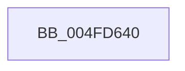

# KeBugCheck

- RVA: `0x004FD640`–`0x004FD64B` (길이 `11` bytes)
- VA: `0x00000001404FD640`
- 실행 섹션: `.text`
- PDB 이름 있음: `예`; PDB Function 태그: `아니요`
- unwind 정보 RVA: `0x000C1588`
- 디코드: `4`개 명령, `11/11` bytes 표시
- 미해석 바이트: `0` (있으면 어셈블리에 `.byte`로 보존)

> 이 문서는 커널 이미지의 기계어와 PDB 기호를 분석해 생성했습니다. 4번과 5번은 함수 원형과 자료형을 바이너리 사용 방식에서 추정한 C 해석이며 원본 소스 복구 결과는 아닙니다.

## 1. Dependencies

- 직접 호출 지점: **1**; 고유 호출 대상: **1**
- 직접 호출자로 확인된 함수: **30**
- RIP 상대 이미지 참조: **0**

### Outgoing calls
- `0x004FD644` → [KeBugCheckEx](KeBugCheckEx_function_004FD660.md) (function, `0x004FD660`)

### Direct callers
- [sub_0020D168](../20/Unknown_function_0020D168.md) at `0x0020D188`
- [KiDetachProcess](../21/KiDetachProcess_function_002172A0.md) at `0x0021734A`
- [sub_00217D5C](../21/Unknown_function_00217D5C.md) at `0x00217E0A`
- [sub_002185C7](../21/Unknown_function_002185C7.md) at `0x00218674`
- [sub_0028EF98](../28/Unknown_function_0028EF98.md) at `0x0028F088`
- [sub_003C7300](../3C/Unknown_function_003C7300.md) at `0x003C73B7`
- [sub_003C77D1](../3C/Unknown_function_003C77D1.md) at `0x003C787A`
- [PspSystemThreadStartup](../49/PspSystemThreadStartup_function_004932C0.md) at `0x00493321`
- [EtwpFreeApcPool](../4A/EtwpFreeApcPool_function_004A5998.md) at `0x004A59EB`
- [sub_0050C0E0](../50/Unknown_function_0050C0E0.md) at `0x0051A850`
- [KiLockServiceTable](../69/KiLockServiceTable_function_0069BC98.md) at `0x0069BD0A`
- [KiLockServiceTable](../69/KiLockServiceTable_function_0069BC98.md) at `0x0069BDC9`
- [KiLockServiceTable](../69/KiLockServiceTable_function_0069BC98.md) at `0x0069BE3E`
- [KiLockServiceTable](../69/KiLockServiceTable_function_0069BC98.md) at `0x0069BE5D`
- [KiStartSystemThread](../6B/KiStartSystemThread_function_006B2AA0.md) at `0x006B2ADB`
- [KeExpandKernelStackAndCalloutInternal$fin$1](../6D/KeExpandKernelStackAndCalloutInternal_fin_1_function_006D1F6E.md) at `0x006D1F83`
- [EtwCleanupSiloState](../../page/7B/EtwCleanupSiloState_function_007B4B9C.md) at `0x007B4CB3`
- [CmpAddProcessorConfigurationEntry](../../page/7E/CmpAddProcessorConfigurationEntry_function_007E4CF8.md) at `0x007E5167`
- [PspProcessDelete](../../page/90/PspProcessDelete_function_00907B90.md) at `0x00907F73`
- [PspThreadDelete](../../page/A7/PspThreadDelete_function_00A79C20.md) at `0x00A79E1F`
- [KeWriteProtectProcessorState](../../pagelk/B6/KeWriteProtectProcessorState_function_00B66BB0.md) at `0x00B66C58`
- [KiInitializeKernel](../../pagelk/B6/KiInitializeKernel_function_00B68D20.md) at `0x00B69537`
- [KiSetCacheInformation](../../pagelk/B6/KiSetCacheInformation_function_00B69B78.md) at `0x00B69BC3`
- [InitBootProcessor](../../init/C1/InitBootProcessor_function_00C1B1C8.md) at `0x00C1B459`
- [InitBootProcessor](../../init/C1/InitBootProcessor_function_00C1B1C8.md) at `0x00C1B835`
- [InitBootProcessor](../../init/C1/InitBootProcessor_function_00C1B1C8.md) at `0x00C1BD42`
- [InitBootProcessor](../../init/C1/InitBootProcessor_function_00C1B1C8.md) at `0x00C1BD6A`
- [InitBootProcessor](../../init/C1/InitBootProcessor_function_00C1B1C8.md) at `0x00C1BD9D`
- [InitBootProcessor](../../init/C1/InitBootProcessor_function_00C1B1C8.md) at `0x00C1BE49`
- [InitBootProcessor](../../init/C1/InitBootProcessor_function_00C1B1C8.md) at `0x00C1BE70`
- [Phase1InitializationDiscard](../../init/C1/Phase1InitializationDiscard_function_00C1C728.md) at `0x00C1C7D9`
- [Phase1InitializationDiscard](../../init/C1/Phase1InitializationDiscard_function_00C1C728.md) at `0x00C1CA40`
- [Phase1InitializationDiscard](../../init/C1/Phase1InitializationDiscard_function_00C1C728.md) at `0x00C1D1CD`
- [Phase1InitializationDiscard](../../init/C1/Phase1InitializationDiscard_function_00C1C728.md) at `0x00C1D315`
- [Phase1InitializationDiscard](../../init/C1/Phase1InitializationDiscard_function_00C1C728.md) at `0x00C1D333`
- [Phase1InitializationDiscard](../../init/C1/Phase1InitializationDiscard_function_00C1C728.md) at `0x00C1D3B0`
- [Phase1InitializationDiscard](../../init/C1/Phase1InitializationDiscard_function_00C1C728.md) at `0x00C1D3C7`
- [Phase1InitializationDiscard](../../init/C1/Phase1InitializationDiscard_function_00C1C728.md) at `0x00C1D72C`
- [Phase1InitializationDiscard](../../init/C1/Phase1InitializationDiscard_function_00C1C728.md) at `0x00C1D806`
- [Phase1InitializationDiscard](../../init/C1/Phase1InitializationDiscard_function_00C1C728.md) at `0x00C1DB34`
- [Phase1InitializationDiscard](../../init/C1/Phase1InitializationDiscard_function_00C1C728.md) at `0x00C1DB3F`
- [BvgaSaveResources](../../init/C2/BvgaSaveResources_function_00C2A668.md) at `0x00C2A6D9`
- [IoInitSystemPreDrivers](../../init/C2/IoInitSystemPreDrivers_function_00C2AC3C.md) at `0x00C2BC27`
- [KeStartAllProcessors](../../init/C3/KeStartAllProcessors_function_00C36F78.md) at `0x00C376EC`
- [PspInitPhase1](../../init/C4/PspInitPhase1_function_00C453B8.md) at `0x00C45453`
- [EtwpInitialize](../../init/C4/EtwpInitialize_function_00C4DBCC.md) at `0x00C4E1B6`
- [EtwpInitialize](../../init/C4/EtwpInitialize_function_00C4DBCC.md) at `0x00C4E22E`
- [KiFatalExceptionFilter](../../init/C6/KiFatalExceptionFilter_function_00C6CFB4.md) at `0x00C6D0EB`
- [Phase1InitializationIoReady](../../init/C7/Phase1InitializationIoReady_function_00C70458.md) at `0x00C705E0`
- [Phase1InitializationIoReady](../../init/C7/Phase1InitializationIoReady_function_00C70458.md) at `0x00C7064D`
- [Phase1InitializationIoReady](../../init/C7/Phase1InitializationIoReady_function_00C70458.md) at `0x00C7083A`
- [VslRegisterBootDrivers](../../init/C7/VslRegisterBootDrivers_function_00C7453C.md) at `0x00C74607`

### Static image references
- 디코드된 RIP-relative 메모리 참조가 없습니다.

## 2. Other-region calls and transfers

- 다른 실행 섹션으로 향하는 call: **0**
- 별도 외부 분기/꼬리 이동을 확인하지 못했습니다.

## 3. Assembly (complete function range)

```asm
004FD640  48 83 EC 28                     sub rsp, 0x28
004FD644  E8 17 00 00 00                  call 0x1404fd660
004FD649  90                              nop
004FD64A  C3                              ret
```

## 4. C-style interpretation (structured pseudocode)

```c
__int64 __fastcall KeBugCheck(void)
{
    __int64 result;
    __int64 v_rsp;

    v_rsp = (v_rsp) - (40);
    result = KeBugCheckEx(a1, a2, a3, a4);
    return result;
}
```

## 5. (Beta) C Style

```c
void KeBugCheck(void)
{
    int64_t result;
    int64_t local_rsp;

    local_rsp = (local_rsp) - (40);
    result = KeBugCheckEx(a1, a2, a3, a4);
    return result;
}
```

## 6. Execution-region graph

[열기: 2D/3D 그래프와 함수 탐색 컨트롤 패널](../../../control-panel.html?section=text&rva=0x004FD640&view=graph)

- 2D 그래프는 위에서 아래로 흐르고, 3D 그래프는 빈 공간을 드래그해 회전합니다. Shift+드래그는 이동, 휠은 확대·축소, 함수 노드 선택은 대상 보고서 이동입니다.

### Static fallback


