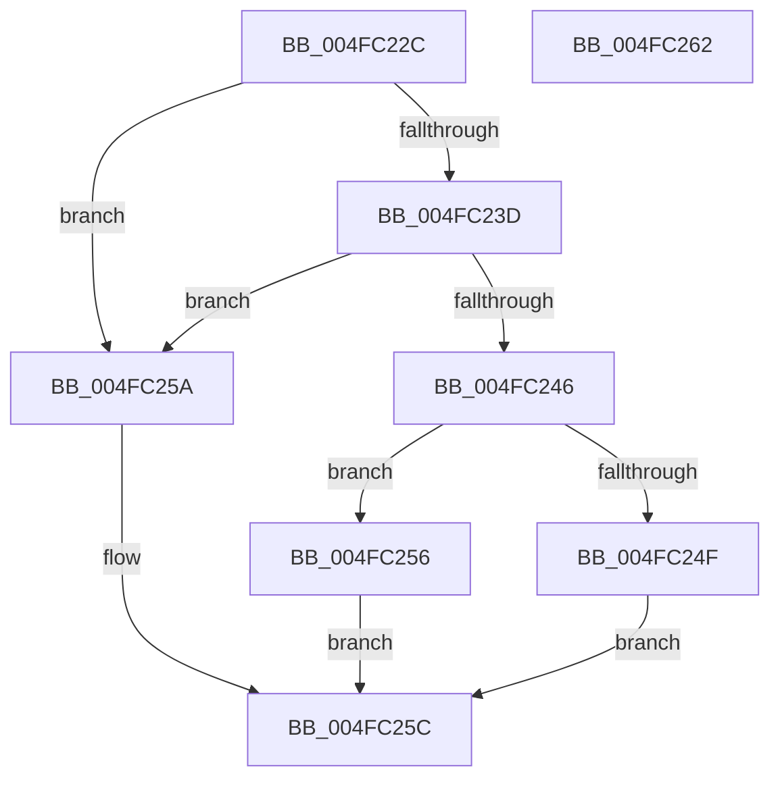

# KeCanUseHaltOnAddress

- RVA: `0x004FC22C`–`0x004FC263` (길이 `55` bytes)
- VA: `0x00000001404FC22C`
- 실행 섹션: `.text`
- PDB 이름 있음: `예`; PDB Function 태그: `아니요`
- unwind 정보 RVA: `0x0005CF00`
- 디코드: `21`개 명령, `55/55` bytes 표시
- 미해석 바이트: `0` (있으면 어셈블리에 `.byte`로 보존)

> 이 문서는 커널 이미지의 기계어와 PDB 기호를 분석해 생성했습니다. 4번과 5번은 함수 원형과 자료형을 바이너리 사용 방식에서 추정한 C 해석이며 원본 소스 복구 결과는 아닙니다.

## 1. Dependencies

- 직접 호출 지점: **1**; 고유 호출 대상: **1**
- 직접 호출자로 확인된 함수: **20**
- RIP 상대 이미지 참조: **1**

### Outgoing calls
- `0x004FC23D` → [KeAreInterruptsEnabled](../2F/KeAreInterruptsEnabled_function_002F8060.md) (function, `0x002F8060`)

### Direct callers
- [KiSwapDirectoryTableBaseTarget](../22/KiSwapDirectoryTableBaseTarget_function_00227FF0.md) at `0x00228096`
- [KiSwapDirectoryTableBaseTarget](../22/KiSwapDirectoryTableBaseTarget_function_00227FF0.md) at `0x002280FA`
- [KxWaitForLockOwnerShip](../25/KxWaitForLockOwnerShip_function_00257EB0.md) at `0x00257F65`
- [MiUpdatePageThresholdsDpc](../3B/MiUpdatePageThresholdsDpc_function_003BD050.md) at `0x003BD0FE`
- [MiUpdatePageThresholdsDpc](../3B/MiUpdatePageThresholdsDpc_function_003BD050.md) at `0x003BD1EB`
- [KxWaitForLockOwnerShipWithIrql](../41/KxWaitForLockOwnerShipWithIrql_function_00414E30.md) at `0x00414EF1`
- [KeSignalCallDpcSynchronize](../43/KeSignalCallDpcSynchronize_function_0043DFA0.md) at `0x0043E02F`
- [ExpGetPoolTagInfoTarget](../44/ExpGetPoolTagInfoTarget_function_004407D0.md) at `0x0044086D`
- [ExpGetPoolTagInfoTarget](../44/ExpGetPoolTagInfoTarget_function_004407D0.md) at `0x004408CC`
- [MiDemoteSlabEntriesDpc](../44/MiDemoteSlabEntriesDpc_function_0044C3C0.md) at `0x0044C47E`
- [MiDemoteSlabEntriesDpc](../44/MiDemoteSlabEntriesDpc_function_0044C3C0.md) at `0x0044C4DF`
- [KiSetSystemTimeDpc](../48/KiSetSystemTimeDpc_function_00486130.md) at `0x0048622D`
- [KiSetSystemTimeDpc](../48/KiSetSystemTimeDpc_function_00486130.md) at `0x0048630B`
- [KiSetSystemTimeDpc](../48/KiSetSystemTimeDpc_function_00486130.md) at `0x00486384`
- [MiJumpStackTarget](../48/MiJumpStackTarget_function_0048BC10.md) at `0x0048BCBC`
- [MiJumpStackTarget](../48/MiJumpStackTarget_function_0048BC10.md) at `0x0048BD15`
- [MiWritePteHighLevelIsr](../4C/MiWritePteHighLevelIsr_function_004C2FC0.md) at `0x004C31B0`
- [MiWritePteHighLevelIsr](../4C/MiWritePteHighLevelIsr_function_004C2FC0.md) at `0x004C326D`
- [MiWritePteHighLevelIsr](../4C/MiWritePteHighLevelIsr_function_004C2FC0.md) at `0x004C336A`
- [MiWritePteHighLevelIsr](../4C/MiWritePteHighLevelIsr_function_004C2FC0.md) at `0x004C34AB`
- [MiWritePteHighLevelIsr](../4C/MiWritePteHighLevelIsr_function_004C2FC0.md) at `0x004C3571`
- [MiWritePteHighLevelIsr](../4C/MiWritePteHighLevelIsr_function_004C2FC0.md) at `0x004C364D`
- [KiOptimizeSpecCtrlSettingsWorker](../5B/KiOptimizeSpecCtrlSettingsWorker_function_005BF5A0.md) at `0x005BF858`
- [KiOptimizeSpecCtrlSettingsWorker](../5B/KiOptimizeSpecCtrlSettingsWorker_function_005BF5A0.md) at `0x005BFCDF`
- [KiOptimizeSpecCtrlSettingsWorker](../5B/KiOptimizeSpecCtrlSettingsWorker_function_005BF5A0.md) at `0x005C0285`
- [ExpLimitInsertDpc](../65/ExpLimitInsertDpc_function_00656BF0.md) at `0x00656CCE`
- [ExpLimitInsertDpc](../65/ExpLimitInsertDpc_function_00656BF0.md) at `0x00656D91`
- [ExpLimitInsertDpc](../65/ExpLimitInsertDpc_function_00656BF0.md) at `0x00656E6C`
- [ExpAeThresholdInitWorker](../65/ExpAeThresholdInitWorker_function_0065D680.md) at `0x0065D723`
- [MiFreeUnusedPfnPagesDpc](../67/MiFreeUnusedPfnPagesDpc_function_00672150.md) at `0x006721E2`
- [MiFreeUnusedPfnPagesDpc](../67/MiFreeUnusedPfnPagesDpc_function_00672150.md) at `0x006722CF`
- [MiMakeIoRangePermanentDpc](../67/MiMakeIoRangePermanentDpc_function_0067C540.md) at `0x0067C5DB`
- [MiMakeIoRangePermanentDpc](../67/MiMakeIoRangePermanentDpc_function_0067C540.md) at `0x0067C6C8`
- [MiReapplyImportOptimizationWorker](../68/MiReapplyImportOptimizationWorker_function_00682720.md) at `0x0068294A`
- [MiDbgCopyMemoryTarget](../68/MiDbgCopyMemoryTarget_function_00684E70.md) at `0x00684FF9`
- [MiDbgCopyMemoryTarget](../68/MiDbgCopyMemoryTarget_function_00684E70.md) at `0x006850EC`
- [MiChangeSlabIdentitiesDpc](../68/MiChangeSlabIdentitiesDpc_function_0068CF10.md) at `0x0068CFC2`
- [MiChangeSlabIdentitiesDpc](../68/MiChangeSlabIdentitiesDpc_function_0068CF10.md) at `0x0068D0B5`
- [MiSpecialPurposeMemoryCacheUpdateDpc](../69/MiSpecialPurposeMemoryCacheUpdateDpc_function_00695240.md) at `0x00695329`
- [MiSpecialPurposeMemoryCacheUpdateDpc](../69/MiSpecialPurposeMemoryCacheUpdateDpc_function_00695240.md) at `0x00695425`
- [MiDpcGangTarget](../69/MiDpcGangTarget_function_00697E60.md) at `0x00697FB6`
- [MiDpcGangTarget](../69/MiDpcGangTarget_function_00697E60.md) at `0x006980D8`

### Static image references
- `0x004FC232` → RVA `0x00FC6ADD` (`ALMOSTRO`; read)

## 2. Other-region calls and transfers

- 다른 실행 섹션으로 향하는 call: **0**
- 별도 외부 분기/꼬리 이동을 확인하지 못했습니다.

## 3. Assembly (complete function range)

```asm
004FC22C  40 53                           push rbx
004FC22E  48 83 EC 20                     sub rsp, 0x20
004FC232  8A 1D A5 A8 AC 00               mov bl, byte ptr [rip + 0xaca8a5]
004FC238  F6 C3 02                        test bl, 2
004FC23B  74 1D                           je 0x1404fc25a
004FC23D  E8 1E BE DF FF                  call 0x1402f8060
004FC242  84 C0                           test al, al
004FC244  74 14                           je 0x1404fc25a
004FC246  44 0F 20 C0                     mov rax, cr8
004FC24A  F6 C3 04                        test bl, 4
004FC24D  75 07                           jne 0x1404fc256
004FC24F  3C 0E                           cmp al, 0xe
004FC251  0F 92 C0                        setb al
004FC254  EB 06                           jmp 0x1404fc25c
004FC256  B0 01                           mov al, 1
004FC258  EB 02                           jmp 0x1404fc25c
004FC25A  32 C0                           xor al, al
004FC25C  48 83 C4 20                     add rsp, 0x20
004FC260  5B                              pop rbx
004FC261  C3                              ret
004FC262  CC                              int3
```

## 4. C-style interpretation (structured pseudocode)

```c
__int64 __fastcall KeCanUseHaltOnAddress(void)
{
    __int64 result;
    __int64 v_rsp;

    v_rsp = (v_rsp) - (32);
    if ((((unsigned __int8)(*(unsigned __int8 *)(v_rip + 11315365))) & (2)) == 0) goto loc_004FC25A;
    result = KeAreInterruptsEnabled(a1, a2, a3, a4);
    if ((unsigned __int8)(result) == 0) goto loc_004FC25A;
    if ((((unsigned __int8)(*(unsigned __int8 *)(v_rip + 11315365))) & (4)) != 0) goto loc_004FC256;
    result = (((unsigned __int8)(v_cr8)) < 14) ? 1 : 0;
    goto loc_004FC25C;
loc_004FC256:
    goto loc_004FC25C;
loc_004FC25A:
    result = 0;
loc_004FC25C:
    v_rsp = (v_rsp) + (32);
    return result;
}
```

## 5. (Beta) C Style

```c
void KeCanUseHaltOnAddress(void)
{
    int64_t result;
    int64_t local_rsp;

    local_rsp = (local_rsp) - (32);
    if ((((uint8_t)(*(uint8_t *)(v_rip + 0xACA8A5))) & (2)) == 0) goto loc_004FC25A;
    result = KeAreInterruptsEnabled(a1, a2, a3, a4);
    if ((uint8_t)(result) == 0) goto loc_004FC25A;
    if ((((uint8_t)(*(uint8_t *)(v_rip + 0xACA8A5))) & (4)) != 0) goto loc_004FC256;
    result = (((uint8_t)(v_cr8)) < 14) ? 1 : 0;
    goto loc_004FC25C;
loc_004FC256:
    goto loc_004FC25C;
loc_004FC25A:
    result = 0;
loc_004FC25C:
    local_rsp = (local_rsp) + (32);
    return result;
}
```

## 6. Execution-region graph

[열기: 2D/3D 그래프와 함수 탐색 컨트롤 패널](../../../control-panel.html?section=text&rva=0x004FC22C&view=graph)

- 2D 그래프는 위에서 아래로 흐르고, 3D 그래프는 빈 공간을 드래그해 회전합니다. Shift+드래그는 이동, 휠은 확대·축소, 함수 노드 선택은 대상 보고서 이동입니다.

### Static fallback


