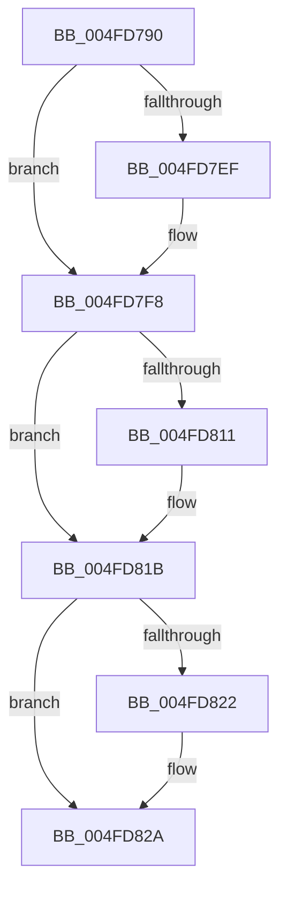

# KeContextToKframes

- RVA: `0x004FD790`–`0x004FD87C` (길이 `236` bytes)
- VA: `0x00000001404FD790`
- 실행 섹션: `.text`
- PDB 이름 있음: `예`; PDB Function 태그: `아니요`
- unwind 정보 RVA: `0x000C15A0`
- 디코드: `43`개 명령, `236/236` bytes 표시
- 미해석 바이트: `0` (있으면 어셈블리에 `.byte`로 보존)

> 이 문서는 커널 이미지의 기계어와 PDB 기호를 분석해 생성했습니다. 4번과 5번은 함수 원형과 자료형을 바이너리 사용 방식에서 추정한 C 해석이며 원본 소스 복구 결과는 아닙니다.

## 1. Dependencies

- 직접 호출 지점: **1**; 고유 호출 대상: **1**
- 직접 호출자로 확인된 함수: **6**
- RIP 상대 이미지 참조: **0**

### Outgoing calls
- `0x004FD808` → [KxContextToKframes](../3D/KxContextToKframes_function_003D6850.md) (function, `0x003D6850`)

### Direct callers
- [KiContinuePreviousModeUser](../2F/KiContinuePreviousModeUser_function_002F9B10.md) at `0x002F9F32`
- [KyRaiseException](../3D/KyRaiseException_function_003D5E20.md) at `0x003D5FAD`
- [KiDispatchException](../3D/KiDispatchException_function_003D7650.md) at `0x003D7808`
- [KiContinueEx](../41/KiContinueEx_function_0041C370.md) at `0x0041C550`
- [KiRestoreProcessorState](../5C/KiRestoreProcessorState_function_005CB87C.md) at `0x005CB90A`
- [KiRestoreSetContextState](../6B/KiRestoreSetContextState_function_006B1CA0.md) at `0x006B1D30`

### Static image references
- 디코드된 RIP-relative 메모리 참조가 없습니다.

## 2. Other-region calls and transfers

- 다른 실행 섹션으로 향하는 call: **0**
- 별도 외부 분기/꼬리 이동을 확인하지 못했습니다.

## 3. Assembly (complete function range)

```asm
004FD790  48 53                           push rbx
004FD792  48 81 EC D0 00 00 00            sub rsp, 0xd0
004FD799  0F 29 74 24 30                  movaps xmmword ptr [rsp + 0x30], xmm6
004FD79E  0F 29 7C 24 40                  movaps xmmword ptr [rsp + 0x40], xmm7
004FD7A3  44 0F 29 44 24 50               movaps xmmword ptr [rsp + 0x50], xmm8
004FD7A9  44 0F 29 4C 24 60               movaps xmmword ptr [rsp + 0x60], xmm9
004FD7AF  44 0F 29 54 24 70               movaps xmmword ptr [rsp + 0x70], xmm10
004FD7B5  44 0F 29 9C 24 80 00 00 00      movaps xmmword ptr [rsp + 0x80], xmm11
004FD7BE  44 0F 29 A4 24 90 00 00 00      movaps xmmword ptr [rsp + 0x90], xmm12
004FD7C7  44 0F 29 AC 24 A0 00 00 00      movaps xmmword ptr [rsp + 0xa0], xmm13
004FD7D0  44 0F 29 B4 24 B0 00 00 00      movaps xmmword ptr [rsp + 0xb0], xmm14
004FD7D9  44 0F 29 BC 24 C0 00 00 00      movaps xmmword ptr [rsp + 0xc0], xmm15
004FD7E2  44 0F 20 C0                     mov rax, cr8
004FD7E6  89 44 24 28                     mov dword ptr [rsp + 0x28], eax
004FD7EA  83 F8 01                        cmp eax, 1
004FD7ED  73 09                           jae 0x1404fd7f8
004FD7EF  B8 01 00 00 00                  mov eax, 1
004FD7F4  44 0F 22 C0                     mov cr8, rax
004FD7F8  49 8B D8                        mov rbx, r8
004FD7FB  4C 8B 94 24 00 01 00 00         mov r10, qword ptr [rsp + 0x100]
004FD803  4C 89 54 24 20                  mov qword ptr [rsp + 0x20], r10
004FD808  E8 43 90 ED FF                  call 0x1403d6850
004FD80D  84 C0                           test al, al
004FD80F  74 0A                           je 0x1404fd81b
004FD811  48 8D 8B 00 01 00 00            lea rcx, [rbx + 0x100]
004FD818  0F AE 09                        fxrstor [rcx]
004FD81B  83 7C 24 28 01                  cmp dword ptr [rsp + 0x28], 1
004FD820  73 08                           jae 0x1404fd82a
004FD822  8B 44 24 28                     mov eax, dword ptr [rsp + 0x28]
004FD826  44 0F 22 C0                     mov cr8, rax
004FD82A  0F 28 74 24 30                  movaps xmm6, xmmword ptr [rsp + 0x30]
004FD82F  0F 28 7C 24 40                  movaps xmm7, xmmword ptr [rsp + 0x40]
004FD834  44 0F 28 44 24 50               movaps xmm8, xmmword ptr [rsp + 0x50]
004FD83A  44 0F 28 4C 24 60               movaps xmm9, xmmword ptr [rsp + 0x60]
004FD840  44 0F 28 54 24 70               movaps xmm10, xmmword ptr [rsp + 0x70]
004FD846  44 0F 28 9C 24 80 00 00 00      movaps xmm11, xmmword ptr [rsp + 0x80]
004FD84F  44 0F 28 A4 24 90 00 00 00      movaps xmm12, xmmword ptr [rsp + 0x90]
004FD858  44 0F 28 AC 24 A0 00 00 00      movaps xmm13, xmmword ptr [rsp + 0xa0]
004FD861  44 0F 28 B4 24 B0 00 00 00      movaps xmm14, xmmword ptr [rsp + 0xb0]
004FD86A  44 0F 28 BC 24 C0 00 00 00      movaps xmm15, xmmword ptr [rsp + 0xc0]
004FD873  48 81 C4 D0 00 00 00            add rsp, 0xd0
004FD87A  5B                              pop rbx
004FD87B  C3                              ret
```

## 4. C-style interpretation (structured pseudocode)

```c
__int64 __fastcall KeContextToKframes(__int64 a1, __int64 a2, __int64 a3, __int64 a4, __int64 a5)
{
    __int64 result;
    __int64 v_cr8;
    __int64 v_rsp;
    unsigned __int64 v_stack_m18;
    unsigned __int64 v_stack_m28;
    unsigned __int64 v_stack_m38;
    unsigned __int64 v_stack_m48;
    unsigned __int64 v_stack_m58;
    unsigned __int64 v_stack_m68;
    unsigned __int64 v_stack_m78;
    unsigned __int64 v_stack_m88;
    unsigned __int64 v_stack_m98;
    unsigned __int64 v_stack_mA8;
    unsigned int v_stack_mB0;
    unsigned __int64 v_stack_mB8;

    v_rsp = (v_rsp) - (208);
    v_stack_mA8 = v_xmm6;
    v_stack_m98 = v_xmm7;
    v_stack_m88 = v_xmm8;
    v_stack_m78 = v_xmm9;
    v_stack_m68 = v_xmm10;
    v_stack_m58 = v_xmm11;
    v_stack_m48 = v_xmm12;
    v_stack_m38 = v_xmm13;
    v_stack_m28 = v_xmm14;
    v_stack_m18 = v_xmm15;
    v_stack_mB0 = (unsigned int)(v_cr8);
    result = v_cr8;
    if (((unsigned int)(v_cr8)) < 1) {
        result = 1;
        v_cr8 = result;
    }
    v_stack_mB8 = a5;
    result = KxContextToKframes(a1, a2, a3, a4);
    if ((unsigned __int8)(result) != 0) {
        a1 = a3 + 256;
    }
    if (v_stack_mB0 < 1) {
        result = v_stack_mB0;
        v_cr8 = result;
    }
    v_rsp = (v_rsp) + (208);
    return result;
}
```

## 5. (Beta) C Style

```c
int64_t KeContextToKframes(int64_t Arg1, int64_t Arg2, void *Arg3, int64_t Arg4, int64_t Arg5)
{
    uint8_t *arg3 = (uint8_t *)Arg3;

    int64_t result;
    int64_t v_cr8;
    int64_t local_rsp;
    uint64_t v_stack_m18;
    uint64_t v_stack_m28;
    uint64_t v_stack_m38;
    uint64_t v_stack_m48;
    uint64_t v_stack_m58;
    uint64_t v_stack_m68;
    uint64_t v_stack_m78;
    uint64_t v_stack_m88;
    uint64_t v_stack_m98;
    uint64_t v_stack_mA8;
    uint32_t v_stack_mB0;
    uint64_t v_stack_mB8;

    local_rsp = (local_rsp) - (208);
    v_stack_mA8 = v_xmm6;
    v_stack_m98 = v_xmm7;
    v_stack_m88 = v_xmm8;
    v_stack_m78 = v_xmm9;
    v_stack_m68 = v_xmm10;
    v_stack_m58 = v_xmm11;
    v_stack_m48 = v_xmm12;
    v_stack_m38 = v_xmm13;
    v_stack_m28 = v_xmm14;
    v_stack_m18 = v_xmm15;
    v_stack_mB0 = (uint32_t)(v_cr8);
    result = v_cr8;
    if (((uint32_t)(v_cr8)) < 1) {
        result = 1;
        v_cr8 = result;
    }
    v_stack_mB8 = Arg5;
    result = KxContextToKframes(Arg1, Arg2, Arg3, Arg4);
    if ((uint8_t)(result) != 0) {
        Arg1 = Arg3 + 256;
    }
    if (v_stack_mB0 < 1) {
        result = v_stack_mB0;
        v_cr8 = result;
    }
    local_rsp = (local_rsp) + (208);
    return result;
}
```

### 관측된 메모리 오프셋

구조체 형식이 확인되지 않은 접근은 인자 기준의 오프셋으로만 기록했습니다.

| 기준 인자 | 오프셋 표현 | 폭 (bit) | 접근 |
|---|---:|---:|---|
| `Arg3` | `+ 0x0` | `64` | `R` |
| `Arg3` | `+ 0x100` | `64` | `R` |

## 6. Execution-region graph

[열기: 2D/3D 그래프와 함수 탐색 컨트롤 패널](../../../control-panel.html?section=text&rva=0x004FD790&view=graph)

- 2D 그래프는 위에서 아래로 흐르고, 3D 그래프는 빈 공간을 드래그해 회전합니다. Shift+드래그는 이동, 휠은 확대·축소, 함수 노드 선택은 대상 보고서 이동입니다.

### Static fallback


