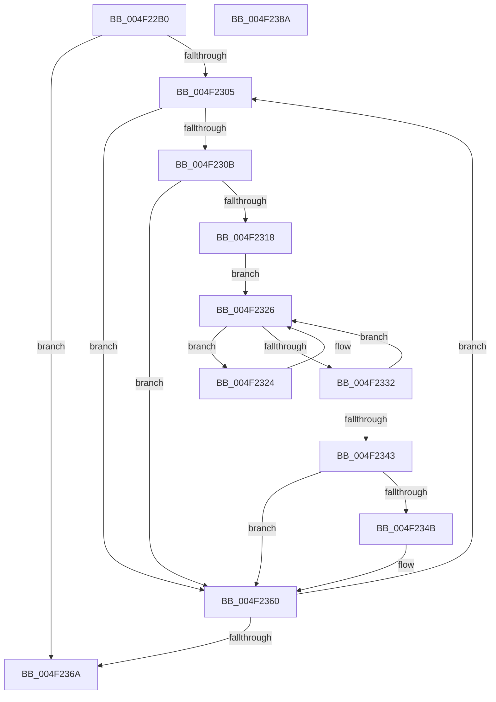

# KeCpuSetQueryUnparkRecommendationEx

- RVA: `0x004F22B0`–`0x004F238B` (길이 `219` bytes)
- VA: `0x00000001404F22B0`
- 실행 섹션: `.text`
- PDB 이름 있음: `예`; PDB Function 태그: `아니요`
- unwind 정보 RVA: `0x00075C18`
- 디코드: `66`개 명령, `219/219` bytes 표시
- 미해석 바이트: `0` (있으면 어셈블리에 `.byte`로 보존)

> 이 문서는 커널 이미지의 기계어와 PDB 기호를 분석해 생성했습니다. 4번과 5번은 함수 원형과 자료형을 바이너리 사용 방식에서 추정한 C 해석이며 원본 소스 복구 결과는 아닙니다.

## 1. Dependencies

- 직접 호출 지점: **2**; 고유 호출 대상: **2**
- 직접 호출자로 확인된 함수: **1**
- RIP 상대 이미지 참조: **3**

### Outgoing calls
- `0x004F22EE` → [memset](../6C/memset_function_006C6C40.md) (function, `0x006C6C40`)
- `0x004F2354` → [KeAddGroupAffinityEx](../25/KeAddGroupAffinityEx_function_0025B6C0.md) (function, `0x0025B6C0`)

### Direct callers
- [PpmParkCalculateCoreParkingMaskEx](../5D/PpmParkCalculateCoreParkingMaskEx_function_005DFBE0.md) at `0x005E0055`

### Static image references
- `0x004F22D3` → RVA `0x00FC5018` (`ALMOSTRO`; read)
- `0x004F231B` → RVA `0x00FC8320` (`ALMOSTRO`; read)
- `0x004F2326` → RVA `0x00FC6BF8` (`ALMOSTRO`; read)

## 2. Other-region calls and transfers

- 다른 실행 섹션으로 향하는 call: **0**
- 별도 외부 분기/꼬리 이동을 확인하지 못했습니다.

## 3. Assembly (complete function range)

```asm
004F22B0  48 89 5C 24 08                  mov qword ptr [rsp + 8], rbx
004F22B5  48 89 6C 24 10                  mov qword ptr [rsp + 0x10], rbp
004F22BA  48 89 74 24 18                  mov qword ptr [rsp + 0x18], rsi
004F22BF  57                              push rdi
004F22C0  41 54                           push r12
004F22C2  41 55                           push r13
004F22C4  41 56                           push r14
004F22C6  41 57                           push r15
004F22C8  48 83 EC 20                     sub rsp, 0x20
004F22CC  44 0F B7 02                     movzx r8d, word ptr [rdx]
004F22D0  48 8B E9                        mov rbp, rcx
004F22D3  44 0F B7 3D 3D 2D AD 00         movzx r15d, word ptr [rip + 0xad2d3d]
004F22DB  48 8D 4A 08                     lea rcx, [rdx + 8]
004F22DF  4C 8B F2                        mov r14, rdx
004F22E2  49 C1 E0 03                     shl r8, 3
004F22E6  45 33 ED                        xor r13d, r13d
004F22E9  33 D2                           xor edx, edx
004F22EB  41 8B F5                        mov esi, r13d
004F22EE  E8 4D 49 1D 00                  call 0x1406c6c40
004F22F3  45 8D 65 01                     lea r12d, [r13 + 1]
004F22F7  41 0F B7 DD                     movzx ebx, r13w
004F22FB  66 45 89 26                     mov word ptr [r14], r12w
004F22FF  66 45 3B EF                     cmp r13w, r15w
004F2303  73 65                           jae 0x1404f236a
004F2305  66 3B 5D 00                     cmp bx, word ptr [rbp]
004F2309  73 55                           jae 0x1404f2360
004F230B  0F B7 D3                        movzx edx, bx
004F230E  4C 8B 44 D5 08                  mov r8, qword ptr [rbp + rdx*8 + 8]
004F2313  4D 85 C0                        test r8, r8
004F2316  74 48                           je 0x1404f2360
004F2318  48 03 D2                        add rdx, rdx
004F231B  4C 8D 0D FE 5F AD 00            lea r9, [rip + 0xad5ffe]
004F2322  EB 02                           jmp 0x1404f2326
004F2324  F3 90                           pause
004F2326  48 8B 0D CB 48 AD 00            mov rcx, qword ptr [rip + 0xad48cb]
004F232D  41 84 CC                        test r12b, cl
004F2330  75 F2                           jne 0x1404f2324
004F2332  49 8B 3C D1                     mov rdi, qword ptr [r9 + rdx*8]
004F2336  90                              nop
004F2337  48 8B 05 BA 48 AD 00            mov rax, qword ptr [rip + 0xad48ba]
004F233E  48 3B C1                        cmp rax, rcx
004F2341  75 E3                           jne 0x1404f2326
004F2343  48 F7 D7                        not rdi
004F2346  49 23 F8                        and rdi, r8
004F2349  74 15                           je 0x1404f2360
004F234B  4C 8B C7                        mov r8, rdi
004F234E  0F B7 D3                        movzx edx, bx
004F2351  49 8B CE                        mov rcx, r14
004F2354  E8 67 93 D6 FF                  call 0x14025b6c0
004F2359  F3 48 0F B8 CF                  popcnt rcx, rdi
004F235E  03 F1                           add esi, ecx
004F2360  66 41 03 DC                     add bx, r12w
004F2364  66 41 3B DF                     cmp bx, r15w
004F2368  72 9B                           jb 0x1404f2305
004F236A  48 8B 5C 24 50                  mov rbx, qword ptr [rsp + 0x50]
004F236F  0F B7 C6                        movzx eax, si
004F2372  48 8B 74 24 60                  mov rsi, qword ptr [rsp + 0x60]
004F2377  48 8B 6C 24 58                  mov rbp, qword ptr [rsp + 0x58]
004F237C  48 83 C4 20                     add rsp, 0x20
004F2380  41 5F                           pop r15
004F2382  41 5E                           pop r14
004F2384  41 5D                           pop r13
004F2386  41 5C                           pop r12
004F2388  5F                              pop rdi
004F2389  C3                              ret
004F238A  CC                              int3
```

## 4. C-style interpretation (structured pseudocode)

```c
__int64 __fastcall KeCpuSetQueryUnparkRecommendationEx(__int64 a1, __int64 a2)
{
    __int64 result;
    __int64 v_r13;
    __int64 v_rbx;
    __int64 v_rdi;
    __int64 v_rsi;
    __int64 v_rsp;
    unsigned __int64 v_stack_p10;
    unsigned __int64 v_stack_p18;
    unsigned __int64 v_stack_p8;

    v_stack_p8 = v_rbx;
    v_stack_p10 = v_rbp;
    v_stack_p18 = v_rsi;
    v_rsp = (v_rsp) - (32);
    a3 = (*(unsigned __int16 *)(a2)) << (3);
    v_r13 = 0;
    a2 = 0;
    result = memset(a2 + 8, a2, a3, a4);
    *(unsigned __int16 *)(a2) = (unsigned __int16)(v_r13 + 1);
    if (0 >= ((unsigned __int16)(*(unsigned __int16 *)(v_rip + 11349309)))) goto loc_004F236A;
loc_004F2305:
    if (0 >= (*(unsigned __int16 *)(a1))) goto loc_004F2360;
    if (*(unsigned __int64 *)(a1 + 0 * 8 + 8) == 0) goto loc_004F2360;
    a2 = (0) + (0);
    goto loc_004F2326;
loc_004F2324:
loc_004F2326:
    if ((((unsigned __int8)(v_r13 + 1)) & ((unsigned __int8)(*(unsigned __int64 *)(v_rip + 11356363)))) != 0) goto loc_004F2324;
    if ((*(unsigned __int64 *)(v_rip + 11356346)) != (*(unsigned __int64 *)(v_rip + 11356363))) goto loc_004F2326;
    v_rdi = ~(*(unsigned __int64 *)(v_rip + 11362302 + a2 * 8));
    v_rdi = (v_rdi) & (*(unsigned __int64 *)(a1 + 0 * 8 + 8));
    result = *(unsigned __int64 *)(v_rip + 11356346);
    v_rsi = 0;
    if (!(condition_is_equal)) {
        a3 = v_rdi;
        a2 = 0;
        a1 = a2;
        result = KeAddGroupAffinityEx(a1, a2, a3, v_rip + 11362302);
        v_rsi = (unsigned int)((0) + ((unsigned int)(a1)));
    }
    v_rbx = (unsigned __int16)((0) + ((unsigned __int16)(v_r13 + 1)));
    if (((unsigned __int16)(v_rbx)) < ((unsigned __int16)(*(unsigned __int16 *)(v_rip + 11349309)))) goto loc_004F2305;
loc_004F236A:
    v_rsp = (v_rsp) + (32);
    return (unsigned __int16)(v_rsi);
}
```

## 5. (Beta) C Style

```c
int64_t KeCpuSetQueryUnparkRecommendationEx(void *Arg1, void *Arg2)
{
    uint8_t *arg1 = (uint8_t *)Arg1;
    uint8_t *arg2 = (uint8_t *)Arg2;

    int64_t result;
    int64_t local_r13;
    int64_t local_rbx;
    int64_t local_rdi;
    int64_t local_rsi;
    int64_t local_rsp;
    uint64_t v_stack_p10;
    uint64_t v_stack_p18;
    uint64_t v_stack_p8;

    v_stack_p8 = local_rbx;
    v_stack_p10 = local_rbp;
    v_stack_p18 = local_rsi;
    local_rsp = (local_rsp) - (32);
    a3 = (*(uint16_t *)(arg2)) << (3);
    local_r13 = 0;
    Arg2 = 0;
    result = memset(Arg2 + 8, Arg2, a3, a4);
    *(uint16_t *)(arg2) = (uint16_t)(local_r13 + 1);
    if (0 >= ((uint16_t)(*(uint16_t *)(v_rip + 0xAD2D3D)))) goto loc_004F236A;
loc_004F2305:
    if (0 >= (*(uint16_t *)(arg1))) goto loc_004F2360;
    if (*(uint64_t *)(arg1 + 0x0 * 8 + 0x8) == 0) goto loc_004F2360;
    Arg2 = (0) + (0);
    goto loc_004F2326;
loc_004F2324:
loc_004F2326:
    if ((((uint8_t)(local_r13 + 1)) & ((uint8_t)(*(uint64_t *)(v_rip + 0xAD48CB)))) != 0) goto loc_004F2324;
    if ((*(uint64_t *)(v_rip + 0xAD48BA)) != (*(uint64_t *)(v_rip + 0xAD48CB))) goto loc_004F2326;
    local_rdi = ~(*(uint64_t *)(v_rip + 0xAD5FFE + arg2 * 8));
    local_rdi = (local_rdi) & (*(uint64_t *)(arg1 + 0x0 * 8 + 0x8));
    result = *(uint64_t *)(v_rip + 0xAD48BA);
    local_rsi = 0;
    if (!(condition_is_equal)) {
        a3 = local_rdi;
        Arg2 = 0;
        Arg1 = Arg2;
        result = KeAddGroupAffinityEx(Arg1, Arg2, a3, v_rip + 11362302);
        local_rsi = (uint32_t)((0) + ((uint32_t)(Arg1)));
    }
    local_rbx = (uint16_t)((0) + ((uint16_t)(local_r13 + 1)));
    if (((uint16_t)(local_rbx)) < ((uint16_t)(*(uint16_t *)(v_rip + 0xAD2D3D)))) goto loc_004F2305;
loc_004F236A:
    local_rsp = (local_rsp) + (32);
    return (uint16_t)(local_rsi);
}
```

### 관측된 메모리 오프셋

구조체 형식이 확인되지 않은 접근은 인자 기준의 오프셋으로만 기록했습니다.

| 기준 인자 | 오프셋 표현 | 폭 (bit) | 접근 |
|---|---:|---:|---|
| `Arg1` | `+ 0x0` | `16` | `R` |
| `Arg1` | `+ 0x8 + rdx*8` | `64` | `R` |
| `Arg2` | `+ 0x0` | `16` | `R` |
| `Arg2` | `+ 0x0` | `16` | `W` |
| `Arg2` | `+ 0x8` | `64` | `R` |

## 6. Execution-region graph

[열기: 2D/3D 그래프와 함수 탐색 컨트롤 패널](../../../control-panel.html?section=text&rva=0x004F22B0&view=graph)

- 2D 그래프는 위에서 아래로 흐르고, 3D 그래프는 빈 공간을 드래그해 회전합니다. Shift+드래그는 이동, 휠은 확대·축소, 함수 노드 선택은 대상 보고서 이동입니다.

### Static fallback


