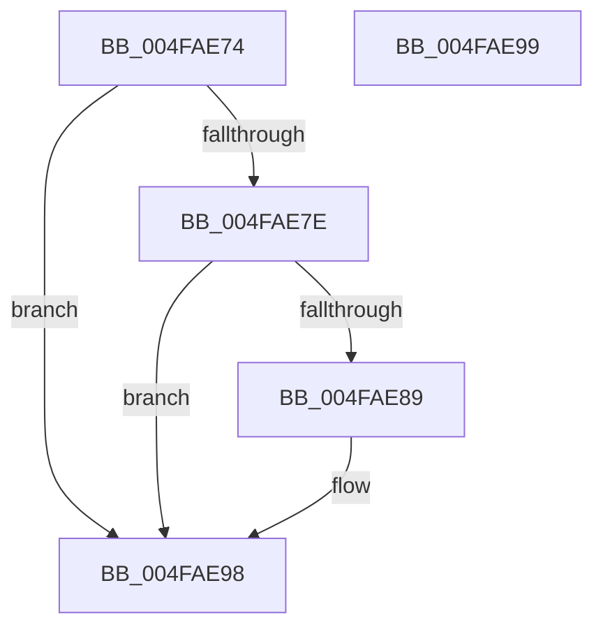

# KeInitializeCatRegisters

- RVA: `0x004FAE74`–`0x004FAE9A` (길이 `38` bytes)
- VA: `0x00000001404FAE74`
- 실행 섹션: `.text`
- PDB 이름 있음: `예`; PDB Function 태그: `아니요`
- unwind 정보 RVA: `0x000DB714`
- 디코드: `12`개 명령, `38/38` bytes 표시
- 미해석 바이트: `0` (있으면 어셈블리에 `.byte`로 보존)

> 이 문서는 커널 이미지의 기계어와 PDB 기호를 분석해 생성했습니다. 4번과 5번은 함수 원형과 자료형을 바이너리 사용 방식에서 추정한 C 해석이며 원본 소스 복구 결과는 아닙니다.

## 1. Dependencies

- 직접 호출 지점: **0**; 고유 호출 대상: **0**
- 직접 호출자로 확인된 함수: **2**
- RIP 상대 이미지 참조: **2**

### Outgoing calls
- 직접 디코드된 call 명령이 없습니다.

### Direct callers
- [KiRestoreFeatureBits](../4D/KiRestoreFeatureBits_function_004D4D18.md) at `0x004D4DD2`
- [KeInitSystem](../../init/C7/KeInitSystem_function_00C71660.md) at `0x00C7174F`

### Static image references
- `0x004FAE74` → RVA `0x00FC6E84` (`ALMOSTRO`; read)
- `0x004FAE7E` → RVA `0x00FC6B30` (`ALMOSTRO`; read)

## 2. Other-region calls and transfers

- 다른 실행 섹션으로 향하는 call: **0**
- 별도 외부 분기/꼬리 이동을 확인하지 못했습니다.

## 3. Assembly (complete function range)

```asm
004FAE74  8B 0D 0A C0 AC 00               mov ecx, dword ptr [rip + 0xacc00a]
004FAE7A  85 C9                           test ecx, ecx
004FAE7C  74 1A                           je 0x1404fae98
004FAE7E  48 0F BA 25 A9 BC AC 00 2C      bt qword ptr [rip + 0xacbca9], 0x2c
004FAE87  73 0F                           jae 0x1404fae98
004FAE89  8B D1                           mov edx, ecx
004FAE8B  8B C1                           mov eax, ecx
004FAE8D  48 C1 EA 20                     shr rdx, 0x20
004FAE91  B9 91 0C 00 00                  mov ecx, 0xc91
004FAE96  0F 30                           wrmsr
004FAE98  C3                              ret
004FAE99  CC                              int3
```

## 4. C-style interpretation (structured pseudocode)

```c
__int64 __fastcall KeInitializeCatRegisters(void)
{
    __int64 result;

    if ((unsigned int)((unsigned int)(*(unsigned int *)(v_rip + 11321354))) == 0) goto loc_004FAE98;
    if (!(condition_is_above_or_equal)) {
        a2 = (unsigned int)((unsigned int)(*(unsigned int *)(v_rip + 11321354)));
        result = (unsigned int)((unsigned int)(*(unsigned int *)(v_rip + 11321354)));
        a2 = (a2) >> (32);
        a1 = 0xC91ULL;
    }
    return result;
}
```

## 5. (Beta) C Style

```c
void KeInitializeCatRegisters(void)
{
    int64_t result;

    if ((uint32_t)((uint32_t)(*(uint32_t *)(v_rip + 0xACC00A))) == 0) goto loc_004FAE98;
    if (!(condition_is_above_or_equal)) {
        a2 = (uint32_t)((uint32_t)(*(uint32_t *)(v_rip + 0xACC00A)));
        result = (uint32_t)((uint32_t)(*(uint32_t *)(v_rip + 0xACC00A)));
        a2 = (a2) >> (32);
        a1 = 0xC91ULL;
    }
    return result;
}
```

## 6. Execution-region graph

[열기: 2D/3D 그래프와 함수 탐색 컨트롤 패널](../../../control-panel.html?section=text&rva=0x004FAE74&view=graph)

- 2D 그래프는 위에서 아래로 흐르고, 3D 그래프는 빈 공간을 드래그해 회전합니다. Shift+드래그는 이동, 휠은 확대·축소, 함수 노드 선택은 대상 보고서 이동입니다.

### Static fallback


