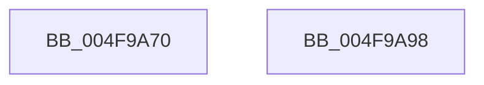

# KeSynchronizeTimeToQpc

- RVA: `0x004F9A70`–`0x004F9A99` (길이 `41` bytes)
- VA: `0x00000001404F9A70`
- 실행 섹션: `.text`
- PDB 이름 있음: `예`; PDB Function 태그: `아니요`
- unwind 정보 RVA: `0x000B47B4`
- 디코드: `12`개 명령, `41/41` bytes 표시
- 미해석 바이트: `0` (있으면 어셈블리에 `.byte`로 보존)

> 이 문서는 커널 이미지의 기계어와 PDB 기호를 분석해 생성했습니다. 4번과 5번은 함수 원형과 자료형을 바이너리 사용 방식에서 추정한 C 해석이며 원본 소스 복구 결과는 아닙니다.

## 1. Dependencies

- 직접 호출 지점: **1**; 고유 호출 대상: **1**
- 직접 호출자로 확인된 함수: **1**
- RIP 상대 이미지 참조: **0**

### Outgoing calls
- `0x004F9A8E` → [KiUpdateTimeAssist](../39/KiUpdateTimeAssist_function_0039E230.md) (function, `0x0039E230`)

### Direct callers
- [HalpAcpiPreSleep](../../pagelk/B7/HalpAcpiPreSleep_function_00B7BFD4.md) at `0x00B7C019`

### Static image references
- 디코드된 RIP-relative 메모리 참조가 없습니다.

## 2. Other-region calls and transfers

- 다른 실행 섹션으로 향하는 call: **0**
- 별도 외부 분기/꼬리 이동을 확인하지 못했습니다.

## 3. Assembly (complete function range)

```asm
004F9A70  48 8B C4                        mov rax, rsp
004F9A73  48 89 48 08                     mov qword ptr [rax + 8], rcx
004F9A77  48 83 EC 28                     sub rsp, 0x28
004F9A7B  48 83 60 10 00                  and qword ptr [rax + 0x10], 0
004F9A80  4C 8D 48 10                     lea r9, [rax + 0x10]
004F9A84  4C 8D 40 10                     lea r8, [rax + 0x10]
004F9A88  B2 01                           mov dl, 1
004F9A8A  48 8D 48 08                     lea rcx, [rax + 8]
004F9A8E  E8 9D 47 EA FF                  call 0x14039e230
004F9A93  48 83 C4 28                     add rsp, 0x28
004F9A97  C3                              ret
004F9A98  CC                              int3
```

## 4. C-style interpretation (structured pseudocode)

```c
__int64 __fastcall KeSynchronizeTimeToQpc(__int64 a1)
{
    __int64 result;
    __int64 v_rsp;

    *(unsigned __int64 *)(v_rsp + 8) = a1;
    v_rsp = (v_rsp) - (40);
    result = KiUpdateTimeAssist(v_rsp + 8, 1, v_rsp + 16, v_rsp + 16);
    v_rsp = (v_rsp) + (40);
    return result;
}
```

## 5. (Beta) C Style

```c
int64_t KeSynchronizeTimeToQpc(int64_t Arg1)
{
    int64_t result;
    int64_t local_rsp;

    *(uint64_t *)(local_rsp + 0x8) = Arg1;
    local_rsp = (local_rsp) - (40);
    result = KiUpdateTimeAssist(local_rsp + 8, 1, local_rsp + 16, local_rsp + 16);
    local_rsp = (local_rsp) + (40);
    return result;
}
```

## 6. Execution-region graph

[열기: 2D/3D 그래프와 함수 탐색 컨트롤 패널](../../../control-panel.html?section=text&rva=0x004F9A70&view=graph)

- 2D 그래프는 위에서 아래로 흐르고, 3D 그래프는 빈 공간을 드래그해 회전합니다. Shift+드래그는 이동, 휠은 확대·축소, 함수 노드 선택은 대상 보고서 이동입니다.

### Static fallback


